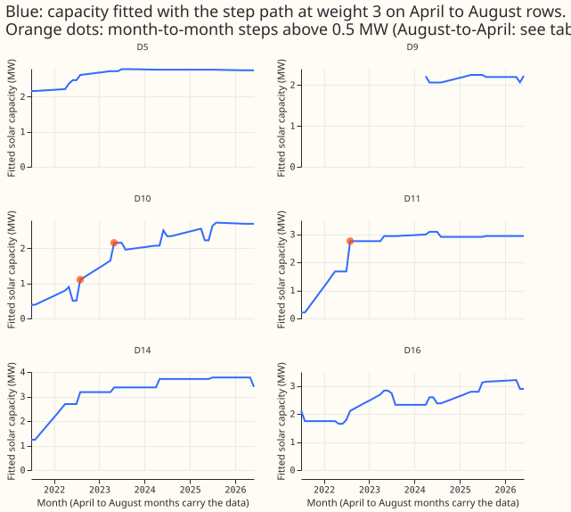
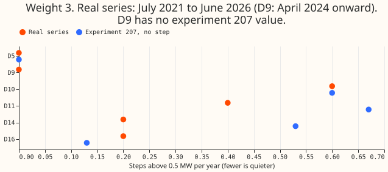
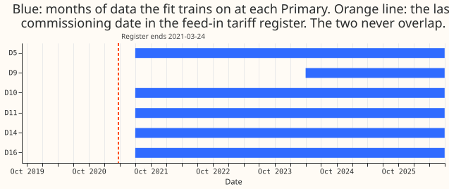

# Do the real Primary series contain solar-capacity steps that match the register?

**The scan finds only as many steps in the real series as the same fit invents on series with no
step, and the register that could confirm them ends before the data begins, so no step can be
called real.** [Experiment 207](../00207-dp-meter-regime-steps-e2-step-capacity-known-answer/result.md)
built a solar capacity that may change by a step each month, and showed that it finds a known
solar-farm step added to a Primary substation's power. A Primary substation feeds homes and
businesses; D5, D9, D10, D11, D14, and D16 are anonymised labels for six of them. We ran the same
fit on each Primary's real power from 2021 to 2026, with no step added. We listed the months in
which the fitted capacity moved by more than 0.5 MW, and compared the increases with the dates when
feed-in tariff solar installations were commissioned. The fit found 7 such changes in 5 years, at
four of the six Primaries. We could not compare them with the register: its last commissioning date
is 2021-03-24, and the fit trains only on rows from 2021-07.

*Figure 1 shows the fitted capacity of each Primary with the month-to-month steps above 0.5 MW.*

*Figure 2 shows how many steps per year the fit finds in the real series, against how many it finds
in experiment 207's series with no step.*

*Figure 3 shows that no month the fit trains on comes before the register's last commissioning
date.*

**Verdict `partly supported`.** The decision rule's `partly supported` branch applies: steps of 0.5
MW or more exist at four Primaries and none matches a register cluster. The match could not be
tested, so the prediction that a step at D10 or D16 lies within 60 days of a cluster is neither
confirmed nor refuted. The placebo part holds: D5 shows 0 steps and D14 shows 0.20 per year, both
under 1 per year. The gate passed: the scan code reproduces experiment 207's stored fitted
capacity at D10 to within 2e-13 points.

## Results

Rows: April to August half-hours from 2021-07 to 2026-06 at each Primary (D9 from 2024-04), after
the project's default row filter (outside the lockdown window and the switching masks), 34,690 to
35,804 rows per Primary and 19,041 at D9. The scan is retrospective and uses every row, so it is
not as-of. The fit is experiment 207's step path with total-variation weight 3.

| Weight 3, steps above 0.5 MW | Month-to-month | August-to-April | Per year | Experiment 207 (no step) |
|---|---|---|---|---|
| D5 | 0 | 0 | 0.00 | 0.00 |
| D9 (2.25 years) | 0 | 0 | 0.00 | none |
| D10 | 2 | 1 | 0.60 | 0.60 |
| D11 | 1 | 1 | 0.40 | 0.67 |
| D14 | 0 | 1 | 0.20 | 0.53 |
| D16 | 0 | 1 | 0.20 | 0.13 |

- **The steps (weight 3, all increases):** D10 +0.60 MW (2022-08), +0.51 MW (2023-05) and +0.54 MW
  from August 2022 to April 2023; D11 +1.08 MW (2022-08) and +1.46 MW from August 2021 to April
  2022; D14 +1.45 MW from August 2021 to April 2022; D16 +0.58 MW from August 2022 to April 2023.
  The August-to-April steps are net changes across the winter, which has no data, so their date is
  unknown within the winter.
- **Likely artefact:** the +1.45 MW changes at D11 and D14 in the first winter of the fit are
  equal to within 0.02 MW. The fit has no earlier summer to anchor them, so we treat them as
  possible fit artefacts and not as installations.
- **Match to the register:** none of the steps lies in the register's period. The share of month
  boundaries between 2019-09 and 2021-03 whose 60-day window holds at least 0.5 MW of
  share-weighted registered capacity is 0 at every Primary, because each Primary's weighted
  register total is 1.6 to 3.5 MW over its whole history, 70% to 90% of it commissioned in 2011 to 2015.
  Every step is therefore "inferred, unconfirmed".
- **Sensitivity (post hoc, not part of the verdict):** at weight 0.3 the fit finds 9, 3, 4, and 6
  steps at D10, D11, D14, and D16 (none at D5, 2 at D9), and at weight 30 one step at each of D10,
  D11, and D14. Steps shrink in number as the penalty grows, as experiment 207 found.
- **Capacity:** the fitted capacity at D10 rises from 0.4 MW in 2021 to 2.7 MW in 2026, a rise
  of 2.3 MW, and 1.7 MW of it is in steps above 0.5 MW. D5 stays between 2.2 and 2.8 MW.

## Checks

- **Gate:** the scan's base path at D10 for weight 3, refitted at experiment 207's cut of
  2025-07-01 on the same rows, matches experiment 207's stored path in all 48 months (largest
  difference 1.7e-13 points). `e00215_scan.py` prints it.
- **Forecast checks:** this experiment scores no forecast, so the median-against-mean check and the
  quantile-score contrast do not apply.
- **Audit conditions:** none was met. The prediction's match part could not be tested, and the
  reason is recorded above, so it is not an unexplained contradiction.
- **Plan correction:** the plan expected that steps in the summer of 2020 could be matched. The
  lockdown window removes that summer from training, so the match was untestable from the start.

## What to try next

- Match the steps to a register that covers 2021 to 2026, or to the metered record of a known
  installation, before reading any step as a commissioning.
- Keep the steps out of the substation cards until one is confirmed, and show them as inferred.
- A longer history, with the lockdown months handled, would give the fit a summer before 2021 to
  anchor the first winter.
