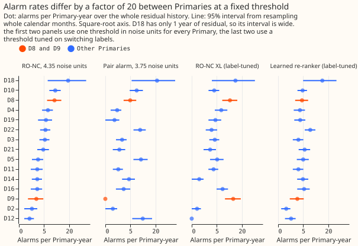
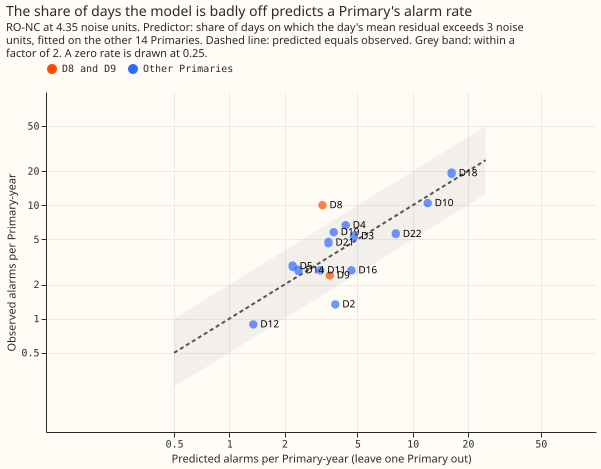
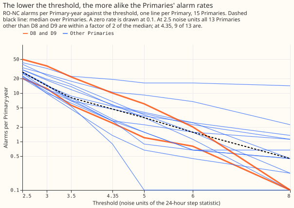
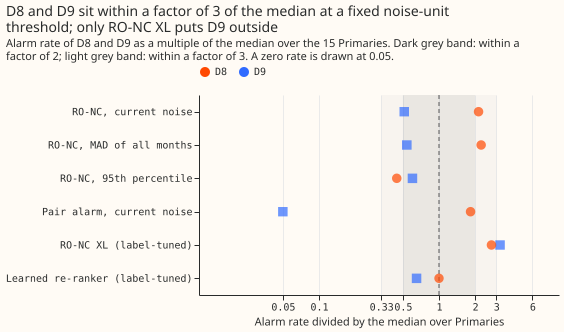

**Take-home: a threshold in noise units gives similar alarm rates across Primary substations only
when it is low. Flexpectation version 2 therefore needs an automatic per-Primary rule for any
threshold above about 3 noise units.** A switching detector raises an alarm when it sees a sudden
step in a substation's demand that the weather-driven demand model did not predict. At 4.35 noise
units, the refit-offset neighbour-count detector (RO-NC) raises between 0.9 and 19 alarms per
Primary-year across 15 Primaries. Of the 13 Primaries other than D8 and D9 (two substations whose
alarms stood out in an earlier analysis), 9 fall within a factor of 2 of the median of 4.7 alarms
per Primary-year. The pre-registered bar was 11 of 13, so the first part of the prediction fails.
Post hoc, the same detector at 2.5 noise units puts 13 of 13 within a factor of 2 (median 27 alarms
per Primary-year). The agreement between Primaries worsens steadily as the threshold rises. At 4.35
noise units D8 and D9 are within a factor of 3 of the median, no more extreme than D18 or D10. Of
the statistics we measured on the residual, the share of days on which the demand model's daily mean
error exceeds 3 noise units predicts the RO-NC alarm rate best of the 30 or so statistics we tried,
on 15 Primaries.

**We asked whether a detector's alarm rate on a new Primary can be predicted from that Primary's
residual alone, so that Flexpectation version 2, which will have no switching labels, needs no
per-Primary tuning.** We ran RO-NC and the pair alarm (an alarm that needs a connected substation to
step the opposite way) at the thresholds in noise units that [experiment
130](../00130-ro-nc-detector-on-the-gam-k-residual/result.md) and [experiment
156](../00156-switching-faster-onset-alarm-from-opposite-steps/result.md) stored. The residual is
the gap between observed demand and the frozen convex demand model of experiment 130. We used the
whole history of every Primary with 12 or more months of residual. We counted all alarms and read no
switching label, logged closure, or labelled transfer. We also read the stored alarms of the learned
score of [experiment 195](../00195-switching-neural-plus-detector-features/result.md), which is
trained on switching labels. One noise unit is the scale of the 24-hour step statistic, estimated
from odd months. The result narrows the search for version 2 to a per-Primary rule that sets a
threshold from the residual's tail, not only from its noise scale.

## Figures

## Headline numbers

- **Prediction, part 1 fails.** RO-NC at 4.35 noise units: 9 of 13 other Primaries are within a
  factor of 2 of the median (69%; 11 were needed). The pair alarm at 3.75 noise units: 5 of 13.
  Dropping any one Primary in turn leaves between 8 of 12 and 9 of 13, so no single Primary changes
  this result.
- **Prediction, part 2 holds, but was never at risk.** D8 is 2.14 times and D9 is 0.51 times the
  median under the current noise estimate, so both were inside a factor of 3 before any change. The
  two robust estimates keep them inside (figure 4). The verdict therefore rests on part 1. The pair
  alarm, which carries no verdict, fails both parts: 5 of 13, and D9 has no alarms in 2.5 years.
- **The two robust estimates do not narrow the spread.** R1, the median absolute deviation (MAD) of
  all months, equals the current odd-month MAD within 8%, so R1 changes most rates by less than 10%,
  and doubles D12's from 0.9 to 1.8 (9 of 13; standard deviation of the base-2 logarithm of the rate
  1.00 against 1.17). R2, the 95th percentile divided by 1.96, more than halves the median rate to
  2.0 and leaves 9 of 13 (1.30).
- **The label-tuned detectors are not clearly more uniform.** RO-NC XL (stored alarms, threshold
  tuned so that at most 80 alarms in odd months match no logged closure) has 9 of 13 within a factor
  of 2, and D9, at 3.2 times the median, is outside a factor of 3. The learned re-ranker has 10 of
  13 within a factor of 2, and the learned logistic score has 7 of 13.
- **Rate against threshold (post hoc).** Other Primaries within a factor of 2 of the median: 13 of
  13 at 2.5 noise units, 12 at 3.0, 11 at 3.5, 9 at 4.35, 8 at 5.0, 6 at 6.0, and 4 at 8.0 (figure
  3).
- **Best predictor, for RO-NC only.** The share of days on which the day's mean residual exceeds 3
  noise units predicts the base-2 logarithm of the RO-NC alarm rate best. Each prediction is made
  without the Primary it predicts. The mean absolute error is 0.58 (about a factor of 1.5 in the
  rate), against 1.14 for the baseline of predicting the median of the other Primaries' log rates.
  13 of 15 predictions fall within a factor of 2 (correlation 0.81, figure 2).
    - Without D18, which has 1 year of residual and the largest share (0.42), the correlation is
      0.72 and the error 0.62 against a baseline of 1.19.
    - The tail ratio (95th percentile over MAD) comes next (error 0.93). The noise scale at any
      window gives 1.03 to 1.04, barely better than the baseline.
    - For the pair alarm the best statistic, the tail ratio, gives 1.46 against a baseline of 1.80.
      No statistic beats the baseline of 1.34 for RO-NC XL. No single statistic worked for the pair
      alarm or RO-NC XL.
    - The 0.58 is the best of about 30 candidate statistics ranked on 15 Primaries, not a nested
      leave-one-Primary-out, so it is optimistic.
- **Winter against the rest.** Pooled over Primaries, RO-NC raises 5.4 alarms per Primary-year in
  December to February and 4.7 in the other months. The pair alarm raises 4.0 in winter and 4.7 in
  the other months. The per-Primary split is in the table. These pooled rates have no interval, so
  the difference is not evidence of a seasonal effect.
- **D8 and D9 are within a factor of 3 of the median at 4.35 noise units.** D8 is the highest of the
  13 other Primaries between 3.0 and 3.5 noise units (2.5 to 2.7 times the median). D8 has the
  largest noise (a 24-hour step scale of 0.62 MW against a median of 0.16) and the heaviest upper
  tail (95th percentile 0.94 MW), but at a fixed threshold in noise units its rate is 2.1 times the
  median, not an outlier. D9 is ordinary on the noise, tail, and misfit statistics (misfit share
  0.14, equal to the median; kurtosis 2.7), but its holiday misfit share, 0.26, is the fourth
  highest of 15,, and raises 6 RO-NC alarms in 2.5 years at 4.35 noise units. Its 34 alarms under
  RO-NC XL come from the label-trained score, which admits alarms at a lower threshold in noise
  units; these data do not say which of that score's inputs raises them.
- **Tail calibration and curtailment.** Not applicable: no forecast is scored.

## Residual statistics and alarm rates per Primary

Sorted by the share of misfit days. "Noise, 24 h" is the current estimate (MAD of the 24-hour step
statistic in odd months, MW); the MAD columns use all months at 2, 4, 6, and 24 hours. Misfit days:
share of days on which the day's mean residual exceeds 3 noise units. Holiday misfit: the same share
over bank holidays and Easter weekends. Rates are alarms per Primary-year at 4.35 noise units
(RO-NC) and 3.75 noise units (pair alarm). D18 has 1 year of residual and D9 2.5 years; the rest
4.5.

| Primary | Years of residual | Noise, 24 h (MW) | MAD 2 h | MAD 4 h | MAD 6 h | MAD 24 h | 95th pct 24 h | Kurtosis 24 h | Misfit days | Holiday misfit | RO-NC all | winter | rest | Pair all | winter | rest |
|---|---|---|---|---|---|---|---|---|---|---|---|---|---|---|---|---|
| D18 | 1.0 | 0.078 | 0.139 | 0.142 | 0.138 | 0.083 | 0.272 | 29.4 | 0.42 | 0.60 | 19.2 | 16.2 | 20.2 | 21.2 | 16.2 | 22.9 |
| D10 | 4.5 | 0.133 | 0.192 | 0.199 | 0.187 | 0.132 | 0.200 | 5.9 | 0.32 | 0.23 | 10.5 | 11.3 | 10.2 | 7.8 | 8.7 | 7.5 |
| D22 | 4.5 | 0.094 | 0.118 | 0.132 | 0.140 | 0.097 | 0.126 | 7.2 | 0.24 | 0.32 | 5.6 | 8.7 | 4.5 | 9.6 | 10.5 | 9.3 |
| D3 | 4.5 | 0.142 | 0.279 | 0.286 | 0.237 | 0.146 | 0.177 | 12.8 | 0.17 | 0.34 | 5.3 | 5.2 | 5.4 | 2.2 | 3.5 | 1.8 |
| D16 | 4.5 | 0.184 | 0.243 | 0.251 | 0.249 | 0.185 | 0.212 | 5.1 | 0.16 | 0.13 | 2.7 | 1.7 | 3.0 | 2.7 | 3.5 | 2.4 |
| D4 | 4.5 | 0.276 | 0.285 | 0.368 | 0.404 | 0.278 | 0.397 | 2.5 | 0.16 | 0.23 | 6.7 | 6.1 | 6.9 | 1.1 | 0.9 | 1.2 |
| D19 | 4.5 | 0.159 | 0.214 | 0.214 | 0.204 | 0.160 | 0.206 | 2.7 | 0.15 | 0.09 | 5.8 | 6.1 | 5.7 | 0.7 | 0.9 | 0.6 |
| D21 | 4.5 | 0.113 | 0.174 | 0.191 | 0.183 | 0.115 | 0.131 | 18.8 | 0.14 | 0.15 | 4.7 | 4.4 | 4.8 | 1.6 | 0.0 | 2.1 |
| D2 | 4.5 | 0.308 | 0.464 | 0.471 | 0.449 | 0.303 | 0.340 | 10.0 | 0.14 | 0.23 | 1.3 | 0.9 | 1.5 | 0.4 | 0.0 | 0.6 |
| D8 | 4.5 | 0.620 | 0.565 | 0.782 | 0.862 | 0.618 | 0.940 | 2.0 | 0.14 | 0.08 | 10.0 | 8.7 | 10.5 | 4.9 | 9.6 | 3.3 |
| D9 | 2.5 | 0.164 | 0.189 | 0.216 | 0.215 | 0.157 | 0.181 | 2.7 | 0.14 | 0.26 | 2.4 | 1.5 | 2.7 | 0.0 | 0.0 | 0.0 |
| D11 | 4.5 | 0.317 | 0.305 | 0.348 | 0.363 | 0.315 | 0.347 | 3.2 | 0.13 | 0.11 | 2.7 | 6.1 | 1.5 | 1.3 | 0.9 | 1.5 |
| D14 | 4.5 | 0.245 | 0.298 | 0.349 | 0.353 | 0.247 | 0.297 | 3.6 | 0.11 | 0.09 | 2.7 | 4.4 | 2.1 | 4.5 | 3.5 | 4.8 |
| D5 | 4.5 | 0.139 | 0.224 | 0.232 | 0.217 | 0.139 | 0.156 | 5.7 | 0.10 | 0.09 | 2.9 | 4.4 | 2.4 | 10.1 | 7.8 | 10.8 |
| D12 | 4.5 | 0.355 | 0.414 | 0.511 | 0.570 | 0.334 | 0.390 | 0.9 | 0.06 | 0.08 | 0.9 | 2.6 | 0.3 | 11.1 | 2.6 | 14.1 |

## Checks

- **Forecast checks (median minus mean forecast, mean-forecast error beside each contrast):** not
  applicable, because the experiment scores alarm counts, not forecasts.
- **Audit triggers:** none fired. There is no control. An earlier analysis (not published) found
  that D8 and D9 raise 61 of 148 alarms that match no logged closure. This result differs, because
  at a fixed threshold in noise units D8 and D9 are not outliers. Only the label-tuned RO-NC XL puts
  D9 outside a factor of 3 (figure 4), so the detector, not the series, produces that finding.
  Dropping any one Primary never reaches 80% (between 8 of 12 and 9 of 13). No nested arms, sister
  experiment, or later design depends on this result yet.

## Caveats

- **Residual and alarms share the same data.** The misfit share and the tail ratio are measured on
  the residual from which the alarms are computed, so the link between each statistic and the alarm
  rate is partly built in. The leave-one-Primary-out test shows the link holds across Primaries, not
  that the statistic is independent of the alarms.
- **Thresholds were tuned on labels elsewhere.** This experiment reads no label, but the thresholds
  of 4.35 and 3.75 noise units were chosen in experiments 130 and 156 against logged closures.
  "Label-free" describes what this experiment reads, not those thresholds. The misfit day compares
  the day's mean residual with the scale of the 24-hour step statistic, the same scale the alarm
  threshold divides by.
- **Only 15 Primaries.** D18 has 1 year and D9 2.5 years of residual. The intervals in figure 1 are
  wide, and alarms in the same week are not independent.
- **Lab shortcuts.** The residual uses ERA5 weather, which arrives about 5 days late, and a convex
  model refitted on the 1st and the 16th of each month, as in experiment 130. A live service would
  have ensemble forecast weather instead. The learned-score alarms are the stored cross-fitted
  alarms of experiment 195, averaged over its three folds, and the learned-score thresholds use
  switching labels.
- **Post hoc.** The threshold sweep (figure 3) and the robustness checks were not in the plan. The
  noise estimates R1 and R2 were named in the plan before any rate was seen.
- **The 35 logged transfers, the real load transfers in the switching log, were not read.**

## What the next experiment should answer

- **Does a per-Primary alarm budget give uniform rates with no labels?** Set each Primary's
  threshold so that its alarms equal a target number per Primary-year, estimated from its own
  history, and check that the rate holds on a later year. The prediction that could fail: the rate
  in the held-out year stays within a factor of 2 of the target for at least 80% of Primaries.
- **Does the misfit-day share carry over to a held-out period?** Compute it on one year and predict
  the next year's alarm rate.
