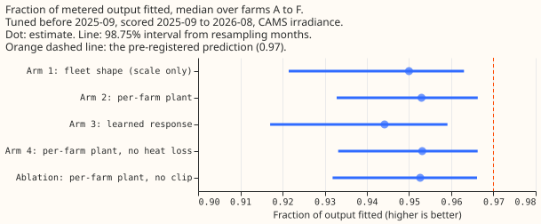
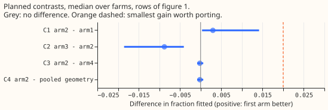
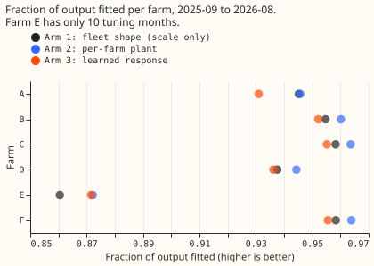
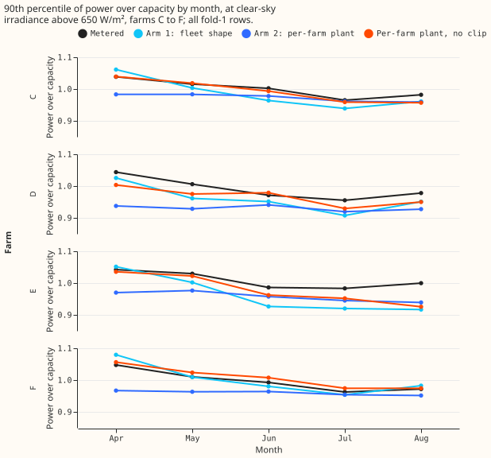

**Giving each of the six metered solar farms its own plant parameters barely improves the fit, so the
plant is probably not what limits it; the sunshine data is the likelier source.** NGED meters the
output of six solar farms in its trial area, which this page labels A to F. We asked whether a plant
model with a fitted panel tilt, panel azimuth, ratio of direct-current (DC) to alternating-current
(AC) capacity, heat loss, and soft inverter clip (a smooth cap on AC output) fits each farm's metered
output better than one fleet shape, a single generic south-facing plant (tilt 35 degrees, 0.4% loss
per kelvin) whose only fitted number is a scale. We fitted each plant on the months before 2025-09
and scored it on the next 12 months (a "fold"), using satellite-derived irradiance from the Copernicus
Atmosphere Monitoring Service (CAMS) and ERA5 air temperature. The fraction of metered output fitted,
defined as one minus the squared error over the squared metered output on daylight half-hours, rose
from 0.950 to 0.953. We had predicted 0.97 or more, a rise from the 0.93 that experiment 157 found
for one scale of the fleet shape on other rows.

**The prediction we wrote before fitting fails, and the stop rule we wrote with it fires.** The median
over farms of the fraction of output fitted is 0.953 for arm 2 (the per-farm plant), with a 98.75%
interval of 0.933 to 0.966 from resampling the 12 scored months. Arm 1 (the fleet shape with one
fitted scale per farm) scores 0.950. The gain is 0.003 (0.0004 to 0.014), under the 0.02 threshold.
The best tilt is 20 degrees and the best azimuth is 180 degrees (south) at all six farms, but 20 is
one of seven values on a coarse grid (10, 20, 30, 35, 40, 50, and 60). The DC:AC ratio (the fitted
scale over the fitted AC limit) is 1.04 to 1.17 at five farms; at farm A the limit sits above the
scale (ratio 0.80), so its clip never bites. The heat loss is 0 at five of six farms, the lowest
value of the grid. Pooling the geometry and heat loss from the other five farms picks the same tilt,
azimuth, and heat loss at every farm, so contrast C4 equals contrast C3 and tests nothing about
pooling. Arm 1 has no clip, so C1 bundles geometry, heat loss, and clip; the no-clip ablation
scores 0.9526, so the clip accounts for 0.0004 of the 0.003.

## Numbers

- **Fold 1** (tuned before 2025-09, scored 2025-09 to 2026-08, CAMS irradiance), median over farms:
  arm 1 0.950 (0.922 to 0.963), arm 2 0.953 (0.933 to 0.966), arm 3 0.944 (0.917 to 0.959), arm 4
  0.953 (0.933 to 0.966), no-clip ablation 0.953, fleet-geometry ablation 0.952.
- **Contrasts, fold 1, 98.75% intervals:** C1 (arm 2 minus arm 1) 0.003 (0.0004 to 0.014); C2 (arm 3
  minus arm 2) -0.009 (-0.019 to -0.004); C3 (arm 2 minus arm 4) -0.0002 (-0.0008 to 0.0007); C4
  (arm 2 minus pooled geometry) -0.0002 (-0.0008 to 0.0007). Arm 2 beats arm 1 in 55 of 72
  farm-months (6 farms times 12 scored months), and in all six farms (+0.0005 to +0.012).
- **Fold 2** (tuned before 2024-09, scored 2024-09 to 2025-08, farm E absent): arm 1 0.947, arm 2
  0.954; C1 0.007 (0.002 to 0.024), C2 -0.008 (-0.012 to 0.004). Fold 2 reuses fold 1's tuning
  months, so fold 2 is a replication and not an independent test.
- **Error in capacity points (fold 1, median over farms):** arm 1 7.5, arm 2 7.4. In MW per farm,
  arm 2 gives 0.45, 0.56, 0.52, 0.10, 1.59, and 0.40 for farms A to F.
- **Tail slices, median fraction fitted** (arm 1, arm 2): sunny half-hours (clear-sky irradiance
  above 650 W/m²) 0.968, 0.973; hot half-hours (air temperature above the farm's 90th percentile)
  0.977, 0.977; shoulder months (March, April, September, October) 0.946, 0.946.
- **Forecast-time weather:** the same fold-1 plants driven by the
  ECMWF ensemble mean at 12 to 36 h leads fit 0.910 (arm 1) and 0.912 (arm 4), against 0.950 and
  0.953 with CAMS on the same half-hours. Error is 10.3 and 10.5 points of capacity.
- **Is the flat top explained? No arm explains it out of sample.** Experiment 183's seasonal range of
  the 90th-percentile flat level (April to August, farms C to F) is 7.3%, 8.9%, 5.9%, and 8.5%
  metered when every fold-1 half-hour is used, pooling years as experiment 183 did. On those rows,
  which are mostly the tuning months, the mean gap between a model's range and the metered range is
  5.1 points for arm 2, 5.1 for arm 4, 2.0 for the no-clip ablation, and 5.1 for arm 1. By the
  rule we wrote before fitting, neither the heat term (arm 2 against arm 4: no difference) nor the
  clip (arm 2's gap is 3.1 points larger than the no-clip ablation's) explains the fall. On the
  scored year alone (post hoc, metered ranges 5.5%, 10.0%, 6.4%, and 9.5%) the gaps are 4.3 points
  for arm 2, 4.7 for the no-clip ablation, 3.3 for the fleet-geometry ablation, and 6.6 for arm 1.
  The fitted clip flattens the level (arm 2's ranges are 2.5% to 4.5%), and the no-clip plant
  overshoots (8% to 13.5%). The 99th-percentile gap is 1.8 points for arm 2 and 5.6 for no clip.

## Checks

- **Median minus mean forecast per site:** not applicable, because every arm is a point forecast.
  The mean-forecast error is the error reported above, so trigger 3 does not apply.
- **Triggers fired.** Trigger 2 (the result contradicts the prediction of 0.97): the explanation, that
  the ceiling is in the irradiance, was tested. On sunny half-hours the plant already fits 0.973, and
  with ensemble irradiance it fits 0.91. Trigger 5 (a nested arm beats the arm that contains it): arm
  4 beats arm 2 by 0.0002 (interval -0.0008 to 0.0007), because arm 2 picked a heat loss of 0.2%/K at
  farm A on tuning error; and arm 3 scores 0.009 below arm 2. A post hoc refit of arm 3 with penalty
  100 scores 0.941, so the table loses 0.012 by projecting arm 2 onto irradiance and elevation (the
  table has no azimuth, beam-diffuse split, or temperature). Trigger 4 (leave-one-farm-out): C1 is positive
  at all six farms, so no farm flips it. No audit was run; the verdict follows the stop rule and
  would not change if arm 4 replaced arm 2.
- **Caveats.** Arm 3's penalty is chosen with arm 2's prediction fitted on all tuning rows as the
  prior, which favours large penalties, and the contiguous month blocks of its cross-validation each
  remove a season from training. The soft clip's AC limit is an asymptote: the curve reaches about
  0.89 of the limit when the unclipped power equals it, so the DC:AC ratio is only approximate.
  ERA5 temperature is applied to both half-hours of its hour. Farm E has 10 tuning months and fits
  worst (0.87). The 12-block interval is close to
  the range of the draws. Cloud acts on the observed and modelled flat levels alike in figure 4. The
  heat loss sits at the lowest value of its grid at five farms, so a heat gain was not tested.

## What the next experiment should answer

- Does a different irradiance product (for example, a blend of CAMS and a numerical weather
  forecast) lift the fraction fitted on the same plants, since the plant is not the limit?
- The fitted clip flattens the falling flat top and no clip overshoots it. Does a clip limit that
  varies with the season, or with cell temperature, fit the scored year's 5.5% to 10.0% fall?

## Plan amendments (made before any fit)

- **The 0.97 is a point estimate** of the median over farms on fold 1; the interval is reported
  beside it. Arm 1 on the same rows is the reference, and the 0.93 of experiment 157 is quoted only
  as background. The fraction uses squared error against a zero baseline, so MAE in MW and in points
  of capacity is reported beside it, with slices for sunny half-hours (clear-sky irradiance above 650
  W/m²), hot half-hours (air temperature above the farm's 90th percentile), and the shoulder months
  (March, April, September, October).
- **Folds.** Fold 1 tunes on every month before 2025-09 and scores 2025-09 to 2026-08. Fold 2 tunes
  on months before 2024-09 and scores 2024-09 to 2025-08; fold 2 is a replication with less tuning data,
  not an independent test. A farm needs at least 12 tuning months to enter a fold, so farm E is out
  of fold 2.
- **The bootstrap** resamples the 12 scored calendar months with replacement, the same months for
  all farms at once, 10,000 draws, seed 218. The number of months where arm 2 beats arm 1 is reported
  too, because 12 blocks give an interval close to the range of the draws.
- **Arm 3's penalty** is chosen by 5-fold cross-validation over contiguous blocks of whole tuning
  months. "Cell means" are the weighted means of arm 2's prediction inside each (irradiance,
  elevation) cell of the hat basis, and the fit is a non-negative least-squares problem on the
  increments, which is a convex bounded quadratic.
- **Arm 4** re-searches tilt and azimuth with the heat coefficient fixed at 0, so C3 measures the
  heat term after refitting. **DC:AC ratio** is the fitted DC scale over the fitted AC limit.
- **C4** pools tilt, azimuth, and heat from the other five farms (summed tuning error divided by each
  farm's squared output), and each farm still fits its own scale and clip. C4 has no gate; a
  positive value favours a farm's own geometry.
- **The flat-top test.** For farms C to F, take the range over its mean of the monthly 90th
  percentile of power over capacity from April to August, on half-hours with clear-sky irradiance
  above 650 W/m², for the metered series (experiment 183's figure) and for each arm's predictions
  on the same half-hours, with the actual CAMS irradiance so that cloud acts on both. The gap is the
  absolute difference of the two ranges. The heat term explains the fall when arm 2's mean gap over
  C to F is at least 2 points smaller than arm 4's, the soft clip when it is at least 2 points
  smaller than the no-clip ablation's, both when both hold, and neither otherwise.
- **Deliverables also include** the fitted parameters per farm and fold (tilt, azimuth, DC:AC ratio,
  heat coefficient, clip sharpness fixed at 6) for the farm page.
- **Weather names.** Fit: CAMS irradiance (about 2 days late) and ERA5 temperature (about 5 days
  late), neither available at forecast time. Forecast-time repeat: ECMWF ensemble mean irradiance and
  temperature at 12 to 36 hour leads, available at forecast time, for the arm with the highest fold-1
  median.
- **Schedule.** One CPU job on 4 cores, no GPU; the grid search is exhaustive, with no seeds.

- **A departure from the plan.** A farm needs at least 10 tuning months and not 12, because farm E
  has 10 months before 2025-09. Farm E fits worst, so it is flagged.
