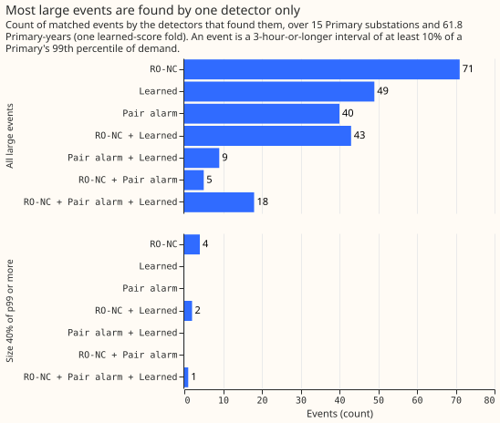
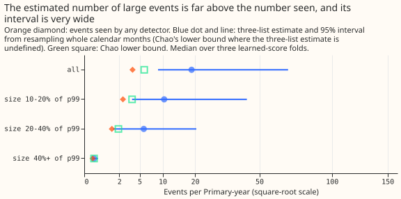
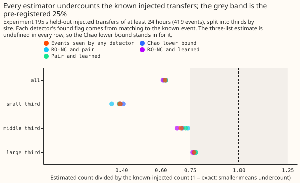
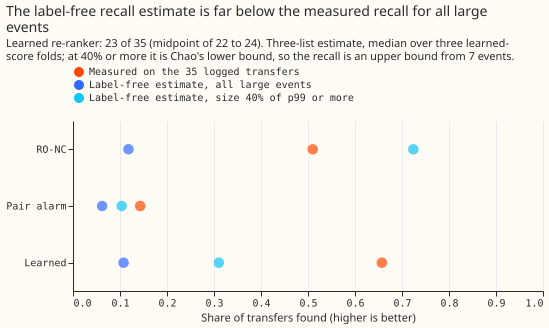

**Take-home: comparing the three detectors with each other cannot tell us how many large load
transfers exist, or how many each detector misses.** We asked whether the number of large load
transfers (demand moved from one Primary substation to another for at least 3 hours, with a step of
at least 10% of the Primary's 99th percentile of demand, p99) can be estimated without a switching
log. The method is capture-recapture: if two detectors search independently, the share of one
detector's events that the other also finds says how many events both missed. We ran it on three
detectors that read the same demand-model residual (observed demand minus the weather-driven
forecast of a demand model): the refit-offset neighbour-count detector (RO-NC), the pair alarm (an
alarm that needs a neighbouring Primary to step the opposite way), and a learned score that re-ranks
the candidate alarms of the other two detectors. The detectors ran over 15 Primary substations with
61.8 Primary-years of data in all (the years of data of each Primary, summed). Together the
detectors found 233 to 244 distinct events (the range is over three folds of the learned score), 3.8
per Primary-year. RO-NC and the pair alarm share only 23 events, so most events were found by one
detector only. The estimate that uses all three lists of events (the three-list estimate) is 1,010
to 1,530 events (16 to 25 per Primary-year), and it puts RO-NC's recall at 0.09 to 0.14. Experiment
146 (a recall measurement on logged transfers) measured a recall of 0.51 for RO-NC on the 35 logged
transfers (transfers recorded in the switching log).

**The method also fails a known-answer test.** In experiment 195, 419 synthetic transfers were
injected into the demand history, so the true count is known, and we ran the same estimators on what
each detector found. The estimate falls 23% to 59% short of the known count, mainly because 158 of
419 injected events are missed by all three detectors. A recall estimate for Flexpectation version 2
would need a list that does not come from the residual, such as a meter-based list of switching
actions or a hand-checked random sample of alarms.

**The three detectors come from experiments 148, 156, and 195.** The estimators are the
Lincoln-Petersen estimate for two lists, the no-three-way-interaction estimate for three lists, and
Chao's lower bound ([Chao, 1987](https://doi.org/10.2307/2531532)). Each detector's set of events is
one list. RO-NC is the detector of [experiment
148](../00148-switching-end-rule-lookahead-ro-nc/result.md), with its 6-hour-lookahead end rule and
24-hour merge. The pair alarm is that of [experiment
156](../00156-switching-faster-onset-alarm-from-opposite-steps/result.md). The learned score is the
re-ranker of [experiment 195](../00195-switching-neural-plus-detector-features/result.md), with one
alarm set per held-out fold of Primary pairs (three folds). Experiment 217 supplied the Primaries
and their years of data. Two intervals are the same event when they share a Primary and overlap by
at least half of the shorter interval. A partner-side interval of the pair alarm counts with its own
alarm-side interval. Strata are the event's step size (as a share of p99), its duration, and whether
the pair alarm saw a metered partner. No switching log is read; the 35 logged transfers are compared
at the end only.

## Figures

## Headline numbers

All counts are medians over the three learned-score folds unless a range is given.

- **The prediction fails on both parts.** RO-NC's label-free recall is 0.12 (folds 0.09, 0.14, 0.12;
  interval 0.03 to 0.25), outside 25% of 0.51 (0.38 to 0.64). Chao's lower bound on the event count
  gives an upper bound on recall of 0.36 to 0.39, which straddles the lower edge of the band; the
  pre-registered three-list estimate does not. The injected arm is within 25% in 1 of 3 size strata
  (large third 0.77 of the known count, middle third 0.71, small third 0.41).
- **Events seen.** RO-NC 137, the pair alarm 72, and the learned score 119 to 140, with 233 to 244
  distinct events in all. RO-NC and the pair alarm share 23 events, RO-NC and the learned score 61
  to 70, and the pair alarm and the learned score 27 to 30 (figure 1).
- **Estimates over all large events.** Lincoln-Petersen gives 429 events (RO-NC and the pair alarm),
  248 to 274 (RO-NC and the learned score), and 317 to 336 (the pair alarm and the learned score).
  The three-list estimate is 1,010 to 1,530 events (16.4 to 24.7 per Primary-year; 95% interval of
  the median fold 548 to 4,190, from resampling whole calendar months). Chao's lower bound is 348 to
  385 events (5.6 to 6.2 per Primary-year).
- **By size (share of p99).** At 10 to 20%, 151 events seen, three-list estimate 644 (folds 545 to
  783), Chao 230. At 20 to 40%, 77 seen, estimate 357 (folds 166 to 420), Chao 118. At 40% or more,
  7 seen and Chao 8.0 to 9.7 (0.13 to 0.16 per Primary-year), where the three-list estimate is
  undefined. RO-NC finds all 7 events at 40% or more, so its recall there is 0.72 to 0.88, an upper
  bound.
- **By duration and partner.** Events under 3 days: 134 seen, estimate 503. Events of 3 to 14 days:
  92 seen, estimate 689. Events of 14 days or more: 9 seen, Chao 13. Events whose partner the pair
  alarm saw: 57 seen, Chao 86. Events without such a partner: 178 seen, estimate 542. The estimates
  are unstable in every stratum except the 40%-or-more size band, the 14-day-or-more duration band,
  and the metered-partner stratum; the three-list estimate is undefined in those three, so each is
  Chao's lower bound.
- **Sensitivity.** With a size cut-off of 5% or 20% of p99, or the unmerged end rule, the three-list
  estimate is 5 to 43 events per Primary-year (up to 53 when the unmerged end rule is combined with
  the 5% cut-off) and RO-NC's recall never exceeds 0.24.
- **Injected arm (experiment 195's held-out injected transfers of 24 hours or longer, 419 events).**
  The detectors saw 261 (62%). The three-list estimate is undefined in every stratum (an empty
  cell), so the estimate is Chao's lower bound, 263 (interval 236 to 291). The two-list estimates
  are 256 to 263. The true recall is 0.575 for RO-NC, 0.592 for the learned score, and 0.215 for the
  pair alarm. The estimated recall is 0.92, 0.94, and 0.34. By size third (140, 139, and 140 known
  events) the estimates are 57, 99, and 108, which is 41%, 71%, and 77% of the known count.
- **Label-free recall by size.** At 40% of p99 or more, RO-NC 0.72, the pair alarm 0.10, the learned
  score 0.31 to 0.50, against 0.51, 0.14, and 0.66 (23 of 35) on the 35 logged transfers.

## Why the estimate fails

- **Many events are missed by all three detectors.** In the injected arm, 158 of 419 events are
  found by none, and no overlap-based estimate sees them. RO-NC and the pair alarm are not nested
  there either, and their two-list estimate is still 258.
- **The learned score is nearly nested in RO-NC.** The learned score re-ranks RO-NC's candidates and
  the pair alarm's, so most of its events are also RO-NC's: 233 of RO-NC's 241 injected finds and
  248 of the learned score's are shared.
- **On real data the detectors mostly find different events.** Only 18 of 235 events are found by
  all three (figure 1), so the three-list estimate divides by small shared counts and is unstable.
  Alarms that are false positives add single-list events, and the method counts every alarm as an
  event.

## Checks

- Median forecast minus mean forecast, and mean-forecast error beside each quantile-score contrast:
  not applicable, because the experiment forecasts nothing.
- **Audit triggers fired:** the known-answer test failed (injected arm), and RO-NC's label-free
  recall contradicts experiment 146. A fresh Opus audit re-derived every headline number from the
  stored inputs, and its report is in the private briefs folder. Findings and triage:
    - The pair alarm's partner-side intervals were counted as separate events, which inflated its
      list. Accepted: partner-side intervals now join their alarm-side interval, and the census was
      re-run. The three-list estimate fell from 1,650 to 2,590 events to 1,010 to 1,530, and RO-NC's
      recall rose from 0.05 to 0.09 to 0.09 to 0.14. The verdict is unchanged.
    - The injected arm and the 40%-or-more band report Chao's lower bound, because the three-list
      estimate is undefined there. Accepted: the page says so, and an advice item that quoted the
      40% band was changed.
    - The injected arm uses experiment 195's 6-hour pair alarm, not the 4-hour pair alarm of
      experiment 156 that the real census uses. Accepted as a caveat: the injected arm therefore
      does not test the real census exactly.
    - The learned score is nearly nested in RO-NC, not in the pair alarm; wording corrected.
    - The size strata now use the same threshold as the large-event filter (the smaller of the two
      Primaries' p99). The sentence on the pair alarm's median step was removed, because the figure
      measured a different quantity.
- The bootstrap intervals mix the three-list estimate and Chao's bound in resamples where the
  three-list estimate is undefined, which matters only in the sparse strata.
- No data-processing finding to add to the data-processing page.

## Caveats

- The detectors' alarm sets were fitted on switching labels: the operating point of 80 unexplained
  odd-month alarms of experiment 195, and a learned score trained on injected events drawn from the
  logged transfers of the other Primary pairs. The census reads only detector outputs. Label leakage
  of this kind would raise recall, so it cannot explain a recall that is too low.
- The injected arm's found flags come from matching to the known event, so the arm tests the
  estimators and not the blind matching rule that the real census uses.
- The 35 logged transfers last longer than 1 day, of any size, while the large events are defined by
  step size, so the recall comparison is approximate.
- The 10% of p99 cut-off, the 50% overlap, and the size, duration, and partner strata were fixed
  before the run. The 5% and 20% cut-offs are sensitivities.

## Questions this result leaves open

- Can a hand-checked random sample of alarms give the precision of each detector, and a meter-based
  list give its recall?
- How many events of 40% of p99 or more does the switching log for the trial area contain, compared
  with the 7 to 10 events this experiment found?
