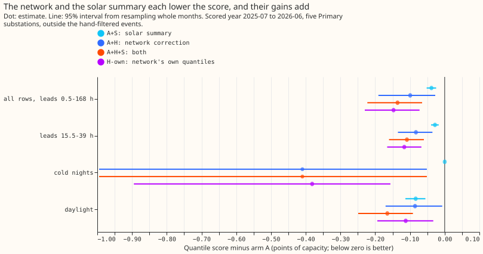
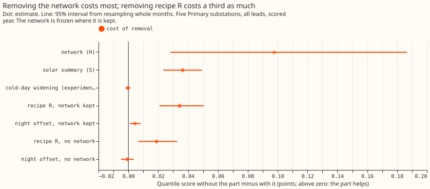
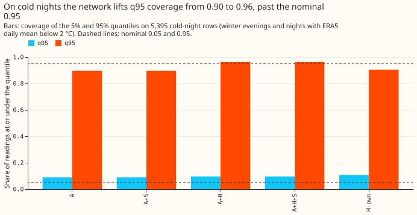
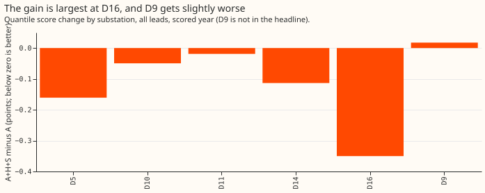

**Take-home.** A small neural network that corrects the demand forecast's median and a two-number
summary of the ensemble's solar response lower the best-guess forecast's quantile score by 0.136
points of substation effective capacity (5%). That is the sum of what each part gains alone. The
network and the solar summary remove different errors, so both belong in the next stack. The
network's own uncertainty bands scored 0.048 points better than the hand-fitted bands plus the
network's correction (A+H), and about 0.01 better than A+H+S, a difference inside the noise of C1
(on cold nights A+H+S scores 2.838 and H-own 2.866), so the band fixes of experiments 160 and 164
may not be needed once the
network is in the stack. The coast-and-widen rule for missing readings was not combined with the
stack (see "What was not done").

We asked whether three parts added to the best-guess forecast since [experiment
170](../00170-dp-bg-stage3-drift-and-holiday-scoring/result.md) stack, meaning that their gains
add. We asked because experiment 167's drift gain of 0.50 points fell to -0.03 inside the full
stack. The quantile score is twice the mean pinball loss over 11 quantiles, in points of a
substation's effective capacity (lower is better). Coverage of a quantile is the share of readings
at or under it. "Drop-one" means removing one part from the stack and scoring the rest. The
labels are:

- **A** is the best-guess forecast: the convex demand model with a Kalman filter on recent
  errors, a winter night offset, and recipe R (a 14-day error profile subtracted from the
  forecast), from [experiment
  155](../00155-dp-bg-stage2-assembly-night-offset-and-error-correction/result.md) (its arm D),
  with the bands of [experiment
  169](../00169-calibration-combined-fixes-and-ensemble-spread/result.md).
- **S** is the solar summary: the mean and spread of the 51 ensemble members' solar response, from
  [experiment 193](../00193-dp-ens-two-number-solar-summary/result.md) and its rolling replay,
  [experiment 202](../00202-dp-ens-two-number-rolling-replay/result.md) (built on [experiment
  187](../00187-dp-ens-members-in-stack/result.md)). A+S is A with S.
- **H** is the correction network: the two-hidden-layer neural network of [experiment
  201](../00201-dp-gam-residual-mlp/result.md) that shifts A's median, with [experiment
  200](../00200-dp-pooled-correction-head-on-kalman-state/result.md) and [experiment
  209](../00209-dp-pinball-table-vs-network-head-on-arm-d/result.md) as its evidence. A+H is A with
  its median shifted by H; A+H+S has both. H-own is the network's own 11 quantiles, with none of
  the band fixes of experiments 160 and 164.
- **C** is the coast-and-widen rule for missing readings of [experiment
  205](../00205-dp-gamk-gap-robustness-coast-or-frozen-gam/result.md). It was not scored here.

We re-scored the stored forecasts of all three parts, refitted nothing, and scored the
combinations on one shared set of rows: the five decision substations (D5, D10, D11, D14, D16),
over the scored year 2025-07 to 2026-06, outside the hand-filtered events (stretches of telemetry
that a hand-made list marks as unusable). D9 is a sixth substation that appears in the
six-substation tables only. A cold night is a winter (November to March) evening or night whose
ERA5 (the ECMWF reanalysis, an estimate of past weather) daily mean temperature is below 2 °C.
Contrasts are written C1 (A+H+S minus A), C2 (the stacking ratio), C3 (H-own minus A+H), and C5
(each drop-one row minus A+H+S). A negative score difference is a gain.

## Results

- **Arms and row set.** A 2.752; A+S 2.714; A+H 2.653; A+H+S 2.616; H-own (the network's own 11
  quantiles) 2.605. Five decision substations, 464,363 rows, leads 0.5 to 168 hours, outside the
  hand-filtered events. Leads 15.5 to 39 hours (66,844 rows): A 2.430; A+S 2.402; A+H 2.347; A+H+S
  2.321; H-own 2.314. Six substations with D9 (561,363 rows): A 2.688; A+H+S 2.578; H-own 2.568.
- **Schedule.** The weekly-refit mean forecast and bands are experiment 155's and 169's stored
  forecasts; the network was trained once on rows before 2025-07; the solar factors are refitted
  monthly (experiment 202). Nothing was refitted here. The network's correction and quantiles are
  the mean over experiment 201's three seeds. We scored one year only, because the network and the
  solar summary were built for that year alone.
- **The network and the solar summary add (prediction 1 passed).** C1 (A+H+S minus A) is -0.136 (95%
  -0.223 to -0.065; 99% -0.253 to
  -0.047). A+H alone is -0.099 (-0.191 to -0.027), A+S alone -0.038 (-0.052 to -0.025). The
  stacking ratio C1 / (A+H + A+S) is 0.99 (95% 0.95 to 1.05), the interaction +0.002 (-0.004 to
  +0.008). At leads 15.5 to 39 hours, C1 is -0.109 (-0.160 to -0.060) and the stacking ratio is
  0.98.
- **The network's own bands match the band fixes on cold nights but score better overall (prediction
  2 failed on its score clause).** H-own's cold-night q95 coverage is 0.904 (A 0.896),
  so the coverage clause passed. H-own scores 0.048 below A+H (-0.081 to -0.021), a gap outside the
  pre-registered 0.02. The clause was two-sided, so it failed because H-own was better than
  predicted, which is a favourable failure. A post hoc check (run after seeing the scores;
  `e00220_posthoc.py`) shows that single-seed networks give gaps of -0.040, -0.042, and -0.043, so
  averaging the three seeds does not explain the gap. At D10 alone it is -0.138, -0.121, and -0.129
  across the seeds, and without D10 it is -0.014 to -0.021; the network's bands fit D10 much better
  than arm A's bands.
- **The network matters most in the drop-one table (prediction 3 passed).** The score rises when a
  part is removed, by +0.098 for the network (+0.028 to +0.187), +0.036 for the solar summary
  (+0.023 to +0.049), +0.034 for recipe R with the network kept (+0.021 to +0.051) and +0.019
  without it (+0.007 to +0.033), +0.004 for the winter night offset with the network kept (+0.001
  to +0.008) and -0.001 without it (-0.005 to +0.004), and -0.0003 for experiment 164's cold-day
  widening (-0.002 to +0.0015). We did not retrain the network without recipe R or the offset. The
  network was trained on arm D, which contains both, so removing R from the stack understates how
  much R helps.
- **Tail calibration, coverage / pinball loss (five substations).** All rows: A q01 0.022 / 0.216,
  q05 0.065 / 0.714, q95 0.948 / 0.745, q99 0.982 / 0.232; A+H+S 0.012 / 0.177, 0.046 / 0.638,
  0.954 / 0.703, 0.985 / 0.216; H-own 0.020 / 0.173, 0.069 / 0.621, 0.940 / 0.704, 0.980 / 0.224.
  Cold nights (5,395 rows): A 0.045 / 0.391, 0.090 / 0.950, 0.896 / 0.819, 0.959 / 0.282; A+H 0.054
  / 0.407, 0.097 / 0.939, 0.964 / 0.622, 0.986 / 0.174; H-own 0.051 / 0.384, 0.108 / 0.908, 0.904 /
  0.716, 0.955 / 0.271. Daylight (211,576 rows): A 0.027 / 0.265, 0.078 / 0.907, 0.933 / 0.924,
  0.979
  / 0.262; A+S 0.016 / 0.236, 0.058 / 0.838, 0.941 / 0.877, 0.983 / 0.245; A+H+S 0.013 / 0.218,
  0.052 / 0.805, 0.944 / 0.850, 0.985 / 0.234.
- **Substations.** A+H+S minus A: D16 -0.350, D5 -0.161, D14 -0.113, D10 -0.049, D11 -0.019, D9
  +0.018. Leaving out one decision substation keeps C1 between -0.083 (D16 out) and -0.167.
- **Gates (all passed).** Arm A 2.7521 (target 2.7519, within 0.005); arm A equals experiment 202's
  stored A on every shared row and experiment 201's `actual` matches (difference 0); R2's daylight
  change -2.30% (target -2.30%); arm D scores 2.756 at five substations (printed 2.756), and the
  three seeds of experiment 201's second arm score -0.109, -0.110, and -0.093 below arm D at six
  substations (the mean of the three is -0.104, matching the printed -0.104; the seed-averaged
  quantiles used elsewhere here give -0.123); building A+H+S directly and as A plus the R2 change
  plus `delta` agrees to 7.6e-6, the float32 storage precision (this checks arithmetic and storage
  only, since both sides use the same stored arrays).

## Checks

- **Median minus mean forecast, 12 to 36 hours, per site.** A and A+S: 0.000 and -0.03 to -0.14
  (the solar summary). A+H: D10 +0.67, D11 -0.32, D14 -0.17, D16 -0.59, D5 +0.18, D9 -0.47, which is
  the network's correction by construction.
- **Error of the median beside each quantile-score contrast.** The mean absolute error of the
  median moves the same way as the score: C1 -0.146, A+H -0.145, A+S 0.000, removing R with the
  network +0.079, removing the network +0.146. H-own minus A+H is 0.000 on this error but -0.048 on
  the score, so the gap is in the bands.
- **Audit conditions** (the seven in the `ml-experiment` skill). None was met. Condition 2 (H-own
  beat A+H by more than predicted) was tested
  with the single-seed and leave-D10-out runs above (`e00220_posthoc.py`), which locate the gap at D10. The nested-arm
  condition was not met: removing the widening changes the score by -0.0003, inside its interval.

## What was not done

- **The coast-and-widen rule (arm A+H+S+C) was not scored.** Experiment 205's code imports a
  GPU-only library through a chain of six modules, and the environment here has no GPU group
  installed. Composing a gap's effect onto the network and the solar summary would also be a
  post hoc approximation. Experiment 205's own gain, 0.25 to 0.44 points on gap rows, stands as
  measured against a forecast without the correction.
- **No replicate year.** The network and the solar summary were built for the scored year only.
- **No curtailment-cost figure.** The node-level curtailment metric was not run on the new arms.
- **Network not retrained in the drop-one rows.** The two score losses from removing recipe R or the
  offset are lower bounds.

## Caveats and what to try next

- **One year and five substations.** D16 carries 0.35 of the gain at its own site, and D9 gets
  worse. Cold-night intervals rest on 3 months and are not quoted.
- **Cold nights use realised weather.** The mask is the ERA5 mean temperature of the UTC calendar
  day, which is not known at forecast time, so the cold-night coverage is not what a forecaster
  would see when it must predict that a night is cold. No arm is fitted on the mask.
- **A+H overshoots on cold nights.** Coverage at q95 is 0.964 against 0.95, and at q05 0.097
  against 0.05, because the correction lifts A's bands that experiment 164 had already widened.
- **Next.** Test the network's own bands inside the stack with the solar summary applied to them,
  then add the gap rule once experiment 205's code runs without the GPU group. Prediction that
  could fail: H-own plus the solar summary scores at least 0.02 points below A+H+S over all rows.
