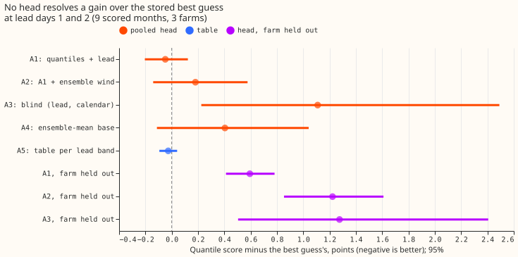
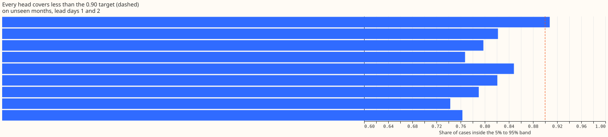
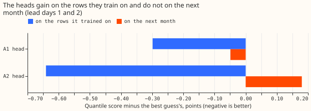
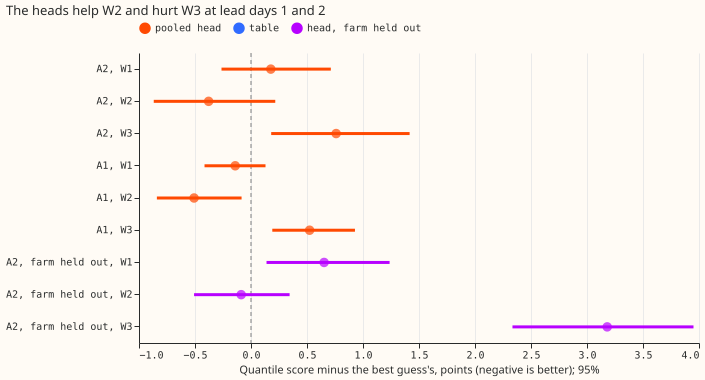

**A small neural-network head on the stored wind forecast did not lower the error of three wind
farms' power forecasts at 1 to 2 days ahead, so on this evidence the stored forecast needs no
head.**
The stored forecast ("the best guess") is the wind-power forecast of
[experiment 33](../00033-best-guess-architecture-vs-production/result.md): nine quantiles per
half-hour, from the 51 members of the ECMWF ensemble forecast (ENS) and a wind-power model. A head
is
a small neural network that shifts and rescales those nine quantiles. We trained one head on all
three farms together, using only earlier months, and scored it on the following month, for the 9
months from October 2025 to June 2026 (July to September only trained the first head). The error
measure is the quantile score, in points of capacity (a point is 1% of the farm's capacity), where a
lower score is better. The head fed the ensemble's mean wind speed, spread, and direction scored
0.180 points worse than the best guess. The 95% interval, from resampling whole months and the three
fitting seeds, is -0.141 to +0.576. A blind head, which saw only the hours ahead and the calendar,
scored 1.109 points worse. The result is consistent with a head that fits 9 months of history from
three farms learning those months, and not a correction that carries over. A head may therefore need
far more farms or years, or far fewer parameters.

The method follows [experiments 200, 201, and
209](../00200-dp-pooled-correction-head-on-kalman-state/result.md),
which found gains from a pooled head on demand forecasts. The head's form is experiment 200's
(a median shift and a log-scale applied to the base quantiles). The three farms are labelled W1 to
W3.

**Verdict: `inconclusive`.** Lead days 1 and 2 are the two calendar days after the date of the ENS
run. The decisive contrast C1 is the head with weather (A2) minus the best guess at those leads. It
is +0.180 (-0.141 to +0.576), so it does not lie below -0.1, and it does not lie wholly above zero.
The prediction (a gain of 0.05 to 0.2) failed. The blind share is undefined,
because C1's point estimate is above zero. The stop rule on the blind head did not fire: the blind
head is worse than the head with weather (A2 minus A3, C3: -0.929, -2.381 to +0.092). The intervals
resample whole
months (9) and the three seeds, and describe these three farms only.

## Results

- **Arms and absolute scores (quantile score at lead days 1 and 2, points of capacity; scored
  rows):** A0 best guess 7.223; A1 head on quantiles and lead 7.174; A2 head with ensemble wind
  7.403; A3 blind head 8.332; A4 head on the ensemble-mean forecast 7.627 (A4's base forecast alone,
  without a head, 7.384); A5 table of shifts and scales 7.196. All arms cover the same 30,240 cases
  at lead days 1 and 2 (213,882 over all leads).
- **Contrasts at lead days 1 and 2 (arm minus A0, 95%):** A2 +0.180 (-0.141 to +0.576); A3 +1.109
  (+0.225 to +2.491); A1 -0.049 (-0.204 to +0.123); A4 +0.404 (-0.113 to +1.041); A5 -0.026 (-0.094
  to +0.041). Other contrasts: A2 minus A3 -0.929 (-2.381 to +0.092); A4 minus A2 +0.224 (-0.125 to
  +0.614).
- **At days 3 to 6:** A1 -0.097 (-0.433 to +0.250); A2 +0.171 (-0.310 to +0.722); A3 +1.478 (-0.172
to
  +3.439); A5 -0.278 (-0.527 to -0.044). Over all leads: A1 -0.210 (-0.528 to +0.142); A5 -0.415
  (-0.597 to -0.192).
- **Tail calibration (lead days 1 and 2; the stored best guess holds the nine levels 0.05 to 0.95
  only, so 0.01 and 0.99 are not scored):**

| Arm | Coverage of 5% to 95% band | Share below 0.05 | Share above 0.95 | Pinball 0.05 | Pinball 0.95 |
|---|---|---|---|---|---|
| A0 best guess | 0.908 | 0.038 | 0.054 | 1.129 | 1.479 |
| A1 | 0.822 | 0.125 | 0.053 | 1.248 | 1.515 |
| A2 | 0.798 | 0.135 | 0.068 | 1.353 | 1.646 |
| A3 | 0.767 | 0.169 | 0.063 | 1.776 | 1.727 |
| A5 | 0.821 | 0.124 | 0.055 | 1.197 | 1.479 |

- **Every head narrows the band, and most of the lost coverage is below the 0.05 quantile.** The
  share of actuals below the 0.05 quantile rises from 0.038 to between 0.12 and 0.17. A2's 0.05
  pinball is worse than A0's by +0.223 (+0.071
  to +0.546) and its 0.95 pinball by +0.167 (+0.017 to +0.440).
- **Leave one farm out (lead days 1 and 2, minus A0):** A1 +0.594 (+0.412 to +0.782), A2 +1.222
  (+0.853 to +1.610), A3 +1.276 (+0.504 to +2.406). A head does not transfer to a farm it never saw.
  A2 held out minus A2 pooled is +1.042 (+0.445 to +1.635).
- **By farm (lead days 1 and 2, minus A0):** A2 +0.177 (W1), -0.378 (W2), +0.760 (W3); A1 -0.141,
  -0.508, +0.523. The only farm where a head's interval lies below zero is W2 under A1 (-0.508,
  -0.840 to -0.084).
- **Post hoc: the heads fit the rows they train on.** Scored on its own training rows, A2 is 0.64
  points better than A0 at days 1 and 2 (6.362 against 7.003) and A1 0.30 better (6.704), with
  coverage 0.86 to 0.87. The in-sample rows are counted once per refit, so the earliest months count
  most.
- **Post hoc: a 2-epoch head and a linear head (no hidden layers) do no better at days 1 and 2.**
  Minus A0: A1 2-epoch +0.070 (-0.073 to +0.254), A2 2-epoch +0.079 (-0.057 to +0.270), A1 linear
  +0.032 (-0.090 to +0.162), A2 linear +0.123 (-0.042 to +0.302). At days 3 to 6 they score better:
  A1 linear -0.352 (-0.698 to -0.041), A2 linear -0.359 (-0.755 to -0.024).
- **Post hoc: the best guess's spread is already close to the best width.** Rescaling its quantiles
  about the median by the single factor that minimises the score on the scored rows gives 7.209
  against 7.223 at days 1 and 2 (factor 0.90, coverage 0.863), and 10.571 against 10.578 at days 3
  to 6 (factor 0.95). The quantile score rewards a band covering about 0.86, not the 0.90 target, so
  a head narrows the band even when the narrowing does not help.

## Checks

- **Median forecast minus mean forecast, per site (points of capacity, whole scored period):** A0
  -5.81 (W1), -5.80 (W2), -4.80 (W3); A2 -5.58, -5.34, -4.25; A3 -4.70, -4.67, -3.78. The "mean" is
  the mass-weighted mean of the nine stored quantiles, which cannot reach the tails, so the gap
  shows the skew of the wind-power distribution and not a shift.
- **Mean and median forecast errors beside the quantile-score contrasts (lead days 1 and 2, minus
  A0):** A2 median error +0.055 (-0.354 to +0.518), mean error +0.423 (-0.036 to +0.946); A1 median
  error -0.165 (-0.370 to +0.078), mean error +0.151 (-0.081 to +0.379); A3 median error +1.313
  (+0.105 to +3.272). A1's mean error and its quantile score point in opposite directions, but the
  mean of nine quantiles is not a proper score for an absolute-error target, and A1's median error
  has the same sign as its quantile score.
- **Triggers fired:** 2 (the result contradicts the prediction and earlier demand experiments), 3
  (A1's mean error against its quantile score), and 5 (A1 beats A2, which contains A1's inputs). A
  fresh Opus audit re-derived C1 by its own code and found the headline numbers stand (the audit's
  interval for C1 is -0.137 to +0.569). No finding changes a verdict. The audit's findings and
  their triage:
    - **Bug in A4's base forecast, fixed and rerun.** The base forecast fed the wind-power model the
      magnitude of the vector-mean wind, and that magnitude shrinks as members disagree on
      direction. `e00221_inputs.py` now feeds the mean of the members' speeds. A1 to A3, A5, and C1
      are unchanged, and A4's days 3 to 6 score moved from 11.436 in the first run to 10.925.
    - **Under-coverage is mostly what the quantile score rewards.** Written into the results above
      (the oracle rescaling).
    - **A2's loss to A1 concentrates in months whose wind lies outside the head's training range,**
      most of all October 2025. This is an audit reading that the committed scripts do not print.
      A2's 10 weather inputs let a 64-unit neural network extrapolate.
    - **The best guess's spread factor differs by month, which is immaterial.** An audit refit with
      the factor matched changed C1's point estimate by about 0.03 (audit only).
    - **The head's loss pools all leads.** Leads of 7 days and later hold about 55% of the training
      loss (audit figure). Accepted, because the weighting was pre-registered.
    - **`error_mean` is not a proper score.** It is the error of the mean of nine quantiles, and is
      labelled as such above.
- **Code review (Sonnet):** no defects found in leakage, masking, head form, leave-one-farm-out,
  direction convention, or scoring.

## How the experiment was run, and where it departs from the plan

- **Rows:** experiment 33's wind cases with experiment 210's mask applied to training and scoring;
  masked share 9.9% of rows (6.7% at W1, 9.0% at W2, 14.1% at W3, from `input_checks.json`). A0
  recomputed on all rows reproduces
  experiment 52's printed scores (6.701 and 11.037, gaps under 0.001).
- **Scored months:** October 2025 to June 2026, each from a head trained on all earlier months
  (valid times at least 4 hours before the month). July to September only train.
- **Schedule:** the head is refitted monthly on an expanding window; the base forecast is the stored
  table, so the contrast does not depend on a retraining cadence. Fixed 12 epochs, no tuning on
  scored months.
- **Weather at forecast time:** the ensemble mean, spread, and direction come from the ENS run the
  best guess already used, so they exist at forecast time.
- **Departures:** the stored best guess holds nine levels, so 0.01 and 0.99 are not scored and the
  predicted concentration at those levels is untested. The node curtailment metric and the
  manual-heuristic cost saving do not apply to three separate farms and are not computed. The
  post hoc rows (in-sample check, 2-epoch and linear heads, oracle rescaling) are labelled post hoc
  and change no verdict.
- **Data processing:** no new finding for `data-processing.md`.
- **Code:** `ml-experiments/00221-wind-correction-head-on-stored-predictions/`.

## What to try next

- **Test a head trained on many more farms or years** (the stored best guess on more wind
  farms, or a long backtest of the best guess), because the in-sample gain shows the head can find
  structure that 9 months do not confirm.
- **Fit the head's loss to the metric and the coverage target together**, for example by adding a
  coverage penalty, because the pinball loss alone pulls coverage towards 0.86.
- **Leave the ensemble-mean base forecast alone**: A4's head-free forecast is worse than the stored
  mixture at days 1 and 2 (+0.161, +0.053 to +0.275).
