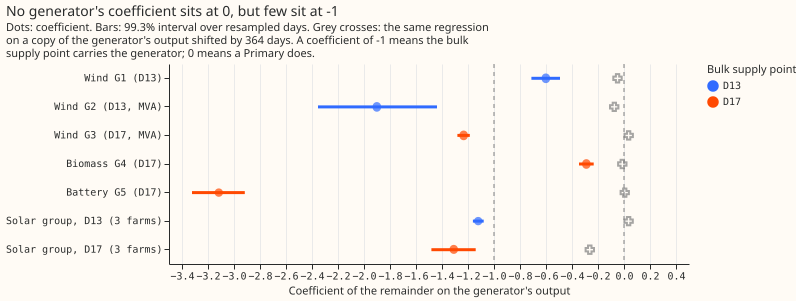

# Experiment 223: are the metered generators under a bulk supply point children of the sum?

**Take-home.** The bulk supply points' remainders move with the metered generators, so the
generators are not simply hidden inside a Primary's reading. No unit's coefficient is a clean -1,
so the pre-registered rule classifies all 7 as `cannot tell`, and Row B did not run.

## Results

**The generator child table.** NGED lists 13 metered generators under D13 and D17. The labels are
private. Generation is positive for every kind, the battery's sign is as stored, and the two wind
readings in MVA are multiplied by 0.97 to give MW.

| Label | BSP | Kind | Unit | Voltage | History (years) |
|---|---|---|---|---|---|
| G1 | D13 | wind | MW | EHV | 6.7 |
| G2 | D13 | wind | MVA | EHV | 6.7 |
| G3 | D17 | wind | MVA | EHV | 6.7 |
| G4 | D17 | biomass | MW | EHV | 6.7 |
| G5 | D17 | battery | MW | EHV | 4.9 |
| G6 | D17 | solar | MW | EHV | 6.2 |
| G7 | D17 | solar | MW | EHV | 6.4 |
| G8 | D13 | solar | MW | EHV | 1.8 |
| G9 | D17 | solar | MW | EHV | 5.4 |
| G10 | D13 | solar | MW | EHV | 6.2 |
| G11 | D13 | solar | MW | EHV | 6.1 |
| G12 | D17 | solar | MW | HV | under 0.01 (1 reading) |
| G13 | D17 | other | MW | HV | 0.3 |

**Row A: every coefficient excludes 0, and few are near -1.** Figure 1 shows each coefficient, its
99.3% interval (Bonferroni across 7 units), and a placebo (the same regression on the generator's
output shifted by 364 days).

- **Wind G3 and both solar groups sit near -1.** The coefficients are -1.23 for G3, -1.12 for the
  D13 solar group, and -1.31 for the D17 solar group. The shifted copy of the D17 solar group
  already gives -0.26, so the unmetered solar that shares the sun biases the solar coefficients by
  about that much. Subtracting the placebo gives -1.16 and -1.05 for the two solar groups.
- **Wind G1 (-0.60) and biomass G4 (-0.29) sit between 0 and -1, and wind G2 (-1.90, wide)
  overshoots -1.** The pre-registered rule classifies all three `cannot tell`. A partial carry, a
  metering mismatch, or stepped biomass dispatch could each produce them, and this regression
  cannot separate those causes.
- **The battery G5 coefficient of -3.1 is not physical.** Battery dispatch follows price and demand,
  so the regression plausibly picks up demand that the profile removal leaves in.
- **The Primary check is not classified and shows small coefficients.** Each child Primary's
  coefficient on a wind,
  biomass, or battery generator lies within -0.3 to +0.03 (largest at D9 and D10 for the D13 wind
  farms). The solar groups give -0.03 to -0.47 for each Primary, and that range reflects the
  Primaries' own embedded solar, so the check cannot separate solar.
- **The 2 HV generators cannot be tested.** G12 has 1 reading and G13 has 0.3 years. Both stay
  Primary-side by their voltage.
- **Row B did not run.** The pre-registered rule runs Row B only for generators classified `carried
  by the BSP`, and none was.

## Checks

- **Predictions against outcomes:** prediction (1) failed, because no interval for wind G3, biomass
  G4, or the battery includes -1 (wind G1 and G2 also miss). Prediction (2) failed for both solar
  groups for the same reason. Predictions (3) and (4) could not be tested, because Row B did not
  run.

- **Known-answer check:** a real generator's output shifted by 364 days, planted in the remainder
  or behind a Primary, was classified correctly for 6 of 7 units in both placements. The D17 solar
  group came out `cannot tell` in both placements, because the planted copy has a coefficient of
  -0.26 on
  the remainder, which carries the unmetered solar. The plan required at least 4 of 5 of each kind,
  and the solar
  kind has 1 of 2, so both rows are capped at `inconclusive`.
- **Median minus mean forecast, and the mean forecast's error beside each contrast:** not
  applicable, because Row B did not
  forecast.
- **Joint regression (not pre-registered):** regressing the remainder on all of a bulk supply
  point's units at once changes the coefficients by 0.0 to 0.15 for solar, biomass, and G3, and
  moves
  G1 from -0.60 to -0.74. G2 moves to +0.10 (interval -0.24 to +0.46), which says its MVA series
  adds nothing once the other wind farm is in. The battery stays at -3.2.
- **Audit triggers:** no Opus audit ran, as the ML manager asked. The serving path, the degradation
  rules, and the stored data are not touched.
- **The connection file does not settle the question.** The MPAN file lists each generator's own
  substation number, and its circuit identifiers for three wind farms match no Primary or BSP in
  the hierarchy files.

## What the next experiment should answer

Whether a regression on a known outage or step, with the unmetered solar modelled first, shows
where each generator connects. Only after that is it worth forecasting the generators and adding
them to the sum.

## Question

[Experiment 204](../00204-dp-bsp-full-bottom-up-with-signed-mva-children/result.md) summed every
child Primary of D13 (Skegness) and D17 (Boston) and found no detectable gain. NGED's hierarchy file
also lists 13 metered generators under the two BSPs. The file gives each generator its BSP but no
Primary, so a generator may connect straight to the BSP or through a Primary. A generator behind a
Primary is already in that Primary's reading, and summing it again would count its output twice.
This experiment tests which generators the BSP's remainder carries, from the readings, and then
adds those generators to the bottom-up sum.

## The generators

| Group | Count | Unit | Voltage evidence | Treated as |
|---|---|---|---|---|
| Wind | 3  | 2 in MVA, 1 in MW | 33 kV (EHV) | tested |
| Solar | 7 | MW | 6 at 33 kV, 1 at 11 kV | 6 tested as a group; the 11 kV one is Primary-side |
| Biomass | 1 | MW | 33 kV | tested |
| Battery | 1 | MW | 33 kV | tested |
| Other generation | 1 | MW | 11 kV | Primary-side |

The generators are labelled G1 to G13 in a private table; no page names one or gives an identifier.
Of the 13, one 11 kV solar series holds a single reading and the other 11 kV series has under 4
  months,
so neither can be tested. The generators' readings are in the cleaned power table in MW (generation
positive) except the two MVA wind series, which are magnitudes of apparent power. Those two are
converted to MW with a power factor of 0.97, enter Row A as a check with the conversion error
stated, and enter Row B only if classified `carried by the BSP`. A battery's reading is signed.

**Primary-side by voltage.** An 11 kV generator must connect downstream of a Primary, so it is
already inside that Primary's reading. The plan treats the two 11 kV generators as Primary-side and
leaves them out of every sum. The 11 EHV generators could connect at the BSP's 33 kV busbar or by a
33 kV feeder to a Primary, so voltage cannot decide them and the readings must.

## Row A: does the remainder carry the generator?

Under the hypothesis that the BSP carries a generator, the BSP's reading falls by that generator's
output, and nothing in the Primaries' readings changes. Under the hypothesis that a Primary's raw
reading carries it, the remainder (the BSP minus the weighted Primaries) does not move with the
generator, and that Primary's reading falls by the output instead. Experiment
[206](../00206-dp-meter-regime-steps-e1-farm-outages-in-primary/result.md) found that D10's reading
did not change when two metered solar farms' meters read zero, which says those farms do not sit
behind D10; experiment 206 could not test the other Primaries.

- **Regression.** The remainder on each
  generator's output, with the remainder built as in experiment 204 (weights from the winter of
  2023-10 to 2024-03, all children with a long history). Removing a smooth hour-of-day-by-month
  profile
  from both sides takes out the slow terms that both sides share. Wind, biomass, and the battery are
  regressed one by one. The six EHV solar
  farms share almost all of their variation (the same sun), so they enter as their sum, and as two
  sums by bulk supply point. The group is still collinear with unmetered solar, so the solar row is
  reported as weak evidence.
- **Second check.** Each Primary's reading on each generator's output; the coefficient is -1 behind
  that Primary and near 0 elsewhere.
- **Interval.** Resampling whole days, 20,000 draws, the 97.5% level with a Bonferroni correction
  for the number of generators and groups tested.
- **Known-answer check.** Add a generator's observed output to the remainder (so the remainder
  carries it by construction) and to a randomly chosen Primary (so the Primary carries it by
  construction), and check that each regression classifies the construction correctly for at least
  four of five generators of each kind. A regression that cannot recover a planted generator cannot
  rule one out.

## Row B: does summing the generators help the BSP forecast?

Three arms, each experiment 204's arm (d) plus the EHV generators classified `carried by the BSP`
as extra children with weight 1 (a generator's output is metered, so no weight is estimated), summed
with the sign the BSP's reading implies. The remainder chain is refitted on the new remainder.

| Arm | Generator forecast |
|---|---|
| G-oracle | The observed output (an upper bound, not a deployable forecast) |
| G-clim | Climatology by local month, half-hour, and weekend flag, fitted before the scored year |
| arm (d) | Experiment 204's arm (d), the reference |

A generator forecast from the generator-forecasting theme would replace the climatology if one
existed for the scored year's 291 daily runs. None does: experiment 87's stored forecasts cover 53
runs and 9 generators. The experiment says so and recommends a generator forecast as the next step
  if
the oracle gains.

## Controls, run before any contrast is read

- Reproduction of experiment 204's arm (d) and top-down scores to three decimals.
- The known-answer check of Row A.
- Leakage: no weight, climatology, or regression coefficient used in Row B reads a half-hour on or
  after the first scored run (the Row A regression is a diagnostic of the electricity network and is
  fitted on
  half-hours before 2025-07-01 only).

## Triggers and size

- **Stored:** private files only.
- **Serving path:** not touched.
- **Degradation rule:** not touched.
- **More than one defensible design:** yes, two, each pre-registered above.
- **Callers not nameable without searching:** no, the scripts read experiment 204's stored files.

## Resources

CPU only, at most 4 cores with every thread cap at 1, each job under `systemd-run --user --scope -p
MemoryMax=16G -p OOMPolicy=continue`. No GPU. The remainder chains reuse experiment 204's copy of
the chain.

## Advice followed and departures

- **Followed:** experiment 204's advice to aim the next hierarchy experiment at the remainder (the
  generators and the unmetered load beneath each BSP); the data-processing page's entry on MVA
  series.
- **Departure:** the generators are summed with weight 1 and no estimated weight, because their
  output is metered.
- **Departure from a forecast arm:** no generator forecast exists for the scored year, so the oracle
  and a climatology stand in.
