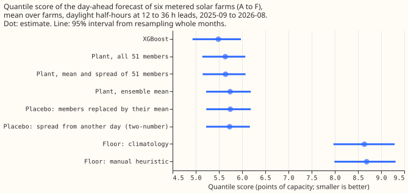
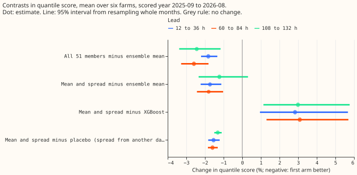
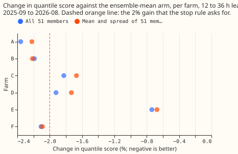
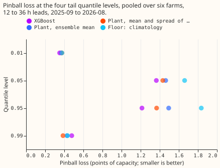

**The 51 members of the weather ensemble help a single metered solar farm's day-ahead forecast only
a little, and two numbers per half-hour carry nearly all of that help.** NGED meters the output of
six solar farms in its trial area, which this page labels A to F. We passed each of the 51 members
of the European Centre for Medium-Range Weather Forecasts (ECMWF) ensemble forecast through a
solar-farm power model, called "the plant" below. The plant has south-facing panels at 35 degrees
tilt and one fitted scale per farm, so each half-hour gets 51 plant outputs, one per member. We
built three forecasts: one from the plant fed the ensemble mean, one from all 51 plant outputs, and
one from only the mean and standard deviation of the 51 plant outputs (the "two-number" forecast).
We scored them on daylight half-hours, 12 to 36 hours after the weather forecast was issued, in
2025-09 to 2026-08. The score is the quantile score: twice the mean pinball loss over 11 quantile
levels. The comparison is an [XGBoost (Chen and Guestrin,
2016)](https://doi.org/10.1145/2939672.2939785) model fitted on the same weather. The plant's scale
and all other fitted numbers come from the months before the scored year. The two-number idea comes
from [experiment 193](../00193-dp-ens-two-number-solar-summary/result.md), which tested it on
Primary substations (the substations that feed local distribution networks), and the code for
passing members through a model from [experiment 187](../00187-dp-ens-members-in-stack/result.md).

**The prediction partly holds, and the stop rule fires: the members gain under 2% at three of the
six farms.** The quantile score (in points of capacity) is 5.74 for the plant fed the ensemble mean,
5.64 for the two-number forecast, 5.64 for the plant fed all 51 outputs, and 5.49 for XGBoost. All
51 members lower the score by 1.8% (95% interval 1.3% to 2.2%). The two numbers alone lower it by
1.7% (1.1% to 2.2%). That is a retained share of 0.95 (0.84 to 1.02), which passes the 80% rule. The
gain is under 2% at three farms (C, D, and E), so this page reports the result without a further
arm. The MAE of the median is within 5% of XGBoost's (9.99 against 9.87 points of capacity, 1.2%
higher). The pinball loss at the 0.99 quantile is lower than XGBoost's (0.386 against 0.478), but at
the 0.01 quantile it is higher (0.374 against 0.352). The prediction therefore holds at the 0.99
quantile and fails at the 0.01 quantile.

## Numbers

- **Arms and schedule.** One plant shape shared by all six farms, with one fitted scale and one
  ceiling (the 99.5th
  percentile of tuning output) per farm; no per-farm plant, because [experiment
  218](../00218-metered-solar-farm-plant-fit/result.md) found that per-farm parameters raise the
fraction of output explained by only 0.003. One fit on the tuning months before the scored year, no
refit in the scored year,
  for the plant scale, the offsets, and XGBoost (150 rounds, eta 0.15, depth 5, no column
  subsampling, no calendar columns). Offsets are the 11 residual quantiles of the tuning months in
  four bins of the forecast. The offset factor and spread factor are shared and fitted
  leave-one-farm-out on the other five farms' tuning rows.
- **Weather.** ECMWF ensemble (51 members), 00 UTC run, at the nearest 0.25 degree cell; every
  half-hour takes the run whose lead is 12 to 36 hours (also 60 to 84 and 108 to 132 hours as
  secondary bands). Each of these weather runs is available at forecast time. The manual heuristic
reads only observed power from 7 or more days earlier, which is also available at forecast time. The
ensemble store starts on 2024-04-01,
  so tuning is April 2024 to August 2025 for the scored year.
- **Rows.** Scored year 2025-09 to 2026-08: 41,654 daylight half-hours per lead band that every arm
  holds, six farms. Replicate (2025-03 to 2025-08, tuning 2024-04 to 2025-02): 23,782 half-hours.
- **Quantile score, 12 to 36 h, scored year (95% interval):** XGBoost 5.49 (4.93 to 5.97); all 51
  members 5.64 (5.14 to 6.07); mean and spread 5.64 (5.15 to 6.07); ensemble mean 5.74 (5.22 to
  6.19); climatology 8.64 (7.97 to 9.29); manual heuristic 8.69 (7.99 to 9.31).
- **Contrasts, 12 to 36 h, scored year:** C0 (members minus ensemble mean) -1.82% (-2.21 to -1.34);
  C1 (mean and spread minus ensemble mean) -1.73% (-2.23 to -1.12); retained share 0.95 (0.84 to
  1.02); C3 (mean and spread minus XGBoost) +2.83% (+0.95 to +5.67); mean and spread against the
  manual heuristic -35.0% (-37.7 to -32.5), against climatology -34.7% (-39.6 to -30.3).
- **Controls.** The placebo that gives the two-number arm the spread of another day (same farm,
  month, hour band, and forecast bin) scores 5.73, so the real spread beats it by 1.54% (1.22% to
  1.83%); the same for all 51 members is 1.47% (1.26% to 1.67%). The placebo that replaces the 51
  outputs by their mean scores 5.75, within 0.1% of the ensemble-mean arm. In these six farms and 12
scored months, the members' gain is distinguishable from zero, and small. The night placebo was not
run (see the plan).
- **Lead bands.** At 60 to 84 hours the members gain 2.59% (1.81% to 3.28%) and the mean and spread
  keep 0.69 (0.55 to 0.76) of that; at 108 to 132 hours the gain is 2.44% (1.16% to 3.38%) and the
  share 0.50 (-0.25 to 0.70). XGBoost remains better than the two-number arm at both (about 3%).
- **Replicate (2025-03 to 2025-08, shorter tuning).** The members gain 1.32% (1.08% to 1.87%) at 12
  to 36 h with a retained share of 0.87 (0.58 to 1.01). XGBoost is 5.2% worse than the two-number
  arm (interval -6.2% to +4.7%), the reverse of the scored year, which may be because its tuning
window is only 11 months.
- **Per farm, gain of all 51 members over the ensemble mean at 12 to 36 h:** A 2.36%, B 2.19%, C
  1.83%, D 1.92%, E 0.74%, F 2.11%. Leaving one farm out leaves the gain at 1.72% to 2.08% and the
  retained share at 0.94 to 0.96, so no farm flips a contrast.
- **Tail calibration, 12 to 36 h, pooled over farms (coverage at the level; pinball in points of
  capacity):** the two-number arm covers 3.2%, 5.5%, 96.3%, and 99.1% at the 0.01, 0.05, 0.95, and
  0.99 levels (pinball 0.374, 1.432, 1.367, 0.386); XGBoost 3.3%, 6.8%, 95.6%, and 99.6% (0.352,
  1.364, 1.214, 0.478); the ensemble-mean arm 3.3%, 6.3%, 94.9%, and 98.7% (0.366, 1.462, 1.494,
  0.428).
- **Curtailment value.** Not scored. The pilot set of `studies.node_curtailment` holds four nodes
  and scores a few events at the scaled limit, so it shows the arithmetic and cannot rank forecasts;
  this experiment did not map the six farms to those nodes.

## Checks

- **Median minus mean forecast per farm (points of capacity, 12 to 36 h):** the two-number arm +0.27
  to +0.48, the ensemble-mean arm +0.64 to +0.91, XGBoost -0.48 to +0.02 (the mean forecast is the
weighted mean of the 11 quantiles). Adding the spread roughly halves the gap between the median and
the mean forecast but does not remove it.
- **Mean-forecast error beside each quantile-score contrast.** The quantile score improves by 1.7%
  from the ensemble-mean arm to the two-number arm, while the MAE of the mean forecast worsens from
  10.13 to 10.20 points and the MAE of the median is unchanged (9.95 to 9.99). The members appear to
change the width of the forecast distribution, not its centre; XGBoost's MAE of the mean is 10.23,
the worst
  of the three, while its quantile score is the best.
- **Triggers fired.** Trigger 3 fires (quantile score and the MAE of the mean forecast point in
  different directions). The explanation, that members sharpen the spread and not the location, is
  supported by the unchanged median MAE and by the placebo that gives the real spread a 1.5%
  advantage over a spread from another day. No Opus audit was run, because the ML manager ruled one
out to save quota, so no independent
  reader has re-derived the headline contrasts. Triggers 1, 2, 4, and 5 did not fire: the controls
  behave (the rescale placebo changes the score by 0.1%, the shuffles lose most of the gain), the
  leave-one-farm-out checks keep every sign, and no nested arm beats the arm that contains it.
  Trigger 6 does not apply, because no sister experiment on the same rows exists. Trigger 7 fires:
  the planned hybrid neural head for the metered farms takes the two ensemble numbers as inputs,
  and this result has not been replicated.
- **Caveats.** The offset factor `f` and spread factor `s` are fitted on tuning rows whose offsets
  were estimated on the same rows. That makes the fit optimistic for every plant arm, by an amount
  we did not measure. The ceiling and scale
  are fitted on the ensemble-driven tuning rows, not on past weather. XGBoost gets one fit and no
  refit, and 17 months of tuning data; the replicate reverses its lead. Farm E has 10 months of
  tuning data in the scored year and the smallest gain. The floors were re-implemented from their
  definitions (13 earlier powers; month, half-hour, and weekend cells pooled over neighbouring
  cells) and not run through `BaseForecaster`. The scored year has 12 months, and resampling so few
months gives intervals close to the full range of the monthly results. Figures were drawn from the
scoring tables; the SVG files were optimised but
  not visually inspected in the built site.

## What the next experiment should answer

- Does an XGBoost model that is given the plant's mean response and the members' spread as input
  columns beat both the plant forecast and plain XGBoost? The two families win at different quantile
  levels. That makes a combination plausible.
- Does the plant's advantage at the 0.99 quantile (0.386 against 0.478) persist when XGBoost is
  refitted weekly instead of fitted once?

## Plan amendments (made before scoring)

- **Supported rule.** The retained share must be at least 0.8 as a point estimate, and the interval
  of C1 must lie wholly below zero; the share's own interval is reported beside it, and the plan's
  wording "excludes 0.8 from below" is dropped as too strict for 12 monthly blocks.
- **Replicate.** The ensemble store starts on 2024-04-01, so the replicate scores 2025-03 to 2025-08
  (six months), with tuning from 2024-04.
- **Quantile score** is twice the mean pinball loss over the 11 levels of `studies.ens_members`, in
  points of capacity; MAE is of the median forecast; the mean forecast in the Checks is the 11-level
  weighted mean.

## Data-processing note

Experiment 268 found crossing quantiles in 26,344 of its 77,897 generator-forecast rows (34%), but
all of them belong to three generators that are not solar farms, so none is on this page.
[Experiment 273](../00273-metered-farm-sorted-quantile-rescore/result.md) counted 0 crossing rows in
every arm here, because the fit scripts sorted the 11 quantiles before writing them, so sorting does
not change the scores on this page.
