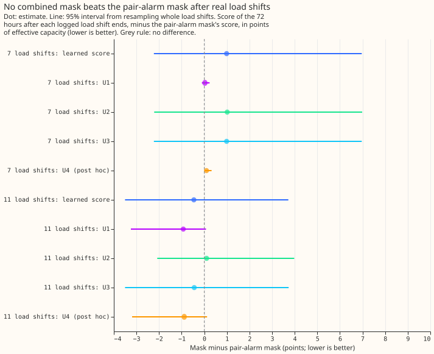
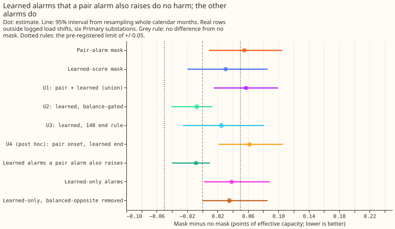
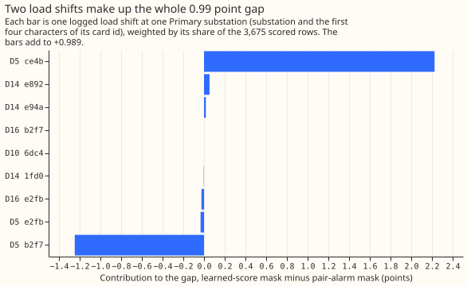
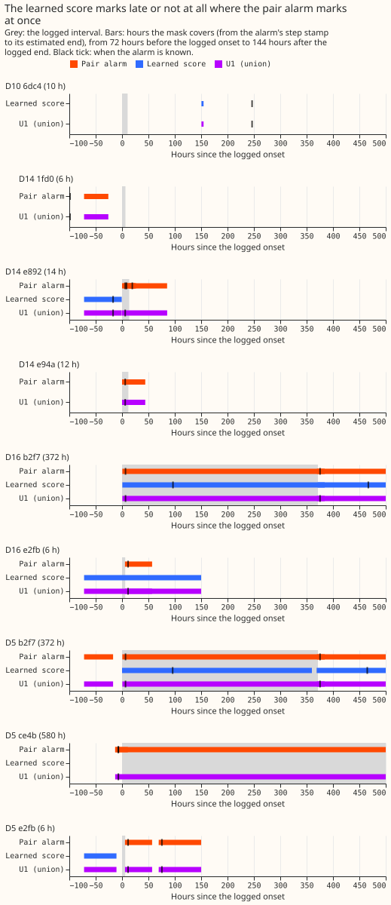

**The learned load-shift score (experiment 195's small neural network re-ranker) finds more real
load shifts than the pair alarm, but combining the two alarms does not give a mask that is both
as good as the pair alarm after load shifts and harmless on ordinary days.** A load shift moves
demand between Primary substations for hours or days, and the forecast's recent-power correction
misreads the moved demand as a change in the substation's own demand. A "mask" tells the
correction to ignore the readings while an alarm is open. Experiment 203 found that the learned
score's mask scored 7.31 points of effective capacity (percent of a substation's effective
capacity; lower is better) on the 72 hours after 7 logged load shifts, against 6.32 for the pair
alarm's mask, although the learned score matches 24 of 35 real load shifts against 5 for the pair
alarm. This experiment split that gap load shift by load shift, split the harm on ordinary days by
alarm source, and tested three combined masks that were fixed before any score was read. No
combination met the pre-registered prediction.

The alarms are those of [experiment 195](../00195-switching-neural-plus-detector-features/result.md),
the pair alarm of [experiment 156](../00156-switching-faster-onset-alarm-from-opposite-steps/result.md)
with the balance gate of [experiment
166](../00166-switching-gated-mask-and-soft-mask-while-alarmed/result.md), and the forecast
harness of [experiment 203](../00203-switching-replay-learned-score-in-masked-forecast/result.md),
which this experiment reuses unchanged: the same cached daily forecasts, the same rows, and the same
controls, which reproduce here (no mask 13.686, pair-alarm mask 6.321, best guess 2 10.091).

## Results

- **Verdict: `not supported`.** The best combination on the 7 load shifts is U1, and of the three
  conditions it meets one (finds 21 of 35, at least 20). It misses 6.32 by 0.03 points (6.350) and
  its ordinary-day harm is +0.057, above the +0.02 limit. U2 meets the harm condition and misses the
  other two. The prediction fails because every combination loses to or only ties the pair-alarm mask
  on the 7.
- **Combinations (all use the re-ranker, known 192 half-hours after the step).** U1: pair alarm
  and learned score merged, one interval per 24 hours, earlier known time and later end. U2: learned
  alarms whose folded opposite-step ratio is at least 0.7 (experiment 166's gate). U3: learned alarms
  with the end known only by experiment 148's rule. U4 (post hoc, not pre-registered): pair-alarm
  onset and learned-alarm end.
- **Mean score of the 72 hours after a load shift (points).** The 7 load shifts that best guess 2
  also scores: no mask 13.686, pair 6.321, learned score 7.310, U1 6.350, U2 7.336, U3 7.310, U4
  6.419, best guess 2 10.091. The 11 load shifts of experiment 163's scored and replicate months: no
  mask 10.129, pair 6.083, learned score 5.623, U1 5.154, U2 6.186, U3 5.639, U4 5.196.
- **Gain against the pair-alarm mask (95% interval, load shifts resampled whole).** On the 7: U1
  +0.029 (-0.103 to +0.236), U2 +1.016 (-2.214 to +6.986), U3 +0.989 (-2.229 to +6.963), U4 +0.098
  (+0.018 to +0.325). On the 11: U1 -0.929 (-3.245 to +0.074), U2 +0.104 (-2.080 to +3.979), U3
  -0.444 (-3.504 to +3.734), U4 -0.887 (-3.194 to +0.125). Leaving D5 out of the 7 moves the
  learned-score gap from +0.99 to +0.09.
- **The 0.99 point gap is two load shifts.** One 580-hour load shift at D5 (card ce4b) adds +2.226
  points: the pair alarm is known 7 hours before the logged onset (its step is 13 hours before),
  and the learned score has no alarm at the step (its only alarm there is the next load shift's onset, known 95.5 hours after this load
  shift ends). One 372-hour load shift at D5 (card b2f7) adds -1.248, because the learned mask
  covers 580 hours with 218 outside the logged interval, and the pair mask covers 1,164 hours with
  794 outside. The other seven scoring windows add +0.011 in total.
- **Late onsets are the cause where the learned score loses.** The learned score's alarm for ce4b
  is known after the load shift ends, and 2.2 of the 2.3 points where the learned score loses come
  from that one load shift. Over-long masks are the pair alarm's cost where the learned score wins (b2f7).
  Which cause applies to a given load shift is in `printed_decompose.txt` (onset error, hours known
  after the logged onset, hours masked inside and outside the logged interval, and logged hours
  never masked).
- **Matches of the 35 logged load shifts lasting over 1 day (experiment 195's rule).** Pair alarm
  5, gated pair alarm 3, RO-NC 19, learned logistic regression 20, learned re-ranker 24, U1 21, U2 6,
  U3 24, U4 21.
- **Harm on ordinary days (arm minus no mask, 1,579,711 rows, no mask 2.718; 95% interval from
  whole months).** Pair alarm +0.055 (+0.009 to +0.105), learned re-ranker +0.031 (-0.020 to
  +0.086), U1 +0.057 (+0.015 to +0.100), U2 -0.007 (-0.041 to +0.013), U3 +0.025 (-0.026 to
  +0.081), U4 +0.062 (+0.021 to +0.106).
- **Split of the re-ranker's alarms by whether a pair alarm also raises them (within 24 hours).**
  Alarms both raise (23 to 29 per fold): -0.008 (-0.040 to +0.010). Learned-only alarms (81 to 94
  per fold): +0.038 (+0.002 to +0.089). Learned-only alarms without the balanced-opposite candidates
  (an opposite step of 0.4 to 2.5 times the own step, probable unlogged load shifts; 64 to 76 per
  fold): +0.036 (-0.000 to +0.086). Removing the probable unlogged load shifts therefore does not
  remove the harm.
- **Learned-only alarms give no gain after a load shift.** On the 7 load shifts a mask built from
  them scores 13.651 against 13.686 with no mask (-0.035, -0.152 to +0.000), and on the 11 load
  shifts 9.506 against 10.129 (-0.624, -2.048 to -0.009). The extra load shifts the learned score
  finds are small or late for the forecast.
- **Harm by Primary substation (arm minus no mask).** The pair alarm's harm sits at D10 (+0.221;
  +0.022 pooled without D10). The learned score's harm sits at D10 (+0.124) and D9 (+0.088, where
  the pair alarm raises none). U2 is at or below +0.014 at every substation.
- **Harm by season.** The learned score's harm is in autumn (September to November, +0.148, +0.003
  to +0.327), against -0.044 in winter (-0.189 to +0.049). U2 is at most +0.016 in every season.
- **Row sets and schedule.** Experiment 163's AFTER rows and experiment 171's ordinary rows, as in
  experiment 203. The cached forecasts are daily at 09:00 UTC, not 6-hourly (a 6-hourly replay
  needs new ensemble forecasts), and the end of an alarm that experiment 147 did not raise is known
  60 half-hours after its estimated end, a lab shortcut. Nothing is refitted.
- **Checks: median and mean forecast.** The median forecast minus the mean forecast per site is the
  same for no mask and the learned-score mask to three decimals (D5 -0.146, D10 -0.058, D11 -0.030,
  D14 +0.037, D16 +0.017, D9 -0.019), because a mask changes the correction only through the mean.
- **Checks: mean-forecast error beside each contrast.** The mean forecast's absolute error on
  ordinary days, arm minus no mask, points the same way as each quantile-score contrast: U1 +0.104
  (+0.035 to +0.176), U2 -0.007 (-0.055 to +0.026), U3 +0.033 (-0.041 to +0.114), U4 +0.103 (+0.038
  to +0.174). On the 7 load shifts the learned score's mean-forecast error minus the pair alarm's is
  +0.525 (-3.238 to +7.311), the same sign as +0.989.
- **Checks: audit triggers.** Trigger 2 fired in form (the prediction failed) and is answered by the
  load-shift decomposition above. Trigger 4 (leaving one site out) changes the 7-load-shift gain,
  which is why the page does not rest on that contrast. The controls reproduce and the quantile-score
  and mean-forecast contrasts agree. Trigger 7 applies in part, because experiment 227 takes the
  best combination from this page as one of its alarm sources, but experiment 227 sweeps its own
  thresholds and does not depend on the headline sign. No audit was run.
- **Caveats.** The learned scores are partly in-sample on ordinary days (experiment 195 trained them
  with even-month candidates as negatives). Seven and 11 load shifts are few, so every gain interval
  is wide. U1 to U3 were chosen on the 7 load shifts, and U4 is post hoc. The pair-alarm intervals
  that are merged into U1 are the same 242 alarms of experiment 163.
- **What this narrows.** The learned score's extra matches are not where the forecast gain is, and
  they are where the ordinary-day harm is. A mask that stays at or below the harm limit needs fewer
  false alarms per matched load shift, and an alarm that arrives early on long load shifts. The
  next experiment, 227, tests alarm sources and thresholds by alarms per matched load shift, and
  uses of an alarm that keep recent power.
