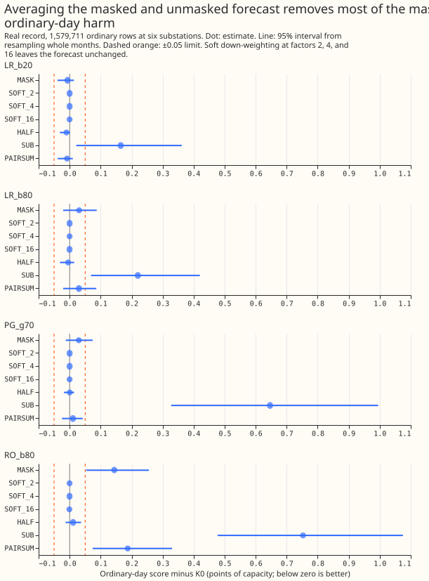
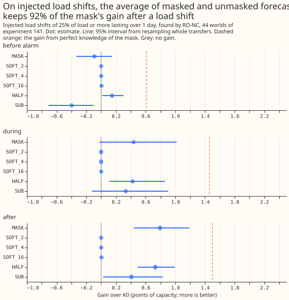
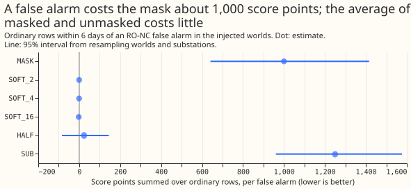

**An alarm score learned from past data, kept only where it is most confident, finds 21 of the 35
load shifts in NGED's log that lasted over 1 day, with 5 alarms per matched load shift. It recovers
an estimated 84% of the forecast gain after a load shift (95% interval -0.1% to 123%, from 11 load
shifts) and shows no measurable harm on ordinary days. The threshold was chosen on the same rows.**
A load shift is demand that the electricity network operator moves between neighbouring Primary
substations for hours or days. An alarm tells the forecast that a load shift is probably under way,
and a "mask" then sets recent power readings aside while the alarm is open. [Experiment
208](../00208-switching-what-is-a-detector-worth/result.md) found that no real alarm source stayed
inside the ordinary-day harm limit of 0.05 points, because each raised 104 to 242 alarms for 15 to
20 matched load shifts. This experiment asks whether a stricter threshold (part a) or a gentler use
of the alarm (part b) fixes that. Part (a) does: at a budget of 20 unexplained odd-month candidates
the learned score matches 21 load shifts, raises 5.0 alarms per match, and has ordinary-day harm of
-0.007 points (95% interval -0.039 to +0.014). Part (b) adds little where the mask is already
harmless, and the verdict is `partly supported`. Points are percentages of a substation's effective
capacity, and a lower score is better.

## Terms

- **Points and harm.** A point is 1% of a substation's effective capacity (the largest power it
  normally carries). The score is twice the mean pinball loss over 11 quantiles, and lower is
  better. Harm is an arm's score minus the no-mask (K0) score on ordinary rows, so a negative harm
  is an improvement. The limit is +/-0.05 points.
- **Rows and phases.** A row is one forecast of one substation for one valid time. On injected load
  shifts, BEFORE_ALARM is the time after the load shift starts and before its alarm is known, DURING
  is while it lasts, AFTER is the 48 hours after it ends, and ORDINARY is every other row. On the
  real record AFTER is the 72 hours after a logged load shift ends, and only AFTER and ORDINARY rows
  exist. The oracle mask opens exactly over the logged load shifts, and "perfect knowledge" means
  the same on injected load shifts.
- **Match.** An alarm matches a logged load shift when its step lies within 2 hours of the logged
  start and its estimated end within the larger of 6 hours and 10% of the logged duration
  (experiment 195's rule). A span is one continuous period during which an alarm is open. A world is
  one simulated demand history with injected load shifts (experiment 141).
- **Uses of an alarm.** MASK sets the readings aside while the alarm is open. SOFT multiplies the
  forecast filter's observation-noise variance by 2, 4, or 16 during the alarm. HALF is the average
  of the K0 and MASK forecasts, the simple hedge. SUB subtracts the detected megawatts from the
  readings. PAIRSUM replaces each Primary's correction with one computed from the pair total, which
  a transfer between the two Primaries leaves unchanged. K0 is the forecast without any alarm, built
  from a Kalman filter on recent power.
- **Source names.** The letter after the underscore says what is swept: b is the alarm limit (the
  budget), g is the balance gate times 100, and h is the stricter limit that UR applies.

## Results

- **Verdict: `partly supported`.** Prediction 1 holds. Prediction 2 holds only for the pair alarm,
  which matches 3 load shifts. The bar (best source with best use recovers at least 50% of the gain,
  harm interval inside +/-0.05) is met by LR_b20 with the plain mask, so the plan's rule would give
  `supported` although part (b) added nothing.
- **Two of three controls reproduce.** The gated pair-alarm mask's ordinary-day harm is +0.030
  (experiment 171's figure). On injected load shifts perfect knowledge gains 1.50 points in the 48
  hours after a long, large load shift (95% interval 1.07 to 1.96), and RO-NC recovers 0.79 (53%),
  the figures experiment 208 found for the same 48 hours. The 13.686 and 6.321 scores of experiment
  203 were not recomputed. The K0 forecast (no mask) scores 10.129 points on the 11 real load shifts
  of experiment 163's scored and replicate months, the logged-oracle mask 4.790, and the pair-alarm
  mask 6.083.
- **Sources.** LR is experiment 195's re-ranker (alarm known 96 hours after the step). LR148 gives
  the same alarms with the end known by experiment 148's rule, and its counts equal LR's, so the
  figure leaves it out. RO is RO-NC. PG is the pair alarm kept where its balance score is at least
  the gate over 100. UR keeps a re-ranker alarm at budget 80 only where a pair alarm also fires
  within 24 hours or the alarm's score passes the threshold of budget h. A budget is the number of
  unexplained odd-month candidates left above the threshold, and a learned source has one threshold
  per fold of three, because each re-ranker was trained without that fold's Primary pairs.
- **Part (a): matches and alarms per match (35 logged load shifts lasting over 1 day).** LR at
  budgets 5, 10, 20, 40, 80, 160, 320 matches 17, 20, 21, 22, 24, 24, 26 with 2.9, 3.6, 5.0, 7.3,
  11.1, 20.1, 40.0 alarms per match. RO-NC matches 9 to 25 with 4.3 to 43.6. The pair alarm at
  balance gates 0.40 to 0.90 matches 5 to 1 with 62 to 107. UR at h = 5, 10, 20, 40 matches 19, 21,
  21, 22 with 4.7, 5.0, 6.3, 7.9.
- **Part (a): ordinary-day harm (arm minus no mask, 1,579,711 rows, 95% interval from whole
  months).** LR at budgets 5 to 40 is inside +/-0.05 (budget 20: -0.007, -0.039 to +0.014; budget
  40: +0.004, -0.030 to +0.032). LR at budget 80 is +0.031 (-0.021 to +0.087), and at budgets 160
  and 320 +0.079 (+0.010 to +0.158) and +0.074 (+0.021 to +0.132). RO-NC is +0.081 to +0.192 at
  every budget. The pair alarm is +0.055 at gate 0.40 and +0.012 to +0.016 at gates 0.80 and 0.90.
  The learned score was trained on even-month data (experiment 195's negatives), so its
  even-numbered months are in-sample, and this bullet also gives them alone: LR budget 20 +0.001
  (-0.014 to +0.018), against -0.015 on odd months.
- **Part (a): share of the gain after a load shift recovered.** Rows are the 72 hours of target time
  after each logged load shift, 5,993 rows from 11 load shifts in 163's scored and replicate months,
  and the share is the arm's gain over no mask divided by the logged-oracle mask's gain. LR budgets
  10 to 160 recover 84% to 85% (intervals reach from about 0% to 123%), budget 320 recovers 94% (28%
  to 100%), and budget 5 recovers 10%. The pair alarm at gate 0.70 recovers 82% (-16% to 101%) and
  RO-NC at budget 80 recovers 83% (-2% to 123%). The intervals are wide because 11 load shifts are
  few, and LR_b20's lower end is -0.1%.
- **Prediction 1 holds on point estimates.** LR budgets 10 and 20 and UR h = 5 and 10 each match at
  least 12, raise 5 or fewer alarms per match, recover more than 50%, and have a harm interval
  inside +/-0.05. LR budget 20 is the carried setting, because it keeps the most matches (21) among
  the settings at 5.0 or fewer alarms. The page carries three sources into part (b), fixed before
  any part (b) score was read: LR_b20, LR_b80 (experiment 208's operating point), and PG_g70 (the
  one source of the four with a metered partner for every alarm). RO_b80 was added afterwards as the
  source with the most harm to repair.
- **Part (b), real record, harm and share by use (95% intervals from whole months and whole
  windows).** MASK: LR_b20 -0.007, LR_b80 +0.031, PG_g70 +0.030, RO_b80 +0.144 points. SOFT at
  factors 2, 4, and 16: harm and share both within 0.002 of zero for every source, so soft
  down-weighting leaves the forecast as it was. HALF (the average of the masked and unmasked
  forecasts): harm -0.010, -0.005, +0.000, +0.011 with shares of 51%, 52%, 47%, 52%, which is 61%,
  61%, 57%, 63% of the mask's share. PAIRSUM: harm -0.008, +0.030, +0.011, +0.187 with shares of
  79%, 80%, 71%, 75%. SUB: harm +0.165, +0.220, +0.646, +0.753 with shares of 75%, 73%, -10%, 64%.
- **Part (b), harm per false alarm (score points summed over the ordinary rows, divided by
  alarms).** The mask adds 433 (LR_b80), 427 (PG_g70), and 1,763 (RO_b80). HALF adds -70, 3,
  and 136. PAIRSUM adds 422, 152, and 2,294. SUB adds 3,113 to 9,279.
- **PAIRSUM coverage.** The pair-sum correction needs a pair alarm backing the span and a metered
  partner. It applies to 26 of 115 LR_b20 spans, 51 of 335 LR_b80 spans, 19 of 129 RO_b80 spans, and
  all 110 PG_g70 spans. Elsewhere it falls back to the mask. The counts sum the three folds of a
  learned source. For RO_b80 the subtraction on the 19 pair-backed spans raises harm above the
  mask's (+0.187 against +0.144).
- **Prediction 2's point estimates hold only for the pair alarm, which matches the fewest load
  shifts.** For PG_g70, PAIRSUM recovers 86% of the mask's gain at 36% of its harm. For every other
  source PAIRSUM recovers 91% to 95% of the mask's gain and cuts the harm by 3% at most (LR_b80) or
  raises it (RO_b80). SOFT fails on both counts. HALF recovers 57% to 63% of the mask's gain, below
  the 80% bar, and removes at least 92% of the harm for LR_b80, PG_g70, and RO_b80.
- **Injected load shifts (44 worlds of experiment 141, RO-NC alarms, six substations).** In the
  headline stratum (25% of load or more, over 1 day) the gain over no mask in the 48 hours after a
  load shift is MASK 0.794 (0.440 to 1.186), HALF 0.730 (0.494 to 0.993, 92% of the mask), SUB 0.408
  (0.026 to 0.831), and SOFT 0.000 to 0.005. During a load shift the gain is MASK 0.438, HALF 0.425,
  SUB 0.333, and before the alarm arrives MASK -0.090, HALF +0.149, SUB -0.397. Per false alarm
  (ordinary rows within 6 days of one), the mask adds 1,000 (641 to 1,416) score points, SUB adds
  1,250, HALF adds 24 (-85 to 145), and SOFT adds -0.2 to -2.3.
- **Post hoc: soft down-weighting works at a much larger factor.** In worlds 9200 to 9203 the
  headline stratum's gain after a load shift is 0.18 at a factor of 1,024 and 0.61 at 16,384 for
  RO-NC alarms (the mask gains 0.53), and 0.82 against 0.67 for the mask with perfect alarms. The
  factors are not pre-registered, four worlds are few, and the harm per false alarm at these factors
  was not measured. A likely reason that factors of 2 to 16 do nothing is that the filter's level
  variance is much larger than its observation noise, but this page did not measure the variances.
- **Row sets and schedule.** Experiment 163's after-load-shift rows (here 72 hours, not the 48 of
  experiment 208's headline) and experiment 171's ordinary rows, with the cached daily 09:00 UTC
  forecasts, as in experiments 203 and 226. A learned source's rows use the fold that holds out the
  load shift's Primary pair, and its harm is the mean over the three folds.
- **Deviations from the plan.** The plan named a combination from experiment 226; experiment 226
  found no combination that beat the learned score alone, so UR is a new rule defined above. The
  budgets are 5 to 320 on 7 values, and the pair-alarm gates are 0.40, 0.55, 0.70, 0.80, 0.90. The
  thresholds were swept on all rows and scored on all rows, with even and odd months reported
  separately, not tuned on odd months and scored on even months, so the carried setting is chosen on
  the pre-registered 5.0-alarms bar and not by a held-out score. Part (b) uses the same alarms and
  rows; the real record has no BEFORE_ALARM or DURING rows, so those phases are shown on injected
  load shifts only.
- **Checks: audit triggers (the `ml-experiment` skill's seven tests).** Trigger 1: the gated
  pair-alarm harm (+0.030) and the injected-world gains of experiment 208 (1.50 and 53%) reproduce,
  but the 13.686 and 6.321 scores on experiment 203's 7 shared load shifts were not recomputed,
  because this page scores the 11 load shifts of experiment 163's scored and replicate months.
  Trigger 2: prediction 2 fails for every source except the pair alarm, and the explanations (the
  pair-sum correction's metered-partner coverage and the filter's small observation noise) are
  tested above. Trigger 3: the mean forecast's absolute-error contrast on ordinary days agrees in
  sign with the quantile score for LR_b20 (-0.004, -0.049 to +0.028, against -0.007) and LR_b80
  (+0.055, -0.020 to +0.137, against +0.031). Trigger 4: leaving one substation out of the
  ordinary-day contrast keeps LR_b20 inside +/-0.05 every time (-0.009 to -0.001), and leaving one
  out of the share keeps the point estimate at 70% to 88% (`printed_checks.txt`). Trigger 5: the
  controls that should change nothing (SOFT at factors 2, 4, and 16) move the ordinary-day harm by
  0.000 to 0.001. Trigger 6: the LR_b80 harm interval (-0.021 to +0.087) is as wide as experiment
  226's (-0.020 to +0.086). Trigger 7 applies in part: later experiments re-choose operating points
  with this method, and the result has not been replicated, which the 11-load-shift caveat below
  covers. No audit was run.
- **Caveats.** The 11 load shifts after which gain is measured give 95% intervals that reach from
  about 0% to above 100%. The learned score's even months are in-sample, and each substation's
  ordinary-day harm averages three re-rankers of which two were trained with that substation's pair,
  so the headline harm is not a held-out figure. The harm per false alarm divides by all alarms at
  the six substations, true ones included, so it is diluted and is not meaningful for arms with
  negative harm. Alarms per match counts alarms on all 16 series over the whole record, while harm
  is measured at the six substations the forecast covers, so the two figures describe different sets
  of series.

## What the next experiment should answer

**Does the learned score at an alarm budget of 20 keep its small harm and its gain on load shifts
outside the 11 this page measures?** The next experiment should score the carried setting on
experiment 163's other windows and on a month-blocked refit of the learned score, so that even
months are out of sample. A second question is whether soft down-weighting at factors of 1,000 or
more costs less per false alarm than the mask while keeping the gain.
