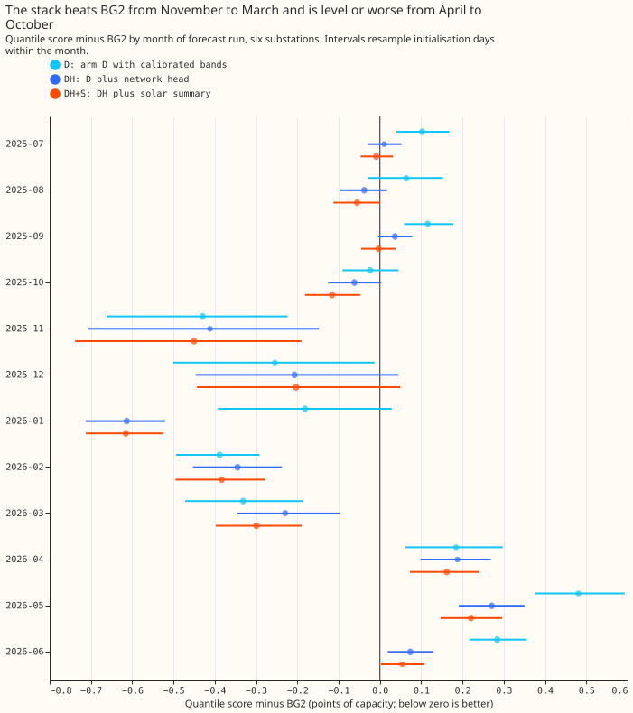
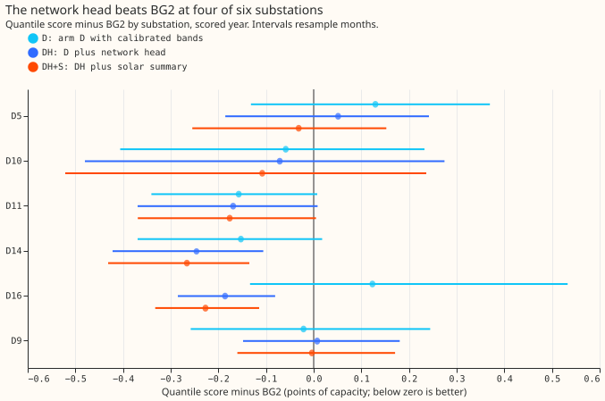
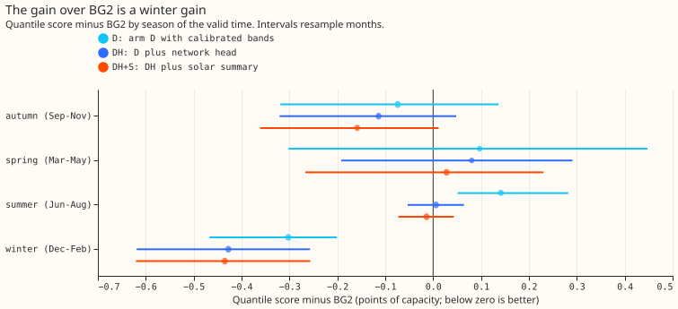
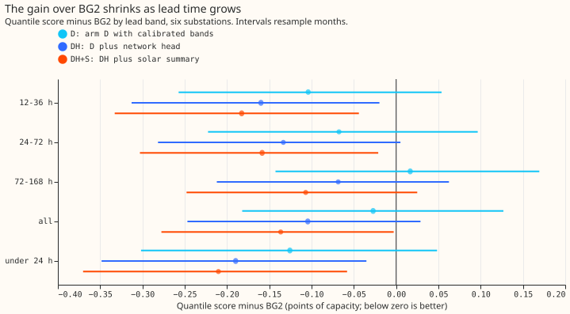

**Take-home.** Over the one year we can score, the full best-guess stack beats BG2 by 0.136
points of substation capacity (5%), and the gain comes from November to March. From April to
October the stack is level with BG2, and arm D without the network head is worse than BG2 in
summer. We could not test other years, because BG2 is stored for 2025-07 to 2026-06 only.

We asked whether the best-guess stack beats BG2 across many months, substations, and seasons. The
stack is [experiment 155](../00155-dp-bg-stage2-assembly-night-offset-and-error-correction/result.md)'s
arm D with the calibrated bands of [experiment 169](../00169-calibration-combined-fixes-and-ensemble-spread/result.md),
the network head of [experiment 201](../00201-dp-gam-residual-mlp/result.md), and the two-number
solar summary assembled in [experiment 220](../00220-dp-bg-stage4-assembly-with-drop-one/result.md).
BG2 is the production-style forecast of [experiment 87](../00087-bg2-best-guess-assembled-with-drop-one-ablations/result.md).
The quantile score is twice the mean pinball loss over 11 quantiles, in points of effective capacity
(lower is better). We re-scored stored forecasts and refitted nothing. The 12 months of the scored
year were all that could be built, so the planned 24 monthly blocks became 12.

## Results

- **Arms.** D is arm D with experiment 169's bands; DH is D with the network head's median
  correction (mean over three seeds); DH+S adds the solar summary (experiment 220's A+H+S). Rows:
  561,207 at six substations (464,233 at the five decision substations), leads 0.5 to 168 hours,
  outside hand-filtered events, 156 rows fewer than experiment 220 because climatology and the
  manual heuristic lack them. Weekly-refit forecasts from experiments 155 and 169; the network
  was trained once on data before 2025-07.
- **Gate passed.** D scores 2.7524 (target 2.7519) and BG2 2.7809 (target 2.780) at the five
  decision substations.
- **Absolute scores (five substations / six).** BG2 2.781 / 2.715; D 2.752 / 2.688; DH 2.653 /
  2.611; DH+S 2.617 / 2.579; manual heuristic 3.497 / 3.397; climatology 3.804 / 3.665.
- **Pooled difference from BG2 (six substations, 95% interval over months).** DH -0.104 (-0.246 to
  +0.029), 7 of 12 months, 4 of 6 substations. D -0.027 (-0.181 to +0.130), 6 of 12 months, 4 of 6.
  DH+S -0.136 (-0.278 to -0.006), 9 of 12 months, 6 of 6. At the five decision substations: DH
  -0.128, D -0.028, DH+S -0.164 (-0.318 to -0.026).
- **Predictions.** Prediction 1 (DH wins at least 9 of 12 months and at least 5 of 6
  substations, and the interval excludes zero) failed: DH won 7 and 4, and its interval includes
  zero. The full stack DH+S met all three clauses (a post hoc reading, because the brief named DH).
  Prediction 2 (D wins at least 6.5 of 12 months and 4 of 6 substations) failed on months (6 of 12)
  and passed on substations. Prediction 3 passed: winter (December to February) differences from BG2
  are D -0.30, DH -0.43, DH+S -0.44; summer (June to August) D +0.14, DH +0.01, DH+S -0.01.
- **Months.** DH+S beats BG2 in all of November to March (-0.20 to -0.62) and is worse in April to
  June 2026 (+0.05 to +0.22). The 24 December to 1 January block is worse than BG2 for D (+0.46) and
  DH (+0.55) with one block, so no interval is meaningful. Easter was not scored separately.
- **Lead bands (DH minus BG2).** Under 24 hours -0.19; 24 to 72 hours -0.13; 72 to 168 hours -0.07.
- **Tails (coverage / pinball; BG2, D, DH, DH+S).** q01 0.010/0.211, 0.022/0.207, 0.017/0.181,
  0.013/0.172; q05 0.041/0.623, 0.066/0.687, 0.057/0.645, 0.049/0.622; q95 0.944/0.751, 0.948/0.723,
  0.947/0.714, 0.951/0.692; q99 0.983/0.253, 0.982/0.222, 0.982/0.220, 0.984/0.211.
- **Curtailment, calibration to history and not a saving** (node-only rule of experiment 169, five
  substations, GBP million over the scored year against the manual heuristic, GBP 2,000 per
  MWh-equivalent, 95% intervals over months). Scaled limit f=0.9: BG2 1.45 (0.19 to 3.23), D 2.06
  (0.23 to 5.06), DH 2.17 (0.21 to 5.43), DH+S 2.14 (0.21 to 5.29). f=0.75: 7.1, 10.6, 11.1, 11.1; f=0.5:
  21.9, 28.6, 29.6, 30.1. Every arm beats the manual heuristic, and the arms' intervals overlap.
- **Earlier 12 months (2024-07 to 2025-06): not built.** Stored ensemble frames start at 2024-04,
  and arm D exists for all 24 months, but the network head, the solar summary, and BG2 are stored
  for the scored year only. A faithful BG2 re-run is a five-member blend with offset twins and 52
  weekly refits, which the manager judged too expensive on CPU. Years before 2024-04 would also
  need the Source Cooperative ensemble backfill, which was not fetched. Sixteen-substation
  coverage would need a pinned PV capacity vintage per site and year, stored ensemble-mean frames
  at each weather cell, and a BG2 run per site.
- **Retraining schedule.** Weekly refits of the XGBoost and convex models as stored; the network
  was trained once. BG2 is production-style (weekly refits, spread factor 1.15).

## Checks

- **Median minus mean forecast.** D and BG2 are equal by construction. The network head shifts
  the median, by -0.75 to +0.83 points per substation (D5 +0.26, D10 +0.83, D11 -0.40, D14 -0.13,
  D16 -0.75, D9 -0.64).
- **Error of the median forecast beside the quantile score.** The mean absolute error of the
  median differs from BG2's by -0.14 (D), -0.26 (DH), and -0.26 (DH+S) points, the same direction as
  the quantile score.
- **Leaving one substation out.** No contrast changes sign: DH minus BG2 stays between -0.076 and
  -0.132 and D minus BG2 between 0.000 and -0.057.
- **Triggers fired.** None of the seven triggers fired, so no audit ran. Trigger 7 does not
  apply: the later final assembly depends on experiment 220's gain and not on this result.

## What to try next

- Re-run BG2 for 2024-07 to 2025-06 (on a GPU) to obtain 24 monthly blocks, then test the stack
  across both years.
- A summer fix: arm D is worse than BG2 from April to October, and the head only removes that
  loss.

The code is in `ml-experiments/00228-dp-bg-rolling-origin-stack-against-bg2/`; the stored
forecasts are in `dp_preds` layout under `data/ml-experiments/00228-*/work/dp_preds/`.
