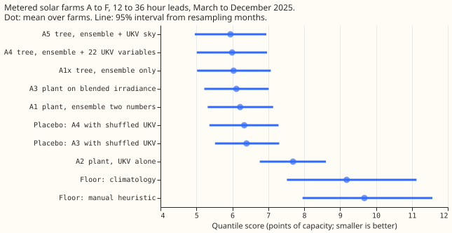
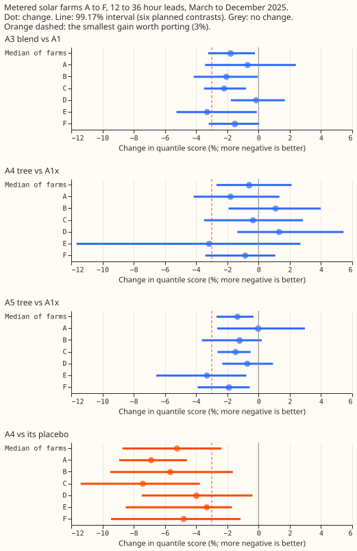
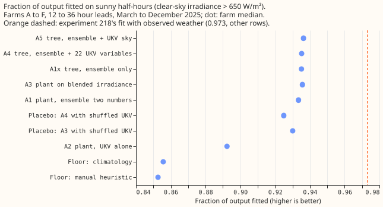

**Adding the Met Office UKV weather forecast to the ECMWF ensemble lowers the day-ahead error of a
metered solar farm by 1% to 2%, which is small.** UKV (the Met Office's UK Variable-resolution
forecast, 2 km grid, 54 hours ahead) is the weaker forecast on its own: it scores 26% worse than
the ensemble, so the fitted blend puts 0.7 to 0.8 of its weight on the ensemble. The error is the
quantile score defined in the Results section. The gain is under the 3% we set before running as
worth a second weather source. It also closes only about 6% of the gap between the fit that uses the
ensemble alone and the fit that uses observed weather, against the quarter we set. The UKV used
here is the research archive on the Centre for Environmental Data Analysis (CEDA), which differs
statistically from the live UKV, so any gain is an upper limit for production.

We asked whether a metered solar farm's output is forecast better from the ECMWF ensemble (the
European Centre for Medium-Range Weather Forecasts' 51-member ensemble) plus UKV than from the
ensemble alone. For each of six farms, A to F, we compared a solar plant model on the ensemble's
mean and standard deviation (arm A1, the day-ahead design of
experiment 224 (the metered-farm day-ahead experiment, not yet merged), with the plant of
[experiment 218](../00218-metered-solar-farm-plant-fit/result.md)), a plant model on a blend of
ensemble and UKV irradiance (A3), and XGBoost second-stage trees with and without UKV variables.
Each weather product was trained on its own history. Shuffling UKV across days of the same month,
hour band, and cloud band makes A3 and the tree 5% worse, so the models do use UKV's information
about the day. The verdict is a small gain.

## Results

- **Arms.** A1 is the plant model fed the mean and standard deviation of the 51 ensemble members'
  plant responses. A1x is XGBoost on ensemble columns only. A2 is the plant model fed UKV alone. A3
  is the plant model on a convex blend of the ensemble and UKV plant forecasts, with weights by UKV
  cloud band (0.7 to 0.8 on the ensemble) and the ensemble's spread. A4 is XGBoost on ensemble
  columns plus 22 UKV variables, and A5 is the same tree with UKV shortwave and cloud variables
  only. The placebos are A3 and A4 with UKV taken from a random row of the same month, hour band,
  and cloud band.
- **Rows.** The rows are daylight half-hours (sun more than 5 degrees above the horizon) of the six
  farms with a complete UKV run: 34,147 rows at 12 to 36 hours and 20,091 at 36 to 54 hours. The
  score is twice the mean pinball loss over 11 quantile levels, in points of capacity. Two folds are
  scored in the second UKV era: 2025-03 to 2025-08 (the replicate) and 2025-09 to 2025-12 (the
  scored fold). Each fold is tuned on every ensemble month before it, from 2024-04.
- **The quantile score at 12 to 36 hours** (mean over farms, 95% interval) is 5.95 (4.96 to 6.95)
  for A5, 6.00 (5.01 to 6.97) for A4, 6.03 (5.02 to 7.07) for A1x, 6.11 (5.22 to 7.01) for A3, and
  6.22 (5.32 to 7.14) for A1. The placebos score 6.33 (A4) and 6.40 (A3), A2 scores 7.69 (6.77 to
  8.60), climatology 9.19, and the manual heuristic 9.68.
- **The planned contrasts** are the median over six farms of the percentage change, with 99.17%
  intervals (the Bonferroni level for six contrasts). C1a, A3 against A1, is -1.8% (-3.2 to -0.2).
  C1b, A4 against A1x, is -0.6% (-2.7 to +2.1). C1c, A5 against A1x, is -1.3% (-2.7 to -0.3). C2, A5
  against A4, is -1.1% (-2.9 to +0.3). C3, A3 against its placebo, is -5.2% (-7.6 to -2.3), and C4,
  A4 against its placebo, is -5.2% (-8.7 to -2.4). The best blend by the registered rule is A3. The
  stop rule did not fire, because C1a's interval includes zero at 3 of 6 farms (A, D, and F) and the
  rule needs 4. The registered rule's verdict word for an interval that excludes zero but misses the
  3% threshold is "partly supported"; the `ml-experiment` skill's word for the same case is "small
  gain", which this page uses.
- **At 36 to 54 hours** the point estimates are similar, but C1a's interval includes zero: C1a is
  -2.7% (-4.8 to +0.1) and C1c is -1.6% (-2.5 to -0.3). A3 against its placebo is -5.1% (-7.0 to
  -3.2).
- **On sunny half-hours the plant fit rises by 0.003.** The fraction of output fitted (clear-sky
  irradiance above 650 W/m², median over farms, mean forecast against metered output) is 0.933 for
  A1, 0.936 for A3 and A5, and 0.892 for A2. The registered baseline was experiment 218's 0.91 for
  the ensemble-driven fit, which was measured on other rows. A1 reaches 0.933 on these rows, so the
  gap to 0.973 (the fit with observed weather in experiment 218) is 0.040 here, not 0.063, and A3
  closes 6% of it and A5 7%. The prediction needed a quarter.
- **The tails are not calibrated at the lowest and highest levels for any arm.** Pooled over farms
  at 12 to 36 hours, the coverage at q01 is 0.039 for A1, 0.039 for A3, and 0.044 for A5, against
  0.01 nominal. At q99 it is 0.991 for A1, 0.992 for A3, and 0.987 for A5. The trees' q05 coverage
  is 0.101 (A5) and 0.113 (A4) against 0.05, and their q95 coverage is 0.925 (A5) and 0.920 (A4)
  against 0.95. Pinball at q01 and q99 is 0.410 and 0.405 for A1, 0.414 and 0.398 for A3, and 0.387
  and 0.499 for A5. A3's tails match A1's, and the trees trade a better q01 for a worse q99. A3
  beats the manual heuristic's quantile score by 38% (X3) and A4 by 41% (X4); A5 against the
  heuristic was not a planned contrast, and the curtailment value is not scored.
- **The checks show no spread shifting the forecast.** The median forecast minus the mean forecast
  per farm is between -0.9 and +0.7 points of capacity for every arm (median over farms +0.13 for A3
  and +0.26 for A1). The mean forecast's absolute error points the same way as the quantile score
  (A3 10.77 against A1 11.05, and A5 10.60 against A1x 10.76). C1a's point value is negative at all
  six farms; no leave-one-farm-out refit of the contrast was run.
- **Two audit triggers fired weakly, and no audit was run.** Trigger 5 (a nested arm beats the arm
  that contains it) fired because A5, with fewer UKV variables, scores better than A4. C2's interval
  includes zero, A4 and A5 score the same on the replicate fold (6.32 and 6.32), and they are 0.11
  apart on the scored fold, so the difference is within noise. Trigger 2 (a result contradicts its
  prediction) fires only in the sense that the gain, 1.8%, is under the 3% predicted; the registered
  stop rule did not fire. A follow-on experiment with the ICON-D2 weather model reads this result,
  which is trigger 7. The maintainer or the manager can decide whether an audit is wanted before
  this page merges.
- **The data gate passed.** UKV instants are complete in 99% to 100% of hours from 2025-03 to
  2026-05 (82% in 2026-06 and 92% in 2026-07). The UKV shortwave peak hour matches the clear-sky
  peak at four farms and is one hour earlier at two, within the hourly resolution of UKV. At the
  freshest-run leads 0 to 5 hours, the plant fed UKV shortwave has a mean absolute error of 10.3 to
  12.2 points of capacity, against 16.5 to 18.5 for the cloudless sky, so the stop rule's
  data-problem check passes. The monthly ratio of UKV to clear-sky shortwave could only use April to
  September (the sunny rows), so it cannot see the boundary around the 2026-01-21 live-UKV upgrade;
  no fit or score crosses that boundary. The gate ran after the arms were scored.
- **The scope is narrow.** The scored months are 10, of which 4 are autumn and winter. The UKV era
  from 2026-02 is not scored, because it holds no training months of its own. The publication delays
  are assumptions: 8 hours for the ensemble and 4 hours for UKV after the run's 00 UTC start, and
  the UKV run used is the 00 UTC run of the ensemble run's date. Leads of 0.5 to 12 hours appear
  only in the data gate, because a forecast made from a 00 UTC run at 08 UTC has no such leads.
- **Three choices depart from the experiment's brief.** The trees predict output divided by
  clear-sky irradiance over 1,000 (a stand-in for the plant's clear-sky output). The night placebo
  was not built, because the tables hold only daylight rows, and the shuffled-UKV controls replace
  it. Blend weights come from two sources in three UKV cloud bands, fitted on the other farms, as in
  the convex weights of `studies.blending`. The weather is read at each farm's nearest 2 km UKV
  cell, and the schedule is one refit per fold; a gain of 1% to 2% could depend on that schedule,
  and this experiment did not test whether it does.
- **What to try next.** A weather product of a different kind, such as the ICON-D2 regional weather
  model, for the same farms; irradiance and cloud variables only if UKV is kept; and a small learned
  irradiance-response component fed by both products, with A3 as the comparison arm.

## Data-processing note

Experiment 268 found crossing quantiles in 26,344 of its 77,897 generator-forecast rows (34%), but
all of them belong to three generators that are not solar farms, so none is on this page.
[Experiment 273](../00273-metered-farm-sorted-quantile-rescore/result.md) counted 0 crossing rows in
every arm here, because the fit scripts sorted the 11 quantiles before writing them, so sorting does
not change the scores on this page.
