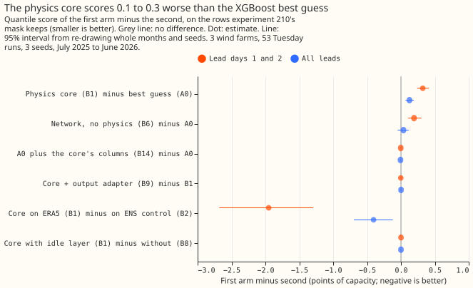
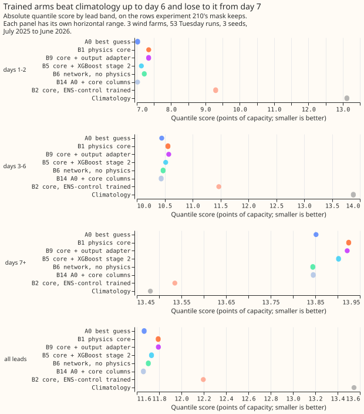
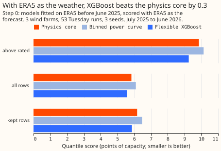

**Take-home: the physics model is slightly worse than XGBoost, and the weather input is the limit.**
A physics model of a wind farm scored 0.13 points of capacity worse than the XGBoost best guess on
the three metered wind farms, so we should not port it. The score is far better when ERA5 supplies
the wind, which shows that the 25 km ensemble wind, not the turbine model, causes most of the error.

## Results

Scores are the quantile score in points of capacity (smaller is better), on the rows that experiment
210's mask keeps, over all lead times, for W1, W2, and W3 across 53 Tuesday runs from July 2025 to
June 2026. The intervals resample whole months and the three seeds, and do not resample farms, so they
describe these three farms only.

- **C1, the decisive contrast: the core minus the best guess is +0.126 (95% interval 0.068 to 0.190).**
  At lead days 1 and 2 it is +0.322 (0.241 to 0.413). The core is worse, so the porting threshold (an
  interval wholly below zero) is not met.
- **C4: the idle layer is worth nothing (B1 minus B8 is 0.000, interval -0.002 to 0.002).**
  The residual-quantile layer already carries the reactive-power floor.
- **C2: the neural output adapter (B9) adds nothing (+0.002, -0.004 to 0.007).**
- **C3: training the core on ERA5 beats training it on the ENS control member by 0.40
  (interval 0.12 to 0.69).** At lead days 1 and 2 the gap is 1.95 points. Most of it comes from W2.
- **XGBoost on the core's output (B5) closes about half the gap (B5 minus B1 is -0.060, -0.120 to -0.004),
  and still trails the best guess.**
- **The pure neural network (B6) is no better than the best guess (+0.037, -0.047 to 0.115).**
- **The best guess with the core's columns added (B14) equals the best guess (-0.007, -0.014 to 0.000).**
- **ERA5 as the forecast (E0) scores 6.71 against 11.79 for B1.** The 25 km wind, not the power
  curve, causes most of the error.

| Arm | Description | Kept rows, all leads | Kept rows, lead days 1 and 2 | All rows, all leads |
|---|---|---|---|---|
| A0r | Best guess, refitted here | 11.66 | 7.03 | 11.04 |
| B14 | Best guess plus the core's columns | 11.66 | 7.02 | 11.03 |
| B6 | Neural network, no physics | 11.70 | 7.22 | 11.08 |
| B5 | Core plus XGBoost stage 2 | 11.73 | 7.13 | 11.09 |
| B1 | Physics core, ERA5-trained | 11.79 | 7.35 | 11.14 |
| B9 | Core plus neural output adapter | 11.79 | 7.34 | 11.14 |
| B8 | Core without the idle layer | 11.79 | 7.35 | 11.14 |
| B2 | Core, ENS-control-trained | 12.20 | 9.30 | 11.68 |
| A1 | Best guess, ENS-control-trained | 12.17 | 9.24 | 11.67 |
| CLIM | Climatology | 13.55 | 13.12 | 13.12 |
| E0 | ERA5 as the forecast (reference) | 6.71 | 6.36 | 6.32 |

**Beyond day 7, climatology (13.48 on the kept rows) beats every trained arm (13.84 to 13.93).** The
tails behave alike across arms: on the kept rows the 0.01 pinball loss is 0.285 to 0.288 and the 0.99
loss is 0.658 to 0.676 for A0r, B1, B5, B6, and B14, and the 5% to 95% band covers 91.4% to 91.7% of
rows. Persistence on hours 0 to 6 scores 15.57, worse than every other arm.

## Step 0: the ERA5 ceiling

- **With ERA5 as the weather, a flexible XGBoost model (X) beats the physics core (P) by 0.27 points
  and the binned power curve (S) by 0.54 (interval 0.43 to 0.64) on all rows.** The gate asked whether
  S was within 0.02 of the ceiling. It was not, so the other arms ran.
- **The core explains 0.84, 0.76, and 0.72 of the power's variance (R squared) at W1, W2, and W3.**
  X explains 0.85, 0.77, and 0.75.
- **Stop rule 3 fired literally at W2.** The 5% to 95% band of B1 covered 59% of W2's idle rows
  (threshold 80%). W2 is in MW, observed idle power can be negative, and the clip at zero is shared by
  every arm, so the arms stay comparable.

## Comparison with experiment 221

[Experiment 221](../00221-wind-correction-head-on-stored-predictions/result.md) put a neural head on
the stored best guess, and found no reliable gain. On the same kept rows at lead days 1 and 2, its A0
scored 7.223 and its head 7.403. Here the best guess scores 7.02 to 7.03 on the same rows, B6 (a neural
network with no physics) 7.22, and the core 7.35. Neural components and a physics core thus land in
the same place: neither beats XGBoost on these three farms.

## Checks

- **Median minus mean:** the median of the forecast sits 5.2 points below the mean on the kept rows
  for A0r and 5.3 for B1, so all arms share the same skew and the mean-error contrasts agree in
  direction with the quantile-score contrasts.
- **A0r reproduces A0** on the nine shared levels (11.035 against 11.037, all rows).
- **Leave-one-farm-out:** C1 stays positive without any single farm (0.11 to 0.14), and C3 stays
  negative.
- **Row sets:** on the rows above the farm's fitted rated speed, C1 is +0.43 (0.30 to 0.57). On all
  rows it is +0.10.
- **Audit triggers 1 and 4 fired** (and trigger 7 may have). The manager decides whether an Opus audit
  is worth the quota.

## Departures from the plan

- **ENS control member instead of the ENS mean** for A1 and B2.
- **Temperature-only density correction:** ERA5 surface pressure is not on disk, so the core uses a
  fixed 100 kPa.
- **The idle layer shapes the mean, and the noise comes from the residual quantiles.**
- **The fitted hub heights (32 to 37 m) are not physical.** They absorb the 25 km cell's sub-grid wind.
- **The physics arms are deterministic**, so their three seeds repeat one fit.
- **E0 and A0rT (A0r with temperature) are post hoc.**
- **Not run:** B10 to B13, the no-history tests, and the curtailment-cost metric.
- **The wind-farm identities and series are anonymised;** the mask stays private.

## What the next experiment should answer

Does a better weather input, such as a blend of weather models or a downscaled wind, close any of the
6-point gap between the ensemble wind and ERA5 wind?
