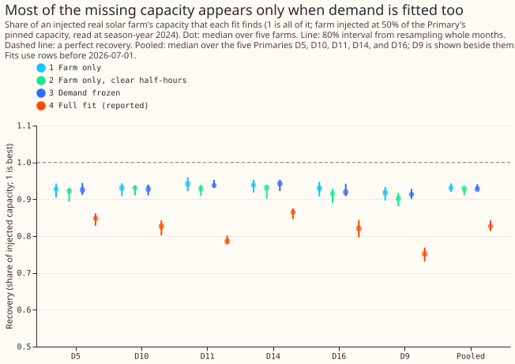
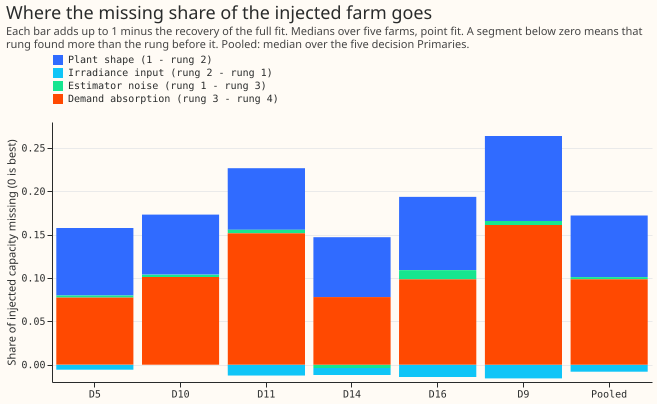
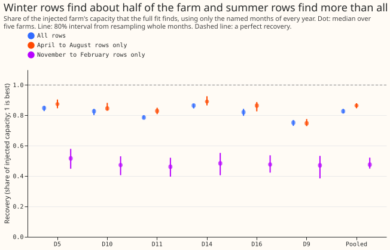
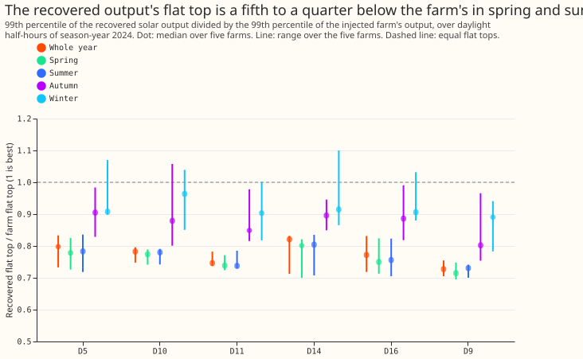

# Photovoltaic (PV) capacity audit: where does the recovery shortfall go?

**Take-home message: the capacity estimator misses about 0.17 of an injected solar farm for two
reasons. The demand terms of the fit take part of the solar signal, and the fixed solar shape does
not match the farm's flat top. The sunshine input is not the limit.**

**What was done.** We added the recorded output of a real solar farm to a Primary substation's
power, at 50% of the Primary's pinned capacity (the unmetered solar capacity that experiment 45's
real-time estimate gives the Primary). Then we asked the capacity fit of experiment 129 how much of
the farm it finds again. The share found is the recovery: the capacity found with the farm added,
minus the capacity found without it, divided by the injected capacity. The full fit finds 0.827
(median over the five decision Primaries, 80% interval 0.814 to 0.842). Five further fits, each
simpler or narrower, show where the missing 0.173 goes. Fitting the farm alone against the fixed
solar shape finds 0.931, the highest recovery any fit of that shape can reach. Fitting the full
model with its demand terms frozen finds 0.928. The verdict is `partly supported`: demand absorption
took the share the plan predicted, and the other three predicted shares were wrong.

**Terms used below.** D5, D10, D11, D14, and D16 are the five decision Primaries of experiment
103's data set, and D9 is shown beside them. Farms A to F are metered generators and are never
named. A season-year runs from July to June and is labelled by the year of the July; the recovery
is read at season-year 2024. The capacity unit is the 99th percentile of alternating-current output
over daylight half-hours, in MW. The shortfall is 1 minus the recovery of the full fit. A rung is
one fit of the ladder (rungs 1 to 4, and the season refits that are rung 5; rung 6 is the flat-top
check). Demand absorption is the full fit attributing part of the solar signal to its demand terms
(the daily profile, heating, lighting, and annual harmonics). The flat top is the 99th percentile of
the solar output. CAMS is the Copernicus Atmosphere Monitoring Service's satellite irradiance. The
intervals resample whole months of training rows.

**Figure 1. Fitting the farm alone finds 0.93 of it; adding the demand terms drops that to 0.83.**

**Figure 2. Demand absorption and the plant shape account for the whole shortfall.**

**Figure 3. Winter rows find about half of the farm, and April-to-August rows find more than all
rows.**

**Figure 4. The recovered output's flat top is a fifth to a quarter below the farm's in spring and
summer.**

## Findings

- **Demand absorption is the largest share, and the irradiance input is none of it.** The
  pre-registered prediction scored as follows (pooled median over the five decision Primaries).
  Demand absorption was 57.7% of the shortfall (80% interval 54.1% to 62.7%), predicted at least
  40%, met at all five Primaries. The irradiance input was -5.8% (-11.8% to -2.4%), predicted at
  least 25%, met at none. The season share (April-to-August rows only, against all rows) was 19.3%
  (13.1% to 28.2%), predicted under 15%, met at one Primary. The divisor share was 27.3%, predicted
  under 15%, met at none.
- **The rungs, pooled, with 80% intervals:** farm only 0.931 (0.920 to 0.943); farm only on clear
  half-hours 0.929 (0.910 to 0.930); demand frozen 0.928 (0.924 to 0.941); full fit 0.827 (0.814 to
  0.842); full fit on April to August rows 0.864 (0.847 to 0.880); full fit on November to February
  rows 0.475 (0.450 to 0.522).
- **The plant shape and flat top are 47.1% (43.0% to 53.5%) of the shortfall.** The fleet shape
  with one fitted scale reaches 0.929 on clear half-hours, so the fleet shape cannot reproduce about
  0.07 of the farm's capacity.
- **Demand absorption costs 0.098 (0.089 to 0.110) of the injected capacity.** The estimator noise
  with the demand terms frozen is 0.003 (-0.007 to 0.004).
- **Clear half-hours at the Primary's CAMS point fit the farm no better than all daylight
  half-hours (0.929 and 0.931).** Experiment 218 reported 0.973 and 0.953 for the same comparison.
  Those figures are the fraction of squared output explained, which measures scatter. This page
  measures the fitted scale, and scatter does not lower the scale.
- **April-to-August rows alone raise the recovery from 0.827 to 0.864 at all five decision
  Primaries, and D9 is unchanged.** November-to-February rows alone find 0.475 (0.450 to 0.522).
- **Reading the capacity at the 99th percentile makes the shortfall larger, not smaller.** The
  whole-year ratio of the recovered output's 99th percentile to the farm's is 0.75 to 0.82 over the
  five decision Primaries (range over farms 0.71 to 0.83). That is 0.039 to 0.050 below the
  recovery of the full fit. The ratio is 0.74 to 0.80 in spring and summer and 0.90 to 0.96 in
  winter.
- **A heat derating that is too strong is one possible cause of the flat-top gap, and this
  experiment did not test it.** The fitted shape derates for heat loss, and experiments 183 and 218
  found no heat or clip term that explains the farms' flat top. A derating that is too strong would
  make the flat top fall more in the fit than in the farm from spring to summer.
- **The injected fit reproduces experiment 129 exactly.** The injected-fit capacity equals
  experiment 129's matched-farm capacity at every Primary and farm (the printed relative difference
  is 0.000, and the check tolerance is 1e-6). With experiment 129's base (fitted on all rows) the
  recovery matches exactly. With this experiment's base (fitted on the rows where the farm has a
  reading) the recovery differs by 0.007 to 0.019.

## Checks

- **Data cut:** the fits stop at 2026-07-01, so the maintainer's labelled exception (data to
  2026-07-31) is not used. No forecast is scored.
- **Median forecast minus mean forecast, and the mean-forecast error:** not applicable, because the
  experiment scores no forecast.
- **Audit triggers** (the seven triggers in the `ml-experiment` skill's "Audit before merge"):
    - **Fired: the result contradicts three of four pre-registered shares and seems to contradict
      experiment 218's 0.973.** The explanation was tested by reading experiment 218's definition of
      "fraction of output fitted" (above).
    - **Fired: the designs of later experiments depend on this result and it has not been
      replicated.** Whether a second, Opus review runs is for the maintainer to decide, so the pull
      request stays open until that is settled.
    - **Did not fire:** a failed control (none ran), a mean-forecast contrast that disagrees (no
      forecast), a leave-one-site-out sign flip, a nested arm beating its container (the summer-only
      fit is the measured contrast), and a headline interval more than twice or under half a sister
      experiment's width.
- **Review:** one Sonnet code review found no finding that changes a result, and one Sonnet review
  of the page checked every number against the printed report.

## What the next experiment should answer

- **Matched sunny-minus-cloudy day pairs target demand absorption,** the largest cause that can be
  fixed. Experiment 235 plans this.
- **A shared seasonal efficiency curve targets the flat-top gap and the season share,** and should
  run after the day-pair test.
- **The clear-sky fit and the nearest-metered-farm sunshine reference both target the irradiance
  input, which explains none of the shortfall here (-6%),** so their predicted gains are unlikely
  to hold. Experiment 236 plans the clear-sky fit.
- **Neural components:** a learned smooth response of the solar term to temperature and irradiance
  could replace the fixed heat derating if the seasonal curve helps. The prediction that could fail
  is a flat-top ratio of 0.9 or more in every season.

## Plan: the ladder of fits

Every rung reports the recovery at season-year 2024, as a median over the five farms, with a
month-block 80% interval (a stratified bootstrap of the training months, 200 resamples, the same
draws for every farm at a Primary). The brief's "injection start months" is read as the training
months, because the injection covers the whole history.

- **Rung 1, farm only:** the least-squares scale of the farm's output on the temperature-derated
  fleet unit shape (CAMS irradiance), over all daylight half-hours of season-year 2024. No demand.
- **Rung 2, farm only on clear half-hours:** the same scale over the half-hours where the Primary's
  CAMS global irradiance is at least 0.9 of its clear-sky value and the clear-sky value is at
  least 200 W/m².
- **Rung 3, demand frozen:** the base fit (no injection) is solved first. Then the injected series
  is fitted with every column except the capacity increments held at the base fit's values.
- **Rung 4, full joint fit:** experiment 129's arm 2 (convex, ridge 0.1) fitted to the base and the
  injected series; the recovery we report.
- **Rung 5, season rows:** rung 4 refitted on April to August rows only, and on November to
  February rows only, read at the same season-year.
- **Rung 6, divisor check:** the 99th percentile of the recovered solar output (rung 4 capacity
  difference times the derated shape) over daylight half-hours, divided by the farm's own 99th
  percentile over the same half-hours, for the whole season-year and for each season (spring March
  to May, summer June to August, autumn September to November, winter December to February).
  Point values per farm; the interval is the range over farms.

The shares of the shortfall `1 - R4` are: plant shape `1 - R2`, irradiance input `R2 - R1`,
estimator noise with frozen demand `R1 - R3`, demand absorption `R3 - R4`. They sum to the
shortfall. The season share is `R5_summer - R4` and the divisor share is `|R4_p99 - R4|`, where
`R4_p99` is the whole-season-year 99th-percentile ratio of rung 6; both are alternatives to the
ladder and not terms of the sum.

## Plan: checks

- **Read-out year (changed before the real run):** the first draft of this plan read the recovery at
  season-year 2025. A one-farm pilot at D10 (10 resamples, not a result) then showed that
  experiment 129's known-answer table stops at season-year 2024, so the plan reads season-year 2024
  to make rung 4 comparable with it. The pilot's numbers played no part in the choice.

- **Reproduction:** the injected fit's capacity must equal experiment 129's `kat_arm2` matched-farm
  capacity (50% injection, no cloud load, season-year 2024) to within 1e-6 relative at every Primary
  and farm. Experiment 129 subtracts one base capacity fitted on all rows from every injected fit,
  whereas this experiment fits the base on the rows where the farm has a reading, so that the two
  fits of a recovery share one row set. The page reports rung 4 with both bases, and the two
  recoveries must agree to within 0.02.
- **Wiring:** the monthly Gram matrices must sum to the Gram matrix of `accumulate_gram` to within
  1e-8 relative, and the rung-4 base capacity must equal `fit_gam`'s.
