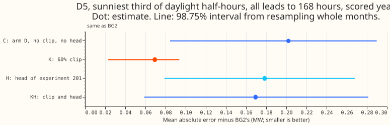
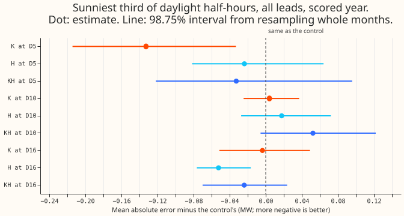
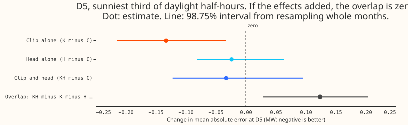

**The correction heads of experiment 201 do not clearly fix D5's sunny-daylight loss, and added to
the 60% clip they partly undo the clip's gain at D5, though the estimate is imprecise.** The result
supports using the clip alone. D5 is an
anonymised Primary substation, which feeds homes and businesses. Arm D is the demand forecast of the
best convex generalised additive demand model with its Kalman filter, winter night offset, and error
recipe. BG2 is the best-guess forecast that serves as the benchmark. A correction head is a small
neural network that adds a shift to the demand forecast, using the forecast's own inputs.

[Experiment 178](../00178-dp-sunny-daylight-gap-diagnosis/result.md) found that arm D has a higher
mean absolute error than BG2 on the sunniest third of daylight half-hours, mostly at D5. The "gap"
is arm D's mean absolute error minus BG2's, and it is +0.202 MW at D5. [Experiment 180](../00180-dp-
sunny-daylight-fix-d5-solar-shape/result.md) closed most of that gap by capping the solar output
that the forecast subtracts at 60% of the solar capacity held for D5 ("the clip"). We asked whether
the stored heads of [experiment 201](../00201-dp-gam-residual-mlp/result.md) close the same gap, and
whether a head adds to the clip. We fitted no demand model and no head. We added each head's stored
median shift and quantile offsets to arm D and to arm D with the clip, and scored the same half-
hours as experiment 178 (each row is one half-hour of one substation's forecast).

The head alone closed 12% of the gap (+0.202 MW to +0.178 MW). The head on top of the clip left a
gap of +0.169 MW. The clip alone leaves +0.069 MW.

**Verdict `not supported`.** Four criteria were set. The first holds: the head alone closed 12%
of the gap, under the predicted 30%. The second fails: the head with the clip left D5 at +0.169 MW,
not +0.05 MW or less. The third fails: the clip and head effects overlap by +0.124 MW, not to
within 0.02 MW. The fourth fails: head arm 2 moves the placebo D16 by -0.052 MW and the clip and head
move the placebo D10 by +0.052 MW, against a limit of 0.02 MW.

## Results

- **Arms:** C is arm D (the control), K is arm D with the 60% clip, H is arm D plus a head, and KH
  is the clip plus a head. Heads are arms 1, 2, and 3 of experiment 201 (19, 28, and 32 input
  columns), with three seeds averaged, and the planned head is arm 2. Experiment 200's head stored
  only monthly scores, so it is not rescored.
- **Rows:** experiment 178's rows at D5, D10, and D16 in the scored year (2025-07-02 to 2026-06-29),
  leads to 168 hours, outside the load shifts. D5 has 14,045 sunny half-hours.
- **Construction:** arm H is arm D's median plus the head's median shift, with the head's own
  quantile offsets from its median. This reproduces the stored head forecast. Arm KH puts the same
  shift and offsets on the clip's median. The head was not trained on the clip's forecast.
- **Absolute scores, D5 sunny:** the mean absolute error (MW) is 0.655 for C, 0.523 for K, 0.632 for
  H (arm 2), 0.623 for KH, and 0.453 for BG2. The pinball loss (MW) is, in the same order, 0.185,
  0.154, 0.178, 0.173, and 0.130.
- **Head alone, against arm D (98.75% interval):** arm 1 -0.017 MW (-0.096 to +0.112), arm 2 -0.024
  (-0.082 to +0.064), arm 3 -0.002 (-0.059 to +0.099). The gap to BG2 falls from +0.202 to +0.185,
  +0.178, and +0.200 MW. Arm 2 closes 12% of the gap.
- **Clip and head against the clip alone (D5 sunny):** arm 1 +0.138 MW (+0.033 to +0.260), arm 2
  +0.100 (-0.007 to +0.211), arm 3 +0.121 (+0.013 to +0.231). The gap to BG2 is +0.207, +0.169, and
  +0.190 MW. The clip alone has +0.069 MW.
- **Overlap (clip and head minus clip minus head plus control):** arm 2 +0.124 MW (+0.029 to
+0.204),
  arm 1 +0.155, arm 3 +0.123. The clip and the head together do not have the sum of their separate
  effects. We have not tested why. The clip arm is a separate fit, so K minus C also includes refit
  differences.
- **Placebos, sunny, change against arm D (MW):** the clip moves D10 by +0.004 (-0.025 to +0.037)
and
  D16 by -0.004 (-0.051 to +0.049). Arm H (arm 2) moves D10 by +0.018 (-0.027 to +0.072) and D16 by
  -0.052 (-0.076 to -0.017). Arm KH (arm 2) moves D10 by +0.052 (-0.006 to +0.122) and D16 by
  -0.024 (-0.070 to +0.024). Only D16's change with the head alone has an interval excluding zero,
  so the head's shift on sunny rows is not specific to D5.
- **All half-hours at D5:** the head alone changes the error by -0.008 MW (-0.022 to +0.004), the
clip
  and head by -0.003 (-0.019 to +0.013).
- **Shifts on D5's sunny rows:** the clip raises the median forecast by 0.031 MW on average and the
  head by 0.139 MW. The clip's shift and the head's shift have a correlation of 0.43 across
  half-hours.
- **Tails at D5, sunny.** Coverage is the share of actuals at or below the quantile. Each cell is
  coverage and pinball loss (MW).

  | Quantile | C | K | H | KH |
  |---|---|---|---|---|
  | q01 | 0.051, 0.025 | 0.056, 0.023 | 0.065, 0.026 | 0.060, 0.024 |
  | q05 | 0.168, 0.097 | 0.176, 0.085 | 0.201, 0.094 | 0.198, 0.086 |
  | q95 | 0.967, 0.081 | 0.996, 0.076 | 0.982, 0.075 | 0.992, 0.075 |
  | q99 | 0.993, 0.022 | 0.999, 0.021 | 0.995, 0.020 | 0.998, 0.020 |

  The lower tail stays under-covered in every arm, and the head raises q01 coverage from 0.051 to
  0.065 and q05 coverage from 0.168 to 0.201 (nominal 0.01 and 0.05).
- **Clip form for the assembly:** the hard 60% clip at D5, in the form [experiment
  214](../00214-dp-pv-clip-ceiling-as-of-and-screen/result.md) selected as-of, with no correction
head.

## Checks

- **Median minus mean forecast:** arm D's stored mean equals its median (experiment 180). The heads
  stored no mean, so the head arms have no mean forecast to compare.
- **Mean-forecast error beside the quantile score:** the head arms store only quantiles. Mean
  absolute error and pinball loss point the same way for every contrast above.
- **Triggers fired:** the second trigger of the `ml-experiment` skill's audit list (a result
  contradicts its own prediction). The clip and head leave D5 far above the predicted +0.05 MW. The
  partial explanation we tested is the overlap row: the clip's shift and the head's shift both raise
  the forecast on the sunny rows (correlation 0.43), and the head's shift is larger. We did not
  test why a head trained on unclipped forecasts hurts after the clip. No audit has run.

## Caveats

- **The head is a three-seed average and was trained once.** Experiment 201 trained it on arm D's
  errors, with 4,320 training rows (0.8%) whose valid times fall inside the scored year, and did not
  refit it through the year. Arm H averages the seeds, so it matches a stored forecast per seed only.
- **The head helps D16.** Head arm 2 lowers D16's sunny error by 0.052 MW (-0.076 to -0.017). The
  finding is about D5 and the clip, and does not rule out a head elsewhere.
- **The head was trained on the unclipped forecast.** Experiment 201 trained it on arm D's errors,
so
  applying its shift to the clip's forecast is a stacking test, not a head trained for the clip.
- **One substation and one year.** The intervals come from 12 monthly blocks and are wide. The
  head-alone gain at D5 is not distinguishable from zero.
- **The prediction is not independent of the scores.** The plan was committed after the rescore ran.
  The prediction and decision rule are the ones written in the maintainer's brief before the
rescore.

## What to try next

- Retrain the head on the clipped arm D's errors, so the head and the clip share one set of
  residuals.
- The next experiment in this series tests a cap learned from the metered series, which tests the
  clip's form and does not involve the head.
