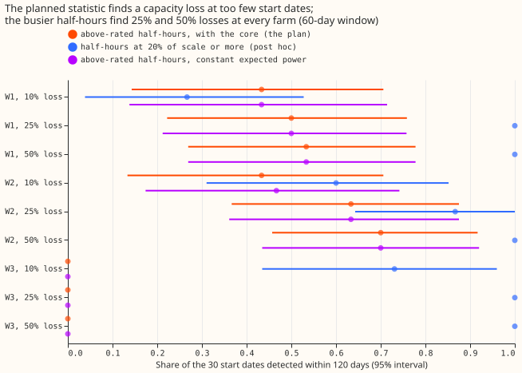
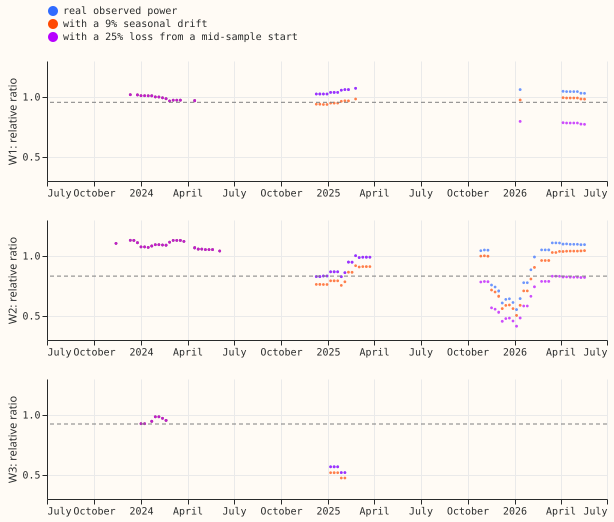
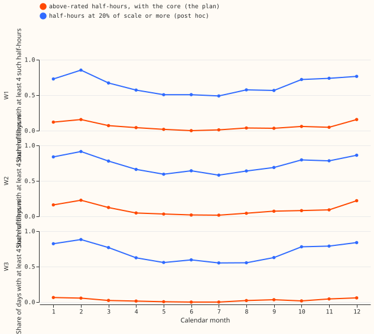
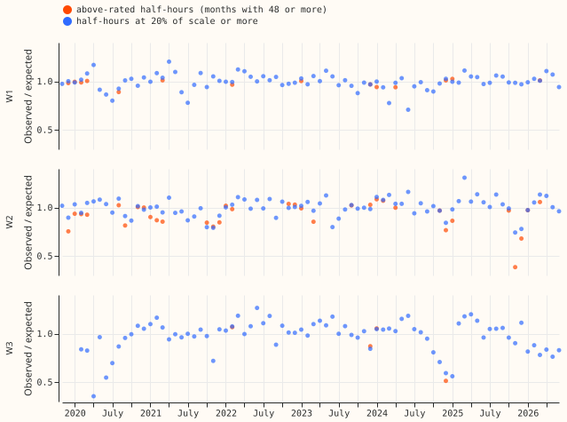
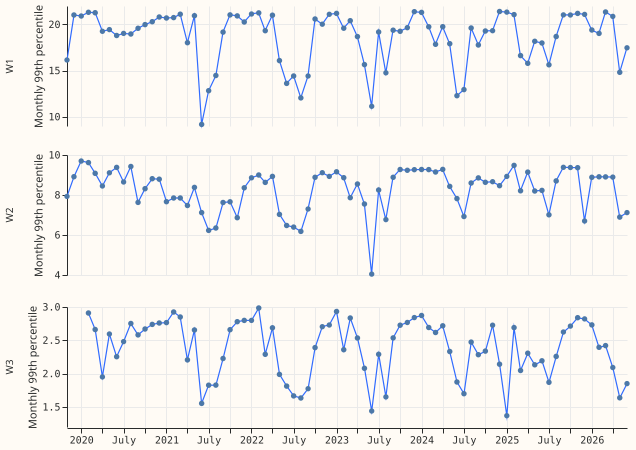

**A monitor that compares observed power with the physics model only in strong wind cannot show a
25% loss of capacity in time, because strong-wind half-hours are too rare.** The verdict is **not
supported**, and the pre-registered stop rule fires. Using every half-hour at 20% of rated power or
more (a post hoc variant) finds a 25% loss quickly, but a smooth 9% seasonal drift then raises
false alarms.

## Question and answer

We asked whether the physics model of [experiment 230](../00230-wind-physics-core-part-1/result.md)
can show that a wind farm has lost effective capacity. We injected losses of 10%, 25%, and 50% into
the observed power of three wind farms (W1, W2, W3) from 30 random start dates, and measured how many
days passed before the ratio of observed to expected power, over a trailing 60 days of strong-wind
half-hours, fell below an alarm threshold set on earlier years. A 25% loss was found within 120 days
at 50% of start dates at W1, 63% at W2, and 0% at W3. The post hoc variant that uses every half-hour
at 20% of the fitted scale or more found it at 100%, 87%, and 100%. The result narrows a capacity
monitor to the busier part of the power curve with a seasonal baseline.

## Results

- **Row set:** half-hours with the core expecting at least 95% of its fitted scale are 2% of
  half-hours at W1, 4% at W2, and 0.6% at W3 over 2019-09 to 2026-06. The plan predicted 3% to 14%,
  because experiment 230's rated-speed rule used the 100 m wind speed and this experiment uses the
  core's expected power.
- **Days with a statistic (60-day window, planned rows):** 21% (W1), 45% (W2), and 5% (W3). With the
  post hoc rows (20% of scale or more), 97%, 97%, and 93%.
- **Thresholds (60-day, planned rows):** relative ratio below 0.956 (W1), 0.832 (W2), and 0.926
  (W3). The W1 threshold sits only 4% below 1, so any slow drift of 4% or more alarms there.
- **25% loss, planned rows:** median delay 121.5 days (W1, bootstrap 95% interval 79 to not
  reached), 105.5 days (W2, 77.5 to 162), and no detection (W3). Shares detected within 120 days:
  0.50 (0.22 to 0.76), 0.63 (0.37 to 0.88), and 0.00. The interval is over 18 calendar months of
  start dates.
- **25% loss, post hoc rows:** median delay 27 days (W1, 24.5 to 36), 51.5 days (W2, 42 to 75), and
  34 days (W3, 27 to 43); shares within 120 days 1.00, 0.87 (0.64 to 1.00), and 1.00. A 50% loss is
  found in 12.5, 27, and 15 days. A 10% loss is found within 120 days at 0.27 (W1), 0.60 (W2), and
  0.73 (W3).
- **Constant expected power (planned rows):** the shares and median delays equal the core's at
  every farm, so the fitted power curve adds nothing on the flat top.
- **9% seasonal drift, new alarm days over two years:** planned rows 50 (W1), 42 (W2), and none at
  W3 (no statistic exists); post hoc rows 10, 28, and 62. Drifts of 15% and 25% raise 152 and 340
  new alarm days at W1 with the post hoc rows.
- **Real series, alarm days after 2024-07-01 with no injection:** planned rows 0, 102, and 36
  (W1, W2, W3); post hoc rows 13, 32, and 202. Monthly observed over expected power (post hoc rows)
  ranges from 0.71 to 1.20 (W1), 0.74 to 1.31 (W2), and 0.35 to 1.27 (W3). On planned rows W2's monthly ratio
  falls to 0.39 in one month of winter 2025 to 2026, and W3's falls to 0.51 in one month of 2024 to
  2025; on post hoc rows W3 stays near 0.8 through 2026.
  No cause is claimed. W1's monthly 99th percentile is mostly 18 to 21 MVA and falls to 9 to 15 MVA in some summer
  months, so it follows the wind and shows no step.
- **Starts before and after 2025-06-17** (the end of the core's fitting data) are in `detect.json`;
  the post hoc rows detect a 25% loss at all starts in both halves at W1 and W3.

## Checks

- **Median minus mean forecast, and the error of the mean forecast:** not applicable, because the
  experiment produces no forecast.
- **Audit triggers fired:** trigger 1 (the 9% drift control raises new alarms at W1 and W2) and
  trigger 2 (the prediction that W1 and W2 detect a 25% loss within 60 days failed; the explanation,
  that qualifying half-hours are too rare, is tested in Figures 1 and 3 and by the post hoc rows).
  The audit and its triage are recorded below.
- **Hold-out check of the threshold:** calibrating on 2021-09 to 2023-06, 51 of 104 days with a
  statistic in 2023-07 to 2024-06 alarm at W1 and 50 of 50 at W3, so the minimum-over-years
  threshold is not stable out of sample at those farms; at W2 none of 159 alarm.
- **Tail calibration and curtailment cost:** not applicable.

## Caveats and what to try next

- **Post hoc rows:** the 20%-of-scale variant was in the plan only as a descriptive contrast, so its
  numbers are post hoc and have not met the pre-registered drift rule (9% drift raises new alarms
  at all three farms).
- **Lab conditions:** the core is frozen, the loss is a multiplier of observed power, and an export
  cap would hide a loss at strong wind, so the delays are optimistic.
- **Next:** a monitor on all half-hours above cut-in with a seasonal baseline (the 9% drift is
  mostly absorbed by a baseline that is a function of month), then a check of the W2 and W3
  shortfalls against NGED's outage records. A learned correction of the ratio by wind speed is a
  candidate neural component; its prediction that could fail is that the 9% drift then raises no new
  alarm at W1.
