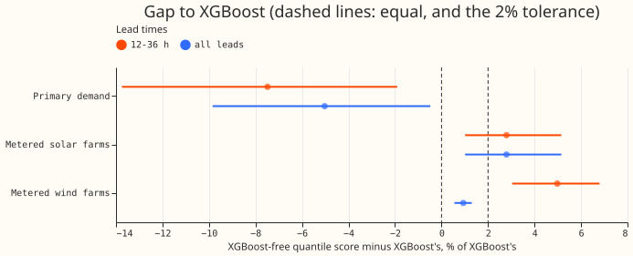
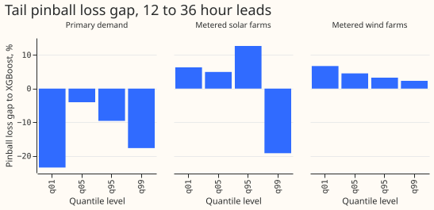

**Take-home.** An XGBoost-free forecast of Primary substation demand scores 7.5% better than BG2, the
XGBoost best guess, at 12 to 36 hours ahead. XGBoost is a gradient-boosted decision-tree model, and
production uses it today. The XGBoost-free forecasts for metered solar farms and metered wind farms
score 2.8% and 5.0% worse, which is over the 2% tolerance the maintainer set. The next experiment,
Part 2, tests small XGBoost components inside the solar and wind forecasts.

We asked whether each of the three series types that National Grid Electricity Distribution (NGED)
needs can be forecast without XGBoost: Primary substation demand (substations that step power down to
the local distribution network), metered solar farms, and metered wind farms. We recomputed one
comparison per type from forecasts stored by earlier experiments, on identical rows. Each gap is a
percentage of the XGBoost forecast's quantile score. The quantile score is twice the mean pinball loss
over 11 quantile levels, and lower is better. A lead is the number of hours between the forecast time
and the time forecast. Nothing was refitted.

## Results

- **Verdict per type (rule: gap at most 2% at 12 to 36 hours).** Demand is within tolerance. Solar
  is over it: the point estimate, 2.8%, is above 2%, and the interval's lower end, 1.0%, is below
  2%. Wind is over at 12 to 36 hours and within at all leads.
- **Demand arms.** The XGBoost-free forecast is arm D (a convex demand model with a Kalman filter)
  plus a neural-network correction of the median and the two-number summary of the 51 ensemble
  members' solar response ([experiment 228](../00228-dp-bg-rolling-origin-stack-against-bg2/result.md),
  [experiment 220](../00220-dp-bg-stage4-assembly-with-drop-one/result.md)). The XGBoost forecast is
  BG2.
- **Solar arms.** The XGBoost-free forecast is a physical model of the solar farm (a plant model)
  fed the mean and spread of the 51 European Centre for Medium-Range Weather Forecasts (ECMWF)
  ensemble members. The XGBoost forecast is arm 5 of [experiment
  224](../00224-metered-farm-dayahead-two-number/result.md).
- **Wind arms.** The XGBoost-free forecast is a physics-based wind model, B1. The XGBoost forecast is
  the best guess refit with 11 levels, A0r. Both come from experiment 230, read from its work folder
  before that experiment merged, so the wind numbers are provisional.
- **Quantile score, 12 to 36 hours (XGBoost-free / XGBoost; gap, 95% interval from resampling
  whole months).**
    - Demand: 2.258 / 2.440; -7.5% (-13.7% to -1.9%); 82,479 forecast rows at six substations.
    - Solar: 5.598 / 5.446; +2.8% (+1.0% to +5.2%); 41,676 forecast rows at six farms, pooled over
      rows (experiment 224's farm-weighted 5.64 and 5.49 give the same gap).
    - Wind: 5.112 / 4.870; +5.0% (+3.0% to +6.8%); 22,788 forecast rows at three farms with three
      XGBoost training seeds.
    - Units are percentage points of effective capacity for demand (the substation's usable
      capacity) and of installed capacity for solar and wind.
- **All leads.** Demand 2.579 / 2.715, -5.0% (-9.8% to -0.5%), 0.5 to 168 hours. Wind 8.636 / 8.556,
  +0.9% (+0.6% to +1.3%), 0.5 to 351 hours. Solar was scored on the 12 to 36 hour rows only
  (experiment 224 also has 60 to 84 and
  108 to 132 hour rows, not used here).
- **Mean absolute error (MAE) of the median, 12 to 36 hours.** Demand 3.945 / 4.254 (-7.2%). Solar
  9.918 / 9.810 (+1.1%). Wind 9.383 / 8.872 (+5.8%).
- **Pinball loss at four quantile levels, 12 to 36 hours (XGBoost-free / XGBoost), with the share
  of actuals at or below the quantile (coverage).** The 0.01, 0.05, 0.95, and 0.99 quantiles are
  written q01, q05, q95, and q99.
    - Demand: q01 0.157 / 0.205, q05 0.558 / 0.582, q95 0.608 / 0.673, q99 0.188 / 0.228; coverage
      0.013 / 0.008, 0.048 / 0.036, 0.952 / 0.948, 0.984 / 0.985.
    - Solar: q01 0.374 / 0.352, q05 1.433 / 1.365, q95 1.367 / 1.214, q99 0.386 / 0.478; coverage
      0.032 / 0.034, 0.055 / 0.068, 0.963 / 0.956, 0.991 / 0.996.
    - Wind: q01 0.239 / 0.224, q05 1.019 / 0.975, q95 1.327 / 1.285, q99 0.368 / 0.360; coverage
      0.032 / 0.032, 0.038 / 0.043, 0.951 / 0.953, 0.984 / 0.985.
    - The XGBoost-free solar and wind forecasts lose at q01, q05, and q95, and wind loses at q99
      too. Only solar q99 favours the XGBoost-free forecast. No middle quantile was scored.
- **Curtailment cost was scored for demand only.** Experiment 228's node-only curtailment proxy (GBP
  million over the scored year, scaled limit 0.9, scored at the five decision substations only) is
  2.14 for the XGBoost-free forecast and 1.45 for BG2,
  with overlapping 95% intervals. Threshold-weighted continuous ranked probability score
  (CRPS) was not scored for any arm compared here.

## Remaining XGBoost dependencies

- **`packages/xgboost_forecaster`** is the only trained forecaster class the audit found. It owns
  the one-booster-per-series save format (`.ubj` files and `meta.json`) and `train` and `predict`.
  An XGBoost-free forecast needs its own `BaseForecaster` subclass with its own `save` and `load`.
- **`conf/model/xgboost.yaml`** names `XGBoostForecaster` as `_target_`, and `conf/cv/default.yaml`
  uses `xgboost_no_power_lags` as the reference experiment name. A new forecaster class needs its
  own config file and its own reference experiment name.
- **`PowerForecast`** is an ensemble of deterministic members. The XGBoost-free forecasts store 11
  quantiles. The `climatology` forecaster already maps quantile ranks to member indices, so the same
  mapping would carry the quantiles after interpolating the 11 levels to 51 members, and no
  contract change would be needed.
- **`src/.../live_forecast_assets.py` and `cv_assets.py`** call `forecaster.predict`, so they are
  model-agnostic. Only an error message and some descriptions and comments mention boosters.
- **`packages/ml_core`** mentions boosters in docstrings and the `.ubj` compression note, with no
  import in `src`. The default `TabularFeatureEngineer` builds the tabular `AllFeatures` frame, and
  the convex model would need its own `FeatureEngineer`, as the `BaseForecaster` design allows.
- **`packages/baseline_forecasters`** has no XGBoost dependency (one docstring mentions it).
- **The XGBoost-free demand, solar, and wind forecasts live in `packages/studies/`.** Production
  code may not import `studies`, so they would first move to a reviewed package. The root
  `pyproject.toml` still installs `xgboost_forecaster`, and `packages/studies` itself depends on
  `xgboost`.

## Consistency checks on the headline gaps

- **Median minus mean forecast per site.** Not recomputed here. Experiment 228 reports the
  difference for the demand arms, and experiment 230 reports -4.6 to -5.5 points at all three wind
  farms for both wind arms.
- **Error of the mean or median forecast beside the quantile score.** The MAE of the median moves
  the same way as the quantile score for demand (-7.2%), solar (+1.1%), and wind (+5.8%).
- **Audit triggers.** None applies: no control, nested arm, or leave-one-out check is needed for a
  collation of stored forecasts.

## Caveats and what to try next

- **The wind numbers come from experiment 230's work folder before that experiment merged.** Re-run
  `e00234_score.py` after experiment 230 merges.
- **The demand comparison covers one scored year and six substations.** Experiment 228 found the
  XGBoost-free forecast worse than BG2 from April to June 2026.
- **Wind is scored on experiment 33's Tuesday runs and solar on experiment 224's daily runs**, so the
  gaps across types compare different rows.
- **Part 2 (separate PR) is the planned test** of an XGBoost residual correction and an XGBoost
  spread model inside the solar plant forecast and the wind physics model. A sprinkled arm is kept
  if it closes at least half the gap at no worse than +0.01 on the placebo series (a series the
  correction should not change).

The code is in `ml-experiments/00234-no-xgboost-forecast-audit-part-1/`.
