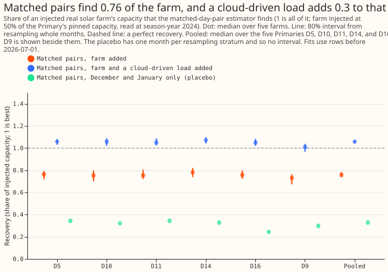
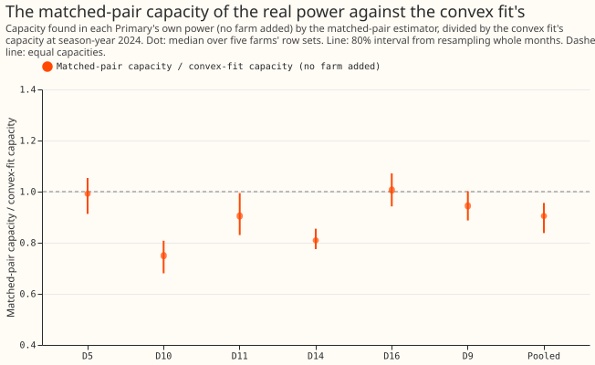

# Photovoltaic (PV) capacity: does matching sunny and cloudy days remove the demand?

**Take-home message: pairing a sunny day with a cloudy day of the same day type and temperature
removed none of a synthetic load that follows cloud, so the pair estimator is no better than the
convex fit.** The convex fit is the least-squares fit of solar capacity per season-year that
experiment 129 used. The synthetic load is 10% of the injected capacity, scaled by each day's
cloudiness, which is the variable the pairs are chosen on. It therefore tests the worst case, not a
measured demand response. With the load added, the pair estimator over-recovers the injected farm by
about 0.3 of its capacity, against about 0.2 for the convex fit.

**What was done.** We added the recorded output of a real solar farm to a Primary substation's
power, at 50% of the Primary's pinned capacity (the unmetered solar capacity that experiment 45's
real-time estimate gives the Primary). Farms A to F are metered generators and are never named.
Then we measured how much of the farm a matched-pair estimator finds. A pair is two days of the same
day type (weekday, Saturday, or Sunday) and the same clock offset (local time minus UTC, which
separates summer-time days from
winter-time days), at most 21 days apart, whose mean
daylight temperatures differ by at most 1 K, where the sunny day's clear-sky index exceeds the
cloudy day's by at least 0.4. The clear-sky index is the satellite global irradiance divided by its
clear-sky value. The estimator is the least-squares scale of the pair's difference in net power on
the pair's difference in the solar shape (the unit PV output per MW of capacity, derated for
temperature), with no demand terms: the net power is the Primary's demand minus its solar output.
The share found is the recovery: the
capacity found with the farm added, minus the capacity found without it, divided by the injected
capacity. D5, D10, D11, D14, and D16 are the five decision Primaries (the substations whose capacity
is judged), with temperatures in kelvin (K),
and D9 is shown beside them. The recovery is read from pairs in season-year 2024 (July 2024 to
June 2025), and the capacity unit is the 99th percentile of alternating-current output over
daylight half-hours, in MW.

**Figure 1. Matched pairs find 0.76 of the farm, and a cloud-driven load adds 0.3 to that.**

**Figure 2. The matched-pair capacity of the real power is 0.75 to 1.01 of the convex fit's.**

## Findings

- **The pre-registered prediction failed.** The plain recovery was predicted at 0.90 to 1.10 at 4
  of the 5 decision Primaries, and it was in that range at 0 of 5 and under 0.88 at 5 of 5. The
  plan's rule drops the estimator in that case. (D5's recovery is 0.8997, just under 0.90.) The
  placebo was predicted under 0.15 and was above
  it at 5 of 5. With the cloud-driven load, the recovery was predicted to stay within 0.10 of the
  plain recovery, and it stayed within 0.10 at 0 of 5.
- **Pooled, with 80% intervals from resampling whole months (median over five farms, then over the
  five Primaries):**
    - **Plain recovery** 0.758 (0.742 to 0.783); over the five farms the range is 0.65 to 0.82.
    - **With the cloud-driven load** 1.058 (1.041 to 1.075), so the load adds 0.295 (0.286 to
      0.304).
    - **Placebo** (pairs whose sunny day is in December or January; the cloudy partner can fall
      up to 21 days away) 0.328, with 0.24 to 0.34 across Primaries. The
      placebo has one month per resampling stratum and so no interval.
    - **Capacity of the real power** 0.905 (0.838 to 0.956) of the convex fit's.
- **The estimator is linear, so the plain injection test cannot show demand absorption.** The
  recovery equals the farm-only scale on the pair differences, which is why the cloud-driven load,
  the one input that reaches demand, is the informative test.
- **The placebo is not a clean zero.** The injected farm still produces output in winter, and
  experiment 231's winter-rows fit found 0.475, so 0.33 is a farm-only winter scale and not an
  invented solar signal. The 0.33 is below the 0.475 of experiment 231 because the pair estimator
  uses only pairs whose sunny day is in December or January, not every winter row. The plan's limit
  of 0.15 was too low for that reason.
- **Post hoc sensitivity, days with at least 20 daylight half-hours (10 hours).** The
  plan fixed no minimum number of daylight half-hours for a day to be paired. The first choice, 20,
  left no December or January day, so the placebo had no pairs, and the minimum was lowered to 10
  half-hours for the main run. The run with 20 is kept as a post hoc sensitivity. Its pooled
  recovery is 0.908 (0.899 to 0.928), in 0.90 to 1.10 at 4 of 5 Primaries, with 43 to 90 pairs per
  Primary against 122 to 181. The load still adds 0.266 (0.263 to 0.272), and the capacity of the
  real
  power is 0.969 (0.914 to 1.006) of the convex fit's. Restricting to days with at least 10 hours of
  daylight finds more of the farm, in
  line with experiment 231's finding that winter rows weaken the fit.
- **Pair counts:** medians over the farms of 122 to 181 pairs per Primary (2,100 to 3,500
  half-hours) for the main run, and
  84 to 140 for the placebo.

## Checks

- **Data cut:** the fits stop at 2026-07-01, so the maintainer's labelled exception (data to
  2026-07-31) is not used. No forecast is scored.
- **Median forecast minus mean forecast, and the mean-forecast error:** not applicable, because the
  experiment scores no forecast.
- **Toy check:** the pair estimator returned a synthetic capacity of 7 and a farm recovery of 0.5
  to within 1e-6 before any real fit ran.
- **Audit triggers** (the seven triggers in the `ml-experiment` skill's "Audit before merge"): none
  fired. The month-block interval covers month-to-month variation only, and the spread over farms is
  reported separately. The result contradicts the pre-registered prediction, and the plan's own
  linearity caveat
  anticipated why the plain test was uninformative.
- **Review:** one Sonnet code review and one Sonnet review of the page.
- **No Opus audit was run.** The ML manager decided that quota did not allow an Opus review of
  any of this series' experiments, so every audit trigger listed above stays unaudited and a
  Sonnet reviewer read the code and the page instead.

## What the next experiment should answer

- **Pairing did not remove the synthetic cloud-driven load, so a different remedy is worth
  testing.** A learned model of the demand's response to cloud, fitted on the metered farms' own
  cloud dependence, is one option.
- **Neural components:** a small neural network for the demand's dependence on irradiance could
  separate it from the solar term. The prediction that could fail is a bias under 0.10 on the
  cloud-driven load test.

## Plan: design

- **Pairs.** Within season-year 2024, a day is sunny when its daylight mean of the clear-sky index
  (CAMS global irradiance over clear-sky irradiance at the Primary) is at least 0.4 above the other
  day's. A pair needs the same day type, a mean daylight temperature within 1 K, and the two days
  within 21 days of each other. Each sunny day takes at most three cloudy partners, the ones with
  the smallest
  temperature gap. Holiday periods are excluded.
- **Estimator.** The least-squares scale through the origin of the pair difference in net power on
  the pair difference in the temperature-derated unit shape of the fit in experiment 129, over the
  daylight half-hours at which both days have a training row. The recovery is the scale found with
  the farm's output added, minus the scale found without it, divided by the injected capacity.
- **Linearity caveat.** The estimator is linear in the power, so the difference of its two scales is
  the scale of the farm's own output difference on the shape difference. A farm injection alone
  therefore cannot show demand absorption, and the recovery without load is a property of the
  estimator's shape and weather error (experiment 231's rung 1 reads 0.93). The informative tests
  are the cloud-driven load of experiment 129 (added to the net power, scaled to 10% of the injected
  capacity) and the placebo.
- **Placebo.** The same pairing and estimator on December and January days only, where the sun is
  low, reported as the share of the injected capacity found. The injected farm still produces a
  little output in those months, so the placebo's expected value is small and not zero.
- **Intervals.** A month-block bootstrap of the pairs by the month of the sunny day, 200 resamples,
  stratified as in experiment 231, and the range over the five farms.

## Plan: checks

- **Pair count:** report the number of pairs and the usable half-hours per Primary. A Primary with
  fewer than 30 pairs is reported and left out of the "4 of 5" count.
- **Toy check:** the script runs its pairing and scale on a synthetic series with a known capacity
  and no demand, and must return that capacity to within 1e-6 before any real fit runs.
