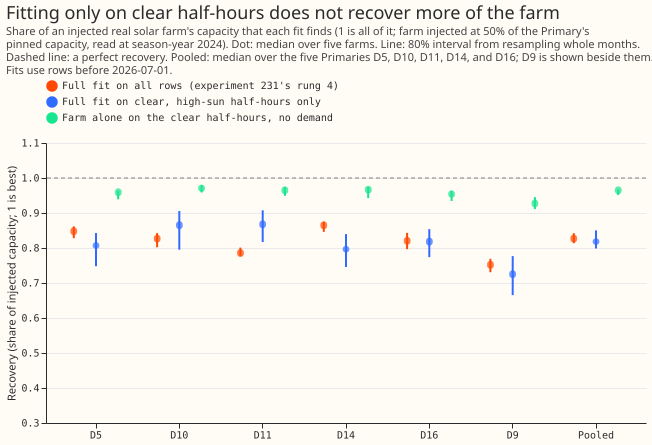

# Photovoltaic (PV) capacity: does fitting only on clear, high-sun half-hours help?

**Take-home message: fitting the solar capacity only on clear, high-sun half-hours does not find
more of an injected solar farm, and the interval gets wider.** Consistent with experiment 231, the sunshine
input does not appear to be the limit, and restricting the rows seems to move the loss into the
demand terms.

**What was done.** We added the recorded output of a real solar farm to a Primary substation's
power, at 50% of the Primary's pinned capacity (the unmetered solar capacity that experiment 45's
real-time estimate gives the Primary). Then we asked the capacity fit of experiment 129 how much of
the farm it finds again, using only the half-hours where the Primary's satellite irradiance is at
least 0.9 of its clear-sky value, the clear-sky irradiance is at least 200 W/m2, and the sun is at
least 20 degrees above the horizon. The share found is the recovery: the capacity found with the
farm added, minus the capacity found without it, divided by the injected capacity. Farms A to F are
metered generators and are never named. D5, D10, D11, D14, and D16 are the five decision Primaries
of experiment 103's data set, and D9 is shown beside them. The recovery is read at season-year 2024
(July 2024 to June 2025), and the capacity unit is the 99th percentile of alternating-current
output over daylight half-hours, in MW.

**Figure 1. Clear half-hours leave the recovery at about 0.82 and widen the interval.**

## Findings

- **The pre-registered prediction failed.** The recovery was to rise by at least 0.05 at 4 of the 5
  decision Primaries and the interval was to widen by no more than 50%. The rise was at least 0.05
  at 1 of 5 Primaries (D11, +0.082), and the interval was no wider than 1.5 times at 0 of 5.
- **Pooled recovery (median over five farms, then over the five Primaries; 80% interval from
  resampling whole months):** 0.827 (0.814 to 0.842) on all rows and 0.818 (0.799 to 0.851) on clear
  rows. The change is -0.002 (-0.040 to 0.023). The pooled interval is 1.8 times wider on clear
  rows.
- **The farm alone fits better on the clear half-hours (0.965; 0.951 to 0.967), but the full fit
  does not.** Demand absorption, the farm-alone scale minus the full-fit recovery, is 0.147 on clear
  rows and 0.104 on all rows (experiment 231's rung 1 minus its rung 4, 0.931 and 0.827). A possible
  cause is that the clear-day solar curve is smooth, which makes the curve closer to the seasonal
  demand terms, so the demand terms take more of it. That explanation was not tested directly
  here.
- **The clear rows are a small share of the training rows.** At the five decision Primaries, 5,600
  to 5,900 of 78,000 to 89,000 training half-hours remain (3,300 of 45,000 at D9), and 1,300 to
  1,600 remain in the read-out season-year.
- **The all-rows fit reproduces experiment 231's full fit** (the maximum absolute difference
  over every Primary and farm prints as 0.000 at three decimals).

## Checks

- **Data cut:** the fits stop at 2026-07-01, so the maintainer's labelled exception (data to
  2026-07-31) is not used. No forecast is scored.
- **Median forecast minus mean forecast, and the mean-forecast error:** not applicable, because the
  experiment scores no forecast.
- **Audit triggers** (the seven triggers in the `ml-experiment` skill's "Audit before merge"): none
  fired. The result contradicts the pre-registered prediction, but experiment 231 had already
  lowered that prior and the result agrees with its finding that the irradiance input is not the
  limit. The coverage test of experiment 129 (23 of 30 cells) was not re-run; the interval-width
  condition stood in for it. The intervals are month-block bootstrap intervals only; the plan's
  range over the five farms is not reported.

## What the next experiment should answer

- **Reduce demand absorption.** Matched sunny-minus-cloudy day pairs (experiment 235) target it
  directly.
- **Neural components:** a learned smooth response of the demand's dependence on irradiance could
  separate the demand's cloud response from the solar term. The prediction that could fail is a
  full-fit recovery of 0.90 or more on all rows.

## Plan: design

- **Rows.** The row rule is applied through month weights and a row mask on the Gram matrices, as
  in experiment 231, so that the base and injected fits share one row set.
- **Demand terms.** The demand columns of the fit are unchanged. On clear days the solar shape is
  closer to a smooth seasonal curve than on all days, so the demand harmonics may absorb more of it;
  the experiment reports that as the contrast between the farm-only scale on clear rows and the
  full fit on clear rows.
- **Reported rows.** The recovery on clear rows, the recovery on all rows (rung 4 of experiment
  231), the number of training rows kept, and the share of each season-year kept.
- **Intervals.** A month-block bootstrap, 200 resamples, stratified as in experiment 231, and the
  range over the five farms.

## Plan: checks

- **Reproduction:** with the row rule switched off the script must reproduce experiment 231's rung 4
  at every Primary and farm to within 1e-6.
