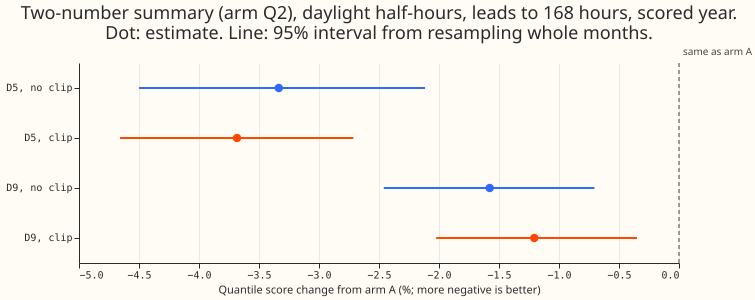
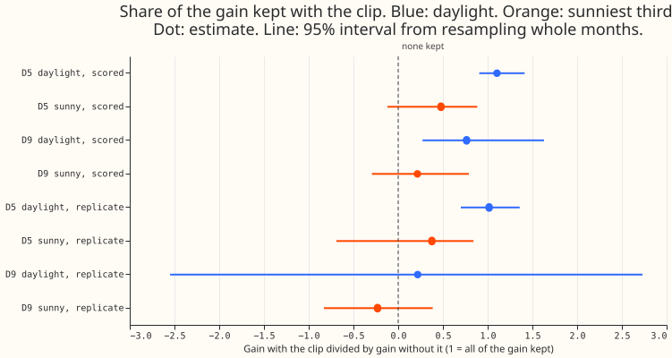
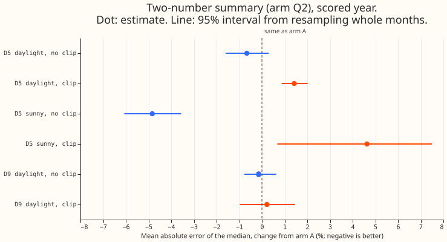

**Summarising the 51 ensemble weather members as a mean and a standard deviation lowers the D5
daylight quantile score about as much with the solar clip as without it, but on the sunniest rows
the gain from the mean appears to be largely lost once the clip is in.** D5 and D9 are anonymised
Primary substations, which feed homes and businesses. Each demand forecast subtracts an estimate of
the embedded solar generation, called the solar term. The ensemble weather forecast has 51 members.
[Experiment 187](../00187-dp-ens-members-in-stack/result.md) passed each member through the solar
term. That pass lowered the daylight quantile score of the demand forecast. [Experiment
193](../00193-dp-ens-two-number-solar-summary/result.md) found that the mean and the standard
deviation of the 51 members' solar responses keep 98% of that gain. We call this the two-number
summary. [Experiment 180](../00180-dp-sunny-daylight-fix-d5-solar-shape/result.md) and [experiment
214](../00214-dp-pv-clip-ceiling-as-of-and-screen/result.md) capped the solar output that the
forecast subtracts at 60% of the solar capacity held for D5, and we call this cap "the clip". Cloud
uncertainty and the clip both matter at midday, so we asked whether the clip removes part of the
gain from the two-number summary.

We built two conditions at D5 and D9 with experiment 193's method. In the no-clip condition the
forecast and the 51 member responses are experiment 184's. In the clip condition each member passes
through the clipped fits of experiment 214 (the 60% clip, and the 50% clip at the cuts where
experiment 214 chose it as-of), and arm A is experiment 214's forecast. The quantile score is twice
the mean pinball loss over 11 quantiles, in points of effective capacity (percentage points of the
substation's rated demand), and a gain is the change from arm A as a percentage. Arm M uses the 51
members and arm Q2 uses the mean and standard deviation. The retained share is Q2's gain with the
clip divided by Q2's gain without the clip. A row is one forecast of one half-hour at one lead, so a
half-hour appears in several rows.

**Verdict `supported`.** At D5 the retained share of the daylight gain is 110% in the scored year
(95% interval 91% to 141%) and 102% (70% to 136%) in the replicate months, so the prediction of at
least 70% holds. At D9 it is 76% (27% to 163%), and that interval includes 70%. Two checks
qualify the result: the sunniest third has a retained share of 48% (-12% to 88%), and on those rows
the clip turns the two-number summary's 4.8% reduction in the median's absolute error into a 4.6%
increase.

## Results

- **Rows:** experiment 178's rows at D5 and D9 in the scored year (2025-07-02 to 2026-06-29), leads
  to 168 hours, outside the load shifts. Daylight means the sun is at least 5 degrees above the
  horizon. D5 has 39,874 daylight rows and 14,045 sunny rows (the sunniest third); D9 has 43,551
  and 15,415. Offset and spread factors are fitted on the tuning months of D5 and D9 together,
  separately for each condition.
- **Arms:** A is the forecast without member information, M the 51 members, Q2 the mean and standard
  deviation of the responses, and SG (post hoc) the standard deviation of the responses only, with
  the mean response set to zero.
- **Quantile score, D5 daylight, scored year:** A 5.294, M 5.129, Q2 5.117 without the clip; A
  5.028, M 4.848, Q2 4.842 with the clip. The clip alone changes arm A by -5.0% (-10.9% to +0.4%).
- **Gain of Q2 (95% interval):** D5 -3.34% (-4.50% to -2.12%) without the clip and -3.68% (-4.66% to
  -2.71%) with it. D9 -1.58% (-2.46% to -0.71%) and -1.21% (-2.02% to -0.35%). D5 and D9 pooled
  -2.63% and -2.67%, retained 101% (85% to 129%).
- **Retained share of Q2's gain:** D5 110% (91%
  to 141%), D9 76% (27% to 163%). A ratio is not meaningful where the gain without the clip has an
  interval that includes zero, as at D9 in the replicate months and on sunny rows. Replicate months:
  D5 102% (70% to 136%, the lower end only touches
  the 70% bar), D9 22% (-255% to 273%), pooled 84% (54% to 110%). M's retained share at D5
  is 115% (95% to 151%).
- **Q2 against M under the clip:** on daylight rows D5 -0.11% (-0.43% to +0.14%) and D9 +0.07%
  (-0.14% to +0.25%), so the two numbers match the 51 members to within about half a percentage
  point there. On sunny rows Q2 is worse than M by 0.61% at D5 (-0.06% to +1.08%) and 0.41% at D9
  (0.05% to 0.81%).
- **Sunniest third at D5:** the Q2 gain is -5.57% (-8.60% to -3.24%) without the clip and -2.67%
  (-6.85% to +0.45%) with it, a retained share of 48% (-12% to 88%). The clip alone lowers arm A's
  quantile score on those rows by 15.2% (3.4% to 25.4%).
- **Median error:** with the clip, Q2 raises the mean absolute error of the median by 1.4% (0.9% to
  2.0%) on D5 daylight rows and 4.6% (0.7% to 7.5%) on sunny rows, where without the clip Q2 lowers
  the error by 0.7% (-1.6% to +0.3%) and 4.8% (3.6% to 6.1%). At D9 on daylight rows the change is
  +0.2% (-1.0% to +1.5%) with the clip and -0.1% (-0.8% to +0.6%) without it. On D9's sunny rows it
  is +1.8% (-1.2% to +4.2%) with the clip and -2.5% (-4.2% to -1.4%) without it.
- **Rescale-only control (post hoc):** arm A with only its offset factor refitted, and no member
  information, changes D5 daylight rows by -0.65% (-1.19% to -0.10%) with the clip and -0.69%
  (-1.19% to -0.18%) without it, and D5 sunny rows by -0.63% (-1.60% to +0.19%) with the clip.
  Recalibration alone therefore explains little of the spread-only gain below.
- **Spread only (post hoc):** SG's D5 gain is -4.11% (-5.09% to -3.22%) with the clip and -2.86%
  (-4.05% to -1.79%) without it; on sunny rows -4.18% (-5.75% to -3.04%) with the clip, better than
  Q2's -2.67%, and -1.89% without it. Its median error with the clip changes by +0.3% (daylight)
  and +1.5% (sunny, 0.5% to 2.5%).
- **Tails, D5 daylight, scored year (coverage; pinball loss in points):**

  | Quantile | A, no clip | Q2, no clip | A, clip | Q2, clip |
  |---|---|---|---|---|
  | q01 | 0.023; 0.355 | 0.012; 0.317 | 0.025; 0.328 | 0.010; 0.272 |
  | q05 | 0.075; 1.293 | 0.047; 1.192 | 0.089; 1.219 | 0.053; 1.054 |
  | q95 | 0.902; 1.365 | 0.927; 1.256 | 0.918; 1.349 | 0.942; 1.210 |
  | q99 | 0.974; 0.388 | 0.981; 0.345 | 0.982; 0.359 | 0.989; 0.324 |

- **Clip form this experiment would suggest for the assembly:** the as-of 60% clip of experiment
  214, with the standard deviation
  of
  the member responses and without their mean on the sunniest half-hours. The mean-free form is a
  post hoc finding.
- **Post hoc:** arm SG, and every sunny-row cut. The pre-registered contrast is the daylight
  retained share of Q2 at D5.

## Checks

- **Median minus mean forecast:** the arms store quantiles only, so no mean forecast exists to
  compare. Arm A's mean equals its median in experiments 180 and 193.
- **Median error beside the quantile score:** the quantile score and the median's absolute error
  point in different directions in the clip condition. Q2
  lowers the quantile score by 3.7% on D5 daylight rows and raises the median's absolute error by
  1.4%. Arm SG shows the disagreement comes from the members' mean, because SG keeps the quantile
  gain and its median error rises by only 0.3%.
- **Triggers fired:** the third trigger of the `ml-experiment` skill's audit list (the quantile-
  score
  contrast and the median-error contrast point in different directions). The mean-free arm SG is
  the explanation we tested. No audit by a second reviewer has run.
- **Control:** the no-clip condition reproduces experiment 193's D5 gain (-3.34% against -3.27%),
  with factors refitted on D5 and D9 only. Experiment 193's arms were not re-run.

## Caveats

- **Two substations and one year.** The D9 intervals are wide. The replicate months hold six months.
- **The mean and standard deviation are taken after each member is passed through the clipped solar
  term.** The clip is nonlinear, so taking them before the clip would give a different answer.
- **The clip ceiling was chosen by experiment 214 as-of** and is read from that experiment's
  stored fits. Arm A in the clip condition is experiment 214's, whose mean forecast differs from
  experiment 184's through the clip only.
- **The plan was committed after the first run,** so the pre-registration holds only for the
  prediction and decision rule in the maintainer's brief.

- **Fitted factors at the edge of the grid.** The clip condition's spread factor is 1.5, the top of
  the grid, in the shortest lead band for Q2 and the spread-only arm, so the spread may be
  truncated.
- **The member deltas are not checked against experiment 214's mean.** The reproduction gate of
  experiment 184 compares against an unclipped mean, so it applies only to the no-clip arm, where
  it passes (4e-6). Experiment 214's stage-2 mean also recomputes the filter on the clipped
  residuals. We did not test that the deltas sit consistently on that mean.
- **The sunny mask differs slightly from experiment 214's.** It is the top third of each period's
  own unit-shape values and includes rows where no member is available. Experiment 214 used the
  period before 2024-07, so the cut
  differs slightly. The tuning and replicate months use the fixed 60% clip, as experiment 214 chose
  60% at every cut there.

## What to try next

- A pre-registered test of the spread-only form at D5 on a later scored period is possible once the
  period from 2026-07-01 onwards, which is held out from all experiments, is released for scoring.
- The final assembly could include one combined arm with the two numbers and the clip, scored per
  substation and on the sunniest third.
