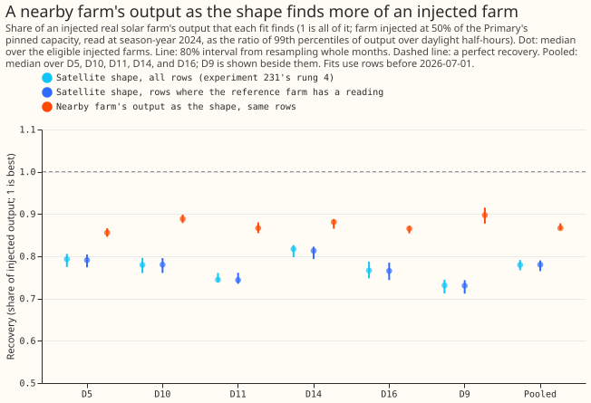
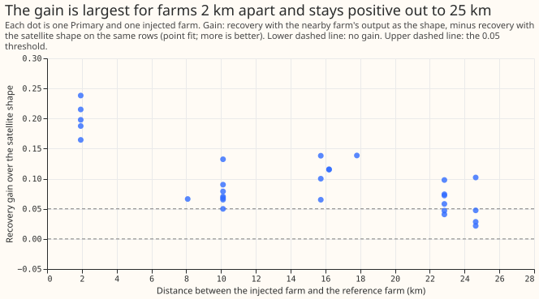

# PV capacity: does a nearby metered farm work as the sunshine reference?

**Take-home message: a nearby farm's measured output finds more of an injected solar farm than the
satellite irradiance does, but the result does not yet show that the irradiance is the limit.** The
pooled recovery rises from 0.780 to 0.867, and the gain is at least 0.05 at all five decision
Primaries. The nearby farm's output also carries plant effects, so part of the gain may come from
the plant shape, which experiment 231 found explains much of the shortfall.

**What was done.** We added the recorded output of a real solar farm (farms A to F are metered
generators and are never named) to a Primary substation's power at 50% of the Primary's pinned
capacity, as in experiment 231. The convex fit of experiment 129 then reported how much of the farm
it found again, under two solar shapes. The first is the satellite-based shape. The second is the
recorded output of a different farm, the one nearest to the Primary within 30 km of the injected
farm, divided by its 99th percentile with the temperature derating divided out. The Primaries are
3 to 23 km from their reference farms. D5, D10, D11, D14, and D16 are the five decision
Primaries (the substations whose capacity is judged), and D9 is shown beside them. The recovery is
the 99th percentile of the recovered output over daylight half-hours of season-year 2024 (July 2024
to June 2025), divided by the 99th percentile of the injected farm's output over the same
half-hours, both in alternating-current MW. Fits stop at 2026-07-01, so the maintainer's labelled
exception (data to 2026-07-31) is not used, and no forecast is scored.

**Figure 1. A nearby farm's output as the solar shape finds 0.87 of the injected farm, against
0.78 for the satellite shape.**

**Figure 2. The gain is 0.17 to 0.24 for the one pair of farms 2 km apart and 0.02 to 0.14 for farms
5 to 25
km apart.**

## Findings

- **The prediction was half met.** The recovery rose by at least 0.05 at 5 of 5 decision Primaries
  (the prediction asked for 4 of 5). The farm alone, fitted on one scale of the shape, explains
  0.953 of the injected farm's squared output, below the predicted 0.97, against 0.895 for the
  satellite shape.
- **Pooled recovery, with 80% intervals from resampling whole months (median over the injected
  farms, then over the five Primaries):**
    - **Satellite shape on all rows** 0.780 (0.767 to 0.791), and **on the rows where the
      reference farm has a reading** 0.780 (0.765 to 0.790).
    - **Nearby farm's output** 0.867 (0.863 to 0.878).
    - **Gain on the same rows** (median over farms of each farm's paired difference, so not the
      difference of the medians) 0.090 (0.074 to 0.100). Per Primary the gain is 0.058 (D5), 0.138
      (D10), 0.115 (D11), 0.066 (D14), and 0.090 (D16), and 0.168 at D9.
- **The gain is smaller in the capacity unit of experiment 231.** The plain capacity ratio rises
  from 0.826 to 0.869, a gain of 0.052 (0.029 to 0.061), and the gain reaches 0.05 at 3 of 5
  Primaries (D10, D11, and D16). The two readings differ because the reference farm's 99th
  percentile over the rows is higher than the injected farm's.
- **The 5 pairs under 5 km are the same 2 farms (A and C) in both directions.** They may flatter the
  result, because two farms 2 km apart probably share nearly all their weather. The
  median gain is 0.198 for the 5 pairs less than 5 km apart, 0.069 for the 8 pairs 5 to 12 km
  apart, and 0.073 for the 16 pairs 12 to 30 km apart. Without the pairs under 5 km, the median
  gain per decision Primary is still 0.058 to 0.116, at least 0.05 at 5 of 5.
- **The gain shrinks with the demand terms frozen, but remains.** With the demand terms frozen at
  the
  base fit, the recovery rises from 0.897 to 0.959 (gain 0.064, 80% interval 0.057 to 0.080),
  against 0.090 with the demand terms free.
- **The farm-only gain is small.** The share of the injected farm's output that one scale of the
  shape explains rises by 0.025 (0.018 to 0.047), from 0.929 to 0.954. The share of squared output
  rises by 0.054, from 0.895 to 0.953. The prediction quoted 0.953 as the satellite shape's value
  from experiment 218, a different statistic (a fit at the farm's own site), so the 0.97 target is
  not comparable with the figures here.
- **The decision rule is met on the pre-registered metric.** The recovery rises by at least 0.05 at
  5 of 5 Primaries by the 99th-percentile ratio and at 3 of 5 by the capacity ratio. The reference
  is kept only as a test of plant shape, not as a sunshine measure.
- **Row counts.** The reference farm's dropouts remove 151 to 3,941 (median over farms) of 45,168 to
  89,172
  training rows per Primary. The satellite and reference arms use identical rows.

## Checks

- **Reproduction:** the satellite shape on all rows reproduces experiment 231's rung 4 (the full
  joint fit on all rows) at every Primary and injected farm, with a largest difference of 0.000 at
  three decimal places.
- **Derating:** the script checks that the reference shape, derated by the fit, equals the farm's
  output to within 1e-6 on every half-hour at which both farms have output, and it did at every
  Primary.
- **Same rows:** the satellite and reference arms train on the same number of rows at every
  Primary, as the script asserts.
- **Median forecast minus mean forecast, and the mean-forecast error:** not applicable, because
  the experiment scores no forecast.
- **Audit triggers** (the seven triggers in the `ml-experiment` skill's "Audit before merge"):
  trigger 2 fires, because the result is in apparent tension with the finding of experiment 231
  that the irradiance contributes almost none of the shortfall, and the explanation in the Limits
  section was not tested here. Trigger 7 fires because the design of experiment 239 (the seasonal
  efficiency curve) depends on
  whether the gain is plant shape or sunshine. The maintainer's decision on an audit is pending.
- **Review:** one Sonnet review of the plan, one of the code, and one of the page.

## Limits

- **The reference farm's output holds more than sunshine.** It reflects the farm's tilt,
  orientation, curtailment, and soiling, so the gain may come from plant shape that the plant model
  lacks. A null result would have meant that one farm is not a clean sunshine index, and the gain
  has the matching reading: it does not show that a better irradiance product would help.
- **Distance between the injected farm and the reference farm is up to 25 km,** often larger than
  the distance from a real unmetered farm to its nearest metered farm. Figure 2 shows the gain
  against that distance.
- **A reference farm metered behind the Primary** would sit in both the base and the injected
  series and cancel in their difference, so it should cancel to first order (the bounded, penalised
  fit is not linear).
- **The interval covers month-to-month variation only,** and the spread over injected farms is
  shown by the dots of figure 2.

## What the next experiment should answer

- **Does the gain come from sunshine or from plant shape?** Fit the shared seasonal efficiency
  curve of experiment 239 on the farms' output first. If the curve recovers most of the 0.09, the
  nearby farm was supplying plant shape. The prediction that could fail is a gain from the curve
  of at least 0.03 at 4 of 5 Primaries.
- **A neural component** that learns the plant shape from the farms' output could be tested
  against the satellite shape and the reference shape together.

## Plan: design

- **Distances.** Each Primary has a metered farm within 30 km (the brief's rule). The nearest
  farms to the five decision Primaries and D9 are 3 to 23 km away.
- **The reference farm.** For an injected farm X, the reference is the nearest farm to the Primary
  among the other farms with data from 2019-09 (A, B, C, D, F), provided it lies within 30 km of
  X. A reference at X itself would return the injected output and make the test trivial. The
  injected farm and the reference farm are different sites, as a real unmetered farm and a metered
  reference would be, but their distance (up to 25 km) is often larger than the distance from a
  real unmetered farm to its nearest metered farm. The recovery is therefore also reported against
  the distance between the injected farm and the reference farm. Farm E is neither injected nor a
  reference, because its record starts later than 2019-09. A Primary with fewer than three eligible
  farms is reported as not testable.
- **The shape.** The reference farm's output divided by its 99th percentile over daylight
  half-hours, with the temperature derating divided out, so that the fit does not apply the derating
  a second time. The fit's derating is `u (1 - 0.004 (T + 25 u - 25))` for the shape `u` and the
  Primary's temperature `T` in degrees Celsius, and `u` is found by fixed-point steps. The script
  checks that the fit's derated shape equals the farm's normalised output to within 1e-6 on daylight
  half-hours. The reference farm's own temperature differs from the Primary's, which this
  approximation ignores. Night half-hours take a shape of zero, as the farm output does. Half-hours
  at which the reference farm has a dropout or no reading drop out of both the
  base and the injected fit.
- **Controls.** The CAMS shape on the identical rows (so a change in the rows is not mistaken for a
  change of shape), and the CAMS shape on all rows. The script asserts that the satellite and
  reference
  arms train on the same number of rows. The CAMS shape on all rows, fed through the same
  shape-substitution code, must reproduce experiment 231's rung 4 (the full joint fit on all rows)
  to within 1e-6.
- **The farm-only fit.** The share of the injected farm's squared output explained by one scale of
  the reference shape and of the CAMS shape, on season-year 2024 daylight half-hours, as in
  experiment 231's rungs 1 and 2.
- **Intervals.** A month-block bootstrap, 200 resamples, stratified as in experiment 231, and the
  range over the eligible farms.
- **Limits to state.** The reference farm's output also reflects its tilt, azimuth, curtailment,
  and soiling, so a null result can mean that one farm's output is not a clean sunshine index, not
  that a better reference would not help. A reference farm metered behind the Primary would sit in
  both the base and the injected series and cancel in their difference.
- **Stop rule.** If the reference does not explain more of the injected farm than the CAMS shape
  on the farm-only fit, the injection fits still run, because they are cheap, and the write-up says
  the reference carries no new information.

## Plan: checks

- **Reproduction and derating:** as above.
- **Review:** one Sonnet review of this plan, one of the code, one of the write-up.
