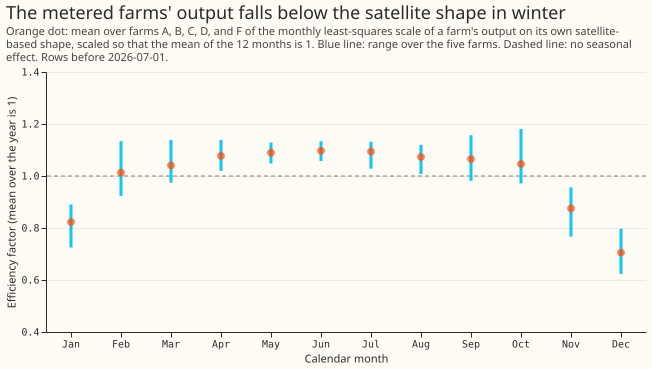
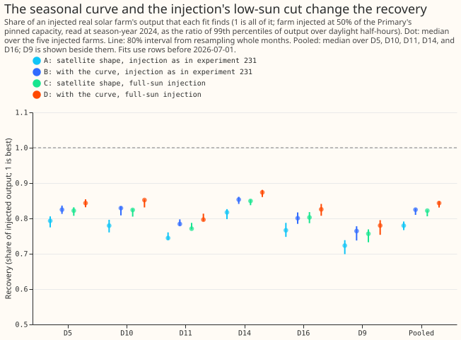

# PV capacity: does a shared seasonal efficiency curve help?

**Take-home message: twelve monthly efficiency factors fitted on the metered farms' output do not
close the recovery shortfall, and the injection of experiment 231 was itself part of it.** The
curve raises the farm-only fit from 0.946 to 0.949, below the target of 0.968. The curve raises the
pooled recovery by 0.039 with the injection of experiment 231 and by 0.025 when the injected farm
keeps its low-sun output. Keeping that output raises the recovery by 0.033 on its own. Every
"gain" on this page is the median over farms of each farm's paired difference, so it can differ
from the difference of two medians (0.780 to 0.825 is 0.045, against the paired 0.039).

**What was done.** We added the recorded output of a real solar farm (farms A to F are metered
generators and are never named) to a Primary substation's power at 50% of the Primary's pinned
capacity, as in experiment 231, and the convex capacity fit of experiment 129 reported how much of
the farm it found again. The fit used the satellite-based solar shape, with and without a seasonal
efficiency curve. The curve has 12 monthly factors, each the mean over the four other farms of the
least-squares scale of a farm's output on its own satellite-based shape, divided by the mean of the
12 values. The injected farm is never one of the four. Figure 1 shows the curve of all five farms.

**A deviation from the plan.** The plan described only the injection of experiment 231, which sets
the farm's output to zero when the sun is under 15 degrees above the horizon (zenith over 75
degrees), so that December has almost no output. The first fit of the curve showed a December factor
near zero, so we added a full-sun injection that keeps the output at every sun height, and we fitted
the curve at every sun height. The full-sun injection takes its unit from the same 99th percentile,
so the two injections differ only in the low-sun half-hours and in a few training rows. The full-sun
arm is exploratory. The plan's check that a curve of 12 ones reproduces the arm without the curve
was not run.

D5, D10, D11, D14, and D16 are the five decision Primaries (the substations whose capacity is
judged), and D9 is shown beside them. The recovery is the 99th percentile of the recovered output
over daylight half-hours of season-year 2024 (July 2024 to June 2025), divided by the 99th
percentile of the injected farm's output over the same half-hours, both in alternating-current MW.
Fits stop at 2026-07-01, so the maintainer's labelled exception for capacity experiments (data to
2026-07-31) is not used, and no forecast is scored.

**Figure 1. The farms fall below the satellite shape in November to January and differ by 3% from
April to September.**

**Figure 2. The curve raises the pooled recovery from 0.780 to 0.825 with the injection of
experiment 231 and from 0.822 to 0.843 with a full-sun injection.**

## Findings

- **The farm-only fit missed its target, and the planned recovery condition was met.** The
  farm-only fit rose from 0.946 to 0.949 over all years and from 0.955 to 0.962 in season-year 2024
  (median over farms), against a target of 0.968. With the injection of experiment 231, the
  recovery rose by at least 0.03 at 5 of 5 Primaries. The decision rule needs both, so it is not
  met, and the verdict rests on the farm-only fit. With the full-sun injection, which the plan did
  not include, the recovery rose by less than 0.03 at every Primary.
- **The factors are lowest in November to January.** They are 0.82 in January, 0.88 in November,
  and 0.71 in December, and 1.01 to 1.10 from February to October. The factors are a description
  of the fit, not a cause: most of the half-hours fitted in December and part of those in November
  and January have a sun under 15 degrees above the horizon (the share of the fit weight above that
  height is 1% in December, 69% in November, and 43% in January). Refitted on half-hours with the
  sun above 15 degrees only, the factors are 0.89 in January and 0.91 in November, so the dip
  shrinks but remains. From April to September the largest factor is 1.03 times the smallest, so
  the 6% to 9% fall of the flat top from spring to summer does not appear as a monthly scale on the
  satellite shape. The range over farms is 0.62 to 0.80 in December.
- **Pooled recovery, with 80% intervals from resampling whole months (median over the five injected
  farms, then over the five Primaries):**
    - **Injection as in experiment 231:** 0.780 (0.767 to 0.791) without the curve and 0.825 (0.810
      to 0.828) with it. The paired gain is 0.039 (0.034 to 0.042), at least 0.03 at 5 of 5
      Primaries.
    - **Full-sun injection:** 0.822 (0.806 to 0.823) without the curve and 0.843 (0.831 to 0.849)
      with it. The paired gain is 0.025 (0.023 to 0.028), at least 0.03 at 0 of 5 Primaries. The
      gains at D10 (0.027) and D14 (0.026) lie within resampling noise of 0.03.
    - **With the demand terms frozen** at the base fit, the gain is 0.021 (0.017 to 0.024) with the
      injection of experiment 231 and 0.015 (0.012 to 0.017) with the full-sun injection.
- **Keeping the farm's low-sun output raises the recovery.** The pooled paired gain is 0.033 (80%
  interval 0.027 to 0.035), and 0.029 to 0.036 at each decision Primary. The injection of
  experiments 129 and 231 therefore understates the recovery of a farm that produces in winter.
  The two injections also differ in their training rows (the full-sun injection removes 89 to 223
  of 45,000 to 89,000 rows per Primary, median over farms, where a dropout falls between 15 and 0
  degrees of sun height), and the full-sun output carries its own noise at low sun.
- **The capacity ratio of experiment 231 falls with the curve** (0.827 to 0.812, paired change
  -0.021), while the ratio of 99th percentiles rises. The curve has mean 1 over the year, so it
  raises the shape from February to October and lowers it from November to January, which changes
  the scale that the fit finds. The 99th percentile of the derated shape over the read-out year,
  which summer half-hours dominate, rises from 0.948 to 1.019 of the injected farm's, while the
  fitted capacity falls by 1.8%. The ratio of 99th percentiles therefore reads summer-peak output
  only, and part of its gain is the curve lifting that peak; winter output is not measured by it.

## Checks

- **Reproduction:** the satellite shape with the injection of experiment 231 reproduces
  experiment 231's rung 4 (the full joint fit on all rows) at every Primary and injected farm,
  with a largest difference of 0.00e+00.
- **Derating:** the script checks that the curved shape, derated by the fit, equals the satellite
  shape times the curve to within 1e-6, and it did at every Primary and farm.
- **Same rows:** the satellite and curved shapes train on the same number of rows under each
  injection, as the script asserts. The two injections do not share rows exactly.
- **Median forecast minus mean forecast, and the mean-forecast error:** not applicable, because the
  experiment scores no forecast.
- **Audit triggers** (the seven triggers in the `ml-experiment` skill's "Audit before merge"):
  trigger 2 fires, because the farm-only fit missed its prediction, and the low-sun refit above
  is the explanation tested here. Trigger 7 fires, because the finding on the low-sun cut changes
  how experiments 231, 235, 236, and 238 should be read. The maintainer's decision on an audit is
  pending.
- **Review:** one Sonnet review of the plan, one of the code, and one of the page.
- **No Opus audit was run.** The ML manager decided that quota did not allow an Opus review of
  any of this series' experiments, so every audit trigger listed above stays unaudited and a
  Sonnet reviewer read the code and the page instead.

## Limits

- **The month-block intervals assume independent Primaries.** Each Primary draws its own
  resamples, although the Primaries share the same calendar months, so the pooled intervals are
  probably too narrow.
- **The farm's temperature is the mean of the six Primaries' temperatures,** because the farm
  frame holds no temperature. The temperature derating at the farm's own site is approximate, and
  the curve partly absorbs the heat loss, so the curve overlaps with the derating that the fit
  applies.
- **The curve has no interval for its own uncertainty.** Each resample holds the curve fixed, and
  the range over farms is reported separately. The curve also uses the other farms' rows from the
  read-out year, so it is not a hold-out in time.
- **The satellite shape at the farm and at the Primary differs,** because the farm sits tens of
  kilometres from the Primary, so the curve fitted at the farms is applied to a different shape.

## What the next experiment should answer

- **Does the full-sun injection change the winter finding of experiment 231?** Experiment 231
  found 0.475 from winter rows with the farm's low-sun output zeroed. The recovery in winter rows
  with the full-sun injection has not been measured.
- **How much demand absorption remains once the injection keeps the low-sun output?** With the
  demand terms frozen at the base fit, the pooled recovery is 0.919 with the full-sun injection
  and 0.883 with the injection of experiment 231, against 0.822 and 0.780 with the demand terms
  free.

## Plan: design

- **The curve.** For each farm and calendar month, the least-squares scale of the farm's output
  (divided by its 99th percentile) on the temperature-derated satellite shape at the farm's own
  site, over half-hours with the sun up before 2026-07-01 (the plan said daylight half-hours with
  the sun under 75 degrees of zenith; the fit used every sun height, as the deviation above
  explains). The farms are
  A, B, C, D, and F, the farms with data from 2019-09. The curve is the mean over the farms of the
  monthly scales, divided by the mean of its own 12 values so that the curve has mean 1.
- **No leakage from the injected farm.** For an injected farm X, the curve uses the other four
  farms only. The farm-only fit of X also uses that curve.
- **Applying the curve.** The Primary's derated shape is multiplied by the factor of the
  half-hour's calendar month. The temperature derating is then divided out again (the fixed-point
  step of experiment 238), so that the fit does not apply the derating a second time.
- **Arms.** The satellite shape without the curve, and the satellite shape with the curve, on the
  same rows and the same injections at D5, D9, D10, D11, D14, and D16.
- **Intervals.** A month-block bootstrap, 200 resamples, stratified as in experiment 231, over the
  fits of the Primary's injected farms; the curve is held fixed in each resample, which understates
  the uncertainty of the curve. The spread of the factors over the farms is reported beside it.
- **Reading a flat curve.** If every factor lies within 3% of the others, the fall of the flat top
  is not a seasonal efficiency effect, and the write-up says so.

## Plan: checks

- **Reproduction:** the arm without the curve reproduces experiment 231's rung 4 to within 1e-6,
  and a curve of 12 factors equal to 1 reproduces the arm without the curve.
- **Derating:** the shape returned for the fit, derated by the fit's own formula, equals the
  satellite shape times the factor to within 1e-6.
- **Review:** one Sonnet review of this plan, one of the code, one of the write-up.
