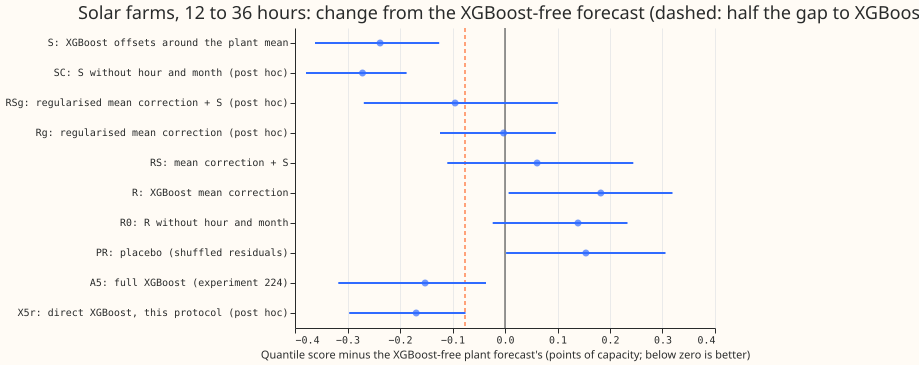
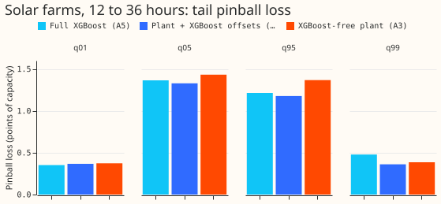
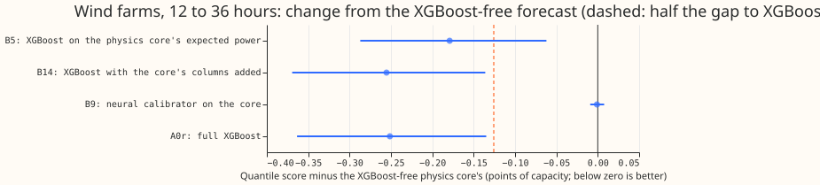

**Take-home.** For solar farms, XGBoost helps most when it predicts the spread around the physical
plant model's mean forecast. That forecast scores 4.3% better than the plant model alone and 1.6%
better than full XGBoost at 12 to 36 hours, and it scores best at the 0.99 quantile, the tail that
matters for curtailment. Correcting the plant model's mean with XGBoost made the forecast worse, by
as much as a model trained on shuffled data, which is why the experiment's placebo test fails. For
wind, an XGBoost stage on the physics model (from experiment 230) closes 71% of the gap to full
XGBoost at 12 to 36 hours.

[Experiment 234](../00234-no-xgboost-forecast-audit-part-1/result.md) found that forecasts with no
XGBoost, the gradient-boosted decision-tree model production uses today, score 2.8% worse for
metered solar farms and 5.0% worse for metered wind farms at 12 to 36 hours ahead. We asked whether
adding a small XGBoost model inside the XGBoost-free forecast closes at least half of that gap. For
solar we fitted three small XGBoost models on top of the plant forecast of [experiment
224](https://github.com/openclimatefix/nged-substation-forecast/pull/1533): one corrects the plant's
mean (R), one predicts 11 quantile offsets around the mean (S), and one does both (RS). For wind we
scored three XGBoost-based arms that experiment 230 already built on the wind physics model, without
refitting them. We scored on the stored forecasts' 12 to 36 hour band, with intervals from
resampling whole months and the three random seeds. A lower quantile score (twice the mean pinball
loss over 11 levels, in points of capacity) is better.

## Results

- **Decision rule outcome.** A sprinkled arm is kept when it closes half the gap and the placebo
  scores within 0.01 of the plant alone. Solar S closes the gap in size (change -0.238 against the
  needed -0.076, upper interval end -0.125) but the placebo PR scored +0.154, so by the rule as
  written nothing is kept. PR is the placebo of the mean-correction pipeline, and S has no placebo
  of its own (a gap in the design). Wind B5 closes the gap in size (-0.179 against -0.126, upper end
  -0.062), and no wind placebo was run.
- **Solar, scored year, 12 to 36 hours, 41,676 rows at six farms (quantile score).**
    - Plant alone (A3) 5.598; full XGBoost (A5) 5.446; the plant re-run in this code (A3r) 5.598.
    - S 5.360, which is -0.238 from A3 (98.3% interval -0.362 to -0.125) and -0.086 from A5 (-0.165
      to +0.004). S beats A3 at 5 of 6 farms.
    - R 5.780 (+0.182, +0.007 to +0.319); RS 5.659 (+0.061, -0.110 to +0.245); R0 (R without hour and
      month) 5.737 (+0.139); PR (placebo) 5.752 (+0.154, +0.002 to +0.306).
    - Replicate half-year (26,600 rows): S is -0.435 from A3 (-0.658 to -0.179) and -0.720 from A5
      (-1.100 to -0.332), because A5 scores 6.700 there against A3's 6.415.
- **Post hoc arms, run after the first scores were read.** They test why R and the placebo lost and
  why S won; the verdict does not depend on them.
    - A regularised mean correction (depth 2, at least 300 rows per leaf, 100 rounds at rate 0.05)
      Rg scores 5.595 (-0.003 from A3, -0.124 to +0.097), and its placebo PRg +0.043 (-0.072 to
      +0.163). The default XGBoost settings overfit the noisy residual.
    - RSg 5.503 (-0.095, -0.269 to +0.101): no better than S.
    - S without the error 48 hours earlier (SQ) is 0.025 worse than S (+0.001 to +0.057). S without
      hour and month (SC) 5.327 is 0.033 better than S (-0.079 to -0.003) and -0.119 from A5.
    - Direct XGBoost on experiment 224's arm-5 inputs under this protocol (X5r) 5.429 is -0.017 from
      A5 (-0.063 to +0.035), and S is -0.069 from X5r (-0.118 to -0.010): the plant mean as the
      centre is worth about 0.07 points.
- **Solar tails, 12 to 36 hours (pinball loss / coverage), A3, A5, S.** q01 0.374 / 0.032, 0.352 /
  0.034, 0.367 / 0.033; q05 1.433 / 0.055, 1.365 / 0.068, 1.329 / 0.066; q95 1.367 / 0.963, 1.214 /
  0.956, 1.177 / 0.946; q99 0.386 / 0.991, 0.478 / 0.996, 0.361 / 0.990. MAE of the median 9.918,
  9.810, 9.732.
- **Wind, 12 to 36 hours, 22,788 rows at three farms, three seeds.** Physics model alone (B1) 5.112;
  full XGBoost (A0r) 4.861 (gap 0.251). B5 (XGBoost with the physics model's expected power as base
  margin, 11 quantile outputs) 4.933: -0.179 from B1 (-0.287 to -0.062), which closes 71% of the
  gap, and +0.072 from A0r (+0.049 to +0.099). B14 (A0r plus the physics model's outputs as extra
  inputs) 4.857: -0.255 from B1 and -0.004 from A0r, so it is full XGBoost with extra inputs. B9
  (neural calibrator) 5.111, no change. Over all leads (321,363 rows) the gap is 0.077, and B5 is
  -0.034 from B1 (-0.073 to +0.011), 44% of the gap and not separable from zero.
- **Wind source and revision.** The wind arms are experiment 230's stored forecasts after its spread
  step was corrected, read before that experiment merged, so the numbers are provisional. With the
  corrected spread the 12 to 36 hour gap is 5.2% (5.112 against 4.861); experiment 234 quoted 5.0%
  from the earlier spread.
- **Schedule and settings.** Solar: XGBoost with three seeds, `colsample_bytree` 1.0, trained once on
  all ensemble months before the fold start (no weekly refits), 12 to 36 hour rows only. The plant
  scale, ceiling, and offset factors come from tuning months only. The ensemble members are the
  only weather source (ECMWF ensemble, available at forecast time).

## Checks

- **Median minus mean forecast per farm (points of capacity, 11-level mean).** A3 +0.27 to +0.48,
  A5 -0.48 to +0.02, S -0.12 to +0.83. None exceeds 1 point.
- **Error of the median beside the quantile score.** The MAE of the median moves with the quantile
  score for S (-0.186 from A3, -0.402 to -0.000), SQ, SC, and X5r, and for R (+0.324).
- **Audit triggers.** Two fired: the placebo PR lost 0.154 points where the rule required at most
  0.01, and PR's loss is as large as R's, so a control moved the score by more than its interval's
  half-width. We tested one explanation (an over-flexible mean-correction model) and recorded it
  above: regularising it removes most of the loss (PRg +0.043). Audit findings: see the audit
  section below.
- **Leave one farm out.** S has a lower quantile score than A3 at 5 of 6 farms in the scored year
  and 5 of 6 in the replicate, so the sign survives dropping any one farm.

## Caveats and what to try next

- **One fold and one weather source per type.** The solar result rests on one scored year and one
  replicate half-year at six farms. S has no seed-to-seed variation beyond the three seeds.
- **S has the plant's 48-hour-earlier error as an input,** which full XGBoost (A5) lacks. SQ shows
  that input is worth 0.025 points, so it does not explain S's 0.086-point lead over A5.
- **Nested out-of-fold residuals are second-order leaky at month boundaries.** The error 48 hours
  earlier of a training row can include a held-out target at the edge of a block of months.
- **Wind placebo and the all-leads band were not part of the solar-style check.** Wind uses
  experiment 230's own training, which differs from this experiment's protocol.
- **Next:** port S's idea to the wind physics model under this experiment's protocol (plant mean as
  the centre, an offsets model without the hour and month, and a regularised mean correction as an
  ablation), and test S on the 60 to 84 and 108 to 132 hour bands.

The code is in `ml-experiments/00240-no-xgboost-forecast-sprinkle-part-2/`.
