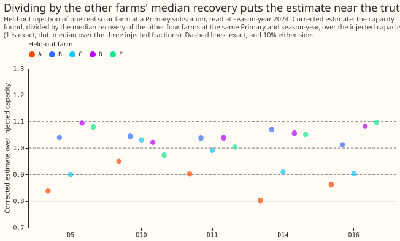
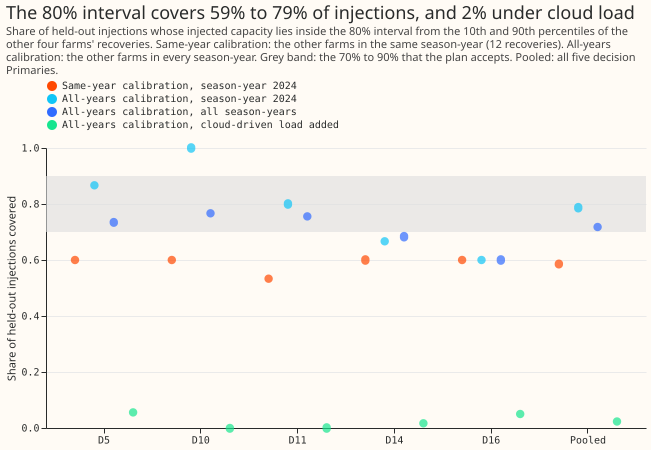

# PV capacity: how well does a calibrated interval cover?

**Take-home message: dividing the capacity found by the median recovery of other real farms removes
most of the bias, and the interval built from the same recoveries is too narrow to call an 80%
interval.** The corrected estimate is within 10% of the injected capacity at all five decision
Primaries when the calibration uses the same season-year. The interval covers 58.7% of held-out
injections with that calibration and 78.7% with the all-years calibration. The interval covers 0% to
2% when a
cloud-driven load is added to the Primary's demand.

**What was done.** The experiment fits nothing. It reads the recoveries that experiment 129 measured
when it added the recorded output of a real solar farm (the five farms A, B, C, D, and F are metered
generators and are
never named) to a Primary substation's power at 20%, 50%, and 100% of the Primary's pinned capacity,
for season-years 2019 to 2024. For each held-out farm at a Primary, the capacity found is divided by
the median recovery of the other four farms at the same Primary, and the 80% interval runs from the
capacity found divided by the 90th percentile of those recoveries to the capacity found divided by
the 10th percentile. The calibration set is either the other farms in the same season-year (12
recoveries) or the other farms in every season-year (up to 72 recoveries). D5, D10, D11, D14, and
D16 are the five decision Primaries (the substations whose capacity is judged). The recovery is the
capacity found with the farm added, minus the capacity found without it, divided by the injected
capacity, in the capacity unit of experiment 129 (the 99th percentile of alternating-current output
over daylight half-hours, in MW). The stored fits stop at 2026-07-01, so the maintainer's labelled
exception for capacity experiments (data to 2026-07-31) is not used, and no forecast is scored.

**Figure 1. The corrected estimate is within 10% of the injected capacity for 63 of 75 held-out
injections at the five decision Primaries (same-year calibration, season-year 2024).**

**Figure 2. The 80% interval covers 59% to 79% of held-out injections, and 0% to 2% when a
cloud-driven load is added.**

## Findings

- **The accuracy condition is met with same-year calibration.** The median absolute error of the
  corrected estimate is 0.032 to 0.094 of the injected capacity at the five Primaries (0.056 over
  all 75 held-out injections at season-year 2024), against 0.145 to 0.220 uncorrected (0.193
  pooled). The corrected estimate is within 10% for 84% of those injections.
- **The accuracy condition fails at 2 of 5 Primaries with all-years calibration.** The median
  absolute error is 0.104 at D5 and 0.103 at D16, and 0.031 to 0.056 at the other three. The
  corrected estimate is within 10% for 73% of the injections.
- **The coverage depends on the calibration set.** At season-year 2024 the interval covers 58.7% of
  the 75 held-out injections with same-year calibration and 78.7% with all-years calibration. Over
  all season-years (six at three Primaries, four at D14 and D16) the coverage is 60.8% and 71.8%
  (390 injections). The target is 70% to 90%.
- **The two conditions are met by different calibration sets, so neither set meets both.**
  Same-year calibration meets the accuracy condition and misses the coverage range. All-years
  calibration is in the coverage range and misses the 4-of-5 accuracy requirement (3 of 5 Primaries
  pass). The
  plan did not say which calibration set decides, and the decision rule is not met by either.
- **A cloud-driven load breaks the calibration.** With experiment 129's cloud-driven load added to
  the held-out injection, the median corrected estimate is 26% to 30% too high (a median ratio of
  1.26 to 1.30 at season-year 2024) and the interval covers 0% to 1.3% of injections (2.3% over all
  seasons with all-years calibration).
- **The sample is smaller than it looks.** The 3 injected fractions at each farm give nearly the
  same recovery, so the 75 injections at season-year 2024 are about 25 distinct farm and Primary
  pairs, and the Primaries share the same weather. With about 25 pairs, a coverage of 79% has a
  standard error of about 0.08.

## Checks

- **Row counts:** every Primary holds 15 injections without load and 15 with load per season-year,
  except D14 and D16, which start at season-year 2021.
- **Reproduction:** the stored recovery equals the capacity found with the farm minus the capacity
  found without it, divided by the injected capacity, to within 1e-9, as the script checks.
- **Median forecast minus mean forecast, and the mean-forecast error:** not applicable, because the
  experiment scores no forecast.
- **Audit triggers** (the seven triggers in the `ml-experiment` skill's "Audit before merge"):
  none of triggers 1 to 6 applies, because the experiment has no control, no sister experiment, and
  no nested arm. Trigger 7 may apply, because a later design may depend on the finding that the
  interval is not an 80% interval. The maintainer's decision on an audit is pending.
- **Review:** one Sonnet review of the code and the page.

## Limits

- **The injections zero the farm's output when the sun is under 15 degrees above the horizon.**
  Experiment 239 found that keeping that output raises the recovery by 0.033, so the recoveries
  here understate a farm that produces in winter. Dividing a real farm's estimate by them would
  overstate its capacity by about 4%.
- **The calibration uses four farms,** so the 10th and 90th percentiles sit close to the smallest
  and
  largest recovery, and a fifth farm falls outside that range at least 2 times in 5.
- **The farms sit tens of kilometres from the Primaries,** so a real unmetered farm near the
  Primary may differ in orientation and size from the five farms.

## What the next experiment should answer

- **Does a wider interval cover 80% of new farms?** Widening the interval to the full range of
  the four recoveries, or taking the 90% interval from the all-years calibration, would test the
  coverage without changing the correction. The prediction that could fail is a coverage of 70% to
  90% at 4 of 5 Primaries.
- **How large is the shift from a cloud-driven load in real demand?** The correction is
  26% too high in that case. A measured demand response to cloud would show whether the shift is
  realistic.

## Plan: design

- **Held-out injection.** One Primary, one farm, one fraction (20%, 50%, or 100% of the pinned
  capacity), and one season-year. The calibration set holds the same Primary's injections of the
  four other farms, without cloud-driven load. The held-out farm never enters its own calibration.
- **Corrected estimate.** The capacity found divided by the median recovery of the calibration
  set. Its ratio to the injected capacity is the held-out recovery divided by that median.
- **Interval.** The capacity found divided by the 90th percentile of the calibration recoveries
  (lower end), and by the 10th percentile (upper end).
- **Two calibration sets.** The four other farms at the same season-year as the held-out
  injection (12 recoveries), and the four other farms over all six season-years (72 recoveries).
- **Reading.** The decision reads season-year 2024, the last complete season-year, over 15 held-out
  injections per Primary (5 farms by 3 fractions). Coverage over all six season-years is reported
  beside it.
- **Shift.** The same intervals applied to injections with a cloud-driven load added (experiment
  129's `cloud_load` rows) show whether the calibration survives demand that follows cloud.
- **Limit to state.** The injections of experiment 129 set the farm's output to zero when the sun
  is lower than 15 degrees above the horizon, so the recoveries understate a farm that produces in
  winter.

## Plan: checks

- **Row counts:** every Primary and season-year holds 15 injections without load, and 15 with load.
- **Reproduction:** the stored recoveries equal the capacity found with the farm minus the capacity
  found without it, divided by the injected capacity.
