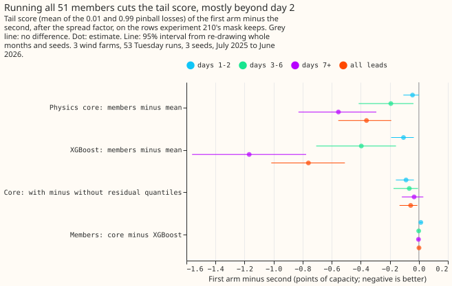
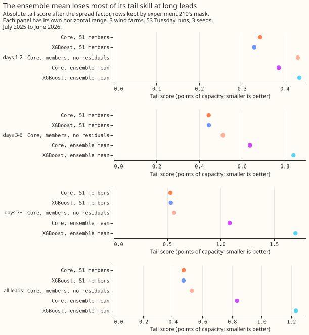
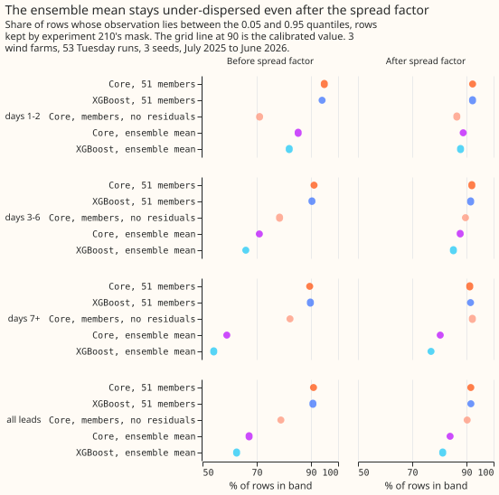

**Take-home: keep running all 51 ensemble members through the wind model.** Running the wind model
once on the ensemble mean of the weather instead raises the tail score (the mean of the 0.01 and
0.99 pinball losses, in points of capacity) from 0.47 to 0.83 for the physics core and to 1.23 for
XGBoost, and the change comes entirely from the 0.99 quantile. The likely cause, which this
experiment did not test directly, is that averaging the members removes the high winds that give
full output, so the upper tail comes out too low. The single spread factor tried here, which widens
the forecast about its median, did not repair that. The physics core and XGBoost differ by under
0.01 points on the tails, so the choice between them does not matter for the tails.

This experiment asks whether the 1% and 99% quantiles of three metered wind farms (labelled W1 to
W3) are better when each of the 51 ensemble weather members (ECMWF ENS) goes through a wind model
and the 51 forecasts are combined into one distribution, or when the wind model runs once on the
average weather. A wind model here turns weather inputs into power, trained on ERA5, the
past-weather estimate. We refitted [experiment 230](../00230-wind-physics-core-part-1/result.md)'s
two wind models, a physics-based power curve (the core) and an XGBoost model, and ran each both ways
on its 53 Tuesday forecast runs. Running the members scored better in every comparison. At days 1
and 2 the physics core's gap includes zero, and the gap grows with lead time. This result narrows
the tail question to "run the members, whichever wind model", and leaves open whether a cheaper
route can keep the tails.

## Results

Scores are in points of capacity (smaller is better), on the rows that experiment 210's mask keeps,
for W1, W2, and W3 over 53 Tuesday runs from July 2025 to June 2026. The tail score T is the mean of
the 0.01 and 0.99 pinball losses. Intervals resample whole months and the three seeds, not farms, so
they describe these three farms. The decisive intervals, including the by-band ones, are corrected
to 98.75% across the four contrasts. Experiment 210's mask drops rows where the observed power is an
idle-band measurement artefact. The schedule was one fit per farm, on valid times before 2025-06-17,
with no later refitting.

- **C1, physics core, members minus mean: -0.361 (interval -0.612 to -0.157).** By lead band: days 1
  and 2 -0.043 (-0.131 to 0.008), days 3 to 6 -0.193 (-0.491 to -0.028), days 7 and later -0.554
  (-0.906 to -0.235).
- **C2, XGBoost, members minus mean: -0.760 (-1.079 to -0.450).** Days 1 and 2 -0.106 (-0.217 to
  -0.023), days 3 to 6 -0.396 (-0.807 to -0.128), days 7 and later -1.168 (-1.667 to -0.683).
- **C3, core with minus without residual quantiles: -0.056 (-0.162 to -0.005).** The residual
  quantiles help, slightly.
- **C4, members, core minus XGBoost: +0.001 (-0.007 to 0.008).** The tail scores differ by under
  0.01 points.
- **All of the change in T comes from the 0.99 quantile.** The 0.99 pinball loss is 1.378 for the
  core on the mean against 0.658 on members, and the 0.01 loss is 0.289 against 0.288.
- **Quantile score (nine levels):** core members 11.79, core mean 12.20, XGBoost members 11.66,
  XGBoost mean 12.34, core members without residuals 12.02. The members results reproduce experiment
  230's B1 (11.79) and A0r (11.66).

| Arm | T, all leads | T, days 1 and 2 | Coverage, all leads (%) | Coverage before the spread factor (%) |
|---|---|---|---|---|
| XGBoost, 51 members | 0.472 | 0.329 | 91.6 | 90.7 |
| Core, 51 members | 0.473 | 0.343 | 91.6 | 90.9 |
| Core, members, no residuals | 0.529 | 0.431 | 90.3 | 78.9 |
| Core, ensemble mean | 0.833 | 0.386 | 84.0 | 67.2 |
| XGBoost, ensemble mean | 1.232 | 0.435 | 81.3 | 62.6 |

## Checks

- **Median minus mean forecast, per farm (points):** the members route sits 5.4, 5.6, and 4.7 points
  below the mean at W1, W2, and W3 for the core, and the mean route 1.7, 2.4, and 2.1. The members'
  median lies further below the mean because the mixture has a long upper tail, so the skew is real
  and not a shifted spread.
- **Error of the mean forecast beside each quantile contrast:** the mean absolute error contrast has
  the same sign: C1 -0.182 (-0.318 to -0.025) and C2 -0.308 (-0.516 to -0.068), 95% intervals.
- **Leave one farm out (95% intervals):** C1 and C2 stay negative without any one farm (C1 -0.29 to
  -0.48, C2 -0.62 to -1.00). C3's interval includes zero without W2.
- **Audit triggers** (the seven in the `ml-experiment` skill): trigger 2, a result contradicting its
  prediction, fired on size and not on direction. The prediction was 0.02 to 0.08 points, and C1 and
  C2 are about 7 and 15 times the middle of that range. The explanation was tested, and the Results
  bullets give it: the 0.01 loss does not move and all of the change in T comes from the 0.99 loss.
  The prediction also named days 3 to 6 as the largest gap, and the largest gap is at days 7 and
  later. No other trigger fired, and no Opus audit was run.
- **Prediction record:** the mean route's raw coverage at days 1 and 2 was 85.3% (core) and 82.0%
  (XGBoost), under 88% as predicted. The members route's raw coverage there was 94.9% and 94.1%,
  above the predicted 88% to 92%.

## Caveats

- **The pre-registered text is unchanged.** The hypothesis, prediction, and decision rule in the
  front matter are as committed before any fit.

- **Weather source:** ERA5 (training, about 5 days late) and ENS members (inference, available at
  forecast time).
- **Ensemble mean of direction:** the mean route averages the direction sine and cosine columns, so
  the pair is no longer a unit vector when members disagree. The unit-vector error affects XGBoost's
  mean route only, because the physics core ignores direction.
- **Ensemble mean:** the mean route averages the inputs. Averaging the 51 outputs is the members
  route's centre and was not run separately.
- **Not scored:** the curtailment-cost metric (it needs a node with its generators). The tail score
  is the proxy.
- **Three farms:** W1 to W3 only, and one year.

## What to try next

- **A cheaper route that keeps the tails:** a small neural network, or a quantile regression, that
  maps the ensemble mean and the ensemble standard deviation of the weather to the 11 quantiles.
  Pre-register a gain over the members route of at least 0 on T and a cost saving; the prediction
  that could fail is that it stays 0.1 points worse than members on T beyond day 6.
- **Separate spread factors per tail:** the factor scales about the median and is fitted on the 5%
  to 95% band, so a factor for each tail would test whether the upper tail of the mean route can be
  repaired.
