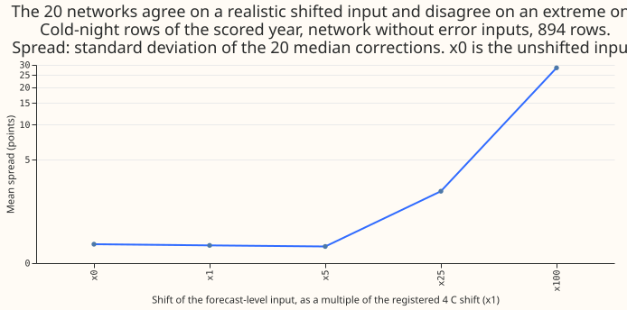
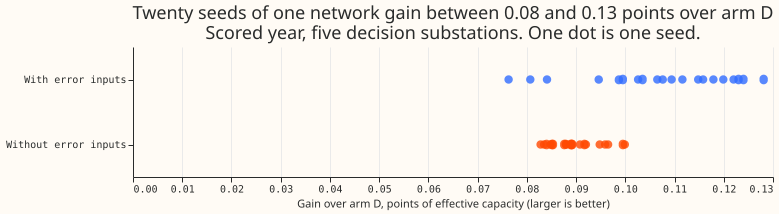
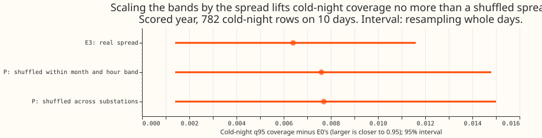

**Take-home: the spread of 20 independently trained neural networks does not predict how wrong the
substation demand forecast is on cold nights, so it cannot set the width of the cold-night
prediction bands.** On cold nights the 95% quantile of E0's bands (the combined bands of experiment
169) covers 0.8875 of the readings, against a nominal 0.95. Scaling the bands by the spread raises
that coverage to 0.8939, and scaling by a randomly shuffled spread, a control, raises it to 0.8951.
The registered check that the spread reacts to an unusual input failed, so the verdict is
`inconclusive`, although every contrast points the same way as `refuted`. The experiment cannot rule
out other uses of the spread.

**The question.** We asked whether the demand forecast's cold-night errors reflect information that
the
correction network lacks, which the disagreement between independently trained copies of the network
would show.
[Experiment 192](../00192-dp-ens-members-temperature-cold-nights/result.md) found that the 51
ensemble
weather members differ too little to signal the error. A cold night is a winter night (November to
March, evening or night hours) whose ERA5 day-mean temperature (the European Centre for Medium-Range
Weather Forecasts' estimate of past weather) is
below 2 C.

**The method.** We trained 20 copies of the pooled correction network of [experiment
200](../00200-dp-pooled-correction-head-on-kalman-state/result.md) and [experiment
211](../00211-dp-boosted-tree-calibrator-and-input-ablations/result.md), once without and once with
recent-error inputs, with different random seeds, or on bootstrap resamples of whole months. The
error inputs are the
forecast's recent errors. The correction network is a small neural network that shifts and rescales
the quantiles of arm D, the best day-ahead forecast of experiment 155. Deep ensembles are the method
of [Lakshminarayanan et al. (2017)](https://arxiv.org/abs/1612.01474). The spread of
the 20 corrections scaled the bands of E0, the combined bands of [experiment
169](../00169-calibration-combined-fixes-and-ensemble-spread/result.md) (arm D with experiment
[160](../00160-calibration-band-width-fix-on-stage-2-winner/result.md)'s smooth table and experiment
[164](../00164-calibration-cold-night-tail-under-coverage/result.md)'s widening). Scores are
quantile
scores in points of effective capacity, lower is better, on experiment 211's rows: scored year
2025-07-02 to 2026-06-29, leads 15.5 to 39 h, five decision substations (D5, D10, D11, D14, D16).
A row is one substation's forecast for one half-hour from one run.

**The caveat.** The scored year holds 782 cold-night rows on 10 days, so every cold-night number is
noisy.

## Results

- **Gate (failed).** The registered shift (4 C times the substation's cold-night slope, applied to
  the
  forecast-level input) lowered the spread of the network without error inputs from 0.426 to 0.393
  on
  the 18 injected rows (ratio 0.92, 95% interval 0.87 to 0.99) and from 0.387 to 0.360 on all 894
  cold-night rows (the 782 rows of the decision substations plus D9's 112). The rule needed a ratio
  of at least 1.1, so the verdict is capped at `inconclusive`.
  The failure comes from the gate's design: cold-night inputs already sit at the 70th to 95th
  percentile
  of each substation's training levels, so the registered shift moves them towards the middle. A
  shift
  of 25 times the size raised the spread 6.4-fold, and the opposite sign gave 1.10 (the audit's post
  hoc check).
- **Prediction 1 (fails).** Cold-night Spearman correlation of the seed-ensemble spread with the
  absolute error of E0's median: 0.00 (95% day-resampled interval -0.19 to +0.18) in the scored
  year,
  -0.16 (-0.50 to +0.34) in the replicate even months on 257 rows over 4 days, -0.07 in the odd
  (tuning)
  months. Over all rows it is 0.27 (0.25 to 0.29). The error-input networks reach 0.29 (0.05 to
  0.41)
  in the scored year and -0.01 in the replicate months. Pre-registered rule: at least 0.2 with a
  lower
  bound above 0.1 in both years.
- **Prediction 2 (fails).** E0's cold-night q95 coverage is 0.8875 on these rows (0.896 in
  experiment
  169 over leads to 168 h). E3 reaches 0.8939 (+0.0064, 0.0014 to 0.0116), below 0.90. The placebo P
  (20 shuffles within substation, month, and hour band) reaches 0.8951, E3 minus P is -0.0012
  (-0.0036
  to 0.0000), and the shuffle across substations gives +0.0077. E3's q95 scale is 1.017 plus 0.024
  per
  unit of spread above the 90th percentile; the intercept alone gives the whole lift.
- **Prediction 3 (passes).** The 20 single-network gains over arm D range from 0.083 to 0.100 (mean
  0.090, standard deviation 0.0052) without error inputs and from 0.076 to 0.128 (mean 0.107,
  standard
  deviation 0.0147) with them (figure 3).
- **Arms, scored year, five decision substations.** Arm D 2.4317, E0 2.4302, E1 (mean of the 20
  corrections, arm D's offsets) 2.3315 without and 2.2920 with error inputs, E1 bagged 2.3328 and
  2.3095, E3 2.4307 (E3 minus E0 +0.0005, -0.0021 to +0.0030). Replicate even months: E3 minus E0
  +0.0009 (-0.0023 to +0.0042). E3 on the error-input spread scores 0.007 lower than E0 (-0.0124 to
  -0.0021), post hoc and descriptive: it was not the registered arm and the placebo was run on the
  reference spread only.
- **Tail calibration, scored year (coverage / pinball loss; nominal 0.01, 0.05, 0.95, 0.99).** All
  rows,
  E0: q01 0.022 / 0.386, q05 0.064 / 1.265, q95 0.948 / 1.320, q99 0.981 / 0.416. All rows, E3:
  0.022 / 0.387, 0.072 / 1.273, 0.950 / 1.319, 0.984 / 0.410. Cold nights, E0: 0.042 / 0.751,
  0.088 / 1.752, 0.887 / 1.491, 0.962 / 0.420. Cold nights, E3: 0.043 / 0.754, 0.091 / 1.764,
  0.894 / 1.475, 0.972 / 0.397. Cold nights, E1 without error inputs: 0.038 / 0.629, 0.086 / 1.594,
  0.797 / 1.859, 0.910 / 0.661;
  the network head moves the cold-night upper tail further from nominal than E0.
- **Checks.**
    - Median minus mean forecast: E0's median equals its mean at every substation (difference 0.0);
      E1's centre minus the mean is -0.52, 0.01, -0.35, 0.19, and -0.04 at D10, D11, D14, D16, and
      D5.
    - Mean-forecast error beside the contrasts: E3 shares E0's centre, so its centre error is E0's
      (mean error -0.32, absolute error 4.19). E1's centre scores 4.06 absolute error against 4.19,
      the
      same direction as its score gain. On cold nights E1's mean error is +1.78 against E0's +1.22
      and
      its absolute error 5.10 against 5.14.
    - Leave one substation out: E3's cold-night coverage lift stays positive at all five substations
      (+0.004 to +0.009); the all-row score contrast changes sign (D11 -0.0014, D10 +0.0023), inside
      its interval.
    - Triggers: the failed gate (a known-answer test) fired trigger 1 of the skill's seven audit
      triggers (a control fails), so a fresh Opus audit
      re-derived every headline from the stored files and found no error that changes a number or
      the
      verdict (the report is in the private briefs folder). Its points: row alignment and
      out-of-sample
      head sets correct, no leakage in the training masks, the gate wired correctly and failing by
      design, E3's lift from its intercept alone. Trigger 6 (a headline interval under half as wide
      as a sister
      experiment's) is not met on like rows: experiment 169's interval covers leads to 168 h and
      resamples
      months, this experiment's covers 15.5 to 39 h and resamples days.
- **Caveats.** The gate injects through the forecast-level input because the networks have no
  temperature input, and its slope uses ERA5 temperature rather than the ensemble-mean temperature.
  The replicate year uses two cross-fit network sets trained on 3 to 5 months of ensemble-weather
  rows
  each, so it is not like-for-like with the scored year. D9's training data starts in 2024.
  Schedule:
  one fit per network, no retraining cadence; the contrasts do not depend on it.
- **What to try next.** (1) An input-distance score (the forecast level's distance from its training
  range) as the band-width covariate, since the spread tracks it at 0.50 on cold nights. (2) A bias
  correction of the mean forecast at ensemble-mean temperatures near 0 C, as experiment 169
  proposed.
  (3) A small neural layer is not indicated by this result; the prediction that could fail is that a
  learned scale on the cold-night residual beats the constant 1.017 widening on 3 winters.

## Pre-registration amendments (made before any score or spread was read)

- **Early stopping and purge.** The `full` and `cfx` sets stop on 2025-04-28 to 2025-06-24; `cfy`
  stops on 2024-10-01 to 2024-11-10, because its held-out half contains the usual block. All
  early-stopping blocks come from the training half. A 15-day purge sits on both sides of each
  held-out half and each early-stopping block. The cross-fit networks see 3 to 5 months of ensemble
  weather rows, fewer than the full set's 12, so the replicate-year numbers are not like-for-like
  with the scored year.
- **Normalisation and knots.** The spread `z` is divided by the median spread of the tuning months
  of the same head set, and the knots are the 50th and 90th percentiles of the tuning months. The
  scored year is divided by the full set's own tuning-month median. The tuning-month spread
  distributions of the cross-fit and the full sets are plotted side by side.
- **Months.** E3 is fitted on all rows of the odd months (tuning) of 2024-07 to 2025-06, never on
  cold nights alone. The replicate-year test of prediction 1 uses the even months; the odd months
  are reported beside it. Cold-night row and day counts of each period are printed; if the tuning
  months hold fewer than 300 cold-night rows, the cold-night result is read from the scored year
  and the replicate even months alone.
- **Intervals.** Spearman correlations and coverages carry 95% intervals resampled by valid day.
  Prediction 1 passes when the point estimate is at least 0.2 and the interval's lower bound is
  above 0.1. E3 passes prediction 2 on a point estimate of 0.90 or more, and the write-up states
  whether the lift over E0 exceeds its interval.
- **Placebo.** Primary P shuffles `z` among rows of the same substation, valid month, and hour band,
  20 times (seeds 0 to 19); the reported lift is the mean over shuffles. A second placebo shuffles
  among all substations (descriptive). P is read as a difference from E3 in cold-night q95 coverage
  over resampled days. E3 must lift coverage by at least 0.005 for the "P's lift under half of E3's"
  clause to apply.
- **Gate.** The forecast level (`mean`, divided by 100) is one of the network's inputs, so the
  injection reaches the networks. The cold-night slope of the forecast level on ensemble-mean
  temperature is fitted on the training months (2020 to 2025-06) of each substation. The rows are
  picked with seed 244, the spread is computed twice on the same rows (clean and injected), and
  the number of injected rows and days is printed. The gate reads spread only, no coverage or score.
- **Prediction 3.** The seed-to-seed spread is the standard deviation, across the 20 seeds, of each
  single network's scored-year all-row quantile-score gain over arm D, using the network's own
  bands (arm D offsets), in points of effective capacity.
- **Extra arms and reports.** E1's own score (ensemble-mean centre, arm D offsets) is reported so
  the
  change of centre is separate from the band scaling; E3's centre is E0's mean. E3 fits the levels
  0.01, 0.05, 0.10, 0.25, 0.75, 0.90, 0.95, and 0.99 as experiment 169 did; the middle three levels
  (0.40, 0.50, 0.60) keep E0's offsets. The spread of the log scales is reported as a second
  covariate (Spearman only). E3 on the bagged spread (E2) is fitted too and reported as descriptive.
  The coverage by spread decile is the first figure, and the 20 seed gains and the placebo follow.
  Experiment 201's three stored corrections are not used. Experiments 160, 164, 169, 192, 200, 201,
  209, and 211 are cited in the write-up.
