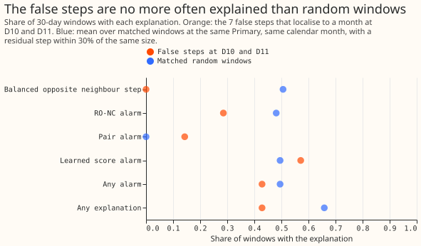
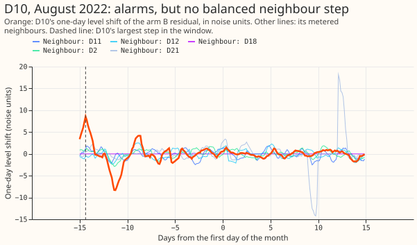
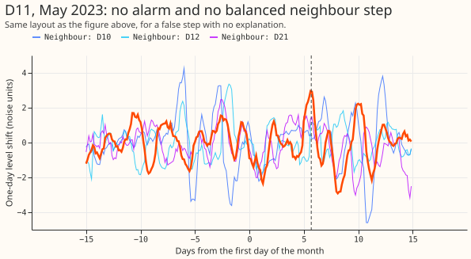

# Are the false steps in the meter-regime test load shifts between Primaries?

**The false steps in experiment 207's test are not load moved between connected Primaries, and the
load-shift detectors do not explain them.** Experiment 207 fitted a solar capacity for each month to
the power of a Primary substation (a substation that feeds homes and businesses), and the fit
showed jumps in capacity in years where we had added nothing. We asked whether those jumps are
real transfers of load between neighbouring Primaries, which would also appear as a step in the
Primary's demand forecast error. We took the 7 jumps at D10 and D11 that fall in a single month,
and checked whether a neighbouring Primary's forecast error stepped the opposite way by a similar
amount within 6 hours of the largest step at the Primary, or whether any of three load-shift alarms
(RO-NC, the pair alarm, and the learned score of experiment 195) fired within 24 hours. We repeated
the check on random 30-day windows at the same Primary and calendar month, with a step of similar
size, to see what chance would give. Experiment 245 only reads stored results and fits nothing. The
result narrows the search: the capacity jumps and the load-shift detectors are separate problems,
and the first thing to check at the jumps is the cleaning rule's zero readings.

**Verdict `not supported`.** The pre-registered prediction (at least half of the false steps
explained, at twice the base rate) fails. At D10 and D11, 3 of 7 localised false steps have an
explanation (0.43), against a matched base rate of 0.66 (ratio 0.65; 95% interval 0.19 to 1.0
from resampling the 7 false steps). No false step has a balanced opposite neighbour step (0 of 7,
base rate 0.51). The gate of experiment 207, recounted with the explained steps removed, passes at
D10 (0.80 false steps per year, from 1.73) and still fails at D11 (1.00). Chance alone would have
removed a similar share, so the recount shows nothing about cause. No verdict on experiment 207 is
given.

## Checks

- **Explained share (7 localised false steps at D10 and D11, base rate from matched windows):**
  balanced opposite neighbour step 0 of 7 (0.00; base 0.51), RO-NC alarm 2 of 7 (0.29; 0.48), pair
  alarm 1 of 7 (0.14; 0.00), learned score alarm 4 of 7 (0.57; 0.50), any alarm 3 of 7 (0.43;
  0.50), any explanation 3 of 7 (0.43; 0.66). The one pair alarm is at D11, August 2022, where no
  matched window had one, so a single event moves that row.
- **Ratio to the base rate, any explanation:** 0.65 (0.19 to 1.0) at D10 and D11, 0.75 at D10
  alone (5 events), 0.00 at D11 alone (2 events); for all four Primaries with false steps (8
  events) 0.71 (0.26 to 1.0).
- **Wider window:** an alarm anywhere in the 30-day window at 4 of 7 false steps, against 0.55 of
  matched windows.
- **Cleaning flags (descriptive, not scored):** 3 of the 10 localised false steps (D11 August 2022,
  D11 May 2023, D14 August 2022) have 1 to 7 half-hourly readings of 0 MW that the cleaning rule
  flags `substation_zero` within a day of the Primary's largest step, against 0 of 241 matched
  windows. A zero reading is kept in the data the model sees, so it may drive the step. No false
  step is within a day of a bank holiday (matched windows: 0.11).
- **Sign:** the largest residual step has the same sign as the capacity step in 4 of the 10
  localised false steps and the opposite sign in 6.
- **Forecast checks:** no forecast is scored, so the median-minus-mean forecast and the
  mean-forecast error do not apply.
- **Audit triggers:** none fired. The failed prediction was pre-registered as a possible outcome,
  no control or nested arm exists, leaving D10 or D11 out does not change the verdict (0.60 against
  0.80 at D10, 0.00 against 0.30 at D11), and no later experiment depends on the result.

## Notes

- **Row definition:** the localised false steps are experiment 207's step path at weight 0.3 with no
  injection, summer rows of 2022 to 2024, 5 row sets per Primary counted once. A false step that
  falls between two summer months is dated to a 30-day window centred on the first day of the later
  month. The window is wide because the fit sees one level per month.
- **Gate recount:** per Primary, false steps per year before and after removing the explained ones:
  D5 0.00 and 0.00, D10 1.73 and 0.80, D11 1.00 and 1.00, D14 0.93 and 0.67, D16 0.60 and 0.27.
  The August-to-April net change counts 10 of D10's 26 false-step counts and 5 of D11's 15, and it
  cannot be dated, so the recount keeps it. Without it (post hoc) the false steps per year before
  any removal are D10 1.07 and D11 0.67.
- **Own step:** the largest one-day level shift of the arm B residual in the window, needing 3
  noise units. The step falls at the window's edge for D10 in August 2022 (Figure 2), so a window
  that is too wide can pick a step from the neighbouring month.
- **Alarms:** RO-NC from experiment 130 arm B, the pair alarm and the logistic learned score from
  experiment 195 (any of its three folds, so the learned score covers more alarms than one fold).
- **Matched windows:** 241 windows over the 8 events with controls (10 to 62 per event, none for
  D14), within 30% of the false step's own residual step.
- **Caveats:** 7 events at the two failing Primaries cannot show a small effect; the interval on the
  ratio is wide. A month-resolution capacity step cannot show cause. The lab shortcuts are ERA5
  weather in the residual model of experiment 130 and hindsight alarm tables.

## What the next experiment should answer

Whether the three `substation_zero` readings beside false steps are the cause. A fit that masks
readings of 0 MW flagged by the cleaning rule, and drops the August-to-April net change from the
false-step count, would show how many of the 26 and 15 false-step counts remain at D10 and D11.
