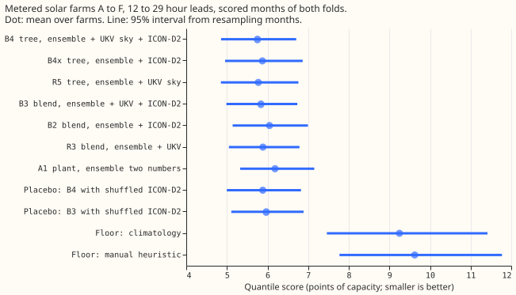
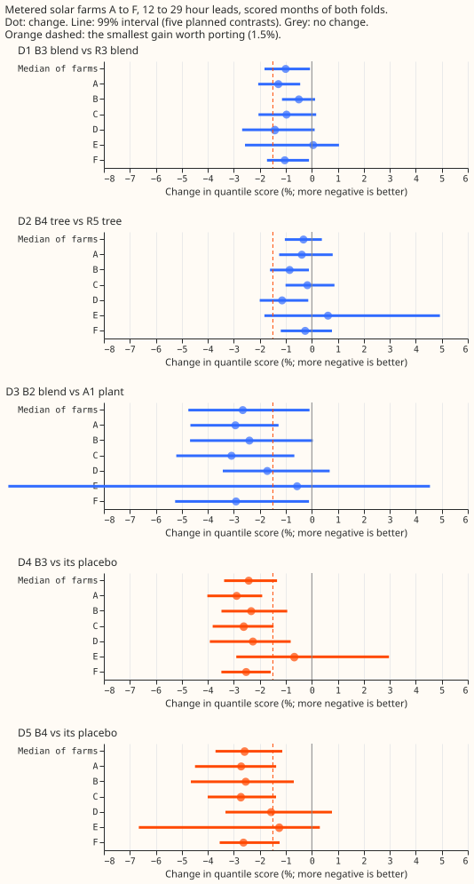
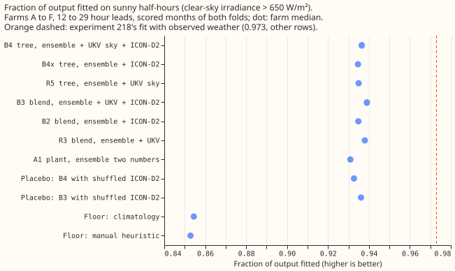

**Adding the German ICON-D2 weather forecast to the ECMWF ensemble and the Met Office UKV lowers the
day-ahead error of a metered solar farm by 1.0%, which is under the 1.5% we set as worth a fourth
weather source.** ICON-D2 is the Deutscher Wetterdienst's regional weather model (2 km grid, run
every 3 hours). The error is the quantile score: twice the mean pinball loss over 11 quantile
levels, in points of capacity. The tree with ICON-D2 columns is 0.3% lower than the tree without
them, with an interval that includes zero. The UKV used here is the research archive on the Centre
for Environmental Data Analysis (CEDA), which differs statistically from the live UKV, so any gain
is an upper limit for production.

We asked whether a metered solar farm's output is forecast better from ensemble, UKV, and ICON-D2
together than from ensemble and UKV. For each of six farms, A to F, we compared the plant model on a
blend of the three products' irradiance (arm B3) with the blend of ensemble and UKV (arm R3), and a
second-stage tree with ICON-D2 columns (B4) with the tree without them (R5). R3 and R5 are
[experiment 229's](../00229-metered-farm-ens-ukv-blend/result.md) arms A3 and A5, re-run on these
rows. The verdict is a small gain. The pre-registered prediction was a gain under 1.5% with an
interval including zero; the B3 interval excludes zero by a small margin (-1.8% to -0.1%).

## Results

- **Arms.** B2 is the plant model on a convex blend of the ensemble and ICON-D2 plant forecasts,
  with weights by UKV cloud band, so B2 also uses UKV's cloud forecast. B3 is the same on ensemble,
  UKV, and ICON-D2, with weights in steps of 0.1 by UKV cloud band, fitted on the other farms. B4 is
  the second-stage tree on ensemble columns, UKV shortwave, cloud, and plant-forecast columns, and
  six ICON-D2 columns (shortwave, direct radiation, air temperature, wind speed, the plant response
  to ICON-D2, and the plant forecast). B4x is the tree on ensemble and ICON-D2 columns only. The
  placebos are B3 and B4 with ICON-D2 taken from a random row of the same month, hour band, and
  cloud band.
- **Rows.** The rows are 19,225 daylight half-hours (sun more than 5 degrees above the horizon) of
  six farms that have a complete UKV run and an ICON-D2 value, valid 12 to 29 hours after the
  ensemble run's 00 UTC start. The folds, the tuning months, and the 10 scored months are those of
  experiment 229. ICON-D2 enters through Open-Meteo's Previous Runs file (`previous_day1`, the run
  Open-Meteo labels as made about 24 hours before), assumed published 3 hours after the run starts,
  so the latest valid time available at an 08 UTC forecast origin is 29 hours out. The ICON-D2
  tables hold no usable rows before 2024-04, so each fold is tuned on the months from 2024-04 to
  just before it.
- **The quantile score at 12 to 29 hours** (mean over farms, 95% interval) is 5.75 (4.86 to 6.71)
  points of capacity for B4, 5.77 (4.85 to 6.76) for R5, 5.84 (4.99 to 6.73) for B3, 5.87 (4.96 to
  6.87) for B4x, 5.89 (5.05 to 6.79) for R3, 6.05 (5.14 to 7.00) for B2, and 6.19 (5.33 to 7.15) for
  the ensemble plant A1. The placebos score 5.88 (B4) and 5.97 (B3), climatology 9.25, and the
  manual heuristic 9.62.
- **The planned contrasts** are the median over six farms of the percentage change, with 99%
  intervals (the Bonferroni level for five contrasts). D1, B3 against R3, is -1.0% (-1.8 to -0.1).
  D2, B4 against R5, is -0.3% (-1.0 to +0.4). D3, B2 against A1, is -2.7% (-4.8 to -0.1). D4, B3
  against its placebo, is -2.4% (-3.4 to -1.3), and D5, B4 against its placebo, is -2.6% (-3.7 to
  -1.1). The hypothesis needed D1 or D2 at least 1.5% lower, and neither is. D1's interval excludes
  zero at 2 of 6 farms (A and F), D2's at 2 (B and D).
- **Shuffling ICON-D2 raises the error by more than adding ICON-D2 lowers it.** D4 and D5 are larger
  than D1 and D2 because the blend weights and the tree are fitted on the real ICON-D2, so a
  shuffled column breaks the fit. The placebo contrasts show that ICON-D2 carries information about
  the day; D1 and D2 show how little it adds to the other two products.
- **ICON-D2 is weaker than the ensemble and highly correlated with it.** On sunny half-hours the
  correlation of plant-forecast errors is 0.76 between ICON-D2 and the ensemble, 0.60 between
  ICON-D2 and UKV, and 0.59 between UKV and the ensemble. B3's weights, averaged over the farms and
  both folds, are 0.44 ensemble, 0.36 UKV, and 0.20 ICON-D2 in the clearest cloud band (UKV cloud
  under 30%), 0.60, 0.22, and 0.18 in the middle band, and 0.70, 0.20, and 0.10 in the cloudiest. In
  B2 ICON-D2 receives 0.42, 0.27, and 0.20 in the same bands. Ensemble plus UKV (X1) is 5.0% better
  than the ensemble alone on these rows (-7.6 to -2.3), nearly twice B2's 2.7%. The shuffle placebo
  draws a random row of the same farm, month, hour band, and cloud band, which may be the row
  itself.
- **On sunny half-hours the plant fit rises by 0.008.** The fraction of output fitted (clear-sky
  irradiance above 650 W/m², median over farms) is 0.931 for A1, 0.935 for B2, 0.938 for R3, and
  0.939 for B3. The gap to 0.973 (experiment 218's fit with observed weather, on other rows) is
  0.042 for A1, and B3 closes 19% of that gap, compared with 17% for R3.
- **The tails are not calibrated at the lowest levels for any arm, nor at q05 and q95 for the
  trees.** Pooled over farms, the coverage at q01 is 0.041 for A1, 0.040 for R3, and 0.040 for B3,
  against 0.01 nominal. At q99 it is 0.993 for all three. The trees are worse at q05 (0.123 for B4
  and 0.122 for R5 against 0.05) and at q95 (0.917 and 0.919 against 0.95). B3 beats the manual
  heuristic's quantile score by 41% (X3, -49.6 to -31.5). The curtailment value is not scored.
- **The checks show no spread shifting the forecast.** The mean forecast's absolute error points the
  same way as the quantile score (10.25 for B4, 10.31 for R5, 10.37 for B3, 10.46 for R3, and 11.13
  for A1, in points of capacity). B3's gain over R3 is negative at 5 of 6 farms (not at E, +0.05%),
  and both folds agree: B3 scores 5.22 against R3's 5.26 on the scored fold, and 6.38 against 6.42
  on the replicate.
- **The data gate passed.** ICON-D2 shortwave peaks in the same hour as the clear-sky curve at all
  six farms. The plant fed ICON-D2 shortwave has a held-out mean absolute error of 10.5 to 12.9
  points of capacity, against 16.2 to 18.9 for the cloudless sky. Coverage is 99% to 100% of
  half-hours in every month from 2024-04, except 94% in 2026-04 and the partial 2026-09, and none
  before 2024-04. The stop rule's 18 months of overlap is met (2024-04 to 2026-08). The monthly
  ratio of ICON-D2 to clear-sky shortwave on sunny rows is 0.52 to 0.84. The ratio is defined only
  for April to September, the months with sunny half-hours.
- **Audit triggers.** The trigger for a nested arm beating the arm that contains it did not fire in
  the planned pairs, but B4x, without UKV, scores worse than R5 (X2, +1.4%, 0.06 to 3.6), as
  expected. The trigger for a result contradicting its prediction fires only for the interval of D1,
  which excludes zero by 0.07 percentage points. No audit was run, because the size of the
  contradiction (1.0% against a predicted under 1.5%) does not change the next step. The ICON-D2
  ensemble arm was not run: D1 and D2 are below the 1.5% that the plan sets for a gain.
- **The scope is narrow.** The 12 to 29 hour band is the first 17 hours of the day-ahead forecast,
  and no row has a lead over 29 hours. The scored months are 10, of which 4 are autumn and winter,
  and the UKV era from 2026-02 is not scored. ICON-D2's publication delay of 3 hours is an
  assumption. The weather is read at each farm's nearest grid cell, and the schedule is one refit
  per fold, as in experiment 229.
- **What to try next.** A weather product of a different kind from a regional deterministic
  forecast, such as a satellite-derived cloud nowcast for the early hours of the day, and a small
  learned irradiance-response component fed by the three products.

