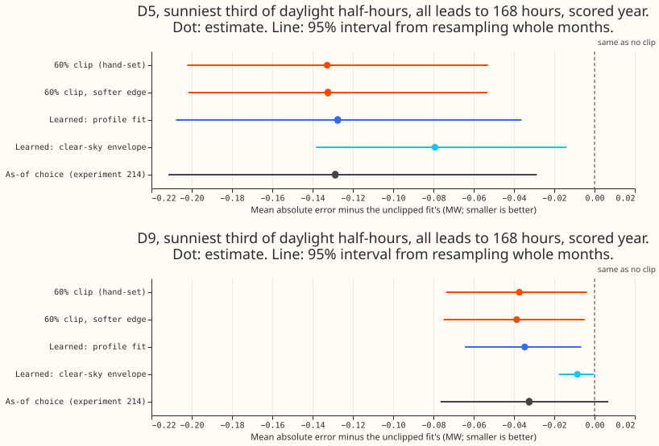
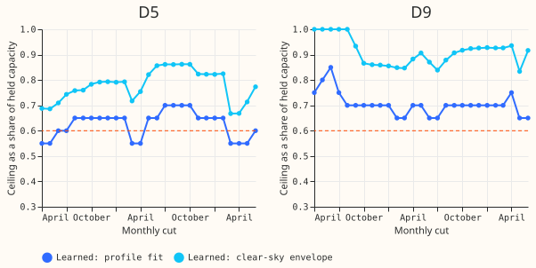
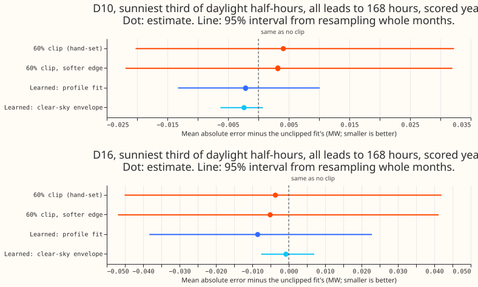

**The profile fit learns a ceiling that closes most of the hand-set clip's gain, but one year of
data cannot show it reaches 80%.** The profile fit refits the demand model for ceilings of 40% to
100% of held capacity on the 12 months before each cut and keeps the ceiling with the lowest
training objective. At D5 the learned ceiling stays between 55% and 70%, close to the hand-set 60%
(figure 2).

*Figure 1. The arms against the unclipped fit at D5 and D9.*

**What already exists.** Experiment 214 picks the clip ceiling as-of from a grid of shares by out-
of-sample error, and experiment 110's `profile_clip` fits the ceiling in sample. Neither experiment
learns the cap from the series alone without scoring a grid of candidate shares on forecast error.
The as-of choice of experiment 214 scores about the same as the profile fit at D5 (0.129 MW).

**Closure at the decision site.** Closure is an arm's gain over the unclipped fit divided by the
hand-set clip's gain, on D5's sunniest third of daylight half-hours, months resampled as whole
blocks in pairs.

| Arm | D5 closure (95% interval) | D9 closure (95% interval) |
|---|---|---|
| Profile fit (learned) | 96% (62% to 104%) | 93% (70% to 189%) |
| Clear-sky envelope (learned) | 60% (22% to 79%) | 23% (5% to 32%) |
| 60% clip, softer edge | 100% (99% to 100%) | 104% (98% to 134%) |

The profile fit passes the pre-registered 80% as a point estimate at both sites. The profile fit's interval
reaches below 80%, so the verdict is `partly supported`. The envelope arm fails: the quantile of
implied clear-sky export sits at 67% to 86% of held capacity at D5 and 84% to 100% at D9
(figure 2), above the ceilings that help.

*Figure 2. The ceiling each learned arm picked at each monthly cut.*

**The placebos do not move.** The arms change D10's and D16's sunny-daylight error by
between -0.009 and +0.003 MW (figure 3), inside the 0.02 MW limit.

*Figure 3. The arms against the unclipped fit at D10 and D16.*

**The clip's edge is not the active ingredient.** A softer edge (smoothing 0.5 per point of
capacity instead of 2.0) gives the same gain as the hand-set clip: 0.132 MW at D5 against 0.133 MW.

## Checks

- Each cut's ceiling uses only rows before that cut. The envelope arm's window ends at the cut, and
  the profile fit's training rows end there.
- The arms read the same rows as experiment 178's cut, and the row counts match the control's.
- The scoring script raises when an arm's row count differs from the control's after the join.
- Held capacity can come from an early vintage newer than the cut when no vintage predates it;
  all arms share that choice.
- Closure ratios are unstable when the hand-set clip's own gain is small, as at D9 (the interval
  reaches 189%).

## Which clip form the final assembly should use

**Use the hand-set 60% ceiling.** Its gain is close to the profile fit's, and it needs no fitting
step at each cut. The softer edge changes nothing, so the experiment-180 form stays. Where a
site has no hand-set value, the profile fit is the better of the two learned choices.

## What the next experiment should answer

**The next experiment takes the clip and the profile-fit cap as inputs.** The small monotone neural
network of the brief's experiment 4 receives either ceiling as one of its inputs.
