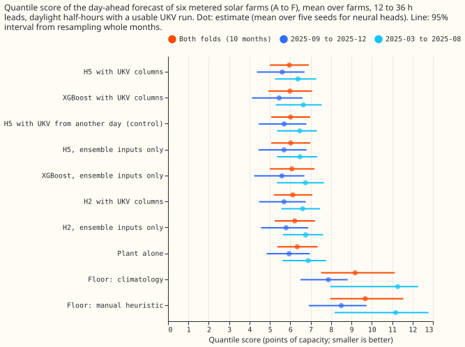
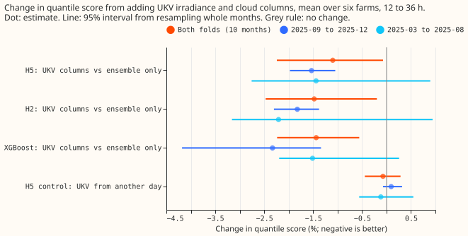
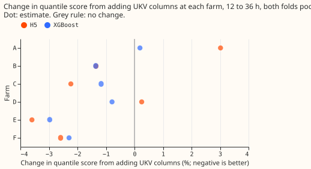

**Giving the neural heads UKV irradiance and cloud columns lowers a metered solar farm's quantile
score by about 1%, and XGBoost gains as much, so UKV is a small gain, below the 3% threshold.**
Experiment 248 is part (B) of the architecture comparison in [experiment
243](../00243-metered-farm-architecture-comparison/result.md), which compared a solar-farm power
model (the "plant"), XGBoost, a neural network, and six hybrids at six metered solar farms labelled
A to F. We gave H5 (the plant forecast plus 11 quantile offsets from a neural network) and H2 (the
plant forecast plus a correction from a neural network) six columns from UKV, the Met Office's UK
high-resolution weather model: shortwave irradiance and the total, low, medium, high, and very low
cloud fractions. [Experiment 229](../00229-metered-farm-ens-ukv-blend/result.md) found that these
columns lower the score by 1.8% when blended into the plant's irradiance. We scored 12 to 36 hour
leads on daylight half-hours in 2025-03 to 2025-12, in two folds of 6 and 4 months. The score is the
quantile score: twice the mean pinball loss over 11 quantile levels, in points of capacity.

**The prediction fails: no arm gains 3%.** Over the 10 scored months, H5 with UKV columns scores
5.96 against 6.02 for H5 with ensemble inputs only, a change of -1.1% (95% interval -2.2% to -0.1%).
H2 gains 1.5% (0.2% to 2.5%) and XGBoost gains 1.4% (0.6% to 2.2%), so XGBoost gains at least as
much as H5, against the prediction. The control, which takes the UKV columns from another day of the
same farm, month, half-hour, and ensemble clear-sky band, changes the score by -0.07% (-0.44% to
+0.29%). H5 with UKV beats the control by 1.0% (0.2% to 2.0%). The gain is smaller than 3%. H5 with
UKV scores 0.5% below XGBoost with UKV, but the interval (-2.9% to +2.2%) spans zero.

**The gain is similar in the two folds and differs across farms.** H5's score falls 1.5% in 2025-09
to 2025-12 (interval -2.0% to -1.0%) and 1.4% in 2025-03 to 2025-08 (interval -2.8% to +0.9%). At
farm A, UKV makes H5 3.0% worse, and at farm D 0.3% worse; at farms B, C, E, and F it makes H5 1.3%
to 3.6% better.

## Numbers

- **Rows.** The scored rows are 34,147 daylight half-hours (sun more than 5 degrees above the
  horizon) at 12 to 36 hour leads with a usable UKV run: 10,470 in 2025-09 to 2025-12 and 23,677 in
  2025-03 to 2025-08. Each farm has equal weight, and the 95% intervals come from resampling the 10
  scored months 20,000 times. Neural scores are means over five seeds; XGBoost and the plant have
  one fit each.
- **Weather and forecast time.** European Centre for Medium-Range Weather Forecasts (ECMWF) ensemble
  inputs as in experiment 243. UKV from the Centre for Environmental Data Analysis (CEDA) archive at
  the farm's nearest cell, from the freshest complete run published 4 hours before the forecast time
  (the delay experiment 229 assumed). Both the ensemble run and the UKV run exist at forecast time.
  Lagged power is the farm's own observed power one day earlier (two days when the lead is over 24
  hours).
- **Quantile score, both folds (95% interval):** H5 with UKV 5.96 (5.00 to 6.91); XGBoost with UKV
  5.99 (4.93 to 7.07); H5 with UKV from another day 6.02; H5 6.02 (5.07 to 6.98); XGBoost 6.08 (5.00
  to 7.19); H2 with UKV 6.12; H2 6.22; plant 6.34 (5.36 to 7.34); climatology 9.19; manual heuristic
  9.68.
- **Quantile score by fold:** in 2025-09 to 2025-12, XGBoost with UKV 5.46, XGBoost 5.59, H5 with
  UKV 5.61, H5 5.69, plant 5.94, climatology 7.87, manual heuristic 8.50; in 2025-03 to 2025-08, H5
  with UKV 6.38, H5 6.47, XGBoost with UKV 6.64, XGBoost 6.74, plant 6.88.
- **Contrasts, both folds, quantile score:** H5 with UKV minus H5 -1.10% (-2.24 to -0.07); H2 with
  UKV minus H2 -1.48% (-2.47 to -0.20); XGBoost with UKV minus XGBoost -1.44% (-2.24 to -0.56); H5
  with UKV minus the control -1.03% (-1.96 to -0.23); control minus H5 -0.07% (-0.44 to +0.29); H5
  with UKV minus XGBoost with UKV -0.53% (-2.87 to +2.17); H5 with UKV minus the plant -6.07% (-8.13
  to -4.09).
- **By fold, H5 with UKV minus H5:** 2025-09 to 2025-12 -1.53% (-1.97 to -1.05); 2025-03 to 2025-08
  -1.44% (-2.76 to +0.90). In the 2025-09 to 2025-12 fold, XGBoost with UKV minus XGBoost is -2.33%
  (-4.18 to -1.34), larger than H5's gain.
- **Cloudy half-hours (clear-sky index under 0.5) and clear half-hours (0.5 or more), both folds;
  the clear-sky index is the ensemble-mean irradiance over the clear-sky irradiance:** H5's gain is
  -1.3% (-5.2 to +4.1) on cloudy half-hours and -1.2% (-2.3 to 0.0) on clear half-hours, so the gain
  is not concentrated in cloud.
- **Per farm, change in quantile score from UKV columns, both folds (farms A to F):** H5 +3.0%,
  -1.3%, -2.2%, +0.3%, -3.6%, -2.6%; XGBoost +0.2%, -1.4%, -1.2%, -0.8%, -3.0%, -2.3%; H2 +1.3%,
  -0.9%, -1.7%, -0.1%, -5.1%, -1.9%.
- **Mean absolute error (MAE) of the median, both folds (points of capacity):** H5 with UKV 10.57;
  H5 10.71; XGBoost with UKV 10.57; XGBoost 10.78; plant 11.06. H5 with UKV minus H5 is -1.33%
  (-2.46 to +0.02).
- **Tails, both folds:** pinball at the 0.99 quantile is 0.493 for H5 with and without UKV and 0.634
  for XGBoost with and without UKV, so UKV does not change the upper tail for either forecaster. H5
  with UKV is 22% lower than XGBoost with UKV at that quantile (interval -35% to -16%). At the 0.01
  quantile, pinball loss is 2.5% higher with UKV, but the interval (-1.3% to +7.2%) spans zero.
- **Seeds.** The standard deviation of the farm-mean score across five seeds is 0.01 to 0.07 for H5
  and H2, with and without UKV.
- **Not measured.** This experiment did not measure the curtailment value, ICON-D2 (a German weather
  service regional weather model) inputs (experiment 229's ICON-D2 follow-on has not reported that
  they helped), the zero-history setting, and the 22-variable UKV set (experiment 229 found it no
  better than the 6 used here).

## Checks

- **Median minus mean forecast (points of capacity, 2025-09 to 2025-12):** H5 -0.10, H5 with UKV
  -0.29, plant -0.07, XGBoost -1.44, XGBoost with UKV -1.28. In 2025-03 to 2025-08: H5 +1.14, H5
  with UKV +1.25, XGBoost +0.41. The mean forecast is the weighted mean of the 11 quantiles. In
  2025-09 to 2025-12 the median of the neural heads sits close to their mean forecast, and UKV moves
  H5's median 0.2 points below its mean, so UKV shifts the centre of the forecast slightly more than
  its middle quantile.
- **Mean-forecast error beside each quantile contrast.** The MAE of the mean forecast falls from
  10.24 to 10.02 points of capacity for H5 in 2025-09 to 2025-12 (-2.2%) and from 11.50 to 11.09 in
  2025-03 to 2025-08 (-3.6%), larger than the 1.5% and 1.4% quantile-score gains. For XGBoost it
  falls from 10.50 to 10.29 and from 11.84 to 11.63. UKV therefore improves the forecast's location
  at least as much as its spread.
- **Triggers fired.** No trigger fired in a way that changes the verdict: the control behaves (it
  gives no gain), the averages without any one farm keep the sign of H5's gain at every farm left
  out (-0.1% to -2.6% across both folds), and the quantile score and the MAE point the same way.
  Trigger 7 does not apply. No Opus audit was run, because the ML manager ruled one out to save
  quota. A Sonnet reviewer has not read this experiment's code; the code is a copy of experiment
  243's code, which a Sonnet reviewer read for leakage, with the folds, the UKV columns, and the
  control added.
- **Caveats.** The CEDA UKV archive is a research archive and differs statistically from the live
  UKV, so any gain is an upper limit for production. Each fold tunes on the months before it, and
  the replicate fold's farm E has 1,063 tuning rows, so its fit there rests on little data. The
  share of observations below the 0.01 quantile forecast is 7% in 2025-09 to 2025-12 and about 3% in
  2025-03 to 2025-08, against a nominal 1%, so the lower tail is under-covered in both folds for the
  neural heads, XGBoost, and the plant. The pooled intervals come from 10 months, and the
  leave-one-farm-out check refits nothing: it drops one farm from the average. The neural heads'
  inputs also include the lagged power and the ensemble spread, which the plant arm does not have.

## What the next experiment should answer

The next experiment should test whether a weather product of a different kind, such as a
satellite-derived irradiance estimate at forecast time, lifts a metered solar farm's forecast by
more than the 1% that UKV does, and whether the under-covered lower tail in autumn and winter can be
fixed by recalibrating the offsets on recent months.

## Plan

- **Why.** Experiment 243 found that a neural head that outputs all 11 quantile offsets on the plant
  (H5) ties XGBoost, and that the best one-number hybrid is H2. Experiment 229 found that UKV adds
  1.8% when blended into the plant's irradiance. This experiment asks whether a neural head
  extracts more from UKV than a blend does.
- **Weather and forecast time.** ECMWF ensemble inputs as in experiment 243. UKV: the six
  irradiance and cloud variables of experiment 229 (shortwave down, and total, low, medium, high,
  and very low cloud) at the farm's nearest cell, from the freshest complete run published 4 hours
  before the forecast time, plus UKV shortwave over clear-sky irradiance. Both exist at forecast
  time. The UKV-CEDA archive is a research archive and differs from the live UKV, so every gain is
  an upper limit for production.
- **Arms.** Ensemble only: the plant, XGBoost, H2, H5. With UKV columns: XGBoost, H2, H5. Control:
  H5 with UKV columns taken from another day of the same farm, month, half-hour, and ensemble
  clear-sky band. Five seeds per neural arm, one fit on the tuning months per fold, no refit.
  Experiment 229 found 22 UKV variables no better than 6, so only the six are used.
- **Folds.** Scored fold 2025-09 to 2025-12, tuned on 2024-04 to 2025-08; replicate 2025-03 to
  2025-08, tuned on 2024-04 to 2025-02. The last two tuning months of each fold select the training
  epoch. Both folds lie in the second UKV era, so no fit and score straddle a UKV physics change.
  Own-history setting only; the zero-history setting is not repeated.

## Data-processing note

Experiment 268 found crossing quantiles in 26,344 of its 77,897 generator-forecast rows (34%), but
all of them belong to three generators that are not solar farms, so none is on this page.
[Experiment 273](../00273-metered-farm-sorted-quantile-rescore/result.md) counted 0 crossing rows in
every arm here, because the fit scripts sorted the 11 quantiles before writing them, so sorting does
not change the scores on this page.
