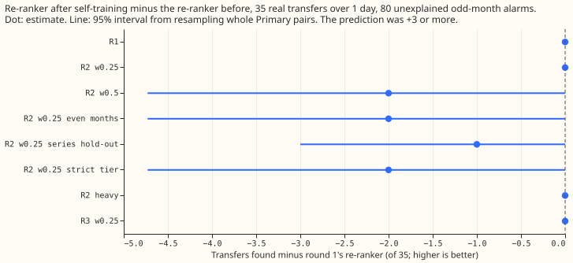
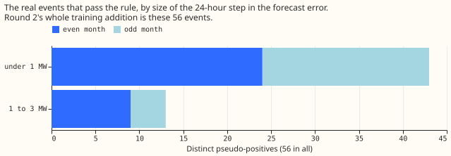

# Experiment 249: retraining the learned load-shift score on its own consistent events finds no more real transfers

**Retraining the learned load-shift score on real events that pass a consistency check, which needs
no NGED label, did not find any extra real transfer.** A transfer is a period in which a change to
the network arrangement moves load from one Primary substation (a substation that steps
transmission voltage down to distribution voltage) to its neighbours. The score is the neural
network of [experiment 195](../00195-switching-neural-plus-detector-features/result.md), which
ranks candidate alarms. Before retraining (round 1) it finds 24 of the 35 hand-labelled real
transfers lasting over 1 day, at 80 unexplained alarms in odd-numbered months. After retraining
(round 2) it finds the same 24: the difference is 0 in every resample of whole pairs of Primary
substations. The prediction was at least 3 more of the 35, so the hypothesis is refuted. The
likely cause is a shortage of examples: 38 to 47 real events per fold (56 distinct events across the
three folds, because folds share events) pass the check, against about 2,000 injected transfers per
fold. A fold is one third of the Primary pairs, held out while the score is trained. Giving the
real events more weight, using a stricter check, using even-numbered months only, and adding a
third round changed the count by between −2 and +1 transfers.

**What we asked.** Flexpectation version 2 will have no NGED labels, so the score must be trained
on injected (synthetic) transfers alone. We asked whether retraining it on its own most consistent
real events, as pseudo-labels, lets it find more real transfers. We fixed the consistency check
before scoring any transfer. A real event counts as consistent when the forecast error steps by at
least 2.5 noise units over 24 hours, a neighbouring Primary substation steps the opposite way, the
logistic regression scores it in the top quarter of candidates, and the error returns to its old
level at the estimated end. The full design, including the hold-out of each pair's own transfers, is
below.

## Results

- **Headline.** No round 2 or round 3 arm of the re-ranker (the neural network that re-scores
  RO-NC's candidate alarms) finds more transfers than round 1, which finds 24 of 35 (MW-weighted
  recall 0.752, 95% interval 0.585 to 0.865). RO-NC is the refit-offset neighbour-count detector of
  [experiment 82](../00082-sw2-18-19-combined-refit-offset-and-same-sign-count/result.md).
  Round 2 with pseudo-positive weight 0.25 finds 24 (0 gained, 0 lost). Weight 0.5, even-month
  events only, and the strict tier each find 22 (−2, interval −4.7 to 0). The series-level hold-out
  finds 23. Round 3 finds 24. The heavy-weight arm finds 24.
- **Heavy weight (post hoc).** This arm gives the pseudo-positives together a quarter of the total
  weight of the injected positives, about 15 to 20 times the per-row weight of the 0.25 arm.
- **Logistic regression.** Round 1 finds 22. Every round 2 and round 3 arm finds 22 except the
  heavy-weight arm, which finds 23 (+1, interval 0 to +3, so indistinguishable from no change). The
  one transfer gained lasts 48 hours and moves 0.4 MW, and neither the pair alarm nor RO-NC finds it.
- **Reproduction.** The retrained round 1 finds 24 (re-ranker) and 22 (logistic regression), the
  numbers of experiment 195, and its re-runs of RO-NC and the pair alarm find 19 and 5.
- **Confirmation bias.** Round 2 gained no transfer, so no sign of it re-finding what the pair alarm
  finds is visible. Of the 56 distinct pseudo-positives, 12 lie within 2 hours of a labelled
  transfer's onset (counted after scoring, for this page only). The report does not separate the
  other 44 into unlabelled real events and false alarms.
- **Pseudo-positive mix.** Of the 130 fold-level rows, 99 step under 1 MW and 31 step 1 to 3 MW, and
  none steps over 3 MW. They sit on 13 of the 16 Primary series, 23 of them on series 24. Each fold
  holds 16 to 19 events in odd months, where the alarm threshold is chosen.
- **Injected-world recall.** Rounds 1 and 2 agree to within 0.01 on both injected sets. On the
  held-out pairs, recall over 1 day is 0.595 for round 1 and 0.588 for round 2 at weight 0.25, so
  retraining did not reduce recall on injected transfers.
- **Downstream test not run.** The decision rule marks the experiment refuted when the count
  difference is 0 or below. The headline arm finds exactly the transfers that round 1 finds, but its
  alarm sets differ elsewhere (277 against 266 alarms over all months), so the gated-mask replay of
  [experiment 203](../00203-switching-replay-learned-score-in-masked-forecast/result.md) would not
  be identical. It was not run.
- **Tail calibration, curtailment cost, and forecast quantiles** do not apply: the experiment scores
  alarms, not a forecast.

## Checks

- **Median minus mean forecast per site:** not applicable; no forecast is produced.
- **Mean-forecast error beside each contrast:** not applicable, for the same reason.
- **Triggers:** the "Audit before merge" trigger for a result that contradicts its prediction
  fired. The explanation, too few
  consistent events, was tested in the same run with the heavy-weight arm, which moved the count by
  0 to +1, so no audit was run. The failed-control trigger did not fire: the reproduction of
  experiment 195 is the positive control. The other five triggers do not apply or did not fire.

## Caveats and next steps

- **Lab shortcuts:** the logged closures and labelled transfers define the hold-out, the
  explained-alarm flag in the threshold, and the negatives, as in experiment 195.
- **Printed numbers:** `printed_report.txt`, `printed_stage_a.txt` (pseudo-positive counts), and
  `printed_counts.txt` (2,980 real candidates, 17 block days, injected training sizes).
- **Schedule:** a single fit per arm and fold, three seeds averaged in each network; no weekly
  refits, because no forecast is trained.
- **Rule changes:** the first draft of the strict tier passed 2 candidates per fold, so the
  thresholds were relaxed and the loose rule added before any transfer was scored.
- **Next step.** Neither remedy was tested: a richer injector, or a longer record that holds more
  consistent events, such as the full history if disaggregation allows it. The choice belongs to
  the roadmap.

## Pre-registered design

- **Round 1** is experiment 195's re-ranker and logistic regression, retrained here from the same
  stored injected worlds with the same seeds.
- **Pseudo-positive rule** (label-free; evaluated on every real candidate of every source, over all
  months). Every pseudo-positive is outside the D8 drops and the 17 block days, has a
  logistic-regression score above the 75th percentile of that fold's scores over all real candidates
  (the re-ranker scores only RO-NC's candidates, so the logistic regression is the gate), and has a
  clean return. A clean return means the estimated end lies 48 to 176 half-hours after the step (so
  that the 12 half-hours after the end lie inside the 4-day window) and the own residual falls across
  the end by at least 50% of the step (mean of the 12 half-hours before the end minus mean of the 12
  after, against the step measured the same way at the onset). The **loose rule** (headline) needs a
  24-hour step of at least 2.5 noise units and an opposite step at any neighbour. The **strict
  tier** needs an own 6-hour step of at least 3.0, an opposite 6-hour step of at least 2.0 at a
  metered neighbour within 4 hours, and an opposite-to-own ratio between 0.3 and 2.0. The first
  draft of the strict tier (opposite step 3.0, ratio 0.5 to 1.5, return 70%, 90th percentile) passed
  2 candidates per fold, so the thresholds were relaxed and the loose rule added **before any real
  transfer was scored**. Counts recorded before scoring: strict 14, 15, and 16 candidates in folds
  0, 1, and 2; loose 49 in every fold, which falls to 47, 38, and 45 after the event hold-out
  (below), of which 19, 18, and 16 lie in odd months. The real record holds 2,980 candidates in all.
- **Hold-out.** A pseudo-positive that lies within 48 half-hours before the onset to 48 half-hours
  after the end of a labelled transfer of fold k, on a series of that transfer, is dropped from fold
  k's round 2 training. The round 1 score that gates fold k's pseudo-positives is fold k's own
  model, trained without fold k's injector pairs. The series-level hold-out (drop every
  pseudo-positive on a series of fold k's pairs) is reported as a robustness check.
- **Hard negatives.** The label-0 candidates of the injected worlds (as in experiment 195), plus
  real candidates that fail the rule and are either on an England bank holiday or isolated (no
  other candidate on any series within 7 days). A candidate is itself an alarm, so "quiet stretch"
  means an isolated alarm. D8 drops and block days are excluded from positives and negatives.
- **Round 2** retrains the same networks with injected positives at weight 1, pseudo-positives at
  weight 0.25 (headline) or 0.5, and the negatives at weight 1. A round 3 is run only if round 2
  finds events that round 1 missed and the pair alarm did not.
- **Scoring.** Operating point at 80 unexplained odd-month alarms, as in experiment 195; the 35
  transfers are scored last. The downstream test copies experiment 203's harness with round 2's
  alarms.

## Sources

Experiments [189](../00189-switching-neural-onset-end-block-detector/result.md) and
[195](../00195-switching-neural-plus-detector-features/result.md) supply the injector, the scoring
that holds out whole pairs, and the learned score. Experiments
[171](../00171-switching-gated-mask-no-harm-pooled-months/result.md) and
[203](../00203-switching-replay-learned-score-in-masked-forecast/result.md) supply the downstream
harness that this experiment did not run.
