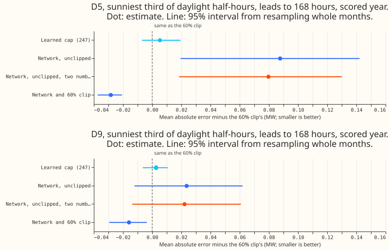
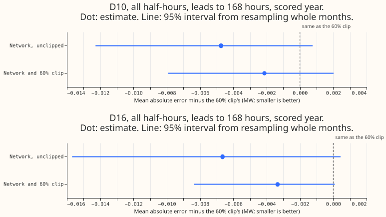

**On top of the hard clip, the network lowers sunny-daylight error a little, but not by the 50% of
the remaining gap that the plan required.** The network reads the solar term after the 60% clip, the
clear-sky index, the hour, and the cap. At D5 the network lowers the sunny-daylight error by 0.028
MW against
the clip alone (figure 1).

*Figure 1. Each arm against the 60% clip at D5 and D9. Smaller is better.*

**At D5, the network without the clip is worse than the clip.** The network on the unclipped solar
term
raises D5's sunny-daylight error by 0.088 MW (0.019 to 0.142) against the clip, and adding the mean
and standard deviation of the 51 members' solar responses lowers
that excess by 0.008 MW.

| Arm | D5 gap to BG2 (MW) | D5 closure beyond the clip | D9 closure beyond the clip |
|---|---|---|---|
| 60% clip | 0.069 | 0% | 0% |
| Network and 60% clip | 0.041 (0.008 to 0.062) | 41% (28% to 81%) | 38% (-59% to 221%) |
| Network, unclipped | 0.157 | -127% | -56% |
| Network, unclipped, two numbers | 0.149 | -115% | -53% |

The gap is the mean absolute error of the median minus BG2's, on the sunniest third of daylight
half-hours. The closure at D9 is unstable because the clip's own gap there is 0.042 MW with an
interval that includes zero.

**The placebos change by less than 0.01 MW.** The network and clip arm changes the all-half-hour
error at D10 and
D16 by -0.002 and -0.003 MW against the clip (figure 2), inside the 0.01 MW limit.

*Figure 2. The network arms against the 60% clip at D10 and D16, all half-hours.*

**The tail check fails for the clip and the network alike.** At D5 the 95% quantile covers 99.5% of
sunny-daylight half-hours (the clip alone: 99.6%) and 92.3% of all half-hours (the clip alone:
92.3%). Both coverages are more than 2 points from 95%.

## Checks

- The learned-cap arm of experiment 247 scores 0.005 MW worse than the clip on D5's sunny-daylight
  rows (-0.007 to 0.019), so it does not close the gap either.
- The band-width factors are fitted on the same rows as the network, of which 85% are in the
  network's training split. That may narrow the bands and contribute to the 92.3% coverage.
- Each network fit uses only forecasts whose valid time falls in the 12 months before the monthly
  cut. The early-stopping rows are the latest 15% of those rows.
- The network's output at a zero solar term is subtracted, so the network removes nothing at night.
- The network replaces the solar term in the stored forecast of the unclipped arm (experiment 180)
  or the 60% arm (experiment 214). The Kalman filter in each stored forecast adapted to its own
  solar term, not to the network's output.
- Each network is the mean of 3 seeds.

## Which clip form the final assembly should use

**Use the hand-set 60% clip alone.** The network removes 0.028 MW at D5 and 0.016 MW at D9 of sunny-
daylight error, for a
trained component on the serving path.

## What the next experiment should answer

A network trained end to end inside the demand model's loss, so the filter adapts to its output,
would test whether the stored-forecast replacement in this experiment held the gain down.

---
