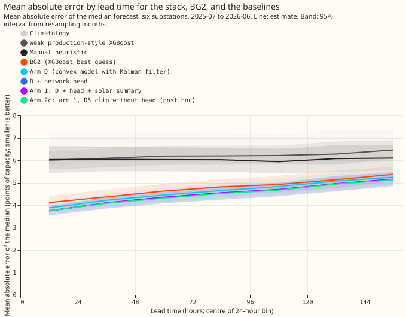
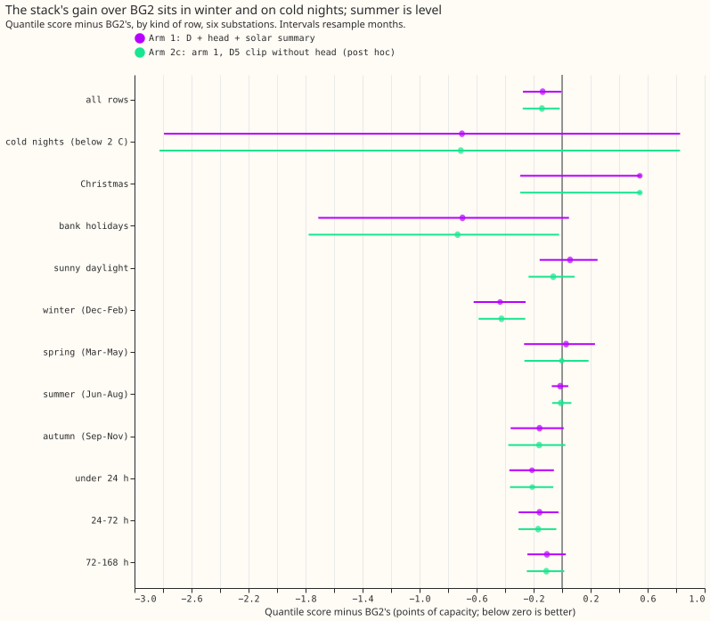
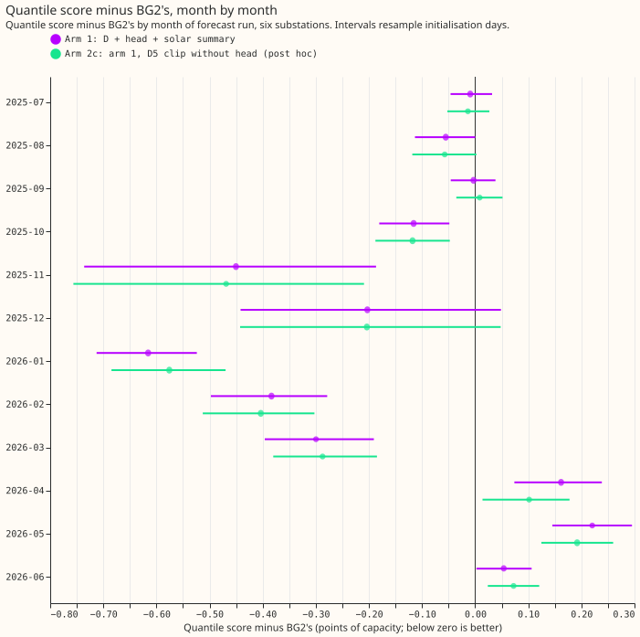
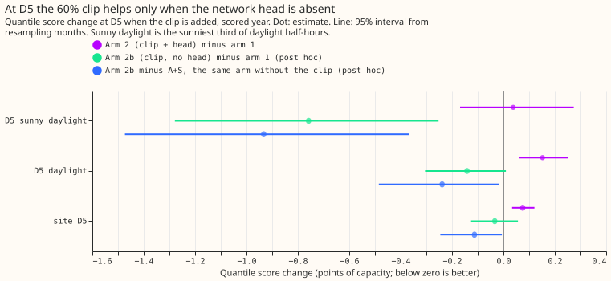
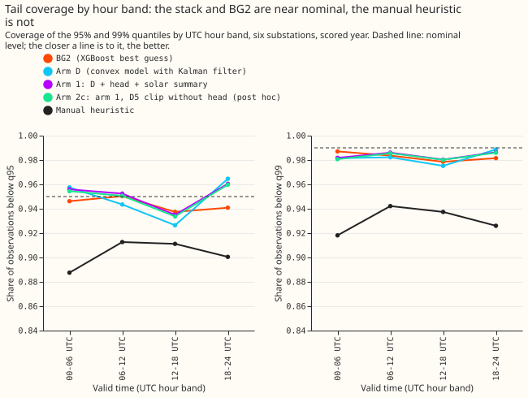
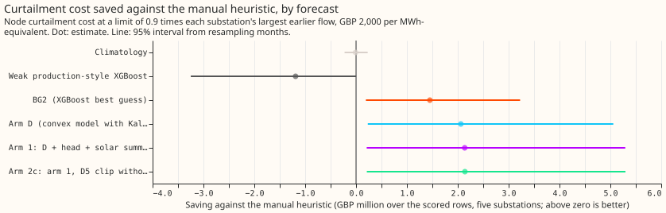

**The full best-guess demand forecast beats BG2 and the manual heuristic over the scored year, but
its gain is a winter gain, and at D5 on sunny hours it is still clearly worse than BG2.** BG2 is the
production-style XGBoost forecast with the best settings found so far, and the manual heuristic is
the rule NGED uses today. D5, D9, D10, D11, D14, and D16 are anonymised Primary substations, which
feed homes and businesses. We took the forecast of [experiment
220](../00220-dp-bg-stage4-assembly-with-drop-one/result.md) (arm 1: the convex demand model with a
Kalman filter, a small neural network that corrects its median, and a mean-and-standard-deviation
summary of the 51 ensemble weather members' solar response) and added the 60% solar clip at D5 from
[experiment 180](../00180-dp-sunny-daylight-fix-d5-solar-shape/result.md). We scored every forecast
on the same 561,207 rows from 2025-07-02 to 2026-06-30. A quantile score (also our CRPS, the
continuous ranked probability score) is twice the mean pinball loss over 11 quantiles, in points of
the substation's effective capacity, and lower is better.

The clip arms are an approximation. The shift includes the clip's effect on the filter state and the
fit, so it is non-zero at night as well as at midday, and the solar summary and the network head
were built on the unclipped solar term. Arm 2 adds the clip's per-row shift in the mean forecast,
measured on arm D alone, to every quantile of arm 1 at D5. Arm 2b adds it to the stack without the
head, and arm 2c (post hoc) uses arm 2b at D5 and arm 1 at the other five substations. [Experiment
237](../00237-dp-two-number-solar-summary-with-clip/result.md) scored the solar summary with the
clip applied inside the member pass. The coast-and-widen rule of [experiment
205](../00205-dp-gamk-gap-robustness-coast-or-frozen-gam/result.md) changes only rows after a
reading gap, so on the scored year's rows arm 3 equals arm 2 and the rule is reported from
experiment 205's injected gaps.

**Verdict `supported`.** The gate passed: arm A scored 2.7524 (required 2.7519 within 0.005), BG2
2.7809 (2.780), and arm 1 2.6167 (2.617) on the five decision substations. Arm 1 is the
pre-registered winner, because arm 2 was 0.038 points worse than arm 1 on D5 sunny daylight
(interval -0.169 to +0.274), not 0.05 points better. It beats BG2 on the six-substation quantile
score by 0.136 points (95% interval -0.277 to -0.005) and beats the manual heuristic on all four
headline metrics. The upper bound of the BG2 interval is only 0.005 below zero, so the margin is
thin.

## Results

- **Prediction scorecard.** P1 held (-0.136, in the predicted 0.10 to 0.17). P2 held: arm 2 equals
  arm 1 at the other five substations, and at D5 it is worse than arm 1 on sunny daylight (+0.038,
  -0.169 to +0.274) and on all D5 rows (+0.075, +0.034 to +0.121). P3 held: arm 2b's D5
  sunny-daylight median error is 0.103 MW below arm 1's (0.033 to 0.170 MW). P4 held: the heuristic
  clause on all four metrics, and arm 1 is worse than BG2 in April, May, and June (+0.162, +0.220,
  +0.054), three of the six months from April to September. P5 held as stated, and see the gap
  bullet.
- **Absolute scores, six substations (quantile score; mean absolute error of the median;
  tail-weighted CRPS at the 95th and 99th percentile of earlier power):** arm 1 2.579; 4.510; 0.171;
  0.044. Arm 2c 2.574; 4.490; 0.171; 0.044. BG2 2.715; 4.767; 0.202; 0.051. Manual heuristic 3.397;
  6.034; 0.246; 0.059. Climatology 3.665; 6.558; 0.263; 0.063. Weak XGBoost 5.697; 6.206; 0.360;
  0.075. Arm D alone 2.688; 4.623; 0.191; 0.053. Arm D with the head 2.611; 4.510; 0.171; 0.044.
- **Arm 1 minus BG2 (95% intervals, six substations):** quantile score -0.136 (-0.277 to -0.005),
  mean absolute error -0.257 (-0.492 to -0.009), tail-weighted CRPS at the 95th percentile -0.032
  (-0.073 to -0.004), at the 99th -0.008 (-0.019 to -0.001). It wins 9 of 12 months. All six
  substations have a negative estimate (D14 -0.266, D16 -0.227, D11 -0.176, D10 -0.108, D5 -0.031,
  D9 -0.004), but only the D14 and D16 intervals exclude zero (D11's reaches +0.001).
- **Arm 1 minus the manual heuristic:** quantile score -0.818 (-1.080 to -0.574), mean absolute
  error -1.524 (-2.027 to -1.079), tail-weighted CRPS at the 95th percentile -0.076 (-0.143 to
  -0.021), at the 99th -0.016 (-0.031 to -0.004), and 12 of 12 months. Arm 2c differs from arm 1 by
  under 0.02 on every one of these.
- **Curtailment saving against the manual heuristic (GBP over the scored rows, five substations,
  limit 0.9 times the largest earlier flow, GBP 2,000 per MWh-equivalent; 95% interval):** arm 1
  2.14 million (0.21 to 5.29 million), arm 2c 2.14 million (0.21 to 5.30 million), arm D 2.06
  million, BG2 1.45 million (0.19 to 3.23 million), climatology -0.01 million, weak XGBoost -1.19
  million. At limits of 0.75 and 0.5 the order is the same: arm 1 11.1 and 30.1 million, BG2 7.1 and
  21.9 million. The heuristic's implied risk level and the price are the assumptions of experiment
  228; the intervals are wide.
- **Where it loses to BG2 (arm 2c minus BG2, quantile score):** D5 sunny daylight +0.540 (0.331 to
  0.743); arm 1 there is +1.298. Christmas +0.545 (-0.293 to +0.554) on the blocks of two months
  (December 2025 and January 2026), so the interval is not informative. April to June are positive
  for arm 1 (+0.054 to +0.220). Winter is -0.425 (-0.586 to -0.259), 12 to 36 hours ahead -0.192,
  and daylight -0.200.
- **Cold nights below 2 C and bank holidays (arm 2c minus BG2):** -0.711 (-2.825 to +0.828) on 3
  months and -0.734 (-1.778 to -0.021). On cold nights the q95 coverage is 0.965 for arm 2c, 0.781
  for BG2, and 0.538 for the manual heuristic.
- **Tails, six substations (coverage; pinball loss, arm 2c against BG2):** q01 0.013; 0.172 against
  0.010; 0.211. q05 0.048; 0.621 against 0.041; 0.623. q95 0.950; 0.696 against 0.944; 0.751. q99
  0.983; 0.213 against 0.983; 0.253. By UTC hour band the q95 coverage of arm 1 runs from 0.935
  (12-18) to 0.960 (18-24), and q99 from 0.980 to 0.986.
- **D5 clip, quantile score change on D5 sunny daylight (95% interval):** arm 2 minus arm 1 +0.038
  (-0.169 to +0.274); arm 2b minus arm 1 -0.758 (-1.279 to -0.253); arm 2b minus the same arm
  without the clip -0.933 (-1.473 to -0.367), or 0.124 MW of median error (0.050 to 0.193 MW). Over
  all D5 rows arm 2b minus arm 1 is -0.034 (-0.126 to +0.057). D5 tail coverage changes by under
  0.01 at every quantile for all three clip arms.
- **Gap rule, from experiment 205's stored scores (arm D on injected gaps, quantile score):** gaps
  of 3, 6, 24, and 72 hours score 2.759, 2.788, 2.857, and 2.948 with coasting and widened bands,
  against 2.747 with no gap and 3.198 for the frozen model alone, so coasting is 0.25 to 0.44 below
  the frozen model alone. At 72 hours coasting without widening (2.953) and with it (2.948) are not
  better than the frozen model with its offset and recipe   R (2.940). We did not measure the share
  of scored rows that follow a natural reading gap.
- **Weak production-style XGBoost model (experiment 87's `ref_xgboost_baseline`):** its median error
  (6.206) sits level with the manual heuristic's (6.034), but its q01 to q99 band is 2.6 points wide
  against BG2's 36.6, and its q01 and q95 coverages are 0.41 and 0.52. Its quantile score of 5.697
  reflects bands that are far too narrow, so only its median error compares fairly.
- **Rows and schedule:** experiment 228's rows (561,207 across six substations, 09:00 UTC runs,
  leads 0.5 to 168 hours, outside hand-filtered load shifts). Experiments 220, 228, and 87 stored
  every forecast; nothing was refitted in this experiment. The stack's monthly refits and BG2's
  weekly refits are those experiments' schedules. Weather at lag times is the ensemble weather
  available at forecast time. No downloads.
- **Post hoc:** arm 2b, arm 2c, and the weak XGBoost comparison; every cut other than the planned D5
  sunny-daylight rows.
- **What to try next:** the solar term at D5 on sunny hours (a learned export cap and a monotone
  network, experiments 247 and 250, were not adopted); a retrained head on clipped residuals, which
  would replace the shift approximation; and a second scored year once BG2 is rerun for earlier
  months.

## Checks

- **Median minus mean forecast, arm 1, per substation (points; the mean is arm D's, before the
  head's correction):** D5 +0.014, D9 -0.746, D10 +0.721, D11 -0.496, D14 -0.200, D16 -0.843. The
  head moves the median by under 1 point of capacity.
- **Mean-forecast error beside the quantile-score contrasts:** the median's absolute error and the
  quantile score move the same way in every contrast against BG2 and the manual heuristic, so
  trigger 3 did not fire. For arm 1 the mean's absolute error is 5.31, 4.21, 3.69, 4.48, 6.01, and
  4.21 at D10, D11, D14, D16, D5, and D9, against 5.36, 4.20, 3.53, 4.03, 5.83, and 4.25 for the
  median.
- **Triggers:** none of 1, 3, 6 fired (the gate passed, and the contrasts agree in sign). Trigger 4
  fired in part: leaving one substation out keeps arm 1 minus BG2 negative every time (-0.110 to
  -0.164), but the 95% interval then spans zero when D11, D14, or D16 is left out, so the gain over
  BG2 depends on all six substations and its upper bound is only -0.005. A fresh Sonnet agent
  re-derived the headline contrasts from the stored arrays with its own code and found no difference
  above 0.005 points. Trigger 5 fired: arm 1, which contains no clip, beats arm 2 at D5 (+0.075,
  +0.034 to +0.121). Experiment 232 predicted that, and arm 2b tests the explanation. Trigger 2 did
  not fire, because the plan's P2 predicted that result. Trigger 7 is open: later work depends on
  the winter gain, which one year of data supports.
