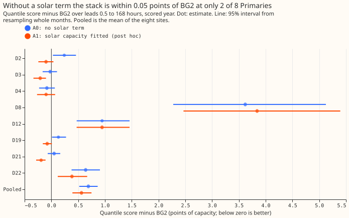
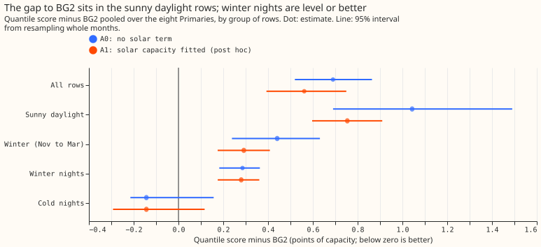

---

**The best-guess demand forecast does not transfer unchanged to the eight primary substations
(Primaries) whose meters record apparent power.** Those meters read megavolt-amperes (MVA) rather
than megawatts (MW). BG2 is the production-style forecast that the best-guess forecast (the stack)
must match. A point is 1% of a substation's effective capacity on the quantile score, and lower is
better. With no solar term the stack is at most 0.05 points worse than BG2 at only two of the eight
(D3 and D4), and the stack is 3.6 points worse than BG2 at D8 alone. D-numbers are anonymised site
codes. Fitting a solar capacity at each monthly refit (arm A1, added after the A0 results were
seen) puts five Primaries at or below BG2 on the point estimate: D2, D3, D4, D19, and D21. The
substation cards are the per-substation pages that show each forecast method's line. Those five
cards can show a best-guess line, and the cards of D8, D12, and D22 should show no such line.

We asked whether the stack of earlier experiments, built for six Primaries with an MW meter,
scores at most 0.05 points worse than BG2 at eight Primaries that have no stack forecast. The stack
is [experiment 247](../00247-dp-learned-export-cap-for-the-solar-clip/result.md)'s chain: T-all
fits (the heating terms split by day type), shared filter noise, ensemble-mean weather, the winter
night offset, and recipe R of [experiment
155](../00155-dp-bg-stage2-assembly-night-offset-and-error-correction/result.md). The ensemble
stores and calibrations are those of [experiment
152](../00152-dp-mva-fold-aware-gam-k-at-mva-only-primaries/result.md), and BG2 is the production-style
forecast of [experiment 87](../00087-bg2-best-guess-assembled-with-drop-one-ablations/result.md).
The score is the quantile score (twice the mean pinball loss over 11 quantiles) in points of
effective capacity; lower is better. No real-time capacity vintage was available for these
Primaries, so no solar term could be pinned. Arm A0 therefore has no solar term.

**Figure 1: the stack with no solar term is level with BG2 at D3 and D4 only.**

**Figure 2: the gap to BG2 sits in the sunny daylight rows.**

## Results

- **Arms.** A0 is the pre-registered arm with a zero solar term. A1 is post hoc: the same chain
  with the solar capacity fitted at each monthly cut (non-negative increments per season-year, as
  experiment 152's arm N). The neural-network arm (A2) was not run, because it needs a non-zero
  clipped solar term. Experiment 169's uncertainty-band fixes are not applied. The fits are monthly
  refits on a 24-month window.
- **Rows.** Scored year 2025-07 to 2026-06, leads 0.5 to 168 hours, outside the hand-filtered
  load-shift events. Each row is one site, forecast run, and valid time; there are 94,444 to 97,046
  rows per site.
- **D8.** D8 is fitted from 2025-04, has 12 monthly fits and no tuning month, and takes its spread
  from the tuning residuals of D2, D3, D4, D19, D21, and D22, as experiment 152 does.
- **Gate passed at two sites.** The same code, reading experiment 111's stores, reproduces
  experiment 155's stored arm D at D10 and D11 (maximum difference 0.0 points in the median and the
  mean, against the 0.001 tolerance). The other four control sites (D5, D9, D14, and D16) were not
  run, because the code path does not differ between MW sites.
- **Absolute scores (quantile score in points of capacity).** BG2 is the best of the five methods
  at D8, D12, and D22. D12's points are of MVA capacity, and the pooled figures include it.

| Site | A0 | A1 | BG2 | Climatology | Manual heuristic |
|---|---|---|---|---|---|
| D2 | 2.419 | 2.079 | 2.179 | 2.932 | 2.839 |
| D3 | 1.603 | 1.417 | 1.626 | 2.325 | 2.052 |
| D4 | 2.309 | 2.294 | 2.393 | 2.830 | 2.778 |
| D8 | 11.212 | 11.433 | 7.593 | 9.757 | 8.469 |
| D12 | 7.415 | 7.414 | 6.468 | 8.768 | 7.836 |
| D19 | 3.178 | 2.969 | 3.047 | 3.935 | 3.760 |
| D21 | 2.348 | 2.106 | 2.297 | 2.907 | 2.757 |
| D22 | 4.193 | 3.937 | 3.553 | 5.430 | 4.628 |

- **A0 minus BG2 (95% interval over months).** Pooled +0.690 (+0.520 to +0.864). By site: D2 +0.241,
  D3 -0.022, D4 -0.084, D8 +3.619, D12 +0.946, D19 +0.131, D21 +0.051, D22 +0.639.
- **A1 minus BG2.** Pooled +0.562 (+0.393 to +0.749). By site: D2 -0.100, D3 -0.209, D4 -0.099,
  D8 +3.840, D12 +0.946, D19 -0.078, D21 -0.191, D22 +0.384. A1's intervals lie wholly below BG2 at
  D3 and D21 only.
- **Predictions.** Prediction 1 failed: pooled +0.690 against -0.12 to +0.05, and 2 of 8 sites
  within +0.05.
  (2) Passed: D8 and D12 are the two worst, and D8 is +3.619 above BG2. (3) Not tested as written,
  because A1 became a fitted-solar-term arm; A1 minus A0 is -0.34 at D2, -0.19 at D3, -0.02 at D4,
  +0.22 at D8, 0.00 at D12, -0.21 at D19, -0.24 at D21, and -0.26 at D22 (point estimates). (4) Not
  run.
- **Groups of rows, pooled A0 / A1 minus BG2.** Sunny daylight +1.043 / +0.754; winter +0.441 /
  +0.292; winter nights +0.286 / +0.280; cold nights -0.143 / -0.143 (intervals include zero). In
  winter nights A0 is below BG2 at D2 (-0.207), D3 (-0.192), D4 (-0.189), D12 (-0.081), D19 (-0.063),
  and D21 (-0.244), and above it at D8 (+2.764) and D22 (+0.499).
- **Leaving one site out (pooled A0 / A1 minus BG2).** Without D8: +0.272 (+0.117 to +0.424) / +0.093
  (-0.032 to +0.213). The verdict does not change for either arm.
- **Tails (the share of readings below the forecast quantile, for A0 and BG2).** The q01 target
  is 0.010: A0 is 0.017 to 0.042 at seven sites and 0.204 at D8; BG2 is 0.002 to 0.011. q95 target
  0.950: A0 0.933 to 0.954 at seven sites and 0.736 at D8; BG2 0.935 to 0.985. Cold-night q95
  coverage at D8 is 0.640 for A0 and 0.644 for BG2.
- **Caveats.** The hypothesised stack had a pinned solar capacity and the 60% clip, which could not be
  built, so the verdict covers the stack with no solar term (A0) and with a fitted one (A1), not the
  stack as specified. A1 was chosen after A0 failed, and its five-site reading uses the same 12
  scored months with no held-out period. Only A0 was pre-registered, so the card decision on A1 is post hoc. These results do not test the
  clip. D8's fit rests on fewer than 15 months of data, and its series changed meaning in April 2025
  (see the data-processing page).

## Checks

- **Median minus mean forecast, per site.** 0.000 at every site: the spread table is symmetric about
  the corrected mean, so the median is the mean.
- **Error of the mean forecast beside the quantile-score contrast (pooled, minus BG2's median).** A0
  +0.487 (+0.198 to +0.754) against +0.690 on the quantile score; A1 +0.212 (-0.063 to +0.487) against
  +0.562. The signs agree.
- **Triggers.** None fired. The control reproduced exactly. The result contradicts the prediction,
  and the sunny-row analysis and the A1 arm test an explanation. Leaving out D8 does not flip any
  verdict. A1 does not score worse than A0 except at D8. The six-site stack's pooled interval is
  0.27 points wide and this experiment's 0.34, a ratio of 1.3.

## What to try next

- **Port the fitted solar term.** The card lines for five Primaries need a stack forecast with a
  fitted solar capacity (A1) written in the stored layout; this experiment's predictions are not
  published to the leaderboard.
- **D8, D12, and D22.** D8 needs more history; D12 needs a fold-aware fit (experiment 152's arm F);
  D22 stays +0.384 above BG2 with unclear cause.
- **Network head.** A learned monotone network on a clipped solar term (experiment 250) can be tested
  only after an as-of solar capacity exists at these Primaries.
