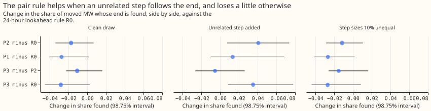
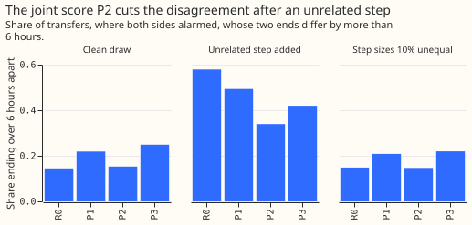

# Experiment 253: does the pair of substations give a better end time for a load shift?

**Reading the two substations of a load shift together makes their end times agree and finds the
right end more often when an unrelated step follows the end, but it costs a little on ordinary
transfers, and it leaves the real 14 January 2026 shift between D5 and D16 unchanged.** When demand
moves from one Primary substation to another, the donor's demand drops and the receiver's rises by
the same amount, so the end of the shift restores the pair's summed demand. Each substation's card
now reads its own end alone. We took the load-shift screen (LSC) of [experiment
148](../00148-switching-end-rule-lookahead-ro-nc/result.md) and added three rules that use the
neighbouring substations. We scored all of them side by side on the 1,160 transfers that experiment
148 injected into real demand, on a copy where an unrelated step follows the end of one side, on a
copy where the two steps differ by 10%, and on the labelled real transfers.

On the clean draw the best rule, P2, finds 0.770 of the moved MW against 0.788 for the lookahead
rule R0 (-0.017, 98.75% interval -0.034 to +0.007). With an unrelated step added it finds 0.633
against 0.593 (+0.041, +0.007 to +0.074). The pre-registered rule needs the clean-draw lower end
above -0.02, so the verdict is `inconclusive`. The result narrows the search: a balance test on the
pair is worth keeping for the case it was built for, and the next change should make it fall back
to the other side's end where a side has no step of its own.

## Definitions

- **Half-hour stamp:** the unit of time of every table here; 48 stamps make a day.
- **Alarm, onset, noise unit:** the load-shift screen (LSC) raises an alarm on a substation at the
  half-hour where its demand steps most, and the alarm opens an interval. The step is measured as
  the mean demand over the next 24 hours minus the mean over the 24 hours before. A noise unit is
  the usual size of that step in odd-numbered months, per substation, when nothing is injected.
- **Injected draw:** the 1,806 transfers that experiment 148 added to real demand, drawn with
  seeds 8200 and 8300 and not changed. Each moves a share of the donor substation's demand to one
  to three receivers, some metered and some not. The shapes S2, S3, and S4 give the transfer a
  flat, a receiver-shaped, and a mixed daily profile.
- **Detector:** arm B of experiment 138, with that experiment's stored scorer and threshold.
- **Share found:** the MW-weighted share of sides whose interval starts within 2 hours of the true
  start and ends within the tolerance of the true end; experiment 148 scored a transfer as found if
  any side was, and R0 reproduces that number as a check.

## Arms

- **R0:** experiment 148's rule at a lookahead of 24 hours, each side alone. The end is the stamp
  of the largest opposite step seen so far, fixed once no larger step follows for 24 hours.
- **P1:** R0, but only balanced stamps are candidates. A partner is a neighbouring metered
  substation (the experiment 138 neighbour table) whose own largest opposite-signed step within 2
  hours of the alarm is at least 1.5 noise units. A stamp is balanced when the side's step plus the
  partners' steps at that stamp is under half the side's step. Unbalanced stamps are skipped. A
  side with no partner, or with no balanced stamp that meets R0's size test, keeps R0's end.
- **P2:** P1 with a joint score. At each balanced stamp the score is the smallest, over the side
  and its partners, of that substation's opposite step divided by its own onset step. A stamp needs
  a score of 0.5 or more, and the end is the stamp with the largest score, fixed by the same
  24-hour lookahead.
- **P3:** P2 with the score replaced by the output of a small neural network (scikit-learn
  multi-layer perceptron, 8 hidden units, seed 253) over seven features of both sides: own and
  partner returns, balance, time since onset, return in noise units, and share of the running
  peak. The target is that the stamp is within the tolerance of the true end. Training uses 600
  injected transfers (shapes S2 to S4) that start in odd months, drawn with seed 8400.
- **Causality:** every arm uses only the steps up to 24 hours (plus the step window) after the
  candidate end. The true end is used only to pick populations, to train P3 on its own draw, and to
  score.

## Variants of the injected draw

- **Clean:** experiment 148's draw.
- **Unrelated step (C):** on one side of each pair transfer, chosen by seed, an extra step lasting
  3 days starts 2 to 20 hours after the true end, in the direction that restores the side's level,
  at 1.0 to 1.5 times the side's own return step. The other side shows nothing. This is the
  situation of the 14 January 2026 shift, and the clean draw never contains it.
- **Unequal steps (U10):** each transfer's receiver shares are multiplied by 0.9 or 1.1, chosen
  by seed, so the two sides' steps differ by 10%.

## Results

- **Check:** R0 on the full draw, scored as experiment 148 scored a transfer, finds 0.794, as in
  experiment 148.
- **Ceiling:** on transfers with a metered receiver, experiment 148's best-of-sides score is
  already 0.962 against a ceiling of 0.980 (the share whose start is found), so the brief's
  predicted gain of 0.03 to 0.10 in that score was out of reach. The plan was revised to score each
  side before any code ran.
- **Share found, side by side (95% interval), pair transfers, shapes S2 to S4, even months:** clean
  R0 0.788 (0.743 to 0.850), P1 0.760, P2 0.770 (0.718 to 0.848), P3 0.759; unrelated step added R0
  0.593 (0.549 to 0.640), P1 0.606, P2 0.633 (0.588 to 0.683), P3 0.628; unequal steps R0 0.781, P1
  0.754, P2 0.769, P3 0.754. The offline rule OFF finds 0.785, 0.621, and 0.779.
- **Contrasts (98.75%):** clean P2 minus R0 -0.017 (-0.034 to +0.007), P1 minus R0 -0.028 (-0.041
  to +0.002), P3 minus P2 -0.011 (-0.023 to +0.016); unrelated step P2 minus R0 +0.041 (+0.007 to
  +0.074), P1 minus R0 +0.013 (-0.010 to +0.068), P3 minus P2 -0.006 (-0.027 to +0.026); unequal
  steps P2 minus R0 -0.012 (-0.029 to +0.011), P1 minus R0 -0.027 (-0.042 to +0.002).
- **False-end share:** clean 0.047 (R0), 0.052 (P1), 0.053 (P2), 0.052 (P3); unrelated step added
  0.041 (R0), 0.104 (P1), 0.093 (P2), 0.112 (P3). P2's false-end share is under the 0.10 limit.
- **Disagreement between the two sides' ends (transfers where both alarmed):** clean, the median is
  0 hours for R0 and P2, and the share over 6 hours is 0.145 (R0) and 0.153 (P2). With the
  unrelated step the median falls from 8.5 hours (R0) to 2.5 (P2), and the share over 6 hours from
  0.579 to 0.339. P3's median is 5.0 hours.
- **Predictions:** the share-found prediction of -0.01 to +0.02 on the clean draw held for P2
  (-0.017) and failed for P1 (-0.028). The predicted gain of +0.05 to +0.20 with the unrelated step
  was not reached (P2 +0.041, P1 +0.013). The prediction that P3 beats P2 by under 0.02 held, and P3
  is not adopted.
- **Real labelled transfers (descriptive):** 55 transfers have two or more metered sides (111
  sides), and the start is found on 26 sides. The end is within the tolerance of the logged close
  on 20 sides for R0, 21 for P1 and P2, and 22 for P3. For the 6 transfers where both sides
  alarmed, the median gap between the ends is 6.8 hours for R0 and 0.0 for P2.
- **The 14 January 2026 shift:** every rule gives the same ends as the card: D5 ends after 9.2
  days and D16 after 2.0 days. D16 has no stamp where the opposite step reaches the 5.0 noise units
  the rule needs (its largest is 2.1), so its end comes from the level tracker. D5 has 13 qualifying
  stamps and none is balanced, so P1 and P2 fall back to R0's choice. The pair rule therefore
  cannot say which card is right.
- **Post hoc, one metered receiver only:** P2 minus R0 is -0.009 (-0.038 to +0.012) on the clean
  draw and +0.055 (-0.002 to +0.105) with the unrelated step; the share of transfers over 6 hours
  apart falls from 0.604 to 0.321 with the step. The loss on the clean draw is mostly in transfers
  with two or more metered receivers.
- **Post hoc, group balance (P1G, P2G):** summing every neighbour that stepped at the onset, of
  either sign, gives P2G minus R0 of -0.018 (-0.037 to +0.005) clean and +0.031 (-0.008 to +0.075)
  with the unrelated step. Group balance does not remove the loss.

## Checks

- **Forecast checks:** no forecast is scored, so the median-minus-mean and mean-error checks do not
  apply.
- **Audit triggers:** trigger 5 (a nested arm beats the arm that contains it) fires, because R0
  beats P1 and P2 on the clean draw. The explanation tested here is that the balance test rejects
  the true end when the group is not fully balanced; the single-receiver and group-balance runs
  above show the loss shrinks to -0.009 for one receiver and does not vanish with group balance.
  Trigger 2 (a prediction contradicted) fires for the unrelated-step gain, which came out at +0.041
  against +0.05 to +0.20. A Sonnet code and numbers audit replaced the Opus audit, because the
  brief allows Sonnet only and the manager session was not running; its findings are triaged in
  the pull request. The other five triggers did not fire. Leaving one series out was not run, and
  no claim here is per series.
- **Not run on all transfers:** the long transfers of experiment 148 and alarm merging were left
  out.

## Caveats

- **Partner finding is favourable on the injected draw,** because the neighbour table that finds
  partners is the table the injection draws receivers from. The test of 1.5 noise units is the only
  detection step.
- **The unrelated step is injected by us.** Its size (1.0 to 1.5 times the side's own step) and
  timing (2 to 20 hours after the end) were chosen to resemble the 14 January 2026 shift, so the
  gain is conditional on such steps being common. The labelled real transfers cannot tell how
  common.
- **Real pairs are few:** the start is found on 26 of 111 sides, and 6 transfers have both sides
  alarmed.

## What to try next

**The next experiment should make a side with no return step use the other side's balanced end,
and should count how often unrelated steps follow real ends.** Tying the ends together removes the
case the 14 January 2026 shift shows, where one side has nothing to read. Counting unrelated steps
in the real telemetry decides whether the gain of +0.04 is worth the loss of 0.017.

Code: `ml-experiments/00253-lsc-end-time-pair-rule/`; every number above is printed by
`e00253_contrasts.py` (saved at `data/ml-experiments/00253-lsc-end-time-pair-rule/printed_report.txt`)
and `e00253_case.py` (`case_report.txt` in the same folder).
