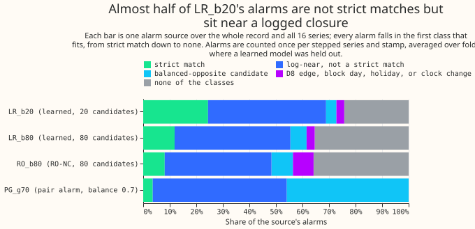
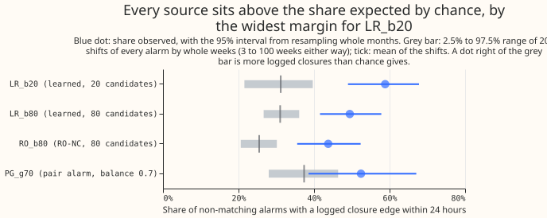
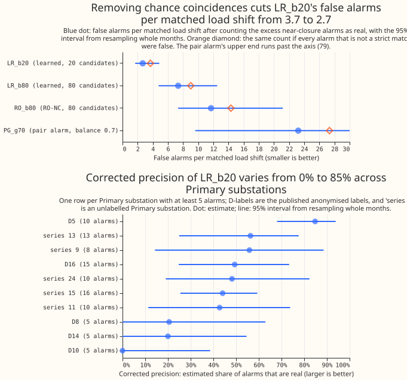

**We estimate that about 45% of the alarms raised by LR_b20 are real load shifts.** LR_b20 is the
learned alarm score of experiment 227, at the threshold that leaves 20 unexplained odd-month
candidates. For each of the 21 logged load shifts that its alarms match, LR_b20 raises 2.7 false
alarms (95% interval from resampling whole calendar months, 1.7 to 4.9). A load shift is demand that
the electricity network operator (NGED, National Grid Electricity Distribution) moves between
neighbouring Primary substations for hours or days. The load shift screen (LSC) raises an alarm when
it detects one. A "strict match" is an alarm whose step and end agree with one of 35 labelled load
shifts of over 1 day, using experiment 195's rule. We checked, for every alarm that is not a strict
match, whether a logged closure on the same or a neighbouring Primary substation starts or ends
within 24 hours. We compared that share with the share after moving every alarm by a whole number of
weeks (200 shifts of 3 to 100 weeks). For LR_b20, 58.8% of the non-strict alarms have such a
closure, against 31.2% after shifting, an excess of 27.7 percentage points. The pre-registered
prediction holds on the point estimates, so the verdict is `supported`. The interval for false
alarms per matched load shift includes the bar of 3, so that half of the prediction is not firmly
met.

**The loose rule overcounts and the strict rule undercounts, so the table states corrected numbers.**
"Alarms" counts each alarm once per series and stepped time, averaged over the cross-validation folds
that held the series out. Shares are shares of the non-strict alarms. "Corrected precision" is the
strict-match alarms plus the excess near-closure alarms, divided by all alarms. "False alarms per
matched load shift" divides the alarms that are not estimated to be real by the 21 matched load shifts.

| Source | Alarms | Strict-match alarms | Matched load shifts | Near-closure share of non-strict alarms | Shifted share | Excess (percentage points) | Corrected precision | False alarms per matched load shift |
|---|---|---|---|---|---|---|---|---|
| LR_b20 | 102.3 | 25.0 | 21 | 58.8% | 31.2% | 27.7 (18.5 to 36.0) | 45.3% (33.3% to 55.5%) | 2.66 (1.67 to 4.86) |
| LR_b80 | 245.3 | 29.0 | 24 | 49.5% | 31.0% | 18.4 (11.0 to 26.5) | 28.1% (19.7% to 37.1%) | 7.35 (4.77 to 12.50) |
| RO_b80 | 296.0 | 24.0 | 19 | 43.8% | 25.5% | 18.3 (10.5 to 26.3) | 24.9% (16.6% to 33.2%) | 11.70 (7.34 to 21.18) |
| PG_g70 | 85.0 | 3.0 | 3 | 52.4% | 37.4% | 15.1 (0.4 to 29.9) | 18.1% (2.8% to 34.0%) | 23.22 (9.61 to 80.02) |

- **Question and rule.** Does LR_b20's near-closure share beat a week-shifted base rate, and what do
  false alarms per matched load shift become? The pre-registered decision rule is met on the point
  estimates: share 58.8% against 30%, excess 27.7 against 15 percentage points, 2.66 false alarms
  against 3. The share lies above the 97.5% point of the shifts (39.7%).
- **Row set and data.** Experiment 227's four frozen alarm sources on all 16 series and the whole
  record (2022-01 to 2026-06), with no tuning. The log is experiment 37's 629 closures of 2 hours to
  60 days. Weather is not used. D-numbers are the published labels of Primary substations, and
  "series N" names an unlabelled Primary substation.
- **Other windows.** At 6 hours LR_b20's share is 48.5% against 13.7% after shifting; at 48 hours it
  is 65.9% against 46.2%. Shifts of 3 to 12 weeks, which keep the season, give 58.8% against 30.5%.
- **Months not used to set the threshold.** LR_b20's budget of 20 unexplained odd-month candidates was
  set on odd months, where "unexplained" means not near a logged closure. That could inflate the share.
  The even months, which did not set the budget, show a larger share: 72.9% against 33.0% after
  shifting (39.8 percentage points, 27.4 to 51.2), corrected precision 60.2% (46.1% to 72.0%), and 1.54
  false alarms per matched load shift (0.81 to 3.35). Odd months give 48.3% against 29.8% (18.5
  percentage points, 4.9 to 31.8) and precision 31.0% (15.6% to 44.7%). This split was chosen after
  seeing the results. The headline stays on the whole record.
- **Leaving one Primary substation out.** The excess stays between 24.5 and 30.4 percentage points.
  False alarms per matched load shift stay between 2.42 and 3.40, and exceed the bar of 3 without
  series 9, series 13, D16, or D5 (3.28, 3.14, 3.02, and 3.40). D5 has the highest precision (84.8%,
  68.0% to 93.9%).
- **Where the excess is absent.** LR_b20's excess at D10 is -3.8 percentage points (-39.0 to 38.6; 5
  alarms) and at D8 +20.6 (-12.9 to 62.9; 5 alarms). LR_b80's excess is +1.0 at D10 (-17.6 to 22.4; 20
  alarms). RO_b80 gives +4.8 at D9, -1.7 at D10, and +5.8 at D8. The pair alarm gives -10.4 at D10. No
  source shows an excess at D10, and the D8 and D9 values lie inside the shifted range. The intervals
  are wide, so the data neither confirm nor rule out real load shifts there.
- **Where the excess is clear.** LR_b20's excess is above zero at D5 (+70.5, 49.1 to 83.6), D16
  (+36.7), and series 15 (+40.2). The other Primary substations have too few alarms to say.
- **Limits.** "Not near a logged closure" is not proof of a false alarm, because the log covers only
  the trial area and only what NGED logged. Each of the 16 series gets its own independent shift. The
  shifted alarms keep weekday and hour of day but not season, except in the 3-to-12-week row. The
  month-resampled intervals hold each alarm's chance probability at its mean over the 200 shifts, so
  they leave out the shift-sampling noise and are slightly too narrow. The pair alarm is counted as 85
  alarm events, whereas experiment 227's interval table has 213 rows that include partner rows, so
  its false alarms per matched load shift are not comparable with experiment 227's. The balanced-
  opposite class says nothing about the pair alarm, because the pair alarm is defined by opposite
  steps; 39 of its 85 alarms land in that class after the strict and near-closure classes have taken
  theirs. The cleaning flag (`substation_zero`) is not used as a class, because the cleaned power
  table is not part of the stored inputs. The false-alarm rate divides by the 21 matched load shifts,
  not by the 25 strict-match alarms (which would give about 2.2).
- **What to try next.** Read the 45 or so LR_b20 alarms that are near a closure but not strict matches
  (about 21 of them excess over chance) with NGED, and report any harm accounting with those excess
  alarms counted as real.

## Checks

- **Median forecast minus mean forecast, per site.** Not applicable: the experiment forecasts nothing.
- **Mean-forecast error beside each quantile-score contrast.** Not applicable, for the same reason.
- **Triggers.** None fired: no control exists, the result agrees with its prediction, leaving one
  Primary substation out keeps the excess above 24 percentage points, and no nested arm exists.
- **Code review (Sonnet).** The review found four defects, all fixed: the threshold might inflate the
  share (the even-month check shows it does not); per-Primary false-alarm denominators mixed events and
  alarms, so the per-Primary table shows precision and excess only; the all-false baseline used a
  different definition of real alarms from the corrected count, so both now count 25 strict-match
  alarms as real; and the week shift wrapped by 4 days, so it now wraps by 234 whole weeks.
