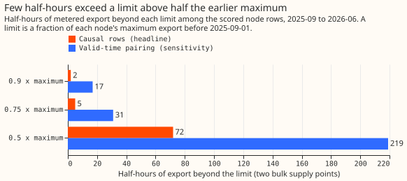
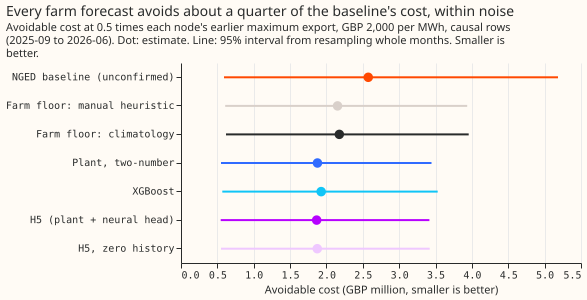
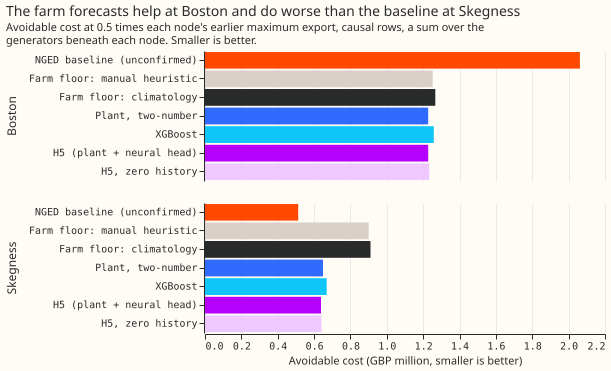
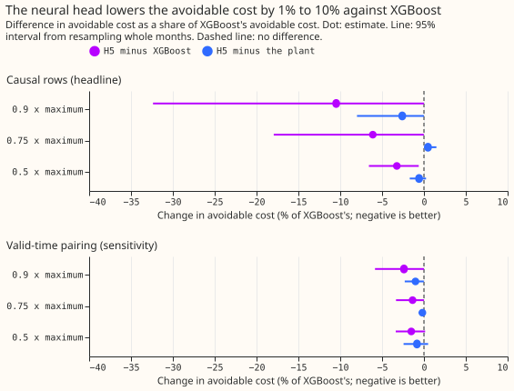

**Forecasting each solar farm's output cut the cost of curtailing at Boston and raised it at
Skegness, so across the two bulk supply points (132 kV to 33 kV substations) the saving of about a
quarter is within noise.** National Grid Electricity Distribution (NGED) meters six solar farms,
labelled A to F, beneath these two substations. We asked what it would have cost to cap the
generators whenever a forecast said a substation would export more than a limit, using the rule of
[experiment 84](../00084-substation-limit-curtailment-cost-worked-example/result.md). We swapped in
the farm forecasts of experiments [224](../00224-metered-farm-dayahead-two-number/result.md) and
[243](../00243-metered-farm-architecture-comparison/result.md), the same substation forecast in
every arm, and compared each with a baseline that assumes every generator runs at full capacity.

**Verdict: inconclusive.** At 0.5 times each substation's earlier maximum export, the avoidable cost
(the cost above a perfect forecast, GBP 2,000 per MWh) is GBP 1.87 million for H5 (the plant plus a
neural network, seed 0), 1.88 million for the plant alone, 1.93 million for XGBoost, and 2.57
million for the baseline. The three forecasts avoid 25% to 28% of the baseline's avoidable cost, but
every 95% interval includes zero (for example H5 minus the baseline: -0.71 million, interval -2.25
to +0.16 million). The prediction that all three contrasts are significant at the 5% level fails.
The neural network's lower pinball loss at the 0.99 quantile cannot show in this rule, which reads
only a farm's median. H5 beats XGBoost by 3.2% (99% interval 0.2% to 7.5%), under the 10% that would
justify porting a neural network.

## Numbers

- **Design.** The substation forecast is experiment 48's best guess in every arm, and the three
  generators that are not metered farms keep experiment 48's forecast. Only the six farms change.
  Farm forecasts are the stored 00 UTC runs at 12 to 36 hours lead, in fractions of capacity, scaled
  to MW and capped at capacity. Farms get 0 MW when the sun is under 5 degrees; that leaves out
  160.8 MWh of 15,036.7 MWh metered (1.1%) in the causal rows.
- **Causal rows are the headline.** A substation forecast is made at 09 UTC for valid times 12 to 36
  hours later, but a farm forecast for a valid time after 12 UTC the next day is the 00 UTC run of
  that day, which exists only after the substation forecast. The causal rows drop those 2,711 of
  11,664 origin-and-valid-time pairs, which removes most of the midday and afternoon peak. The
  valid-time pairing keeps them, giving each farm the forecast stored for its valid time, so it
  favours the farm arms.
- **Event half-hours** (export beyond the limit, scored rows). Causal: 2 at 0.9 times the maximum, 5
  at 0.75, 72 at 0.5. Valid-time pairing: 17, 31, 219. All flows in the window: 17, 36, 259. The
  stop rule fired (fewer than 20 at 0.75), so 0.5 is the only limit with a pre-registered contrast.
  Limits are 0.5, 0.75, and 0.9 times the maximum export before 2025-09-01. The published thermal
  limit was exceeded in 1 half-hour of the window and in none of the causal rows.
- **Avoidable cost at 0.5, causal rows (GBP million, 95% interval):** baseline 2.57 (0.59 to 5.18);
  manual-heuristic floor 2.15 (0.61 to 3.94); climatology floor 2.18 (0.62 to 3.96); plant 1.88
  (0.55 to 3.44); XGBoost 1.93 (0.57 to 3.53); H5 1.87 (0.55 to 3.42); H5 zero history 1.87 (0.55 to
  3.42). The perfect forecast costs GBP 0.29 million. H5 is GBP 46,300 per MW of forecast generator
  capacity per year (78.97 MW, 0.51 years of scored half-hours) and the baseline GBP 63,900. The
  five-seed mean of H5 and its other seeds sit within GBP 6,000 of seed 0 (1.86 to 1.87 million).
- **Contrasts at 0.5, causal rows, with the Bonferroni 99% interval in GBP thousand:** C1 plant
  minus baseline -698 (-2,935 to +258); C2 XGBoost minus baseline -647 (-2,847 to +302); C3 H5 minus
  baseline -710 (-2,971 to +241); C4 H5 minus XGBoost -62 (-145 to -4), or -3.2% of XGBoost's
  avoidable cost (-7.5% to -0.2%); C5 H5 minus plant -11 (-41 to +8). C4 is outside the 5%
  equivalence band (its lower end is -7.5%) and short of the 10% threshold. The 99% half-widths of
  C1 to C3 are about GBP 1.6 million, so the window cannot resolve a difference under about 60% of
  the baseline's avoidable cost.
- **The other limits.** Causal, 0.75: H5 minus XGBoost -6.1% (95% interval -23% to 0%). Causal, 0.9:
  -10.5% (-43% to 0%), on 2 half-hours. Valid-time pairing, 0.5: baseline 10.5, H5 7.25, XGBoost
  7.36 (GBP million); H5 minus baseline -3.27 million (95% interval -10.4 to +0.8); H5 minus XGBoost
  -1.5% (-3.9% to +0.5%).
- **By substation (causal, 0.5, a sum over the generators beneath each).** Boston: baseline 2.06, H5
  1.23, XGBoost 1.26 (GBP million). Skegness: baseline 0.51, H5 0.64, XGBoost 0.67. H5 beats XGBoost
  at both.
- **Tails** (daylight farm rows of the scored node rows, fractions of capacity). Coverage at the
  0.01, 0.05, 0.95, and 0.99 levels: H5 0.034, 0.058, 0.935, 0.981; XGBoost 0.039, 0.075, 0.940,
  0.993; plant 0.034, 0.053, 0.963, 0.990. Pinball loss at 0.99: H5 0.0039, plant 0.0042, XGBoost
  0.0048.
- **Weather and forecast time.** ECMWF ensemble 00 UTC run at the nearest 0.25 degree cell, and farm
  power one or two days earlier; both exist at forecast time for the causal rows. One fit on the
  months before 2025-09 (experiment 243's screening schedule); nothing was refitted here.
- **Departures from the plan.** The plan's resampling is 2,000 draws, the constant of
  `studies.bootstrap`, not 20,000. The 0.9 and 0.75 limits are reported for completeness only.

## Checks

- **Median minus mean forecast (points of capacity, mean over farms):** H5 +0.38, plant +0.23,
  XGBoost -0.56.
- **Mean-forecast error beside the contrasts.** MAE of the median: H5 9.91, plant 10.07, XGBoost
  9.96. MAE of the mean forecast: H5 9.98, plant 10.22, XGBoost 10.19. H5's small gain over XGBoost
  in cost (3.2%) agrees in direction with both.
- **Triggers fired.** Trigger 2 (the result contradicts the prediction): the first part fails on
  power, which the interval half-widths show; the second part holds in size but not in interval,
  because paired differences of 3% are consistent across months. Trigger 4 (leaving one site out
  flips a contrast): leaving Boston out flips C1 to C3, because the baseline is 24% cheaper than H5
  at Skegness. Trigger 5 (a more informed arm does worse): the arm that knows every generator's
  actual output costs GBP 1.96 million against H5's 1.87 million, because a forecast below the
  actual output sets a lower cap and so cuts more (H5 curtails 491 MWh against 368 MWh, and breaches
  29 MWh against 38 MWh), the same pattern as experiment 84. No Opus audit was run, to save quota. A
  Sonnet reviewer read the plan, and the code and write-up reviews are recorded in the pull request.

## What the next experiment should answer

**Why the baseline beats every farm forecast at Skegness, and whether the same holds at the other
bulk supply points when the delivery of about 2,500 series arrives.** Two substations and 72 event
half-hours cannot rank farm forecasts. A forecast that reads the farm's upper quantiles when it sets
a cap is a candidate, since the neural network's gain is in the upper tail that this rule ignores.

Reproduce with `uv run --no-sync python ml-experiments/00255-*/e00255_report.py` and then
`e00255_charts.py`. The printed report is in
`data/ml-experiments/00255-metered-farm-node-curtailment-value/report.md`.
