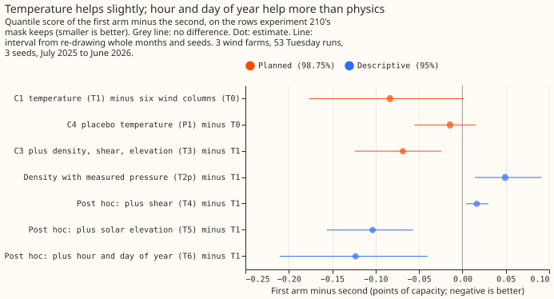
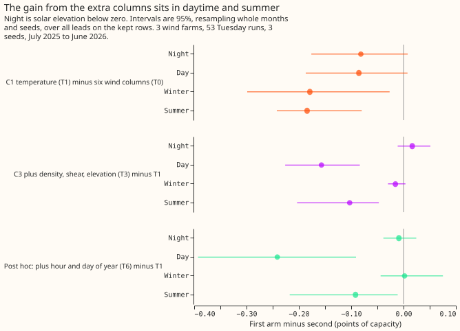
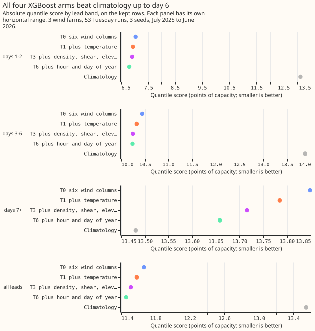

**Take-home: air temperature helps the XGBoost wind forecast slightly, but the larger gain comes
from columns that carry the time of day and the season, not from air density or atmospheric
stability.** We scored each XGBoost model with the quantile score, an estimate of the continuous
ranked probability score, in points of capacity (1 point is 1% of a farm's capacity; smaller is
better). Adding 2 m air temperature to the six wind columns lowered the score by 0.083 points, with
an interval that touches zero at the strict level we set beforehand. Adding density, shear (the
change of wind speed with height), and solar elevation lowered the score by a further 0.069 points.
A post hoc arm (added after the plan) that added only the hour and the day of the year to
temperature lowered the score by 0.123 points. The verdict is `partly supported`: temperature helps
in direction, and the planned physical columns help, but not for the physical reason predicted.

[Experiment 230](../00230-wind-physics-core-part-1/result.md) found, in an unplanned (post hoc)
comparison, that 2 m air temperature improved the XGBoost wind forecast. This experiment repeats
that comparison as a planned test. We trained XGBoost quantile models on ERA5 (the European Centre
for Medium-Range Weather Forecasts' reanalysis, our estimate of past weather) from 2019-09 to
2025-06, and ran them on the 51 members of the ensemble forecast (ENS) from the same centre. We
scored the 53 forecast runs that start on Tuesdays between July 2025 and June 2026, for each of
three metered wind farms (W1 to W3). The arms differ only in the weather columns they receive. A
placebo column and calendar columns show whether a gain is information or only an extra column.

## Arms and results

Every arm is experiment 230's A0r recipe: an XGBoost quantile model fitted to ERA5 on the
power-curve base margin (the binned mean power at each 100 m wind speed, which the trees correct),
run on the 51 ENS members, mixed with equal weights, and given the spread factor (a multiplier on
the forecast's width, fitted month by month on earlier cases so that the 5% to 95% band covers
90%). `colsample_bytree` is 1. Each farm and seed has one fit, with no refit during the scored
year. T0 uses six wind columns: the 10 m and 100 m wind speeds and the sine and cosine of each
direction. Scores are on the kept rows (the rows that experiment 210's mask keeps), over all leads.
Intervals resample whole months and the three seeds, at 98.75% for the four planned contrasts (C1
to C4) and 95% for the rest. The farms are not resampled, so the intervals describe these three
farms.

| Arm | Columns | Kept rows, all leads | Kept rows, lead days 1 and 2 | All rows, all leads |
|---|---|---|---|---|
| T0 | six wind columns | 11.663 | 7.028 | 11.035 |
| T1 | T0 plus 2 m temperature | 11.579 | 6.931 | 10.970 |
| T2 | T0 plus density at a fixed 100 kPa | 11.579 | 6.931 | 10.970 |
| T3 | T1 plus density (fixed pressure), shear, solar elevation | 11.511 | 6.902 | 10.918 |
| P1 | T1 with temperature permuted by month (placebo) | 11.648 | 7.017 | 11.024 |
| T2p | post hoc: T0 plus density from the ENS pressure | 11.628 | 6.947 | 11.008 |
| T3p | post hoc: T3 with the ENS pressure | 11.523 | 6.904 | 10.926 |
| T4 | post hoc: T1 plus shear | 11.596 | 6.983 | 10.984 |
| T5 | post hoc: T1 plus solar elevation | 11.476 | 6.845 | 10.895 |
| T6 | post hoc: T1 plus hour and day of year | 11.456 | 6.795 | 10.883 |
| Climatology | month, half-hour, and weekend | 13.547 | 13.121 | 13.124 |

- **C1, temperature (T1) minus T0: -0.083 (98.75% interval -0.177 to +0.002; 95% interval -0.156 to
  -0.015).** The prediction (-0.04 to -0.12) held, and the planned rule (wholly below zero at
  98.75%) missed by 0.002. T1 reproduces experiment 230's post hoc arm A0rT (T0 plus temperature)
  exactly, at 11.579.
- **C4, the placebo (P1) minus T0, gives no sign of an extra-column effect: -0.014 (-0.055 to
  +0.016).** T1 minus P1 is -0.069 (95% interval -0.152 to +0.011), which also includes zero, so the
  placebo does not show that the whole of C1 is information in the temperature.
- **C2, T2 minus T1, is 0.000 (-0.002 to +0.002), and the contrast cannot test density.** The ENS
  surface pressure differs from ERA5's by up to 7 hPa in a monthly mean. The plan's pressure rule
  therefore applied, and T2 used a fixed 100 kPa pressure. Density at a fixed pressure is a function
  of temperature alone, so T2 carries nothing beyond T1.
- **Density from the ENS pressure (T2p) scored 0.049 points worse than T1 (0.015 to 0.091).** The
  difference may reflect the ENS pressure differing from the ERA5 pressure that the model trained on.
- **C3, T3 minus T1: -0.069 (98.75% interval -0.124 to -0.024), wholly below zero.** The gain is not
  at night, where the prediction expected it (night +0.017, -0.011 to +0.051). It is in daytime
  (-0.157, -0.226 to -0.083) and summer (-0.103, -0.203 to -0.047), and nil in winter (-0.016, -0.030
  to +0.004). The observed gain is also outside the predicted range of -0.05 to +0.02.
- **Post hoc arms split T3's gain.** Shear alone made the score slightly worse (T4 minus T1 +0.017,
  +0.004 to +0.030). Solar elevation alone lowered it by 0.103 (T5 minus T1, -0.156 to -0.057), and
  hour and day of year lowered it by 0.123 (T6 minus T1, -0.211 to -0.040). T3 minus T6 is +0.054
  (-0.005 to +0.116), so T3 is no better than the calendar arm.
- **The 0.99 loss fell slightly more than the 0.01 loss in T1, as predicted.** On the kept rows the
  0.99 pinball loss is 0.659 (T0), 0.656 (T1), 0.656 (T3), and 0.650 (T6), and the 0.01 loss is
  0.285, 0.284, 0.284, and 0.283. Coverage of the 5% to 95% band is 0.915 to 0.918, and of the 1% to
  99% band 0.972 to 0.973. Observations exceed the 0.99 quantile on 2.1% of kept rows in every arm.

## Checks

- **The arms do not differ in the median-minus-mean skew.** In points, for W1, W2, and W3: T0 -5.45,
  -5.38, and -4.68; T1 -5.43, -5.27, and -4.57; T3 -5.40, -5.31, and -4.38. W3 drifts by 0.3 across
  arms.
- **The error of the mean forecast agrees with the quantile score in direction.** Over all leads on
  the kept rows, C1 is -0.046 (-0.092 to +0.001), C3 -0.067 (-0.106 to -0.033), and C4 -0.007
  (-0.036 to +0.017). At lead days 7 and later, C1's mean-error contrast is +0.008, where the
  quantile score gives -0.064.
- **C1 rests on W2.** Without W2 the contrast is -0.032 (-0.094 to +0.023), against -0.117 without
  W1 and -0.101 without W3. C3 stays negative when any one farm is dropped (-0.088, -0.041, and
  -0.077).
- **T0 equals experiment 230's A0r** (11.663 against 11.663 on the kept rows).
- **Three audit triggers fired.** Trigger 2 is a result that contradicts its prediction: C3's gain is
  in the day, not the night. The explanation was tested with T4 to T6. Trigger 5 is a control that
  moves the score by more than its own interval's half-width: the calendar arm T6 moved it by 0.123,
  against a half-width of 0.085. Trigger 7 is a later experiment whose design depends on this
  result: the experiment that trains a neural head on daily ensemble hindcasts adds this
  experiment's best column set to its XGBoost reference if the columns are supported.
- **A fresh audit matched every number and found C1 resting on W2.** It re-derived C1, C3, and
  the calendar arm's contrast from the stored forecasts with its own code. C3 is negative on every
  farm. The calendar arm's gain is concentrated in W1, W2, and 8 of 12 months. The three seeds agree
  to about 0.002 points, so the intervals reflect only 12 months of variation. The audit found no
  leakage route. The report is private.

## Caveats and departures from the plan

- **Solar elevation is a function of the hour and the day of the year at a fixed farm.** The plan
  called it a physical proxy, and the calendar arm T6 shows that it cannot be told apart from a
  calendar column. The plan did not allow columns that let the XGBoost model memorise calendar
  effects. That rule is met only in the sense that the scored year was not in training.
- **The ENS 10 m wind is 0.4 to 1.3 m/s below ERA5's, and the 100 m wind 0.5 to 0.9 m/s below.** The
  shear exponent therefore has a different distribution at inference than in training. This
  difference may be why shear adds nothing.
- **ERA5 temperature comes from the Open-Meteo file that experiment 230 used.** The ENS temperature
  is within 0.22 K of the ERA5 temperature on average.
- **Post hoc arms:** T2p, T3p, T4, T5, and T6 were added after the plan. The verdict uses C1 to C4
  only.
- **Weather at lag times:** the experiment uses none. ERA5 supplies the training columns and is not
  available at forecast time, and the ENS members supply every column at inference.

## What the next experiment should answer

- **Do hour-of-day and day-of-year columns still lower the XGBoost wind forecast's score on months
  the temperature result did not see?**
- **Is the gain a correction for the ENS wind's bias at certain hours and seasons?** If so, a
  bias-corrected wind input would make the columns unnecessary.
