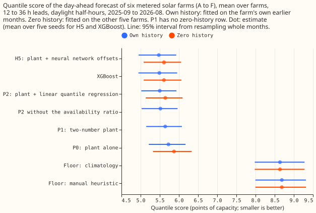
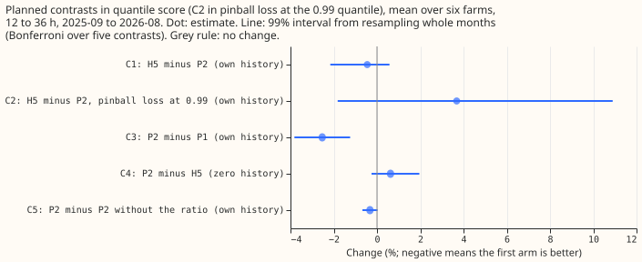
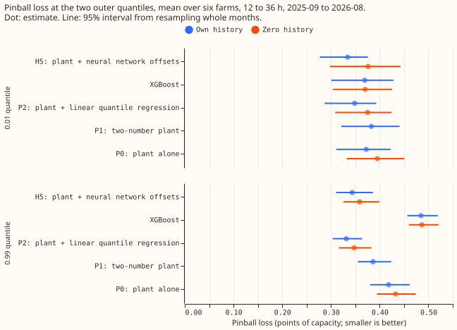

**A linear quantile regression on the lagged power and the ensemble spread scores within 0.5% of
the neural network of experiment 243, so the network was not needed.** National Grid Electricity
Distribution (NGED) meters six solar farms, labelled A to F. [Experiment
243](../00243-metered-farm-architecture-comparison/result.md) found that H5, the plant (a solar-farm
power model) plus a neural network that outputs 11 quantile offsets, scores 4.4% better than the
plant alone, but H5 saw the lagged power and the ensemble spread and the plant did not. We gave a
linear quantile regression (P2) the same inputs, with no network. P2 scores 5.500 against H5's
5.475 points of capacity with own history, so P2 is 0.45% worse (95% interval -1.7% to +0.4%; 99%
interval -2.2% to +0.6%). P2 is 3.95% better than the plant alone, which is 90% of H5's gain.
**The prediction fails and the stop rule fires.** The prediction was that H5 beats P2 by at least
2% in quantile score and by at least 10% in pinball loss at the 0.99 quantile. The first gap is
0.45%, and at the 0.99 quantile P2 is better, with H5 3.7% worse (99% interval -1.8% to +10.9%).
**The ensemble spread and the availability ratio matter, and the ratio matters least.** P2 beats the
two-number plant (P1) of experiment 224 by 2.5% (99% interval -3.8% to -1.2%). Removing the
availability ratio costs 0.33% (99% interval -0.67% to +0.02%). With zero history, P2 is 0.63%
worse than H5 (99% interval -0.25% to +1.96%).

## Numbers

- **Quantile score** (points of capacity, mean over six farms, own history): H5 5.475, XGBoost
  5.490, P2 5.500, P2 without the ratio 5.518, P1 5.642, plant 5.726, climatology 8.638, manual
  heuristic 8.687. Zero history: XGBoost 5.610, H5 5.610, P2 5.645, plant 5.871.
- **Per farm, own history:** P2 is within 0.1 of H5 at five farms (A, B, C, D, F) and 0.09 better
  at farm E (6.26 against 6.35).
- **Median error** (MAE of the median, points of capacity, own history): H5 9.85, XGBoost 9.89, P2
  9.89, plant 9.95.
- **Outer quantiles, own history** (pinball loss at 0.01 and 0.99): H5 0.334 and 0.344, XGBoost
  0.369 and 0.485, P2 0.349 and 0.331, plant 0.372 and 0.418. Coverage of the 0.01 and 0.99
  quantiles: H5 0.033 and 0.985, P2 0.035 and 0.985, plant 0.034 and 0.984.
- **Cloudy and clear half-hours** (clear-sky index under 0.5 and 0.5 or more): H5 minus P2 is -2.7%
  when cloudy (99% interval -6.4% to +0.3%) and -0.15% when clear. P2 with the ratio is 0.48% worse
  than P2 without it when cloudy (99% interval -0.8% to +2.3%) and 0.42% better when clear (99%
  interval -0.8% to -0.1%).

## Checks

- **Fitting fault.** P2 beats P1, which the plan named as the test of a fitting fault, so the fit
  is sound.
- **Member alignment.** The mean of the 51 members' responses differs from experiment 224's
  `unit_mean` by under 0.02 on average, as expected from a non-linear plant, and the correlation
  exceeds 0.99.
- **Triggers.** Trigger 2 fires: the prediction that H5 beats P2 by 2% fails. No other trigger
  fires. The stored H5, XGBoost, and plant predictions are unchanged from experiment 243, and the
  rows are experiment 243's, so the contrasts pair on the same half-hours.
- **Departures from the plan.** The MAE of the mean forecast is not reported, because P2 outputs
  quantiles only.

## What the next experiment should answer

**Whether a small neural network beats P2 once both see more than the inputs here, such as the
neighbouring farms' power.** P2 leaves 0.45% unexplained against H5 with the window's uncertainty
of about 1.4% either side, so a network with extra inputs is the next test, scored against P2 and
not against the plant alone.
