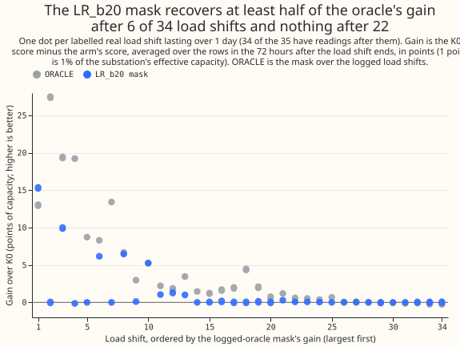
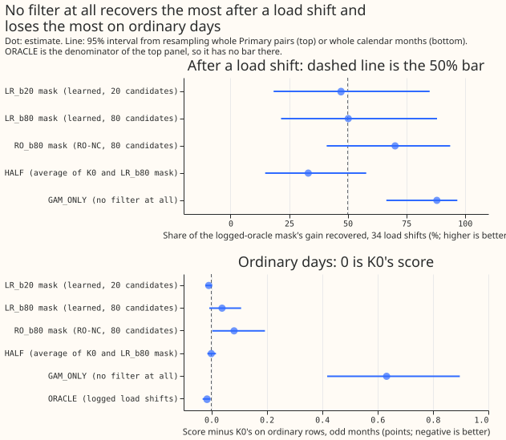
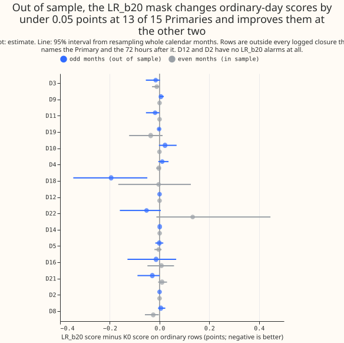
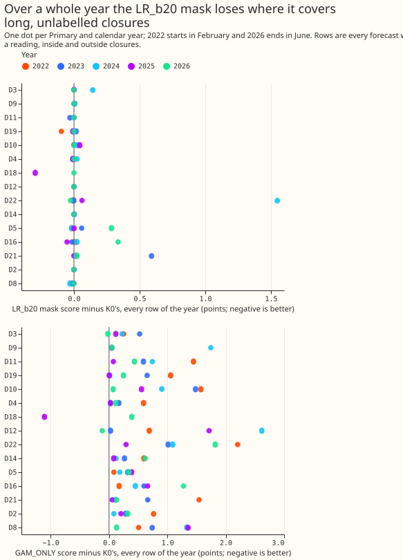
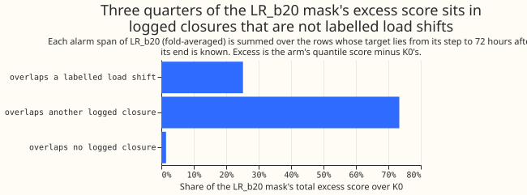

**The result is `inconclusive`, because the harness failed one of its two known-answer gates.** The
harness's numbers still say that the carried LSC mask recovers about half of the oracle's gain and
scores worse than no mask over every row of 4.5 years. The load shift screen (LSC) detects load
shifts. A load shift is demand that the electricity network operator (NGED, National Grid
Electricity Distribution) moves between neighbouring Primary substations for hours or days. The mask
sets the readings inside a detected load shift aside, so the forecast filter does not learn the
temporary level. We scored experiment 227's carried setting, LR_b20, in a new forecast harness on 15
Primary series over about 4.5 years, taking each learned alarm from the fold that held its Primary
pair out and scoring ordinary days on odd months only. In the 72 hours after 34 labelled load shifts
of over 1 day, LR_b20 recovers 47.1% of the gain of the oracle mask (95% interval 18.4% to 85.0%),
which is under the bar of 50%. LR_b20's ordinary-day score difference from no mask is -0.009 points
(-0.022 to +0.002), inside the limit of +/-0.05. The harness reproduces experiment 227's gain on
real load shifts (gate G1). The harness gains 2.39 points on experiment 141's injected load shifts
where experiment 208 found 1.50 (gate G2, limit 30%). The plan makes a failed gate `inconclusive`.
Had both gates passed, the plan's rule would give `not supported`, because the share is under 50%.

## Terms

- **Points and score.** A point is 1% of a series' effective capacity. The score is twice the mean
  pinball loss over 11 quantiles, and lower is better. Every arm uses the same quantile offsets, so
  a score difference is a difference in the forecast's location only.
- **Arms.** K0 is the forecast with no mask: the frozen convex GAM forecast of experiment 130, which
  uses past weather (ERA5 and CAMS), plus the Kalman filter on recent power. A mask arm also sets
  the readings inside each known alarm span aside. ORACLE masks the 66 labelled load shifts as
  logged. LR_b20 and LR_b80 are experiment 195's learned alarm score at budgets of 20 and 80
  unexplained odd-month candidates, taken from the fold that holds the Primary pair out. RO_b80 is
  RO-NC at budget 80. HALF averages the K0 and LR_b80 corrections. GAM_ONLY is the GAM forecast with
  no filter.
- **Row sets.** A row is one forecast of one half-hour from one origin (every 6 hours, leads 0 to 7
  days). AFTER rows are the 72 hours of target time after a labelled load shift ends, from origins
  at or after its logged onset. ORDINARY rows lie outside every logged closure that names the series
  and the 72 hours after each closure. Odd months did not supply the learned score's negative
  training examples; even months did.

## Results

| Arm | Gain after load shifts (points) | Share of ORACLE's gain | Ordinary days, odd months | Ordinary days, even months | Every row |
|---|---|---|---|---|---|
| LR_b20 | +1.69 (0.50 to 3.14) | 47.1% (18.4% to 85.0%) | -0.009 (-0.022 to +0.002) | +0.003 (-0.011 to +0.024) | +0.040 |
| LR_b80 | +1.80 (0.62 to 3.23) | 50.2% (21.6% to 88.1%) | +0.039 (-0.007 to +0.108) | +0.018 (-0.006 to +0.050) | +0.071 |
| RO_b80 | +2.52 (0.75 to 4.47) | 70.2% (41.0% to 93.7%) | +0.082 (+0.003 to +0.194) | +0.026 (-0.022 to +0.074) | +0.099 |
| HALF | +1.19 (0.44 to 2.06) | 33.2% (14.8% to 57.9%) | 0.000 (-0.014 to +0.017) | -0.004 (-0.014 to +0.006) | +0.008 |
| GAM_ONLY | +3.16 (1.15 to 5.79) | 88.0% (66.5% to 96.8%) | +0.633 (+0.418 to +0.897) | +0.456 (+0.305 to +0.632) | +0.582 |
| ORACLE | +3.59 (1.60 to 6.23) | 100% | -0.016 (-0.032 to -0.004) | -0.017 (-0.028 to -0.007) | +0.000 |

Gain is the K0 score minus the arm's score on the AFTER rows of the 34 load shifts (146,354 rows, 18
Primary pairs). Ordinary-day columns are the arm's score minus K0's, so negative is better. "Every
row" is the arm's score minus K0's over every forecast with a reading, in all 5 calendar years, with
no interval.

| Gate | Result | Target | Passes |
|---|---|---|---|
| G1: K0 minus ORACLE on the 13 load-shift and series pairs that experiment 227 scored (32,148 rows) | 5.68 points | 5.339 within 30% | yes |
| G2: K0 minus PERFECT in the AFTER phase of 141's injected load shifts (717,698 rows) | 2.39 points | 1.50 within 30% | no |

- **Question and rule.** Does LR_b20's mask keep at least half of the oracle's gain after a load
  shift, with ordinary-day harm inside +/-0.05 points, on every Primary and on months it did not
  train on? The harm limit holds. The gain share misses the bar on the point estimate (47.1% against
  50%), and its lower bound is above 0%. The failed gate G2 makes the verdict `inconclusive`.

- **Gate G1 passes.** The harness's K0 scores 9.61 points on experiment 227's real load-shift rows
  against 10.13 in experiment 227, and the gain of the oracle is 5.68 points against 5.34. The gain
  rises with lead: 2.22 points under 24 hours, 4.49 from 24 to 72 hours, and 8.53 from 72 hours to 7
  days.
- **Gate G2 fails.** The harness's PERFECT minus K0 gain is 2.39 points, 59% above experiment 208's
  1.50. Each lead band is 42% to 69% above experiment 208's gain in the same band (1.98, 2.65, and
  2.61 points against 1.25, 1.57, and 1.84). Three post hoc diagnostics, all outside the
  pre-registered rule, change the gain. Multiplying the quantile offsets by 1.5 lowers the gain to
  1.90 points, which is within 30% of 1.50 and would pass the gate. Multiplying by 1.2 gives 2.17.
  Keeping only injected load shifts in experiment 208's scored year gives 2.15. The gate fails as
  pre-registered. Whether the gate passes depends on a post hoc setting of the quantile offsets.
- **The gain after load shifts rests on a few events.** The largest of the 34 load shifts carries
  49.9% of LR_b20's total gain and 20.0% of the oracle's. LR_b20 recovers at least half the oracle's
  gain after 6 of the 34 load shifts, and between -10% and +10% of the oracle's gain after 22. The
  median per-shift share (28 load shifts where the oracle gains) is 3.8% for LR_b20 and 98.8% for
  GAM_ONLY. Leaving out one Primary moves LR_b20's share between 38.8% (without D16) and 63.5%
  (without D18), so the 50% bar is crossed by dropping D18. The 30 load shifts of 1 day or less give
  the oracle 0.22 points and LR_b20 0.01.
- **Ordinary days.** LR_b20's difference stays inside +/-0.05 in every variant: -0.010 without D8's
  drops and the 17 block days, -0.011 without D8 and D9, -0.008 when closures of connected
  neighbours are also excluded, and -0.005 (-0.013 to +0.002) without the 7.5 alarms (of 44 that
  start on ordinary rows, each alarm weighted 1 over its series' number of folds) that are
  balanced-opposite candidates. The in-sample even months give +0.003. At 13 of 15 Primaries the
  absolute difference is under 0.05. At the other two, D18 (-0.195) and D22 (-0.052), the mask
  improves the score. D12 and D2 have no LR_b20 alarms. Leaving one Primary out moves the pooled
  difference between -0.006 and -0.012. Of the three alarm settings, LR_b20 has the smallest
  ordinary-day difference: LR_b80 gives +0.039 and RO_b80 +0.082, with an interval above zero.
- **Net over a year.** Over every forecast with a reading, LR_b20 scores 0.040 points worse than K0
  (by year: -0.008, +0.046, +0.125, -0.008, +0.040 from 2022 to 2026), the oracle 0.000, and
  GAM_ONLY 0.582 worse. D22 and D21 account for 65% and 26% of the summed excess over series, mostly
  in 2024 (+1.55 points at D22) and 2023 (+0.59 at D21). The excess sits in the alarm spans: 73% of
  LR_b20's excess score lies in spans that overlap a logged closure that is not a labelled load
  shift, 25% in spans that overlap a labelled load shift, and 1.5% in spans that overlap no logged
  closure (shares of the score summed over the alarm spans, each span counted once, which cover 82%
  of the net figure). The three alarms with the largest excess score last 27, 32, and 44 days, sit
  on D22, D21, and D22, and carry 59%, 31%, and 9% of the excess summed over spans. The 32-day alarm
  on D21 overlaps a labelled load shift.
- **Tails.** After load shifts, K0's readings fall below its 1% quantile 9.1% of the time and
  LR_b20's 4.0%, against 1.8% for ORACLE (nominal 1%). K0's readings fall below the 99% quantile
  93.4% of the time, LR_b20's 96.3%, and ORACLE's 98.6% (nominal 99%). On ordinary rows the tail
  shares of LR_b20, HALF, and ORACLE match K0's within 0.2 percentage points, and GAM_ONLY's
  readings fall below the 1% quantile 2.9% of the time and below the 5% quantile 9.9% of the time.
- **Row sets and data.** 15 Primary series (D15 has no readings), 2022-01 to 2026-06, origins every
  6 hours from 2022-02-01, 12,236,784 ordinary odd-month rows. D-numbers are the labels in the
  series table. The GAM forecast of D9 starts in 2023-12 and D18's in 2025-07, so those two series
  have fewer rows. The 35th labelled load shift (D15 and D18, 2025-03) has no AFTER rows, because
  D18's GAM forecast starts after it.
- **Limits.** The forecast uses past weather, so absolute scores are an upper bound on forecast
  skill and are not comparable with ensemble-driven pages. The effective capacity is the single
  stored value, not re-estimated from data before each origin. A row whose target lies after a refit
  of experiment 130's GAM sees a fit made up to 7 days after its origin. The intervals for gain
  resample 18 Primary pairs, so they are wide. The learned alarm's threshold is set on the pooled
  scores of all 15 series in a fold file, and those pooled scores include the scored series' own odd
  months. A series in two or three folds is scored with each fold's model, weighted equally, and
  each of those models trained on another pair that contains the series. The Kalman hyperparameters
  and the GAM refits come from experiment 130, which used the whole record. A mask arm's span ends
  at the end rule of experiment 148 with 6 hours of lookahead, and every learned alarm is known 96
  hours after its step (RO_b80's: 48 hours).
- **What to try next.** A limit on how long a mask stays open would test whether the excess score
  over a year disappears without losing the gain after load shifts, because 3 alarms of 27 to 44
  days carry 99% of the excess summed over spans. A like-for-like gate would first match the
  harness's forecast spread to experiment 208's.

## Checks

- **Gates.** G1 and G2 were fixed in the plan and run before any arm was read. G2 failed and was not
  changed.
- **Series 10 was read early.** The aggregated table of series 10 (D10) was printed while the
  scoring script was being tested, before the clarifications in the last section were committed.
- **Median against mean.** The median forecast minus the mean forecast differs by series, from -2.06
  points at D12 to +0.61 at D8, and is the same for every arm. The contrasts between arms do not
  depend on the median-minus-mean gap.
- **Direction.** The quantile-score gain and the mean and median absolute-error gains agree in sign
  for every arm except HALF. The exception is HALF, whose ordinary-day differences are within 0.003.
- **Audit triggers.** Three of the six audit triggers fired: the failed G2, a leave-one-out share
  that reaches 63.5% (without D18), and a harm interval under half as wide as experiment 227's. A
  Sonnet audit (Opus was not used, to save quota) recomputed the gain, the share, the harm interval,
  and the per-shift shares from the per-row scores without reading the report script. The audit
  agreed with every figure. The audit also found that leaving out the largest load shift (pair D5
  and D16) drops LR_b20's share to 29.5%, and that the harm interval is built from few non-zero
  months and cannot see an alarm over a logged closure, which the ordinary rows exclude.
- **Code review.** A Sonnet review found no leakage in the filter's cutoffs, the span masking, the
  fold use, the offsets, the row sets, or the gates. The review found that the per-alarm net-loss
  table counted overlapping spans of different folds more than once, so the split of the excess by
  span class was recomputed with each span scored by its own fold. The review also listed the limits
  above that were missing from the page.
- **Numbers review.** A Sonnet review checked every figure against the printed reports and found no
  wrong number. It asked for the post hoc G2 diagnostics to be reported in full, for the claims
  about the net annual loss to be softened, and for the bullet lists to be repaired; all three were
  applied.

## Choices fixed after the plan and before any gate or arm was read

These pin down points the plan left open. The harness code was run and its output for one series
(series 10, aggregated over all its rows) was printed to test the scorer before these choices were
committed; no gate and no contrast was read.

- **Origins and leads.** Origins every 6 hours from 31 days after the series starts (2022-01-01),
  each with 336 half-hourly targets (leads 0 to 7 days). Lead bands: under 24 hours, 24 to 72 hours,
  and 72 hours to 7 days. Hour bands are the four local-time bands of `studies.dp_calendar`.
- **Quantile offsets.** One table per series, hour band, and lead band: the 11 quantiles of the
  no-mask residual over odd UTC months of the target, shared by every arm.
- **Effective capacity.** The single value stored for each series in the stage 1 pilot's series
  table, not re-estimated from data before each origin. The plan said "from data before each
  origin"; the stored value is the one every earlier page used.
- **GAM forecast.** The frozen forecast of experiment 130 uses, for each target, the fit made at the
  latest refit on or before the target. A row whose origin lies before a refit and whose target lies
  after it therefore sees a fit made up to 7 days after the origin.
- **ORACLE.** Masks every one of the 66 labelled real load shifts that involves the series.
- **Gate G1 rows.** The 13 pairs of load shift and Primary series that experiment 227 scored (11
  load shifts in its scored and replicate months). Rows: forecast origin at or after the logged
  onset and target within 72 hours after the logged end, every origin in the harness, leads 0 to 7
  days. The day-ahead lead band is reported beside the pooled figure. The gate is the pooled K0
  minus ORACLE score on these rows, within 30% of 5.339 points.
- **Gate G2 rows.** Experiment 141's 44 stored worlds at the six Primaries, the stream being the
  real residual plus the injected megawatts (in points). Rows follow experiment 208: injected
  transfers of 25% of load or more lasting over 1 day, forecast cutoff at or after the injected
  onset and not within 96 half-hours of it (the AFTER phase is cutoff at least 96 half-hours after
  the onset and target at or after the end), target within 96 half-hours of the end, scored against
  the stream without the injected megawatts. PERFECT masks the true interval, known at the onset
  with the end known at once. The gate is PERFECT minus K0 within 30% of 1.50 points.
- **ORDINARY rows.** The target lies outside every closure of experiment 37's log of 629 that names
  the series as a side, and outside the 72 hours after each closure. A variant that also drops
  closures of connected neighbours is reported beside it.
- **Month for the odd and even split.** The UTC calendar month of the target.
