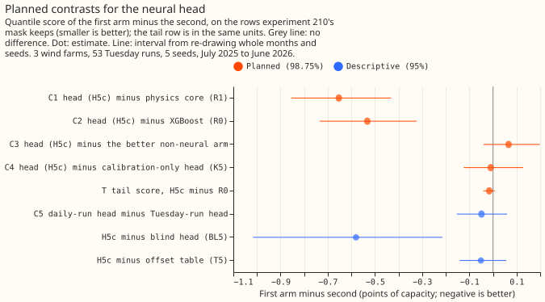
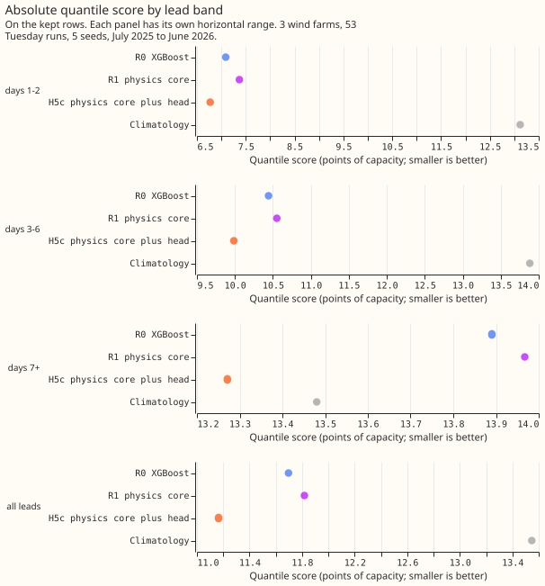
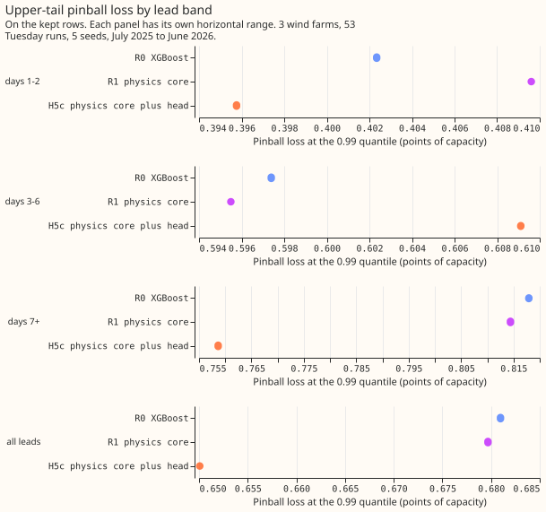
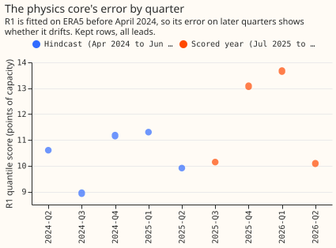

**Take-home: a correction learned from 15 months of daily ensemble forecasts lowered the wind
forecast's quantile score by 4.5% to 5.5%, but a lookup table of offsets gets 92% of that gain, so
the neural network and the ensemble's wind summaries are not what earned it.** We asked whether a small
neural network that adds an offset to each of 11 quantiles of the wind forecast would score better
when it could learn from daily forecast runs from April 2024 to June 2025 (442 runs), instead of the
13 to 40 weekly runs that [experiment 221](../00221-wind-correction-head-on-stored-predictions/result.md)'s
head saw. We scored the quantile score, an estimate of the continuous ranked probability score, in
points of capacity (1 point is 1% of a farm's capacity; smaller is better). Against R1, a physics-based wind-power forecast fitted to ERA5, the head (H5c) was 0.653 points
better, and against R0, an XGBoost forecast fitted to the same ERA5 window, 0.532 points better, on
the rows left after experiment 210's mask removes readings taken while a farm was idle (the kept
rows). A head (K5) that sees only the 11 quantiles of R1's forecast, the lead time, and the farm
scored the same. A table (T5) with one offset per lead day, quantile, and farm scored 0.051 points
worse than the head, with an interval that includes zero. The verdict is `partly supported`: the head
beat both base fits, but its tail score was not separable from XGBoost's, and the network did not
earn its inputs.

The head idea comes from [experiment 243](../00243-metered-farm-architecture-comparison/result.md),
where a head that adds 11 quantile offsets tied XGBoost on a metered solar farm. The base forecasts
here are experiment 230's: R0 is experiment 230's XGBoost recipe and R1 is experiment 230's physics core. Both are fitted to ERA5
(our estimate of past weather) up to 2024-03-31, so they are out of sample on the hindcast runs. The
hindcast base forecasts come from the production feature engineer, which reproduces experiment
230's frames exactly. We scored the 53 Tuesday runs of July 2025 to June 2026 at three metered wind
farms (W1 to W3).

## Design

- **Head.** Experiment 243's H5: two hidden layers of 64 units, a zero-initialised last layer, 11
  corrections of 0.3 times tanh added to the base quantiles, then sorted and clamped to 0 to 1.
  AdamW at a learning rate of 0.002, up to 60 epochs, batches of 512, five seeds, pooled over the
  three farms. The epoch with the lowest loss on runs initialised from 2025-04-16 is kept.
- **Head inputs.** The base 11 quantiles, the members' mean, standard deviation, 10th and 90th
  percentile of the 100 m wind speed, the sine and cosine of the mean wind direction, the mean 2 m
  temperature, the lead, and a one-hot farm column. No calendar columns.
- **Spread factor.** The monthly spread factor of experiment 33 is applied to each base model's
  mixture in one pass over the hindcast and scored cases. The first hindcast month (2024-04) has too
  few earlier cases and keeps the unadjusted mixture.
- **Arms.** H5c is R1 plus the head. K5 gets only the base quantiles, the lead, and the farm. BL5
  gets the lead, the farm, and the hour and day of year. H5c-Tue trains on the hindcast's Tuesday
  runs only. N5-lin is a linear stage and N5-xgb a per-level XGBoost stage on the head's inputs. T5
  is a table of offsets per lead day, quantile, and farm.

## Results

| Arm | Kept rows, all leads | Kept rows, days 1 and 2 | All rows, all leads | 0.99 pinball loss (kept) | 5%-95% coverage (kept) |
|---|---|---|---|---|---|
| Climatology | 13.547 | 13.121 | 13.124 | 0.809 | 0.920 |
| R0 XGBoost | 11.697 | 7.089 | 11.061 | 0.681 | 0.908 |
| R1 physics core | 11.817 | 7.369 | 11.156 | 0.680 | 0.906 |
| H5c | 11.164 | 6.771 | 10.870 | 0.650 | 0.878 |
| K5 base quantiles only | 11.174 | 6.957 | 10.835 | 0.647 | 0.888 |
| BL5 calendar only | 11.745 | 7.407 | 11.376 | 0.793 | 0.868 |
| H5c-Tue | 11.213 | 6.821 | 10.896 | 0.666 | 0.880 |
| N5-lin | 11.178 | 6.958 | 10.853 | 0.662 | 0.915 |
| N5-xgb | 11.098 | 6.733 | 10.748 | 0.636 | 0.887 |
| T5 offset table | 11.215 | 7.069 | 10.843 | 0.640 | 0.890 |

Intervals resample whole months and the five seeds; they are 98.75% for the planned contrasts and
95% for the rest. The farms are not resampled.

- **C1, H5c minus R1: -0.653 (-0.855 to -0.432).** The prediction (-0.15 to -0.40) was too small.
  The gain is similar in every lead band (days 1 and 2 -0.598, days 3 to 6 -0.566, day 7 onward
  -0.696, 95% intervals all below zero) and in every quarter of the scored year (0.59 to 0.71 points better).
- **C2, H5c minus R0: -0.532 (-0.734 to -0.324).** The prediction (inside ±0.10) was too small.
  The rule for replacing XGBoost (wholly below zero) is met on the quantile score.
- **The tail score T, H5c minus R0, is -0.016 (-0.041 to +0.008), so the planned rule is not
  met.** The 0.99 pinball loss is 4.5% lower (-0.031, 98.75% interval -0.080 to +0.016), and 1.6% lower
  at lead days 1 and 2, against the predicted 5% to 15%.
- **C3, H5c minus the better non-neural arm (N5-xgb), is +0.066 (-0.041 to +0.198).** The
  prediction (at least 0.03 lower) failed. N5-xgb was chosen on the early-stopping runs (0.03574
  against 0.03588 for N5-lin).
- **C4, H5c minus K5, is -0.009 (-0.124 to +0.128).** The prediction (at least 0.05 lower) failed.
  The ensemble's wind summaries gave no gain that this interval can separate from zero.
- **D3, H5c minus the offset table T5: -0.051 (-0.141 to +0.057).** The table alone lowers the score
  by 0.602 against R1.
- **C5, H5c minus H5c-Tue: -0.049 (-0.153 to +0.060).** Daily runs did not measurably beat Tuesday
  runs from the same 15 months.
- **The calendar-only head.** BL5 minus R1 is -0.073 (-0.494 to +0.411), and the blind share, (BL5 minus R1) divided by (H5c minus R1), is 0.11 over
  all kept rows. On April to June alone the share is 1.04, because BL5 scores as well as H5c there
  (9.393 against 9.418).
- **Coverage.** H5c's 5% to 95% band covers 0.878 of the kept rows (predicted 0.80 to 0.90), and
  its 1% to 99% band 0.972.

## Checks

- **The quantile score and the mean forecast's absolute error disagree because the base median is
  biased low.** The error of the mean forecast changes by -0.074 for C1 (98.75% interval -0.358 to
  +0.274), +0.060 for C2 (-0.220 to +0.382), +0.068 for C3, and -0.087 for C4. The observed power is
  below the median of R1 on 34% of kept rows, and below its mean forecast on 46%. The head moves
  the median up by about 4.9 points and the mean forecast by 3.5 to 4.1, so the median-minus-mean
  gap goes from -4.98 to -4.03 points, and
  the median's absolute error falls (H5c minus R0 -0.79, -1.08 to -0.46, 95%) and the mean
  forecast's squared error falls, while its absolute error stays flat. The mean forecast's absolute
  error improves at lead day 0 (-0.55) and worsens from day 3 (+0.06, then +0.16 from day 7).
- **Leaving one farm out keeps the sign.** C1 without W1 is -0.772, without W2 -0.377, and without
  W3 -0.808 (95% intervals all below zero); C2 gives -0.641, -0.268, and -0.685. The gain rests
  most on W2. On all rows, H5c scored 10.50, 11.79, and 10.32 at W1, W2, and W3, against R0's
  10.67, 12.43, and 10.09, so the head is worse than R0 at W3.
- **The base fits reproduce experiment 230.** R0 scores 11.697 against 11.663 for A0r, and R1
  11.817 against 11.792 for B1 (limit 0.10). All 442 daily runs have 51 members at the three farms.
- **The head is better than R1 on its early-stopping runs.** Its mean pinball loss there is 0.0356,
  against 0.0383 for R1, so the stop rule did not fire.
- **The low bias is present from the first hindcast quarter.** The observed power is below R1's
  median on 33% of rows in April to June 2024, the quarter after the base fits end, and on 31% to
  40% in the scored quarters. Static offsets fitted on the hindcast still work on the scored year,
  so the bias is stable rather than a drift.
- **Audit.** Trigger 3 fired (the quantile score and the mean forecast's error move in different
  directions for C2), and a fresh audit re-derived the headline contrasts from the stored forecasts.
  It matched every number, found the sign of C1 and C2 stable across seeds, 11 of 12 init months, all
  lead bands, and all farms, and found no leakage. It also showed that constant offsets fitted on the
  hindcast recover 70% of the gain when pooled over farms and leads, 82% per farm, and 92% per farm
  and lead day (T5). The head's per-seed spread (11.10 to 11.22) is larger than its gaps to K5 and
  T5. The report is private.

## Caveats and departures from the plan

- **The cause of the low bias is unknown.** The offsets correct a bias that exists from the first
  month after the base fits end, so it is not drift. The low bias could come from the ERA5-trained fits being
  applied to ensemble members, or from the 51-member mixture itself. The experiment cannot tell which.
- **W2 carries C2.** Without W2 the contrast is -0.268, about half its size. W2 is the one farm
  whose physics core has no idle layer, so its base fit differs from the other two.
- **Departures.** The plan review dropped the second head (H5x) and added H5c-Tue. The score of the
  head without the first hindcast month was not run. R0 and R1 are fitted twice, once for the hindcast rows and once for the scored rows, so a GPU
  fit that is not bit-for-bit repeatable could differ slightly between the two.
- **The blind control is weaker in spring.** The training runs cover April to June 2024 and 1 to 15
  April 2025, so BL5 has seen April to June of the calendar before and can score well there from the season alone.
- **Three farms.** Intervals do not cover other farms.

## What the next experiment should answer

- **Where does the low bias in the ensemble mixture's median come from?** Test a bias correction of
  the ensemble's wind inputs, and a refit of the XGBoost model on ensemble-era data, against the
  offset table.
- **Which months of ensemble forecasts does the offset table need?** The experiment trained on 15
  months and could not say whether a shorter or longer window gives a more stable table.
