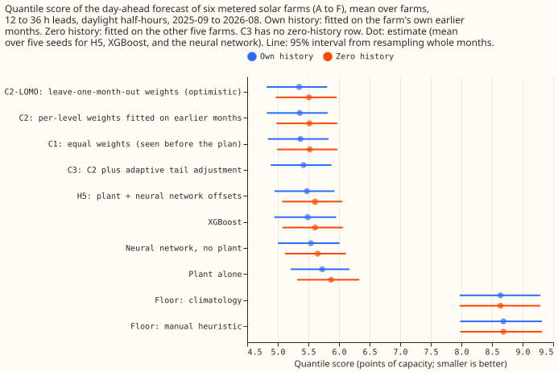
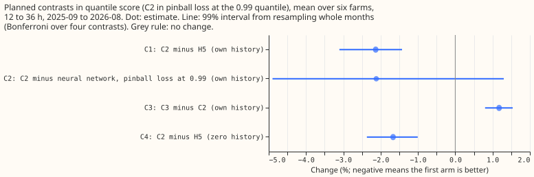
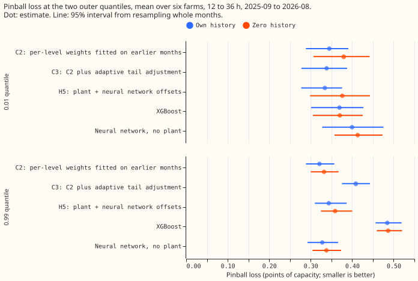
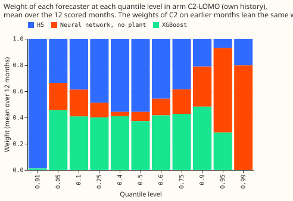

**Blending three stored solar-farm forecasters with a separate weight at each quantile level scores
2.1% better than the best single forecaster, H5, but the rolling tail adjustment raised the error.**
National Grid Electricity Distribution (NGED) meters six solar farms, labelled A to F. [Experiment
243](../00243-metered-farm-architecture-comparison/result.md) stored the forecasts of three
forecasters. H5 is a physical solar-farm power model (the plant) plus a neural network that outputs
11 quantile offsets. The second forecaster is a neural network without the plant, and the third is
XGBoost. The equal-weight arm (arm C1) gives the three forecasters equal weights, arm C2 fits a
separate weight for each forecaster at each of the 11 quantile levels, and arm C3 adds a rolling
adjustment of the outer quantiles to C2. C2 fits its weights on earlier months by minimising pinball
loss, the quantile loss that penalises under-prediction and over-prediction in proportion to the
quantile level.

**The combination beat H5 by more than the predicted 1.5%.** With own history (each farm's forecast
fitted on that farm's own earlier months), the quantile score of C2 (twice the mean pinball loss
over the 11 levels, in points of capacity; lower is better) is 5.358 against 5.475 for H5. Contrast
C1 (C2 minus H5) is -2.13% (95% interval -2.80% to -1.58%; 99% interval -3.09% to -1.42%). The 0.99
pinball loss of C2 is 2.1% lower than the loss of the neural network without the plant (95% interval
-4.2% to +0.5%), inside the predicted limit of 5% above it.

**About a quarter of that gain comes from averaging seeds.** H5, the neural network, and XGBoost
each have five seeds, and C2 combines their seed-averaged quantiles, while the reference scores of
experiment 243 average the losses of the seeds. Averaging H5's seeds in quantile space improves its
score by 0.49% (5.448). Against that like-for-like H5, C2 is 1.64% better (check M1, a post hoc
comparison; 95% interval -2.28% to -1.12%; 99% interval -2.57% to -0.96%), only just past the 1.5%
threshold.

**The rolling tail adjustment missed its prediction on the quantile score but met it on coverage.**
The adjustment (C3) moves the 0.01, 0.05, 0.95, and 0.99 quantiles by an offset that follows recent
misses. Coverage of the 0.99 quantile (the share of actual values at or below it) rises from 0.9877
to 0.9948, inside the predicted band of 0.985 to 0.995. The quantile score rises by 1.19% (95%
interval +0.88% to +1.51%), against the 0.2% allowed, and the 0.99 pinball loss rises by 27%. The
hypothesis is partly supported.

**The neural network without the plant carries the top quantiles and H5 carries the bottom one.**
Over the 9 months after the 3-month burn-in, the fitted weights of C2 give the neural network
without the plant 0.86 of the weight at the 0.99 quantile and 0.70 at the 0.95 quantile, and give H5
all of the weight at the 0.01 quantile. With zero history (fitted on the other five farms), C2 is
1.66% better than H5 (95% interval -2.18% to -1.16%).

## Numbers

- **Quantile score** (points of capacity, mean over six farms, own history): C2-LOMO 5.349, C2
  5.358, C1 5.370, C3 5.422, H5 with seeds averaged 5.448, H5 5.475, XGBoost 5.490, neural network
  without the plant 5.541, plant 5.726, climatology 8.638, manual heuristic 8.687. Zero history:
  C2-LOMO 5.508, C2 5.517, C1 5.522, H5 with seeds averaged 5.584, XGBoost 5.610, H5 5.610, neural
  network without the plant 5.650, plant 5.871.
- **Burn-in and LOMO.** The first 3 scored months (2025-09 to 2025-11) are scored with equal
  weights, so C2 equals arm C1 there. Each later month's weights use only the actuals observed
  before that month's first forecast run. C2-LOMO (C2 with weights fitted on all scored months
  except the scored month, using later months too) cannot exist at forecast time, so C2-LOMO is an
  optimistic reference. C2-LOMO scores only 0.16% better than C2.
- **Exploratory arms** (not pre-registered): arm C1 is 1.91% better than H5 (95% interval -2.52% to
  -1.42%). Arm C1 was scored during planning on a different capacity figure and is rescored here on
  experiment 243's capacity. C2 is 2.40% better than XGBoost (95% interval -2.89% to -1.80%).
- **Per farm** (own history, quantile score, H5 then C2): A 5.277 and 5.221, B 5.252 and 5.138, C
  4.903 and 4.777, D 6.011 and 5.868, E 6.351 and 6.214, F 5.055 and 4.931. C2 is better at all six
  farms.
- **Tail calibration, own history** (share of actual values below the 0.01 quantile, share at or
  below the 0.99 quantile, then pinball loss at 0.01 and 0.99): H5 0.007 and 0.985, 0.334 and 0.344;
  neural network without the plant 0.048 and 0.980, 0.400 and 0.328; XGBoost 0.016 and 0.994, 0.369
  and 0.485; C2 0.018 and 0.988, 0.345 and 0.321; C3 0.008 and 0.995, 0.338 and 0.409. The nominal
  shares are 0.01 and 0.99.
- **Lower tail by farm.** C2's share below the 0.01 quantile is 0.042 at farm D and 0.036 at farm E,
  against 0.003 and 0.018 for H5, so the excess of C2 over 0.01 comes from those two farms. C3
  brings farm D to 0.007 and farm E to 0.020. Of C2's actual values below the 0.01 quantile, 87% are
  under 3% of capacity (H5: 60%; C3: 64%).

## Checks

- **Median beside the contrasts.** The median error (mean absolute error, MAE, of the median) is
  9.72 for C2 and 9.85 for H5, so the gain in quantile score is not carried by the median alone: the
  0.99 pinball loss is 6.6% lower (95% interval -10.9% to -1.7%) and the 0.01 pinball loss 3.2%
  higher (95% interval -0.4% to +9.7%).
- **Triggers.** The second prediction (the tail adjustment raises the quantile score by no more than
  0.2%) fails, which fires the plan's audit trigger for a contradicted prediction. The stop rule
  does not apply, because C2 beats H5 by more than 0.5%.
- **Departures from the plan.** The weights are found by a grid search of the simplex to 0.002 in
  each weight, because the linear programme of the plan took tens of seconds per fit. A linear
  programme and the grid gave weights within 0.0001 on 6 months of own-history data at the 0.01,
  0.5, and 0.99 levels. The MAE of the mean forecast is not reported, because the combined arms
  output quantiles only. Shares below the 0.01 quantile use a strict inequality, because the
  quantile is exactly 0 for 34% of C2's half-hours and counting those ties as misses would overstate
  them.

## What the next experiment should answer

**The next experiment should test two changes: an adjustment of the 0.99 quantile alone with a
smaller step, and a fit of C2's lower quantiles that does not miss at farms D and E.** The
adjustment of the 0.99 quantile overshoots to 0.9948 coverage and raises the 0.99 pinball loss by
27%. C2's excess below the 0.01 quantile at farms D and E is not isolated here, and C3 removes it
only by moving the quantile to zero.

## Data-processing note

Experiment 268 found crossing quantiles in 26,344 of its 77,897 generator-forecast rows (34%), but
all of them belong to three generators that are not solar farms, so none is on this page.
[Experiment 273](../00273-metered-farm-sorted-quantile-rescore/result.md) counted 0 crossing rows in
every arm here, because the fit scripts sorted the 11 quantiles before writing them, so sorting does
not change the scores on this page.
