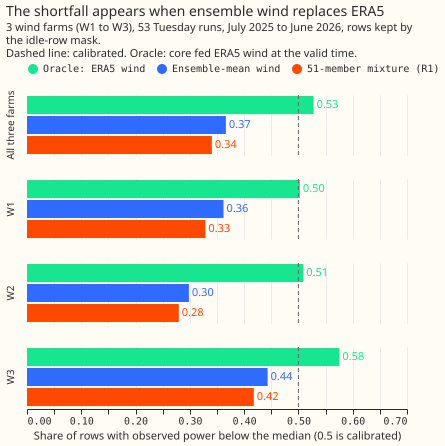
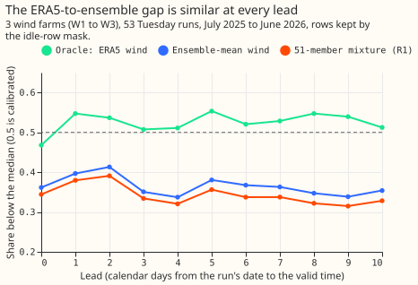
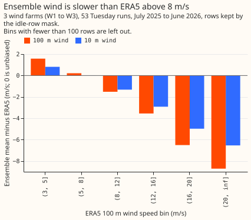
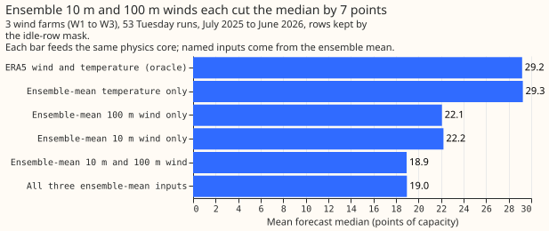
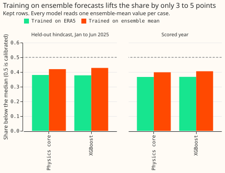

**Take-home: the wind forecast's low median enters at the ensemble's weather, not at the physics core,
the farms, or the mixing of the 51 ensemble members.** The wind-power forecast of [experiment
259](../00259-wind-plant-plus-quantile-offset-head/result.md) is too low: observed power was below
the forecast's median on 34% of rows instead of 50%. The forecast is a physics-based model of
wind-farm power (the physics core, R1) fitted to ERA5, our estimate of past weather, before
2024-04-01. It reads the 51 members (separate forecast scenarios) of the ECMWF ensemble and mixes
the 51 resulting power forecasts. We kept the core fixed and swapped its weather input stage by
stage: ERA5 wind at the valid time (the oracle), the ensemble's mean wind, and the 51 members mixed
together. The scores use the kept rows, which leave out the readings that experiment 210's mask
flags as an idle-turbine artefact.

**With ERA5 wind, the core is calibrated over the scored year at these three farms.** The share of
kept rows below the median was 52.8% (95% interval 50.3% to 55.0%). With the ensemble's mean wind
the share fell to 36.6%, and after mixing the 51 members to 34.1%. The median fell by 11.5 points
of capacity (1 point is 1% of a farm's capacity) from the oracle to the final forecast. The weather
swap accounts for 10.2 of those points (89%, interval 86% to 91%) and the member mixing for 1.3
points (11%). The ensemble's 10 m and 100 m wind speeds each explain about 7 points on their own,
and the temperature none.

**The verdict is `partly supported`.** The predictions held for the oracle share and for the mixing.
The planned conversion from the 100 m wind-speed bias to power (the core curve's slope times the
bias) explains 48% of the 11.5-point fall, not the 70% we predicted, because the conversion leaves
out the 10 m wind that sets the core's shear exponent.

**Training on ensemble forecasts is not a cure.** It lifts the share below the median by 3 to 5
points of the 16-point gap between 50% and 34%.

## Design and results

- **Stages.** The core is experiment 259's R1 (shear exponent to a fitted hub height, air-density
  factor, blurred power curve, idle layer except at W2, 14 bins of residual quantiles), refitted
  here with experiment 259's code. Its stored mixture median matches the recomputed one to 0.0003
  of capacity at every farm, so the refit reproduces experiment 259's forecasts. The spread factor
  scales quantiles about the median, so it cannot move the median.
- **Rows.** The 53 Tuesday runs of 2025-07 to 2026-06 at W1 to W3: 96,479 kept rows and 107,121
  rows in all. The 442 daily hindcast runs (2024-04 to 2025-06, 794,076 kept rows) are descriptive.
  Intervals resample the 12 months of the scored year 2,000 times; the farms are not resampled.
- **Share below the median, scored year, kept rows (all rows).** Oracle 52.8% (52.1%); ensemble-mean
  wind 36.6% (41.2%); 51-member mixture, R1, 34.1% (38.8%); XGBoost mixture, R0, 35.1% (39.8%).
  Intervals on the kept rows: 50.3% to 55.0%, 33.9% to 39.7%, 31.5% to 37.0%, and 32.6% to 38.0%.
- **By farm, kept rows (oracle, ensemble-mean wind, mixture).** W1 50.3%, 36.2%, 32.9%; W2 50.9%,
  29.8%, 28.0%; W3 57.5%, 44.3%, 41.8%. W3's oracle share sits above 50%, and W2's mixture share
  is the lowest.
- **By lead band, kept rows (oracle, mixture).** Days 0 to 2: 52.5%, 37.5%. Days 3 to 6: 52.3%,
  33.7%. Day 7 onward: 53.1%, 33.0%. The shift in the median grows from 4.9 points (days 0 to 2)
  to 9.4 and 14.8 points.
- **Median shift, kept rows, in points of capacity.** Total (oracle minus final) 11.5 (9.7 to
  13.3); weather swap 10.2 (8.5 to 11.8); member mixing 1.3 (0.9 to 1.6). By farm the weather
  share is 86% (W1), 93% (W2), and 85% (W3). By band it is 85%, 88%, and 89%.
- **Wind-speed bias, scored year.** The ensemble-mean 100 m wind is 1.00 m/s slower than ERA5 on
  average (0.70 m/s in the hindcast), 0.37 m/s slower at days 0 to 2 and 1.29 m/s at day 7 onward.
  By ERA5 100 m speed bin: +1.6 m/s at 3 to 5, +0.2 at 5 to 8, -1.5 at 8 to 12, -3.5 at 12 to 16,
  and -6.5 at 16 to 20. The 10 m wind is 1.3 m/s slower at 8 to 12 m/s. The planned range (0.3 to
  0.8 m/s slower at 5 to 12 m/s) was wrong in both size and sign at 5 to 8 m/s.
- **Slope conversion.** The core curve's slope times the 100 m speed bias gives 5.5 of the 11.5
  points (48%, interval 43% to 54%). The conversion leaves out the 10 m wind, which sets the
  core's shear exponent, so the planned 70% was not met.
- **Input swap, mean median forecast (points of capacity).** ERA5 inputs 29.2; ensemble temperature
  only 29.3; ensemble 100 m wind only 22.1; ensemble 10 m wind only 22.2; both ensemble winds 18.9;
  all three 19.0.
- **Mixing.** The core on the ensemble-mean wind gives a mean forecast of 19.0 points. The mean of
  the 51 members' forecasts is 22.4 points and their median 18.0 (convexity of the power curve
  lifts the mean, as the plan expected). The mixture's median is 1.3 points below the core's output
  on the mean wind.
- **Training source (ensemble-mean inputs, kept rows).** On the held-out hindcast months (2025-01
  to 2025-06) the ERA5-trained core has 38.0% of rows below the median and the ensemble-trained
  core 42.0%; XGBoost gives 37.8% and 42.8%. On the scored year they give 36.6% against 39.8%, and
  36.7% against 40.5%. In sample (the 9 months of ensemble forecasts that trained them), the
  ensemble-trained core has 43.7% of kept rows and 50.0% of all rows below the median.
- **Farm check on ERA5.** The ERA5-fed core has 49.9%, 49.5%, and 47.5% of kept rows below the
  median in sample at W1, W2, and W3, and 51.2%, 47.3%, and 50.3% from 2024-04 to 2025-06. Over
  the hindcast the oracle share is 49.5% on kept rows, but it is 52.7% in April to December 2024
  and 44.0% in January to June 2025, so a period's share moves by several points with no
  change in the models.

## Checks

- **Median minus mean forecast, per farm (points of capacity, 51-member mixture, kept rows).** The
  median of the members' forecasts minus their mean is -4.7 (W1), -4.5 (W2), and -3.8 (W3). The mean
  forecast is also low: 22.4 points against an observed mean of 28.9, so the bias is not only a
  skew between median and mean.
- **Control.** The recomputed mixture median matches experiment 259's stored R1 median to within
  0.0003 at every farm, for both the hindcast and the scored year.
- **Leave one farm out.** The weather share of the median shift is 85% to 93% at every farm, so no
  farm carries the conclusion.
- **No quantile-score contrast and no new forecast.** The mean-forecast-error check of experiment
  259 does not apply, and no tail-calibration table applies.
- **Audit triggers.** None of the seven triggers in the `ml-experiment` skill fired. The planned bias range and the slope conversion missed their predictions, and the
  input swap explains why (the 10 m wind enters through the shear exponent), so the
  explanation is tested and recorded here.

## Caveats and departures from the plan

- **ERA5 is the reference, not the truth.** The core was fitted to ERA5, so the fitted hub height
  absorbs ERA5's own bias at each farm. The result says the ensemble's wind is slower than ERA5's,
  and that the ERA5-fitted core is calibrated on ERA5 wind. It does not say which product matches
  the wind at the turbines.
- **Kept rows and all rows differ.** The share on kept rows is 4 to 6 points lower than on all rows
  for the ensemble stages and within 1 point for the oracle, so the rows the idle-row mask removes
  are mostly below the ensemble stages' median. The conclusion is the same on both.
- **Steps run.** The stop rule asked for steps 3 to 6 because the slope conversion fell short of
  70%, so all six steps ran. Step 4 was not run as a refit: the spread factor cannot move a median
  (checked above), and R1 has no base margin yet has the same low share as R0, which has one. The
  BM0 refit was not run for that reason.
- **Training source uses ensemble-mean inputs.** The models in step 5 read one ensemble-mean value
  per case, with four wind columns for XGBoost (no 10 m direction), so they isolate the training
  source from the mixing and are not experiment 259's member-level models.
- **Held-out hindcast months overlap the training months slightly.** Runs of 2024-12 reach about 10
  days into 2025-01, so the first 10 days of the held-out months share observed targets with the
  ensemble-trained models' training rows. The scored-year numbers are clean.
- **Three farms.** Intervals describe these farms, and the 12 resampled months share one weather
  year.

## What the next experiment should answer

- **Does correcting the ensemble's 10 m and 100 m wind speeds remove the shortfall?** Fit a
  correction by ensemble-mean speed and lead from the hindcast, apply it to every member, and
  compare the quantile score with the offset table of experiment 259 on the same rows.
- **Is the speed bias a property of the ensemble or of the grid cell?** Compare the bias at other
  grid cells and, where observations exist, with measured wind.
