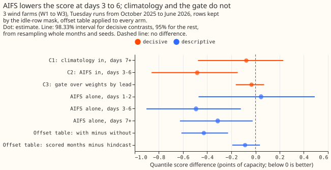
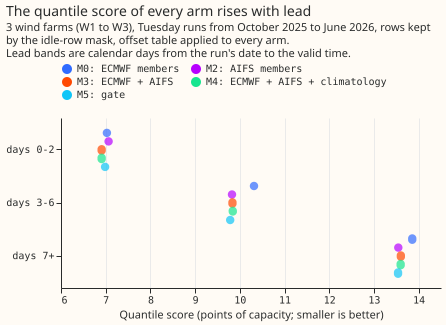
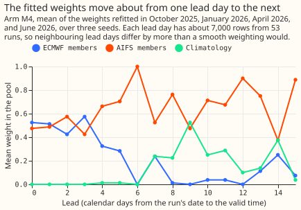

**Take-home: the AIFS ensemble improves the wind forecast's quantile score at 3 to 6 days ahead, but
neither it nor climatology nor a neural gate improves the high-power tail.** We asked whether the
wind forecast for three metered farms (W1 to W3) improves when the 51 ECMWF ensemble members are
pooled with the 51 members of the AIFS ensemble (a machine-learning weather model from ECMWF,
available from [Dynamical.org](https://dynamical.org) under CC BY 4.0), with climatology (the
typical power for the month and half-hour), or both. Every member runs through the ERA5-trained
XGBoost model of [experiment 230](../00230-wind-physics-core-part-1/result.md), and every arm
then gets the table of offsets of [experiment
259](../00259-wind-plant-plus-quantile-offset-head/result.md), which corrects the common low bias.
We scored October 2025 to June 2026 on the rows kept by experiment 210's idle-row mask. The
verdict is `partly supported`: the AIFS result passes the decision rule's point threshold but its
interval ends 0.003 points of capacity short, and the other two contrasts fail.

**AIFS lowers the quantile score at days 3 to 6 by 0.48 points of capacity.** The 98.33% interval
is -0.86 to -0.15 (C2); the threshold needed an interval wholly below -0.15, and the upper end is
-0.147. The 0.99 pinball loss at days 3 to 6 is not lower (0.567 against 0.563 for M0, the
ECMWF-only arm), so the prediction of a 3% fall missed. The gain also exceeds the predicted -0.10
to -0.30, and the predicted days 0 to 2 range of ±0.05 missed too (-0.12, interval -0.38 to +0.10).

**Climatology and the neural gate add nothing.** Climatology weights by lead day lower the score at
days 7 and later by 0.08 (-0.48 to +0.23, C1), against a predicted -0.15 to -0.40. Without the
offset table the same arm lowers it by 0.45 (-0.90 to -0.10, D10), in the predicted range. The
offset table therefore removes most of the long-lead gain climatology gave, which tests the
explanation for the miss. The gate changes the score by -0.03 (-0.16 to +0.07, C3) against the
weights by lead day, and the gate that reads only the lead (M5b) scores within 0.01 of it.

## Design and results

- **Rows.** 53 Tuesday runs from 2025-07-01 to 2026-06-30 at W1 to W3 (107,121 cases). The first
  run has no AIFS run, so 52 runs (105,016 cases, 1.9% of runs missing) remain. July to September
  2025 train the weights, spread factors, and tables; October 2025 to June 2026 are scored: 71,294
  kept rows per seed, 213,882 over three seeds. Intervals resample whole months and seeds 50,000
  times; the farms are not resampled.
- **Scores, kept rows, with the offset table (points of capacity: days 0 to 2 / 3 to 6 / 7+ /
  all).** M0 7.03 / 10.32 / 13.86 / 11.63. M1q 7.04 / 10.33 / 13.78 / 11.60. M2 (AIFS alone) 7.06 /
  9.82 / 13.54 / 11.34. M3 6.91 / 9.83 / 13.60 / 11.34. M4 6.91 / 9.84 / 13.60 / 11.34. M5 6.99 /
  9.79 / 13.54 / 11.31. M5b 6.99 / 9.87 / 13.49 / 11.31. Arms M1q to M5 are all within 0.35 of each
  other overall, and M2 matches M3, so most of the gain comes from using AIFS instead of the
  ECMWF members, not from pooling the two.
- **Tail, kept rows, all leads (T: mean of the 0.01 and 0.99 pinball losses; 0.99 pinball loss).**
  M0 0.451, 0.601. M1q 0.457, 0.614. M2 0.464, 0.630. M3 0.459, 0.618. M4 0.464, 0.629. M5 0.475,
  0.644. No arm lowers either; AIFS raises the 0.99 pinball loss (M3 minus M0 +0.017). **The
  curtailment use case therefore gets no gain from these arms.**
- **Calibration, kept rows, all leads.** Coverage of the 5% to 95% band is 92.3% to 92.8% for every
  arm (nominal 90%), and of the 1% to 99% band 97.5% to 97.9% (nominal 98%). The share of rows
  below the median is 45.3% for M0 and 46.7% for M3.
- **Without the offset table.** M0 12.06 and M3 11.58, a difference of -0.49 (-0.60 to -0.38, D7),
  so AIFS removes part of the low bias on its own. The table lowers M0 by 0.43 (-0.61 to -0.23,
  D5). The hindcast table of experiment 259 scores 11.72 on M0, and the table fitted on the scored
  months beats it by 0.09 (-0.19 to +0.04, D6).
- **Weights.** M4's mean weight on AIFS is about 0.5 at days 0 to 3, 0.66 to 0.70 at days 4 and 5,
  and 0.68 to 0.90 at days 10 to 13 (figure 3). Climatology gets weight (0.2 to 0.5) only at days 7
  to 11 and day 14. Lead days 6 and 12 give AIFS weight 1.0 and 0.9. Each lead day has about 7,000
  rows from 53 runs, so neighbouring days jump about, and the gate's mean weights (0.27 ECMWF, 0.58
  AIFS, 0.15 climatology) are smoother.
- **Linear pool and quantile averaging.** The linear pool M1p scores 0.03 worse than quantile
  averaging M1q (0.01 to 0.05, D3), and 0.06 worse at days 7 and later (0.03 to 0.08). It did not
  beat quantile averaging on the tail score (+0.01, -0.003 to +0.03).
- **Gate.** M5 beats M5b by 0.00 (-0.06 to +0.08, D1), so reading the spread and disagreement of
  the two ensembles gives nothing over reading the lead. At days 0 to 2 the gate's tail score is
  0.072 worse than M4's (0.044 to 0.100). The gate minimises the continuous ranked probability
  score, which weights the tails little, which explains the loss.
- **Run timing and AIFS version.** Reading the AIFS run of 18 UTC the day before (M3prev) scores
  0.09 worse than the 00 UTC run on the same rows (-0.01 to +0.20, D9), so the gain does not
  depend on the assumed 09:00 UTC availability. Before the AIFS version change of 2026-05-12, M3
  scores 0.33 below M0 (12.13 against 12.46, kept rows, with table); from that date, 0.09 below
  (7.44 against 7.53). The later period has 8 runs, so the smaller gain is descriptive.
- **Stop rules.** AIFS alone (M2) scores better than climatology at days 1 to 6, so no AIFS arm
  stopped.

## Checks

- **Audit triggers.** Trigger 2 (a result contradicts its prediction) fired for C1, and the
  session tested the explanation (D10, above). It also fired for C2's size and C3's tail result,
  with the untested explanation recorded above. Triggers 1, 3, 4, 6, and 7 did not fire (there is
  no control that fails, the median-error contrast was not computed, the three farms are too
  few for a leave-one-out check of C1 to C3, and no sister experiment has the same contrast), and
  trigger 5 fired mildly for the gate. No Opus audit ran, because the brief limits this session to
  Sonnet; the maintainer may want one before a port.
- **Circularity.** The weights are fitted on the continuous ranked probability score before the
  spread factor and the offset table are, so the tables see forecasts the weights never saw. The
  alternative (fit the weights through the table) was not tried.
- **Scope.** Three farms and 53 Tuesday runs; intervals describe these farms and months.

## What the next experiment should answer

Whether AIFS still lowers the quantile score at days 3 to 6 on a second year of runs, and whether
weights by lead band (days 0 to 2, 3 to 6, 7 and later) hold up better than weights by lead day.
