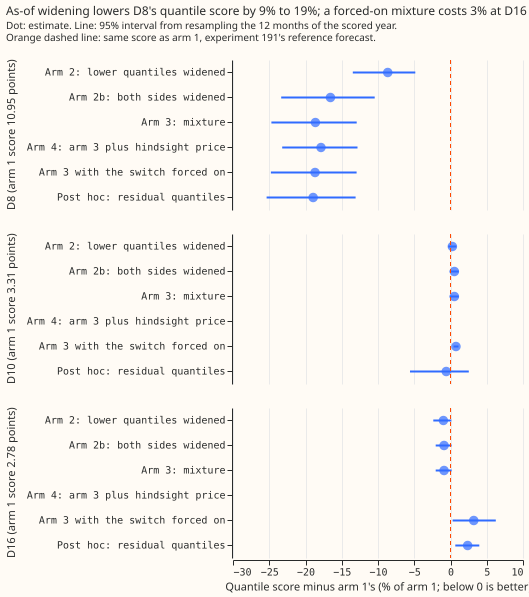
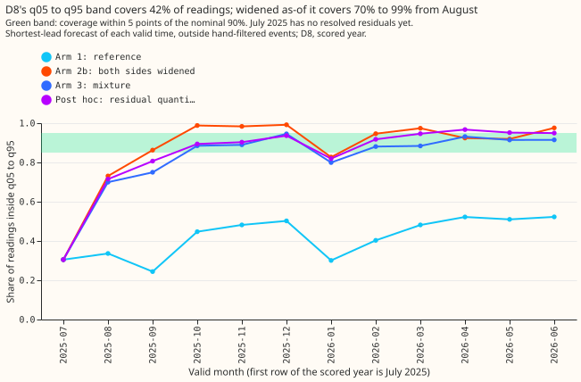
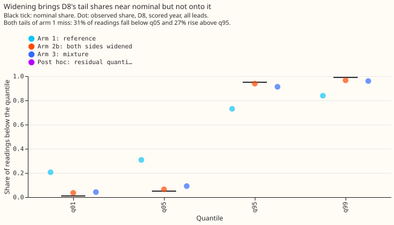

**Widening the forecast band with residuals already seen narrows most of the gap at D8, but the
gain from modelling a gas engine, beyond simple widening, is not shown.** D8 is a primary substation
of National Grid Electricity Distribution (NGED). D8's half-hourly power readings appear to include
the output of a 6 MW gas engine, probably three units of about 2 MW each, which [experiment
191](../00191-dp-price-sensitive-assets-in-the-history/result.md), [experiment
198](../00198-d8-summer-spikes-cooling-load-and-residual-test/result.md), and [experiment
199](../00199-ps2b-engine-detector-v2-ramp-night-price/result.md) could not detect. This experiment
does not try to detect the engine. It asks whether the forecast's q05-to-q95 band, the range meant to
hold 90% of readings, can carry the uncertainty that the engine adds. A residual is the actual
reading minus the forecast median, and every arm uses only residuals known when the forecast is
made. The unchanged forecast (arm 1) is experiment 191's reference, a generalised additive model
with a Kalman filter on recent errors (GAM-K) and no price input. We tested five ways of widening
its band. Arm 2 widens only the lower quantiles, arm 2b widens both sides, arm 3 is a mixture that
assumes 0 to 3 engine units are running, arm 4 is arm 3 plus a price known only in hindsight, and
a post hoc baseline adds the quantiles of the past 365 days of residuals to the reference median.

Widening the band raised the share of readings inside it from 0.42 (arm 1) to between 0.80 and 0.87
(arms 2b, 3, 4, and the baseline), and lowered the quantile score by 9% to 19% against arm 1. The
quantile score is a score for the whole set of 11 forecast quantiles (smaller is better), and one
point is 1% of the substation's effective capacity (0.1 MW at D8). By the pre-registered rule the
verdict is `not supported`: no arm holds the share within 5 points of 0.90 in every quarter of the 12
months from 2025-07-02 to 2026-06-30, the July to September 2025 quarter has only weeks of residual
history to learn from, and arm 2b raises the quantile score by 0.5% at D10, a substation with no
engine. Arm 3 scores 2.5% better than arm 2b, yet the post hoc baseline, which has no engine in it,
scores 0.4% better than arm 3, a difference smaller than its uncertainty. With the engine model
forced on, arm 3 also fits an average 0.27 and 0.46 chance that an engine unit is running at D10
and D16, which have no engine. Arm 3's gain over arm 2b may therefore come from fitting the shape
of D8's tails and not from an engine.

## Arms and rows

- **Rows.** Experiment 191's stored reference forecast (arm a0, the GAM-K engine of [experiment
  152](../00152-dp-mva-fold-aware-gam-k-at-mva-only-primaries/result.md)), `fold_a_daily_gap_v1`,
  seed 0, scored year 2025-07-02 to 2026-06-30, leads 0.5 to 168 hours, outside the hand-filtered
  events: 97,012 rows at D8, 96,370 at D10, and 91,754 at D16. The reference reproduces experiment
  191's D8 scores (quantile score 10.95, mean absolute error 15.18 points, coverage 0.42).
- **Arm 1** is the reference.
- **Arm 2** recalibrates the lower quantiles q01 to q25, with a separate correction for each
  combination of four six-hour blocks of the day and four seasons.
- **Arm 2b** widens both sides by the same method.
- **Arm 3** is the mixture over 0 to 3 running units of 19.7 points (1.97 MW). Where the visibility
  switch is off, arm 3 uses the arm 2b band. The switch turns the engine model on when 5% or more of
  the last 30 days' half-hours had a residual below -25 points (-2.5 MW), and off when the share
  falls below 3%.
- **Arm 4** is arm 3 plus two price flags known only in hindsight.
- **Post hoc baseline** is the reference median plus the quantiles of the trailing 365 days of
  residuals, with no cells and no engine.
- **Schedule.** Each arm refits every 7 daily forecast origins (the moment a forecast is made) on the
  trailing 365 days of residuals that were known at the block's first origin minus 6 hours. The
  reference's own refits are monthly, as in experiment 191.

## Results

- **Quantile score at D8 (points of capacity; smaller is better).** Arm 1 10.95; arm 2 10.00; arm 2b
  9.14; arm 3 8.91; arm 4 9.00; post hoc baseline 8.88. Against arm 1: arm 2 -8.7% (interval -13.5%
  to -4.9%), arm 2b -16.6% (-23.3% to -10.5%), arm 3 -18.6% (-24.7% to -12.9%), arm 4 -17.9%
  (-23.2% to -12.8%), post hoc baseline -18.9% (-25.4% to -13.1%). Every contrast keeps its sign
  when any one month is left out.
- **Coverage of q05 to q95 at D8, all 12 months.** Arm 1 0.42; arm 2 0.67; arm 2b 0.87; arm 3 0.82;
  arm 4 0.80; post hoc baseline 0.85.
- **Coverage of q05 to q95 at D8 by quarter** (2025Q3 excludes July; the target band is 0.85 to 0.95):

    | Arm | 2025Q3 | 2025Q4 | 2026Q1 | 2026Q2 |
    |---|---|---|---|---|
    | Arm 1 | 0.29 | 0.48 | 0.40 | 0.52 |
    | Arm 2 | 0.57 | 0.80 | 0.61 | 0.75 |
    | Arm 2b | 0.80 | 0.99 | 0.92 | 0.94 |
    | Arm 3 | 0.72 | 0.91 | 0.85 | 0.92 |
    | Arm 4 | 0.69 | 0.90 | 0.83 | 0.91 |
    | Post hoc baseline | 0.76 | 0.91 | 0.89 | 0.96 |

  With July included, 2025Q3 holds 0.30 (arm 1), 0.64 (arm 2b), and 0.60 (arm 3).
- **Tails at D8.** Arm 1 puts 20.6% of readings below q01 and 30.8% below q05, and 26.9% above q95 and
  16.1% above q99. Arm 2b gives 3.6%, 6.5%, 6.1%, and 3.4%. Arm 3 gives 4.2%, 9.2%, 8.7%, and 4.0%.
  Pinball loss at q05 falls from 4.12 (arm 1) to 2.46 (arm 2b) and 2.33 (arm 3), and at q95 from
  4.31 to 2.70 and 2.56.
- **Leads at D8.** Coverage of arm 3 is 0.80, 0.83, and 0.82 at 0 to 24, 24 to 72, and 72 to 168
  hours, against 0.39, 0.43, and 0.43 for arm 1. The fit uses the shortest-lead residuals, and the
  coverage at long leads is not gated.
- **Mixture against widening both sides.** Arm 3 minus arm 2b is -2.5% (interval -4.5% to -0.6%, and
  the 99.2% interval stays below zero), with every leave-one-month-out sign negative. The gain sits
  in October to December. The noise scale, a multiplier on the reference's spread, sits at the
  largest value the fit allows (2.0) in every block, and the fitted chance that at least one unit
  is running averages 0.75 at D8.
- **Post hoc baseline against the mixture.** Arm 3 minus the baseline is +0.4% (interval -0.8% to
  +1.7%), so the engine mixture is no better than a band built from past residuals.
- **Placebo: quantile score against arm 1 at D10 and D16, with the upper end of the 95% interval in
  brackets.** Arm 2: +0.26% (+0.82%) and -0.98% (+0.11%). Arm 2b, which arm 3 equals while its switch
  is off at both sites: +0.53% (+1.15%) and -0.89% (+0.14%). Arm 3 with the switch forced on: +0.75%
  (+1.11%) and +3.20% (+6.24%), with an average fitted chance that a unit is running of 0.27 and
  0.46. Post hoc baseline: -0.59% (+2.53%) and +2.36% (+3.96%). The rule needed +0.1% or less and
  an upper end of +0.5% or less, so D10 fails for arms 2, 2b, and 3, and for the forced run, and D16
  fails for the forced run and the baseline.
- **Visibility switch.** At the pre-registered settings (on at 5%, off at 3%) the switch turns on at
  D8 on 2025-07-04 and never turns off, and it never turns on at D10 or D16. At on 7% and off 4%
  (post hoc) it also turns off at D8 on 2026-04-23, the only date in the scored year on which the
  engine's footprint drops out of D8's residuals. At on 3% and off 2% it behaves as at 5% and 3%.
  No NGED data change was tested against these dates.
- **Price.** Arm 4 minus arm 3 is +0.95% (interval -0.1% to +2.1%). A price known only in hindsight
  does not help, so the missing price forecast does not limit arm 3 here.
- **Curtailment.** `studies.node_curtailment` needs a bulk supply point forecast and its generators'
  forecasts, so no curtailment cost was computed. The stand-in Brier score of "reading below D8's 2nd
  percentile of the scored year" is 0.026 for arm 1 and rises to between 0.031 and 0.038 for the
  widened arms, so widening does not help that rare-event score.
- **Predictions.** P1 (arm 2 coverage at most 0.80 in every quarter) failed narrowly, at 0.803 in
  2025Q4. P2 (arm 2b within 5 points of 0.90 in three of four quarters) failed, with two of four.
  P3 (arm 3 in band in three quarters and within 1% of arm 2b) held on coverage and failed on score,
  at -2.5%. P4 (arm 4 lowers the score against arm 3 by under 1%) failed, because the score rose
  0.95%. P5 (the switch turns off at D8 between 2026-03-01 and 2026-05-15) failed at the
  pre-registered settings, and held at D10 and D16. P6 (forced-on mixture below 0.05 at D10 and
  D16) failed, at 0.27 and 0.46.

## Checks

- **Median minus mean forecast.** Zero for arms 1, 2, and 2b. For arm 3, +0.14 points at D8, and 0.00
  at D10 and D16 where the switch is off. For the forced run, +0.16 at D8, -0.04 at D10, and +0.15
  at D16. For the post hoc baseline, -0.96, -0.54, and -0.26.
- **Mean-forecast error.** Every arm keeps the reference's mean forecast, so the mean absolute error
  is 15.18 (D8), 5.54 (D10), and 4.70 (D16) points for all of them, and no contrast can disagree in
  direction with a mean-forecast contrast.
- **Audit triggers 1, 2, and 5 of the seven in the `ml-experiment` skill fired.** A placebo failed
  (D10, and the forced run at D16). Five predictions failed (P1, P2, P4, P5, and P6), and P3 failed
  on its score clause. The forced D16 control moved the score by +0.089 points, more than the 0.083
  half-width of its own interval.
- **Audit.** A fresh Sonnet agent ran the audit, because the maintainer's brief bars Opus. The audit
  re-ran arms 2b and 3 after shifting every actual after 2026-01-10 by -40 points, and found every
  row at earlier origins bit-identical, so the as-of rule leaks nothing. It also reproduced the D8
  numbers, found no bug in the distribution helpers, and found the post hoc baseline. The audit
  added the baseline arm and the noise-scale-limit caveat, and changed the interpretation of arm 3.
  It did not change the stored reference's median or the removal of hand-filtered events before
  fitting.

## Caveats and what to try next

- **Fit to the year.** The descriptive table that chose arm 2b and the switch thresholds came from the
  scored year, and no second year of D8 forecasts is stored, so every verdict is exploratory.
- **Little residual history in 2025Q3.** The earliest D8 forecasts are stored from 2025-07-02, so
  the first quarter, and the cells of the first seasons, rest on weeks of residuals.
- **Next.** Candidates for further work are to store D8 reference forecasts for an earlier period so
  the fit starts with residuals, and to carry plain two-sided widening (arm 2b) and the
  past-residual baseline forward after a check at substations with no engine. Do not extend the
  mixture, or add a neural network to predict its unit probabilities, until NGED can supply the
  engine's own output, because the mixture has not been shown to measure an engine.

## Plan (as pre-registered)

### What was seen first

- **The reference forecast is too narrow in both directions, not only downwards.** Before writing
  this plan we tabulated experiment 191's stored reference forecasts at D8 by month, using for each
  valid time the forecast with the shortest lead. In the 12 months the reference's q05-to-q95
  coverage runs from 0.27 to 0.51. Between 22% and 44% of readings lie above q95, and 25% to 47%
  lie below q05. The median distance from q50 to q05 is only 6.8 to 9.8 points (0.7 to 1.0 MW),
  against a mean absolute error of about 15 points. The share of readings more than 25 points (2.5
  MW) below q50 falls from 5% to 16% in July to March to 3.5% to 5.8% in April to June 2026. At D10
  and D16 the same table shows coverage of 0.77 to 0.97, so the narrow bands are particular to D8.
  The lower-tail-only widening that the maintainer's brief names as arm 2 therefore cannot be
  enough on its own, and we added arm 2b, which widens both sides, to separate "the band is too
  narrow" from "the band is too narrow in the direction the engine pushes".
- **The table of coverage and tail shares is descriptive, was read before the arms were fixed, and
  chose arm 2b and the switch thresholds.** The switch thresholds (on at 5%, off at 3%) sit between
  the placebo sites' share of about 0.1% and D8's share of 5% to 16% in July to March, and the
  write-up reports the switch at two other settings as a sensitivity check.
- **Limits of the design.** Arms 2 and 2b move only the tails, so a bias in the median that the
  engine causes stays in place. Arm 1 is the stored output of experiment 191, whose monthly refits
  use only data before each month and whose spread was fitted on tuning months, so the bands being
  widened carry no information from the scored year beyond the stored forecast itself. No D8
  forecast before 2025-07-02 is stored, so the first weeks of the first quarter have no resolved
  residuals.

### Inputs

- **Forecasts.** Experiment 191's stored arm `a0` (gated variant, which equals the ungated variant at
  D8 because D8 has no pre-connection rows) at D8 (`time_series_id` 26), and at the placebo sites D10
  (10) and D16 (18). Each row holds `q01` to `q99`, `mean`, `actual`, `lead_hours`, and `run`.
  The files are `data/ml-experiments/00191-*/work/preds/gated/scored_<site>.parquet`.
- **Units.** One point is 1% of the site's effective capacity, which is 0.1 MW at D8. The engine unit
  size of 1.97 MW is 19.7 points, and the "drop" threshold of -2.5 MW is -25 points. The placebo
  sites use the same constants in points, because the question there is whether the same algorithm
  with the same settings leaves a site without an engine alone.
- **Price columns for arm 4 only.** The stored `spread_positive` and `price_p75` flags in the same
  files. They are hindsight inputs and never run in a live service.

### The as-of rule

**A residual enters a fit at origin O only if its valid time is at or before O.** For each valid
time, the training row is the stored forecast with the shortest lead, so each valid time counts
once. The residual is `actual` minus `q50`. Every fit is refitted every 7 origins and applied to the
next 7 daily origins, and fit windows are the trailing 365 days of resolved valid times. A fit
needs at least 28 days (1,300 rows) of resolved valid times. Before that, every arm equals arm 1.
This is the cold start. D8's scored forecasts begin on 2025-07-02, and no earlier D8 forecast is
stored, so the first weeks of the first quarter cannot be improved. The burn-in rule in the
decision rule handles that quarter.

### Arms

1. **Control.** Arm 1, as above.
2. **Lower-tail widening** (the maintainer's arm 2). For each row, the normalised shortfall is
   `s = (q50 - actual) / (q50 - q05)`, with the denominator floored at 1 point. In each cell of
   hour-of-day block (00-06, 06-12, 12-18, and 18-24 UTC) by season (December-February,
   March-May, June-August, September-November), and with the cell falling back to the hour block
   alone, then to all rows, when it holds under 300 resolved rows, let `S_tau` be the empirical `1 -
   tau` quantile of `s` for tau in {0.01, 0.05, 0.10, 0.25}. The new lower quantile is `q50 -
   max(r_tau, S_tau) * (q50 - q05)`, where `r_tau` is the reference's own ratio `(q50 - q_tau) /
   (q50 - q05)`. The widening never narrows a band, and the upper quantiles and the mean are
   unchanged.
3. **Arm 2b (added by this plan).** The same method applied to both sides: the upper quantiles
   `q75`, `q90`, `q95`, and `q99` are recalibrated the same way from the normalised overshoot
   `(actual - q50) / (q95 - q50)`.
4. **Mixture over running units (arm 3).** The reading is modelled as the reference's distribution,
   with its spread multiplied by a noise scale `c`, shifted by `delta - k * g`, where `k` is the
   number of running units (0, 1, 2, or 3), `g` is 1.97 MW (19.7 points), and `delta = g * E[k]`
   is set per row so that the mixture's mean equals the reference's mean (the reference was trained
   on readings that include the engine). The reference distribution is the piecewise-linear
   cumulative distribution through its 11 quantiles, with an exponential tail beyond q01 and q99
   whose density is continuous at those quantiles. The probability of `k` follows a multinomial
   logistic model of the hour block, the season, a weekend flag, and the share of half-hours in
   the 14 days before the origin with a residual below -25 points. The logistic model is fitted
   by expectation-maximisation on resolved residuals, with `c` on the grid {1, 1.5, 2} (capped
   at 2 so that one wide component cannot imitate the mixture) and the likelihood-maximising `c`
   kept, a ridge penalty of 1.0 on the logistic weights, and 30 expectation-maximisation
   iterations. The forecast quantiles come from inverting the mixture's cumulative distribution.
   A known-answer test on simulated readings (`e00264_recovery.py`) checks that the fit recovers
   the noise scale and the unit probabilities before the real run.
   **The engine visibility switch** turns on when the share of half-hours in the 30 days before the
   origin with a residual below -25 points reaches 5%, and turns off when the share falls below
   3%. The mixture is fitted only on rows whose own origin had the switch on. Where the switch is
   off the forecast is arm 2b, not arm 1, because the upper-side miss is not caused by the engine.
5. **Arm 4.** Arm 3 with `spread_positive` and `price_p75` at the valid time added to the logistic
   model. These binary flags are a hindsight upper bound for the value of a price forecast, and
   they are coarser than the spark-spread level that the brief names.
6. **Placebo (arm 5).** Arms 2, 2b, and 3 at D10 and D16, with the switch free, and with the switch
   forced on (a stress test that is the real placebo for the mixture, because the free switch is
   off at both sites).
7. **Not run.** The small neural network for the mixture probabilities. The brief welcomes it only if
   it beats arm 3 by a pre-registered margin, and the plan sets none, so the write-up lists it
   under "what to try next".

**The as-of rule has a reporting latency.** A reading counts as known 6 hours after its valid time,
because NGED's delivery lag is unknown. A fit at origin T therefore uses valid times at or before T
minus 6 hours, and so do the 14-day and 30-day drop shares. A fit is frozen at its block's first
origin, so residuals that resolve during the block do not enter its fit.

### Contrasts and scoring

- **Contrasts.** At D8: arms 2, 2b, 3, and 4 each minus arm 1 on the quantile score, arm 3 minus arm
  2b, and arm 4 minus arm 3. Each is a mean paired difference with a 95% interval from 20,000
  resamples of the 12 calendar months of the scored year, and a Bonferroni-corrected 99.2% interval
  (6 contrasts) beside it.
- **Cuts.** All rows; the four quarters; q05-to-q95 coverage and the quantile score at leads 0 to 24,
  24 to 72, and 72 to 168 hours (the fit uses shortest-lead residuals, so long-lead coverage is
  reported but not gated); the share of cells that fell back to the hour block, per quarter; months
  with the switch on and off; winter (November to March) evenings (16:00 to 20:00 UTC).
- **Tail table.** Coverage and pinball loss at q01, q05, q95, and q99 per arm.
- **Checks.** The median forecast minus the mean forecast, per site and arm. The error of the mean
  forecast beside each quantile-score contrast. The leave-one-month-out sign of each D8 contrast.
  Which of the seven audit triggers of the `ml-experiment` skill fired.
- **Curtailment.** `studies.node_curtailment` needs a bulk supply point's forecast and its generators'
  forecasts, and this experiment forecasts a single Primary, so the metric cannot be run. The
  stand-in is the Brier score of the event "the reading falls below D8's 2nd percentile of readings
  in the 12 months before 2025-07-02", computed from each arm's 11 quantiles by linear
  interpolation of its cumulative distribution. The write-up labels the Brier score a stand-in and
  does not call it a curtailment cost.

### Compute

CPU only, 4 cores at most, thread caps of 1, inside `systemd-run --user --scope -p MemoryMax=16G -p
OOMPolicy=continue`. The fits use the 17,000 shortest-lead rows per site and refit 52 times, so the
whole run should take minutes. The three sites run in parallel workers.

### Stop rule

Stop and report if arm 1, rebuilt from the stored files, does not reproduce experiment 191's D8
absolute scores (quantile score 10.95, mean absolute error 15.18 points, q05-to-q95 coverage 0.42)
to within 0.01, or if any arm's row keys differ from arm 1's.

### Anonymisation

The metered generator is named G2 only. No generator time series with a name or an identifier is
published. D8, D10, and D16 are substations and may be named.
