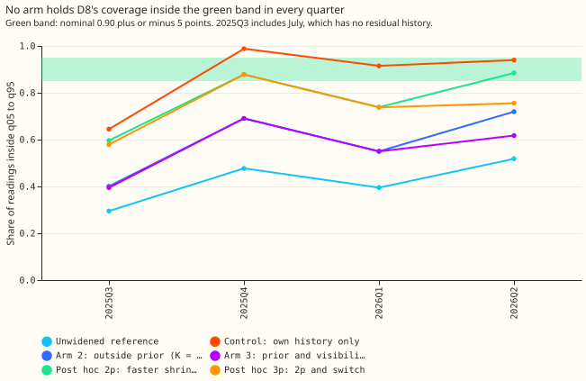
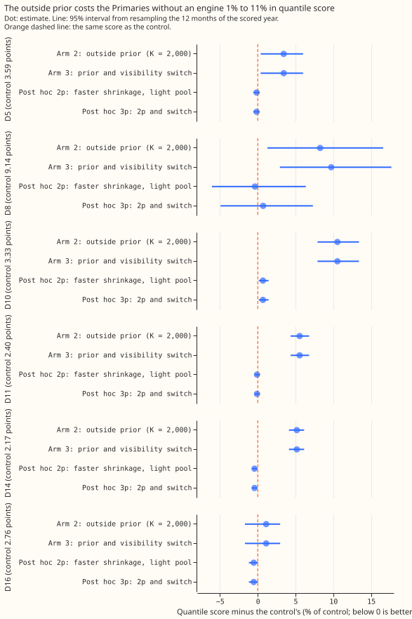
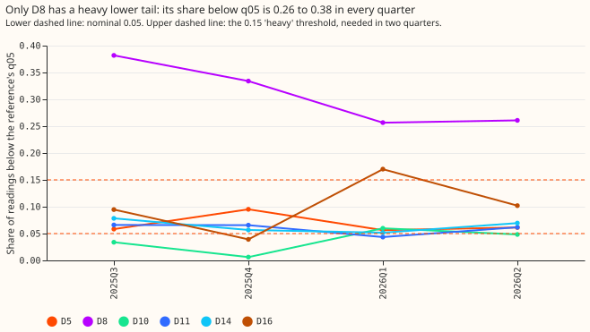

**An outside prior and an "engine visible" switch did not bring D8's forecast bands close to nominal
coverage in every quarter, and no other Primary needs them.** D8 is one of six primary substations
with stored forecasts. Its readings appear to include a 6 MW gas engine of National Grid Electricity
Distribution (NGED) that appears in no measurement we hold and shows only as unexplained drops in
D8's readings. A forecast band here is the range from the forecast's 5% quantile (q05) to its 95%
quantile (q95), meant to hold 90% of readings. [Experiment
264](../00264-dp-gas-engine-asymmetric-bands-at-d8/result.md) widened D8's bands using residuals
already seen (a residual is the reading minus the forecast median). That widening needs about a
month of past residuals, so the first quarter of the scored year (July to September 2025) was
poorly covered. We tested two additions. The first is a starting estimate of the widening taken
from the other five Primaries' residuals, which D8's own residuals replace as they accrue. The
second is a switch that returns the widening to the starting estimate once the share of half-hours
more than 2.5 MW below the forecast median falls. Neither addition fixed the coverage. In the first
quarter, the share of D8 readings inside q05 to q95 was 0.40 with the starting estimate, against
0.65 for widening from D8's own history only (the control). The switch turned off on 2026-04-23 as
intended, but D8's lower tail stayed heavy (many readings far below the forecast), so coverage in
2026Q2 (April to June) fell from 0.94 for the control to 0.62 for the arm with the switch.

The verdict is `not supported`. Both pre-registered arms miss the rule at D8 (coverage within 5
points of 0.90 in every quarter, and a quantile score no more than 0.5% above the control's). The
quantile score is twice the mean pinball loss over 11 forecast quantiles, in points of effective
capacity (a unit of 0.1 MW, which is 1% of D8's 10 MW effective capacity; 9.14 is in those units and
lower is better). The control is 264's two-sided widening, rebuilt here, and it reproduces 264's D8
score of 9.14. A post hoc variant with faster shrinkage and a pool without D8 ties the control on
score but covers less. Only D8 has a heavy lower tail, so there is no second Primary with a heavy
lower tail on which to test whether the prior and switch generalise, and the outside prior raises
the other Primaries' quantile score by up to 11%.

## Arms and rows

- **Rows.** [Experiment 191](../00191-dp-price-sensitive-assets-in-the-history/result.md)'s stored
  reference forecast, `fold_a_daily_gap_v1`, seed 0, 2025-07-02 to 2026-06-30, leads 0.5 to 168
  hours, outside the hand-filtered events: 97,012 rows at D8 and 84,137 to 97,046 at the others.
- **Schedule.** Every arm refits every 7 daily origins on the trailing 365 days of residuals known
  6 hours before the fit. The reference's own refits are monthly, as in experiment 191.
- **Arms.** Control, arm 2 (prior, K = 2,000 rows), arm 2c (prior from an as-of pool), arm 3 (arm 2
  plus the switch at on 7%, off 4%), arm 3 at on 5% and off 3%, and the post hoc arms 2p and 3p
  (K = 300 rows, pool without the heavy-tailed D8). The arm definitions are in Plan, below.
- **No neural network.** The brief made it conditional on beating arm 2, and arm 2 does not pass.

## Results

- **First quarter at D8 (July to September 2025, July included).** Coverage is 0.30 for the
  unwidened reference, 0.65 for the control, 0.40 for arm 2, 0.40 for arm 2c, 0.39 for arm 3, 0.60 for
  arm 2p, and 0.58 for arm 3p. The prior is no help because the other five Primaries' lower-tail
  shares are 0.03 to 0.09 in that quarter against D8's 0.38.
- **Coverage of q05 to q95 at D8 by quarter** (the target band is 0.85 to 0.95):

    | Arm | 2025Q3 | 2025Q4 | 2026Q1 | 2026Q2 | Quantile score |
    |---|---|---|---|---|---|
    | Unwidened reference | 0.30 | 0.48 | 0.40 | 0.52 | 10.95 |
    | Control | 0.65 | 0.99 | 0.92 | 0.94 | 9.14 |
    | Arm 2 | 0.40 | 0.69 | 0.55 | 0.72 | 9.89 |
    | Arm 3 | 0.39 | 0.69 | 0.55 | 0.62 | 10.03 |
    | Arm 2p (post hoc) | 0.60 | 0.88 | 0.74 | 0.89 | 9.10 |
    | Arm 3p (post hoc) | 0.58 | 0.88 | 0.74 | 0.76 | 9.20 |

- **Quantile score against the control at D8.** Arm 2 +8.3% (95% interval +1.3% to +16.6%), arm 3
  +9.7% (+2.9% to +17.7%), arm 2p -0.4% (-6.1% to +6.4%), arm 3p +0.7% (-4.9% to +7.3%). Arm 3
  against arm 2: +1.4% (+0.2% to +3.2%), so the switch makes the score worse.
- **Tail calibration at D8 (share of readings below q01 and q05, above q95 and q99; nominal 0.01,
  0.05, 0.95, 0.99).** Control 0.036, 0.065, 0.939, 0.966. Arm 2 0.130, 0.216, 0.808, 0.888. Arm 2p
  0.056, 0.116, 0.892, 0.941. Pinball loss at q05: control 2.46, arm 2 3.16, arm 2p 2.45.
- **Census (share below the reference's q05, by quarter).** D8 0.38, 0.33, 0.26, 0.26. Every other
  Primary has at most one quarter at or above 0.15 (D16 in 2026Q1, 0.17), so D8 alone has a heavy
  lower tail by the rule (0.15 or more in two quarters). The residual share below -2.5 MW is 0.04 to
  0.12 at D8 and 0.00 to 0.02 elsewhere.
- **Visibility switch.** At on 7% and off 4% the switch turns on at D8 on 2025-07-04 and off on
  2026-04-23, and never changes state at the other five Primaries. At on 5% and off 3% it turns on
  and never off. The 7% and 4% settings come from 264's sweep, so this is a fit-to-the-year check.
- **Placebo Primaries, quantile score against the control (upper end of the 95% interval in
  brackets).** Arm 2: D5 +3.4% (+6.0%), D10 +10.5% (+13.4%), D11 +5.5% (+6.8%), D14 +5.2% (+6.1%), D16
  +1.1% (+3.0%). Arm 2p: D5 -0.1% (+0.2%), D10 +0.7% (+1.4%), D11 -0.1% (+0.3%), D14 -0.4% (-0.1%),
  D16 -0.5% (+0.1%). The rule needs +0.1% or less and an upper end of +0.5% or less, so arm 2 fails
  at all five and arm 2p fails at D10. Arms 3 and 2 equal each other at every Primary except D8,
  because the switch never changes state there.
- **Hindsight in the prior.** Arm 2c (prior from an as-of pool) against arm 2: +0.1% at D8 (-0.4% to
  +0.6%), +1.1% at D10, and +0.9% to +1.3% at D5, D11, D14, and D16. The hindsight in the whole-year
  prior is not what limits arm 2.
- **Curtailment stand-in at D8.** D8 never exports, so no export breach can occur and
  `studies.node_curtailment` cannot score it as an export node. The stand-in treats D8's demand as
  the flow under a limit of `f` times the July to September 2025 maximum (8.2, 6.8, and 4.6 MW for
  `f` of 0.9, 0.75, and 0.5), scores October 2025 to June 2026, and uses the q95 quantile in
  node-only mode. The energy proxy (pounds, at the module's headline price; the perfect forecast
  scores 9.0e4, 7.6e5, and 7.6e6) is: `f` 0.9: reference 1.8e6, control 5.3e6, arm 2p 2.3e6, arm 3p
  2.2e6. `f` 0.75: 1.4e7, 1.6e7, 1.2e7, 1.1e7. `f` 0.5: 7.1e7, 4.1e7, 4.2e7, 4.3e7. No arm is
  best at every limit, and the stand-in scores the upper band, which the engine does not threaten,
  so it does not test the claim of this experiment.
- **Predictions.** P1 failed (first-quarter coverage 0.40 for arm 2, below the control's 0.65). P2
  failed (+8.3%). P3 held (the switch turns off once, on 2026-04-23, and never changes state
  elsewhere). P4 failed (2026Q2 coverage 0.62, and arm 3 scores 1.4% worse than arm 2). P5 failed
  (only D8 is heavy). P6 failed (arm 2 raises the score at all five placebos).

## Checks

- **Median minus mean forecast.** Zero at every Primary for the control and arm 2p (the arms keep
  the reference's median and mean).
- **Mean-forecast error.** Every arm keeps the reference's mean forecast, so the mean absolute error
  is identical across arms (D8 15.18, D10 5.54 points) and no contrast can disagree with a
  mean-forecast contrast.
- **Triggers.** The placebo trigger fired (the placebo rule failed for arm 2 at five Primaries and
  for arm 2p at D10), the contradicted-prediction trigger fired (five of six predictions failed).
  The leave-one-site-out style trigger fired too: leaving out one month flips the sign of the arm 2p
  and arm 3p contrasts with the control at D8, whose intervals span zero, so the verdict does not
  rest on arms 2p or 3p.
- **Audit.** A fresh Sonnet agent (the maintainer's brief bars Opus) re-derived the D8 and D10
  scores and coverage from the stored predictions, and they agree. It shifted D8's actuals by -40
  points after 2026-01-10 and found every row at earlier origins identical for the control, arms
  2, 3, and 2c, so the own-history fits are causal, and the 6-hour latency holds. It found no bug.
  Triaged findings, all accepted and recorded as caveats: the whole-year prior leaks the other
  Primaries' future (small: +0.1% at D8, +1.1% at D10 for the as-of pool); the control applies no
  widening before 2025-08-06 while arms 2 and 3 apply the prior from day 1; the shrinkage weight
  never exceeds about 0.35 at K = 2,000, so the prior dominates, which drives arm 2's D8 failure;
  and arms 2p and 3p were chosen after seeing arm 2's score, so they are exploratory.

## Caveats and what to try next

- **Fit to the year.** The 7% and 4% switch settings and the census rule use the scored year, and
  there is no second year of D8 forecasts.
- **The prior uses future residuals.** It takes the whole scored year of the other Primaries, which
  a live service would not have, and the
  control skips widening for its first 28 days, so July is not like for like.
- **Arms 2p and 3p are post hoc.** K = 300 and the pool without D8 were chosen after arm 2 failed.
- **Next.** Store D8 reference forecasts for an earlier period so the first quarter starts with
  residuals, or ask NGED for the engine's own output. The small neural network for the widening factor
  was not run, because the condition for it (arm 2 passing) was not met.

## Plan (as pre-registered)

The question: can plain as-of widening be made close to nominal in every quarter, including the
first quarter with no history, and does it generalise to other Primaries with price-driven
generation? Pass rules, judged for a candidate arm at D8: (a) coverage in [0.85, 0.95] in every
quarter; (b) quantile score at most 0.5% above the control's; (c) at each non-heavy Primary, the
score against the control rises by at most +0.1% (point) and +0.5% (95% upper end).

### Arms

All arms use the same rows as 264 and the same as-of rule: a residual enters a fit only if its
valid time is at least 6 hours before the fit, fits repeat every 7 daily origins, and the window is
the trailing 365 days.

1. **Control.** 264's arm 2b: widen both tails by cell quantiles (six-hour block by season) of the
    ratio of the residual to the band's half-width, from the site's own window, applied from 28 days
    of history. Reproduced here, and checked against 264's printed D8 quantile score of 9.14.

2. **Arm 2, prior.** The same cells, but each cell's quantile is the weighted mean `w * own +
    (1 - w) * prior` with `w = n / (n + K)`, where `n` is the cell's count of own resolved rows and
    `K = 2,000` rows (about 6 weeks). With no own rows the table is the prior, so the widening works
    from the first origin. The prior is the pooled cell quantiles of the ratios of the five
    Primaries other than the one being widened (D8's pool is D5, D10, D11, D14, and D16, and each
    other Primary's pool includes D8), over the whole scored year. This uses residuals from after the
    fit date, which a live service would not have. Arm 2c is the same with the pool restricted as-of
    to the fit window (falling back to the whole-year prior until 28 days exist), which shows how
    much the hindsight in the prior matters.

3. **Arm 3, visibility switch.** Arm 2, but the own rows in the fit window are only those taken
    while the switch had the same state as at the origin. The switch is on when 7% or more of the
    last 30 days' resolved half-hours had a residual below -25 points (-2.5 MW), and off when the
    share falls below 4% (hysteresis). When the switch is off and the site has few off-state rows,
    the widening is the prior, which is the "normal" widening. The 7% and 4% settings come from
    264's sweep, which found that 5% and 3% never turn off, so the 7% and 4% settings are post hoc.
    The 5% and 3% settings are run as a sensitivity check. Flip dates are reported at both.

4. **Census, then application.** For all six Primaries with stored forecasts the census prints, by
    quarter, the share of readings below the reference's q05, the share above q95, and the share of
    residuals below -25 points. A site has a **heavy lower tail** when the share below q05 is 0.15
    or more in at least two of the four quarters (nominal 0.05). Arms 2 and 3 are run at every
    site, and a site that is not heavy is a placebo, which must not worsen under rule (c). The other
    heavy sites, if any, are scored by rules (a) and (b).

5. **Curtailment cost at D8.** D8 never exports (its readings run from 0 to 99 points, never
    negative), so the export breach that `studies.node_curtailment` scores cannot occur at D8. The
    stand-in treats D8's demand as the flow that must stay under a limit. The limit is `f` times the
    maximum reading in the first quarter (July to September 2025), for `f` of 0.9, 0.75, and 0.5.
    The score runs on October 2025 to June 2026 in node-only mode, with 10 MW effective capacity
    (0.1 MW per point) and the breach ratio 20, and the manual-heuristic arm is not computed. The
    stand-in exercises the upper band, not the lower band that the engine threatens, so it cannot
    show the engine's effect on a generator export.

6. **Neural network for the widening factor.** Not run. The brief makes it conditional on beating
    arm 2 by a pre-registered margin.

### Resources and reviews

CPU only, 4 cores, thread caps of 1, memory capped at 16 GB. One Sonnet reviewer reads the code for
leakage and one checks the write-up against the printed report, then a prose review. An audit by a
fresh Sonnet agent runs if a trigger in the `ml-experiment` skill fires.
