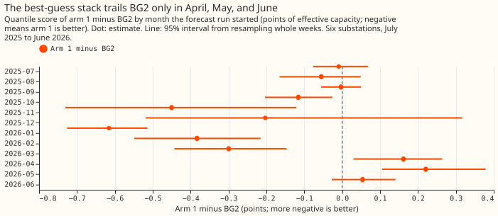
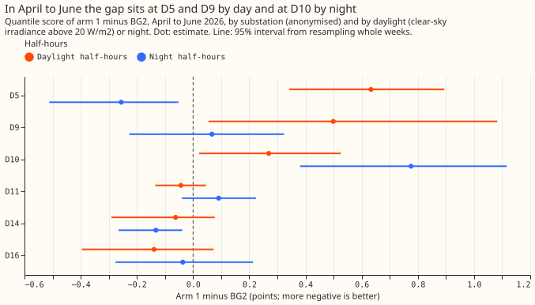
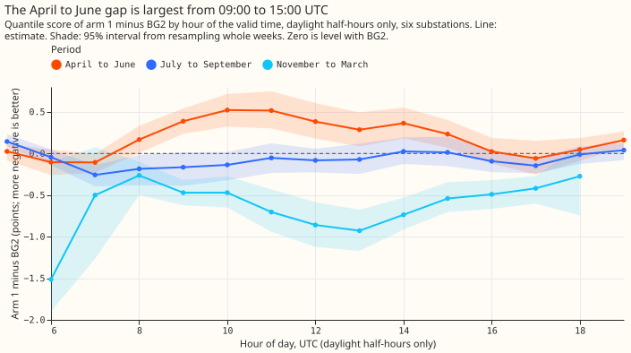
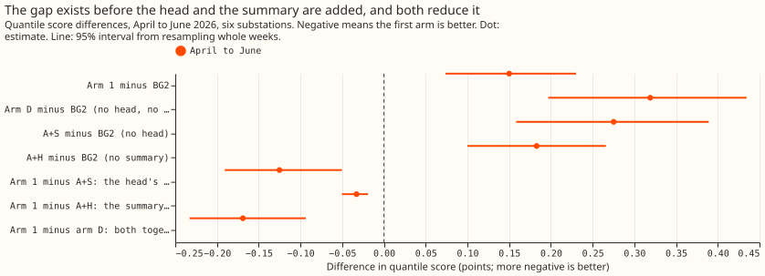
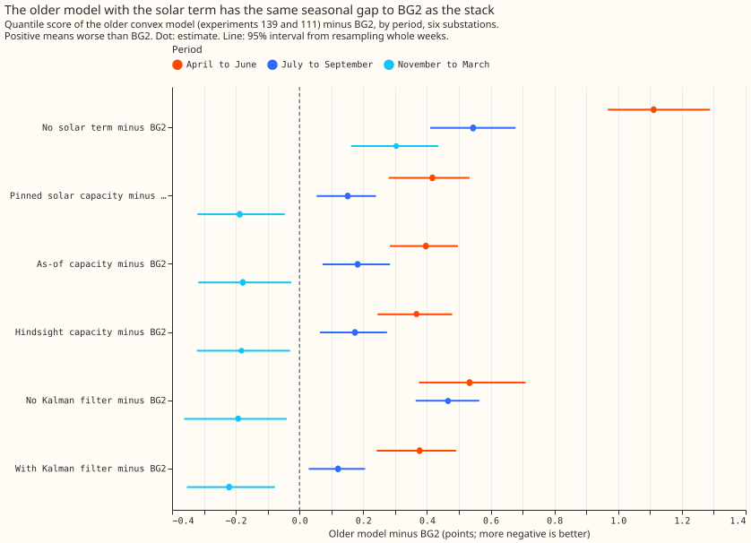
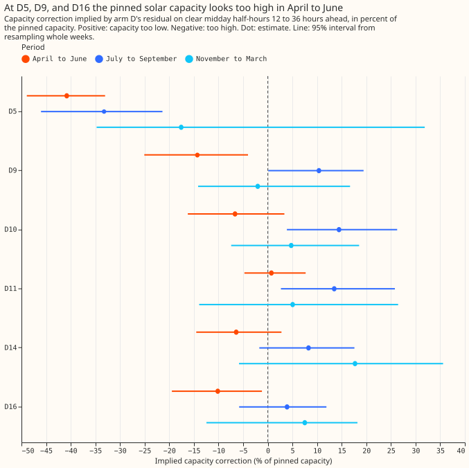
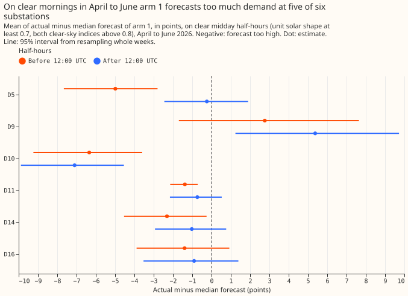
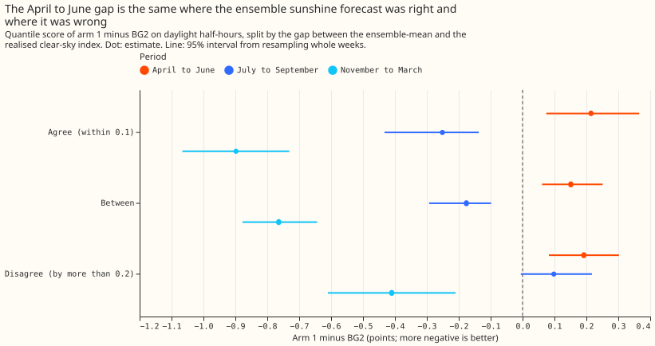

**The best-guess demand forecast (the stack) beats BG2 over the year but is worse in April to June
2026, and the cause is localised.** BG2 is the production-style XGBoost forecast. The stack
subtracts an estimate of unmetered rooftop solar output from demand, called the solar term. Its
April to June error comes from the solar term at two substations, D5 and D9, on daylight
half-hours, and from a night-time error at a third, D10. D5, D9, and D10 are anonymised primary
substations. The error does not come from the neural-network head, the two-number summary of the
ensemble weather forecast, the Kalman filter, or the ensemble sunshine forecast. We had predicted
that the pinned solar capacity is too low in those months; it looks too high at D5, D9, and D16. On
clear days the stack forecasts too much demand in the morning relative to the afternoon.
Candidate next experiments are an export clip at D9, a morning-and-afternoon solar shape, and a
look at D10's night residuals.

Scores are quantile scores in points of effective capacity (a substation's rated demand), and a
lower score is better. A difference written "arm 1 minus BG2" is therefore positive where the stack
is worse. A residual is observed minus forecast demand, so a negative residual means the forecast
was too high.

**Verdict `partly supported`.** The hypothesis said the explicit solar term is the main cause.
Daylight half-hours hold 78% of the April to June gap, as the solar-term explanation predicts, but
an error in the weather input or the demand terms would also produce a daylight gap. The hypothesis
also implied a common cause, but the gap is not common to all substations: D5, D9, and D10 carry the
gap, and the other three substations are level with or better than BG2. Four of the eight
predictions held (P0, P1, P4, and P7), P5 held for the summary and failed for the head, and P2, P3,
and P6 failed.
P1 holds on the point estimate: the daylight gap is +0.189 (+0.089 to +0.298) and the night gap
+0.087 (+0.016 to +0.145), a ratio of 2.17 whose interval spans 0.94 to 7.29.

[Experiment 251](../00251-dp-final-best-guess-assembly-clip-and-coast-against-bg2/result.md) found
that the best-guess demand stack beats BG2 over the year, but only through November to March. In
April to June the stack is 0.05 to 0.22 points worse, and at D5 on sunny half-hours it is 1.30
points worse. The maintainer suspects that unmetered rooftop solar is modelled badly. This
experiment runs six diagnostics on forecasts that earlier experiments already stored, so nothing is
refitted.

Terms. **Arm 1** (the stack) is the convex demand model with a Kalman filter (arm D), plus a small
neural network that corrects the median (the neural-network head), plus a
mean-and-standard-deviation
summary of the 51 ensemble weather members' solar response (the two-number summary). **A+S** is
arm 1 without the head, **A+H** is arm 1 without the summary, and **arm D** has neither.
An **arm** is one configuration of the forecast whose output was stored. The **export clip** caps
the solar output that the forecast subtracts from demand at 60% of the solar capacity held for D5
(experiment 180). **GAM-K** is the older generalised additive model with a Kalman filter of
experiments 111 and 139,
and **gam0** is the same model without the filter. **Primaries** are primary substations, which step
power down from the high-voltage network to the local distribution network. The **pin** is the solar
capacity held fixed for each fit, and the **clear-sky
index** is irradiance divided by clear-sky irradiance.

## Results

- **Gate (P0) held.** Arm 1 minus BG2 is +0.162, +0.220, and +0.054 in April, May, and June, the
  numbers of experiment 251. Every arm has the 561,207 row keys, except the as-of and hindsight
  arms of experiment 139, which have no D9 and so 464,233.
- **Ranked causes.** Each cause lists the rows that carry its gap per row, and the causes overlap.
    1. **Solar term at D5 and D9.** Daylight gap +0.633 (95% interval +0.343 to +0.894) at D5 and
       +0.499 (+0.055 to +1.083) at D9, against +0.150 over all rows. D5, D9, and D10 together
       average +0.364 (+0.193 to +0.552) and the other three substations -0.060 (-0.175 to +0.035).
       At D5 the clip arm (arm 2c) lowers the April to June sunny-half-hour gap from +1.779 (+1.345
       to +2.255) to +0.656 (+0.438 to +0.850). Fix experiment needing no refit to start: the 60%
       export clip of
       experiment 180 applied to D9.
    2. **Solar shape.** The mean residual on clear midday half-hours is 1.5 points lower before
       12:00 UTC than after it (-1.525, interval -2.390 to -0.779, pooled over six substations),
       and the asymmetry of P6 is 0.11, 0.61, 0.77, 0.43, 1.81, and 0.64 at D10, D11, D14, D16, D5,
       and D9, so P6 failed. D9's residuals are positive in both halves of the day, where the other
       substations' are negative. Fix experiment needing no refit to start: refit arm D with a
       per-substation morning-and-afternoon split of the solar shape and score April to June.
    3. **Night-time error at D10 (post hoc).** D10's night gap is +0.776 (+0.381 to +1.116) and its
       daylight gap +0.269 (+0.022 to +0.526). Fix experiment needing no refit to start: inspect
       D10's night
       residuals by month and half-hour.
- **Cleared.** The neural-network head lowers the April to June score by 0.125 (arm 1 minus A+S
  -0.125, -0.191 to -0.050), so P5 failed for the head and the head is not the cause. The
  two-number summary lowers it by 0.033 (-0.050 to -0.019), so P5 held for the summary. The Kalman
  filter changes it by -0.157 (GAM-K minus gam0, -0.368 to +0.017), an interval that includes zero
  but stays below the +0.05 threshold. The ensemble sunshine
  forecast is cleared by P4: the gap is +0.214 (+0.074 to +0.366) where the ensemble-mean and
  realised clear-sky indices agree and +0.192 (+0.082 to +0.302) where they disagree; the ratio is
  1.12 (0.48 to 2.04). Pooled night half-hours give +0.087 (+0.016 to +0.145), below the +0.15
  threshold for the heating and lighting terms.
- **The gap starts in arm D.** Arm D minus BG2 in April to June is +0.319 (+0.197 to +0.434), and
  the head and summary bring arm 1 to +0.150. The plan's literal rule reports a component as masked
  when single removal clears it while arm D minus BG2 is at least +0.15. Here the head and summary
  reduce the gap and hide no defect.
- **Not a stack effect.** The older GAM-K model with the pinned capacity has the same seasonal
  pattern against BG2: +0.417 (+0.280 to +0.533) in April to June, +0.151 in July to September,
  and -0.188 in November to March. The ERA5-driven filter arm scores -0.015 (-0.077 to +0.046)
  against the ensemble-driven one in April to June (descriptive only).
- **P2 failed.** The solar term improves the score more, not less, in April to June: the
  no-solar-term arm minus the pinned arm is +0.694 (+0.497 to +0.923) in April to June and +0.394
  (+0.297 to +0.490) in July to September; the difference July to September minus April to June is
  -0.301 (-0.557 to -0.070). The as-of capacity (+0.397) and the hindsight capacity (+0.367) score
  level with the pin (+0.417) against BG2, so the accuracy of the capacity does not explain the gap.
- **P3 failed, with the opposite sign.** The capacity correction implied by arm D's residual in
  April to June is -40.8% at D5 (-48.9% to -33.0%), -14.3% at D9 (-25.1% to -4.0%), -10.2% at D16
  (-19.5% to -1.2%), -6.7% at D10, -6.4% at D14, and +0.7% at D11. Negative means the pinned
  capacity
  is too high. In July to September the same correction is positive at five of six substations
  (+3.9% to +14.5%, except D5 at -33.2%). The estimate is measured after the Kalman filter, so it
  is a pointer and not an independent capacity estimate; experiments 231 and 241 found the capacity
  estimator recovers 0.83 of an injected farm.
- **P7 held.** At D5 on sunny half-hours arm 1 is +1.298 (+0.980 to +1.633) over the year and
  arm 2c +0.540 (+0.354 to +0.719), the numbers of experiment 251.
- **Where in the day.** The April to June daylight gap is +0.398 (+0.241 to +0.552) from 08:00 to
  12:00 UTC and +0.316 (+0.143 to +0.492) from 12:00 to 16:00 UTC (figure 3).
- **Rows, schedule, and weather.** The diagnostics use the 561,207 rows of experiment 251. The
  stored forecasts were produced with monthly refits (stack) and weekly refits (BG2). Realised
  sunshine is CAMS irradiance, which exists only after the fact; the ensemble-mean irradiance is
  available at forecast time. Nothing was refitted and nothing was downloaded.
- **Post hoc.** We chose these cuts after seeing the results: by substation and daylight, the D10
  night gap, the pooled morning-minus-afternoon difference, the clip comparison in April to June,
  and every month of capacity correction.
- **What this cannot tell.** One year, and 14 weeks in April to June, so intervals are wide. The
  stratification by ensemble agreement does not rule out a biased solar response of the ensemble
  that a refit with realised irradiance as the driver would expose; no such refit was run.

## Checks

- **Median minus mean forecast.** Arm D's median and mean are identical at all six substations
  (difference 0.0), because its quantiles are built symmetrically around the mean, so no spread
  shifts the forecast. The mean forecast of arm 1 is not stored.
- **Error of the median beside the quantile score.** The mean absolute error of the median, arm 1
  minus BG2, is +0.311 (+0.141 to +0.474) in April to June, -0.084 (-0.151 to -0.015) in July to
  September, and -0.648 (-0.840 to -0.426) in November to March, the same signs as the quantile
  score.
- **Triggers (the seven audit triggers of the experiment guide).** Trigger 1 (a failed control) did
  not fire, because the gate passed. Trigger 2 (a result contradicts its prediction) fired: P2, P3,
  P6, and P5 for the head contradicted their predictions; the explanation tested for P3 is the D5
  export clip above. Trigger 3 (median and mean forecasts disagree) did not fire. Trigger 4 (leaving
  one site out flips a contrast) did not fire: leaving out any one substation keeps the April to
  June gap positive (+0.087 to +0.201, every interval above zero). Triggers 5 to 7 (nested arms,
  interval widths against a sister experiment, and later design depending on this result) did not
  apply. One caveat remains: later experiments will depend on this ranking, and one year of data has
  not been replicated.
- **Audit.** A fresh Sonnet agent re-derived the headline numbers from the stored arrays with its
  own code and matched them: April to June gap +0.150 (+0.074 to +0.231), daylight +0.189, night
  +0.087, arm 1 minus A+S -0.125, minus A+H -0.033, minus arm D -0.169, arm D minus BG2 +0.319,
  agree +0.214 against disagree +0.192, and the no-solar-term arm minus the pinned arm +0.695 and
  +0.394. It found no row misalignment, duplicate, crossing quantile, or leakage through the
  normalised solar profile, and could not check whether the stack's settings saw April to June data.
  Experiments 220 and 251 describe the refit schedule.

## Plan

- **Diagnostic 1, error map.** Quantile score of arm 1 minus BG2 by month, by realised clear-sky
  index band (CAMS irradiance over clear-sky irradiance, from [experiment
  178](../00178-dp-sunny-daylight-gap-diagnosis/result.md)'s rows), by ensemble-mean clear-sky index
  band, and by hour of day, at the six substations. Bands apply to daylight half-hours only
  (clear-sky
  irradiance above 20 W/m²); night half-hours form their own cut.
- **Diagnostic 2, solar term on and off.** The GAM-K arms of [experiment
  139](../00139-differentiable-physics-pv-as-of-capacity-in-gam-k/result.md) (no solar term, pinned
  capacity, as-of capacity, hindsight capacity) minus BG2 by month. These arms are a proxy for the
  stack, because the stack with its solar term removed was never stored. The result feeds the solar
  capacity cause through P2.
- **Diagnostic 3, capacity bias.** The capacity held by each monthly GAM-K fit against the capacity
  that arm D's residual implies: on clear midday half-hours at 12 to 36 hours ahead, regress the
  signed residual on the normalised solar profile, per substation and month. The implied correction
  is
  measured after the Kalman filter and so is not independent of the fit. The independent reference
  is the recovery factor of the capacity estimator in [experiment
  231](../00231-pv-capacity-audit-where-recovery-goes/result.md) and [experiment
  241](../00241-pv-capacity-calibrated-interval/result.md), which found 0.83 of an injected farm
  recovered.
- **Diagnostic 4, weather input.** Split the daylight gap by whether the ensemble-mean and realised
  clear-sky indices agree (within 0.1), disagree (by more than 0.2), or lie between, and report
  [experiment 111](../00111-differentiable-physics-6-ens-forecast-engine-against-bg2/result.md)'s
  ERA5-driven filter arm beside the ensemble-driven one as description only. A refit with realised
  irradiance as the solar driver is the cheapest fix if the split cannot decide.
- **Diagnostic 5, residual shape.** Mean signed residual of arm 1 at clear midday by month, before
  and after 12:00 UTC, and at D5 against arm 2c.
- **Diagnostic 6, ablations in April to June.** Arm 1 against A+S, A+H, and arm D, from
  [experiment 220](../00220-dp-bg-stage4-assembly-with-drop-one/result.md)'s stored arms.
