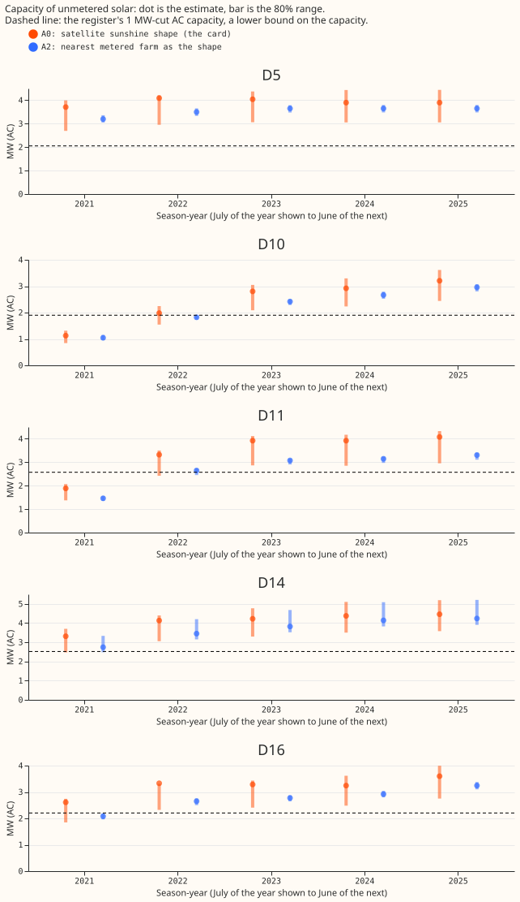

# Unmetered solar capacity at two Primary substations falls below the Feed-in Tariff register in 2021

**Take-home message: the 2021 shortfall at D10 and D11 is not a missing correction and not a thin
fit window, and a nearby metered farm's output makes the shortfall worse.** The card's capacity
estimate is already divided by the recovery of the metered farms, so a further division changes it
by under 3%. Every Primary has 12 months of data in the 2021 season-year. The nearest-farm shape
lowers the 2021 estimate by 7% at D10 and 22% at D11, so the upper end of the 80% range stays below
the register floor at both Primaries. The fall is partly a mismatch between the divisors of the two
shapes, so it does not show that the nearest-farm shape is worse.

**What was asked.** Each Primary substation card (D5, D10, D11, D14, and D16 are anonymised labels)
shows the capacity of unmetered solar panels behind the substation, inferred from its power
readings, in megawatts of alternating-current (AC) output. A season-year runs from July of the year
shown to June of the next. For the 2021 season-year, the estimate is 1.1 MW at D10 and 1.9 MW at
D11. The Feed-in Tariff register (the UK subsidy scheme's list of small installations) lists 1.9 MW
and 2.6 MW of AC capacity at sites of at most 1 MW in the two Primaries' postcode districts. The
register is partial, so we use that capacity as a lower bound, the register floor. A recovery is the
share of a metered solar farm's output that the capacity fit finds again after we add that output
to a Primary's readings (an injected farm).

**The arms.** The decision rule reads the 80% range of each estimate, from a bootstrap over
resampled months.

- **A0:** the card's estimate ([experiment 129](../00129-differentiable-physics-pv-capacity-known-answer-test/result.md),
  fit with an increment penalty of 0.1 and satellite irradiance as the sunshine shape).
- **A1:** A0 divided by the median recovery of the other metered farms
  ([experiment 241](../00241-pv-capacity-calibrated-interval/result.md)).
- **A2:** the same fit with the recorded output of the nearest metered farm within 25 km as the
  sunshine shape, divided by the median recovery under that shape
  ([experiment 238](../00238-pv-capacity-nearest-farm-sunshine-reference/result.md)).
- **A3:** A2 with the number of fitted months per season-year printed and a "thin" mark under 6
  months, which no season-year reaches. The fitted months are the same for A0.

All arms are offline checks and score no forecast.

**Figure 1. At D10 and D11 the 2021 range of the card's estimate (orange) lies below the register
floor (dashed line), and the nearest-farm shape (blue) lowers the estimates.**

## Findings

- **A1, the division by the recovery, equals the card's estimate.** The card's capacity estimate is
  already divided by the Primary's median recovery over the matched farms, which is 0.77 to 0.86
  over the Primaries and season-years. Experiment 241's leave-one-farm-out divisor differs from that
  divisor by at most 0.02. The two estimates differ by at most 3% (D16 2022: 3.25 MW against 3.33
  MW). The median absolute error of a held-out farm under the card's fit is 0.063 of the injected
  capacity.
- **Dividing by the recovery a second time overcorrects.** The result is 1.39 MW at D10 and 2.39 MW
  at D11 in 2021, which are the lifts the plan predicted. The second division corrects the same
  bias twice and would overstate capacity by about 25%. The upper ends of that range (1.62 MW and
  2.62 MW) are still below the AC floor at D10 (1.90 MW) and, at D11, between the AC floor (2.57
  MW) and the direct-current (DC) floor (2.78 MW).
- **A3, the thin-window rule, never fires, but the early data have a gap the rule cannot see.**
  Season-year 2021 has 12 calendar months and 16,390 to 16,608 training half-hours (of 17,520) at
  every Primary (D10's rows start on 19 July, about 11.4 months). Season-years 2022 to 2025 have
  15,212 to 17,568 half-hours. D10 has 5,424 half-hours in 2019 (from December) and D11 has 9,002
  (from September), and neither has any in season-year 2020. The 2021 capacity is the sum of
  increments from 2019 onward, so it spans a gap of about 20 months that a count of months within
  2021 does not show. The register's last entry (24 March 2021, from experiment 215) falls before
  season-year 2021 starts, so the estimate is below the capacity the register lists as installed in
  the district.
- **A2, the nearest-farm shape, lowers every 2021 estimate, partly through a different
  divisor.** The nearest farm to each Primary is 3.1 km
  (D5), 7.7 km (D10), 23.1 km (D11), 5.3 km (D14), and 5.8 km (D16) away, so a metered farm lies
  within 25 km of all five. Against A0 in 2021, A2 gives 1.04 MW at D10 (a fall of 7%), 1.46 MW at
  D11 (22%), 2.74 MW at D14 (17%), 2.08 MW at D16 (20%), and 3.20 MW at D5 (14%). The prediction of
  a change under 10% at D5, D14, and D16 failed. In 2021 the A2 estimate is the card's times 0.93
  (D10), 0.78 (D11), 0.83 (D14), 0.80 (D16), and 0.86 (D5). That ratio is the ratio of the raw fitted
  capacities (1.00, 0.86, 0.83, 0.93, and 0.99) times the ratio of the divisors (1.08, 1.11, 1.00,
  1.17, and 1.14). At D10 the raw capacities agree, so the whole 7% fall at D10 comes from the
  divisor. A2's divisor is one number per Primary from a fit without the increment penalty, read at
  season-year 2024, and the card's divisor is per season-year from the penalised fit, so the two are
  not comparable. D11's reference farm is 23.1 km away, near the 25 km limit.
- **The card's estimate clears the AC floor in 23 of 25 Primary season-years.** The check is
  whether the upper end of the 80% range reaches the floor. A0 misses D10 2021 (1.31 MW against
  1.90 MW) and D11 2021 (2.07 MW against 2.57 MW). A2 clears the AC floor in 22 of 25: it misses
  D10 2021, D11 2021, and D16 2021 (2.18 MW against 2.20 MW), and ties at D10 2022 (1.90 MW). Against
  the DC floor, A0 misses the same two season-years and A2 misses five.
- **No arm met the decision rule.** The rule asks for the upper end to reach the floor at all five
  Primaries in every season-year with register coverage, and for the estimate to stay within 10% of
  A0 at the Primaries with no shortfall. A0 and A2 both fail at D10 and D11. A2 also moves D5, D14,
  and D16 by 14%, 17%, and 20% in 2021. Three of five Primaries (D5, D14, and D16) clear the AC
  floor in every season-year under A0, as predicted, and two of five (D5 and D14) under A2.
- **The increment penalty does not cause the low 2021 level.** Experiment 129's arm 2, which has no
  increment penalty, gives 0.82 MW at D10 and 1.38 MW at D11 in 2021, no higher than the card.
- **The fitted capacity rises about 75% between 2021 and 2022** at D10 (1.13 to 1.98 MW) and at
  D11 (1.88 to 3.32 MW). That rise is consistent with a 2021 level that is too low (for example from
  the data gap above), and equally with real installations during 2021 and 2022.
- **The A2 known-answer check passes at 4 of 5 Primaries.** The median absolute error of a held-out
  injected farm under the nearest-farm shape is 2% of its capacity at D10, 2% at D11, 13% at D14,
  4% at D16, and 6% at D5, with 2 to 4 injected farms per Primary. D14 misses the 10% bound.

## Checks

- **Reproduction:** refitting the satellite shape with the card's settings reproduces the stored raw
  capacity of every Primary and season-year to within 1e-6, as the script asserts.
- **A1 covers 2021 to 2024:** experiment 241 has no 2025 recoveries, and the A1 divisor pools the
  injected fractions of 20%, 50%, and 100% without a cloud-driven load.
- **Audit triggers** (the seven triggers in the `ml-experiment` skill's "Audit before merge"):
  trigger 2 fires, because the result contradicts the prediction. The two predicted causes were
  tested (the division and the fit window). The fall in the estimate under A2 is attributed to the
  higher recovery under that shape and was not tested further. No Opus audit was run, because the
  maintainer's rule is Sonnet by default and the conclusion is a null result. One Sonnet reviewer
  read the code and numbers, and one read the prose.

## Limits

- **The register lists installations by postcode district,** and the page assigns part of each
  district's capacity to each Primary. A shortfall at D10 and D11 may mean the register over-states
  the Primary's share.
- **The A2 range uses 2 to 4 injected farms,** so it is narrow and not a calibrated 80% interval
  (experiment 241). The point estimate divides by the median recovery of the injected farms and the
  range by every farm's recoveries, so the range is not centred on the point (D14's recoveries span
  0.66 to 0.87).
- **The A2 divisors come from experiment 238's injection fits,** which use no increment penalty and
  data to 2026-07-01, and read the recovery at the 2024 season-year. The card's fit uses the penalty
  and data to 2026-07-31, as experiment 129's real-series fit did.
- **A neighbouring farm's output carries plant effects as well as sunshine** (panel tilt, panel
  orientation, curtailment, and soiling; experiment 238).

## What the next experiment should answer

- **Does the register's district share over-state D10 and D11 in 2021?** Compare the register's
  postcode districts with the Primaries' supply areas. The prediction that could fail is a share
  above 70% of each district's listed capacity at both Primaries.
- **Does the 2019 data drive the 2021 level?** Refit the card's estimate on rows from July 2021
  only, and compare the 2021 level. The prediction that could fail is a 2021 estimate at D10 and
  D11 within 10% of the card's.
- **Does a floor constraint hurt the fit?** Fit season-year 2021 with the capacity at least the
  register's AC capacity, and compare the fit's squared error on 2021 half-hours with the free fit.
  The prediction that could fail is a rise in error of under 1%, which would mean the readings
  cannot rule the floor out.
