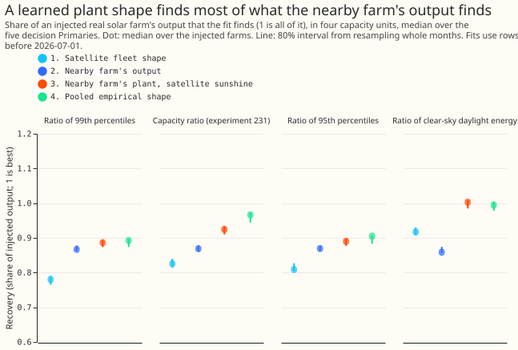
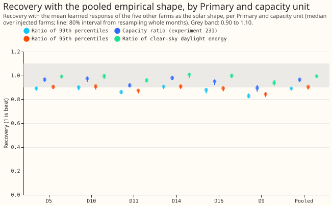
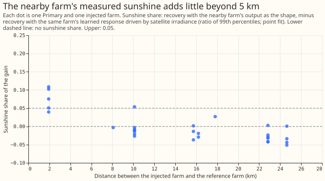
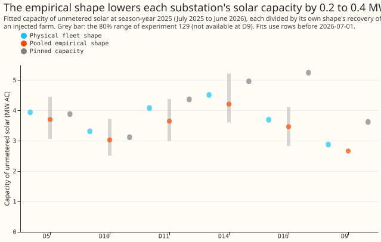

# PV capacity: where does the nearby-farm gain come from?

**Take-home message: the nearby farm's measured sunshine explains almost none of the gain of
experiment 238, and the farms' plant shape explains all of it.** Experiment 238 added the recorded
output of one metered solar farm, scaled to 50% of the substation's pinned capacity, to a
substation's demand. It then asked the convex fit of [experiment
129](../00129-differentiable-physics-pv-capacity-known-answer-test/result.md) to find that farm's
output again. **Recovery is the share of the injected farm's output that the fit finds (1 is all of
it), read in the ratio of 99th percentiles of alternating-current output over daylight half-hours
unless another measure is named.** Using a different nearby farm's recorded output as the solar
shape raised the recovery from 0.780 to 0.867 ([experiment
238](../00238-pv-capacity-nearest-farm-sunshine-reference/result.md)). The gain is the difference
of two recoveries, and the page quotes the median of per-pair differences, so it can differ a little
from the difference of the medians. The recorded output carries the nearby farm's sunshine (the
solar irradiance reaching it) and its plant shape (panel tilt, panel orientation, and the flat top
of the output curve).

We split the two by replacing the recorded output with a smooth table, learned from the farms'
output against the satellite irradiance and the height of the sun (following [experiment
218](../00218-metered-solar-farm-plant-fit/result.md)), and read at the substation's own satellite
irradiance. The sunshine share is the recovery with the recorded output minus the recovery with the
same farm's table. It is -0.014, so the table found as much as the recorded output did. The page
calls the five substations whose capacity is judged the decision Primaries (D5, D10, D11, D14, and
D16), and shows D9 beside them.

**Verdict: partly supported.** Every prediction of stage 1 (the injected farms) was met. The
prediction of stage 2 (the real substation series) was not met: it said the real capacities would
move by under 0.3 MW at 4 of 5 substations, and they did at 3 of 5. The sunny-half-hour score of
the forecast was not run (see "What was not run"). Farms A to F are metered generators and stay
anonymous. Fits stop at 2026-07-01, and no forecast is scored.

**Figure 1. Pooled over the five decision Primaries, the learned plant shape (arms 3 and 4) finds
more of the injected farm than the nearby farm's output does, in all four units.**

**Figure 2. The pooled empirical shape finds 0.90 or more at 5 of 5 Primaries in the capacity ratio
and the energy unit, and at 2 of 5 in the ratio of 99th percentiles.**

**Figure 3. The median sunshine share is above zero only for the pairs of farms under 5 km apart.**

**Figure 4. The pooled empirical shape lowers each decision Primary's fitted capacity by 0.2 to 0.4
MW, and every value stays inside the 80% range of experiment 129.**

## Arms

- **Arm 1, satellite fleet shape** (control): the south-facing physical shape of experiment 129.
- **Arm 2, nearby farm's recorded output:** the nearest other farm's output, as in experiment 238.
- **Arm 3, nearby farm's plant, satellite sunshine:** that farm's learned table (non-negative, smooth,
  rising with irradiance, as in experiment 218), read at the Primary's satellite irradiance and sun
  height. Arm 2 minus arm 3 is the sunshine share.
- **Arm 4, pooled empirical shape:** the mean of the learned tables of the five farms other than the
  injected one, read at the Primary's satellite irradiance and sun height.
- **Rows:** every arm trains on the half-hours at which the reference farm has a reading (75,107 to
  85,231 per Primary, 45,017 at D9).

## Results

- **Pooled recovery, ratio of 99th percentiles (median over farms, then over the five Primaries; 80%
  interval from resampling whole months):** arm 1 0.780 (0.765 to 0.790), arm 2 0.867 (0.863 to
  0.878), arm 3 0.886 (0.874 to 0.893), arm 4 0.892 (0.874 to 0.897).
- **Contrasts:** total gain 0.090 (0.074 to 0.100); sunshine share -0.014 (-0.023 to -0.002); plant
  shape of the nearby farm 0.095 (0.083 to 0.103); pooled shape over the satellite fleet shape 0.105
  (0.095 to 0.113). The share of the gain not due to
  sunshine is 1 minus the sunshine share over the total gain: 115% (above 100% because the sunshine
  share is negative), against the predicted 60%.
- **Other units, pooled recovery for arms 1, 2, 3, and 4:** capacity ratio of experiment 231 0.826,
  0.869, 0.925, and 0.966 (arm 4: 0.944 to 0.973); ratio of 95th percentiles 0.809, 0.869, 0.890,
  and 0.905; clear-sky daylight energy 0.917, 0.859, 1.003, and 0.995 (arm 4: 0.978 to 1.004). The
  sunshine share is -0.060, -0.012, and -0.122 in those three units.
- **Arm 4 at the decision Primaries:** at least 0.90 at 5 of 5 in the capacity ratio (0.916 to 0.979)
  and in the energy unit (0.960 to 1.009), at 3 of 5 at the 95th percentile, and at 2 of 5 in the
  ratio of 99th percentiles (0.862 to 0.908). Arm 4 is under 0.80 nowhere, so stage 2 ran. D9 reads
  0.829 to 0.939.
- **By distance between the injected and reference farms (ratio of 99th percentiles, median over
  pairs):** the 5 pairs under 5 km apart gain 0.198 in total, of which 0.075 is sunshine (range
  0.040 to 0.109); the 8 pairs 5 to 12 km apart gain 0.069, sunshine -0.010; the 16 pairs 12 to 30 km
  apart gain 0.073, sunshine -0.029. One pair at 10 km reaches a sunshine share of 0.054 (figure 3).
- **Without the pairs under 5 km,** the pooled recovery for arms 1 to 4 is 0.773, 0.866, 0.884, and
  0.879 in the ratio of 99th percentiles, and arm 4 is 0.966 in the capacity ratio and 0.992 in the
  energy unit.
- **Stage 2, real capacities (season-year 2025, July 2025 to June 2026).** Each capacity is divided
  by the recovery of its own shape (the capacity ratio of this experiment's injections at
  season-year 2024). The pooled empirical shape moves the capacity by -0.24, -0.29, -0.43, -0.30,
  and -0.23 MW at D5, D10, D11, D14, and D16 (under 0.3 MW at 3 of 5; the prediction asked for 4),
  and by -0.21 MW at D9. All five lie inside experiment 129's 80% range (1.2 to 1.6 MW wide). The
  physical-shape capacities match experiment 129's published estimates to within 0.09 MW at
  season-year 2024.

## What was not run

- **The sunny-daylight score of arm D with the empirical shape was not run.** It needs the empirical
  shape in the ensemble weather path of `studies` (a reviewed change, because that path builds the
  shape from the plant parameters), and monthly refits and ensemble forecasts at six substations
  for the scored year. That is far above the slot's 4 core-hours.
  Whether the empirical shape improves the sunny-half-hour forecast therefore stays open.
- **Bootstrap ranges for the stage 2 capacities** were not refitted; the table uses experiment 129's
  ranges as context.

## Checks

- **Reproduction:** arms 1 and 2 reproduce experiment 238's tables, and the satellite shape on all
  rows reproduces experiment 231's rung 4, with a largest difference of 0.000 at three decimal
  places.
- **Median forecast minus mean forecast, and the mean-forecast error:** not applicable, because no
  forecast is scored.
- **Audit triggers:** none fired. The result agrees with experiment 231 (the irradiance explains
  almost none of the shortfall), the injections are those of experiment 238 and give the same
  interval for the total gain, and no nested arm beats the arm that contains it. This result answers
  the question behind triggers 2 and 7 of experiment 238. One Sonnet review of the code and one of
  the page were run; no Opus audit.

## Caveats

- **The pooled shape includes plants like the injected one.** Farm C sits 2 km from farm A, so the
  mean over the five other farms holds a close twin of each injected farm in some cases. The sunshine
  share needs no twin, but the transfer of arm 4 to a farm unlike all six metered farms is untested.
- **Recovery depends on the unit.** The same fit reads 0.892 in the ratio of 99th percentiles and
  0.995 in clear-sky energy; the decision rule's "some unit" is satisfied by two of four units.
- **The plan left three choices open:** the plant-and-unit share is read as 1 minus the
  sunshine share over the total gain, in the ratio of 99th percentiles; the stage 2 divisors come
  from this experiment's injections and not from the known-answer grid of experiment 129; and stage 2
  fits stop at 2026-07-01.

- **The learned tables read about 0 at low sun.** The injected and reference farms' normalised output
  is set to 0 where the sun is 15 degrees or less above the horizon, and the tables keep those rows,
  so arms 2 to 4 all carry that zero. The arm comparison stays fair, but the tables understate output
  at low sun. The farms' unit shapes are also derate-divided at the substation's temperature, not
  the farm's own.
- **The stage 2 divisor** comes from the pooled table of five farms, while the real fit uses all six.

## What the next experiment should answer

- **Does the empirical shape lower the sunny-half-hour error of the forecast?** A test would port
  the pooled table into the ensemble weather path in `packages/studies` and score
  arm D at D5, D9, D10, D11, D14, and D16 on the sunny-daylight rows of
  experiment 178. A candidate prediction that could fail is a change of under 0.02 MW at the five
  other substations.
- **Is the plant shape of an unseen farm predictable?** Leave each farm out of the pool and also
  leave out its nearest neighbour, then repeat arm 4.
