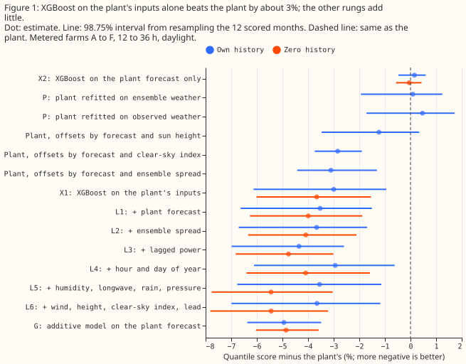
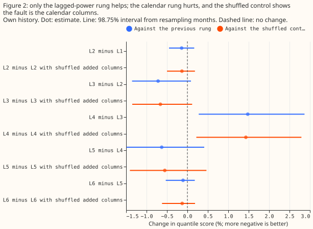
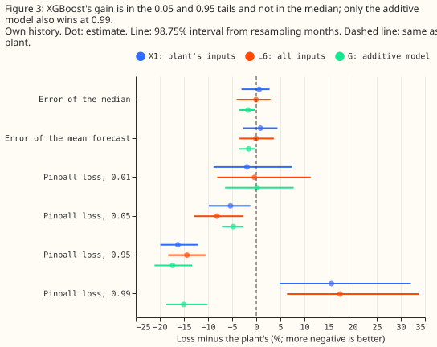
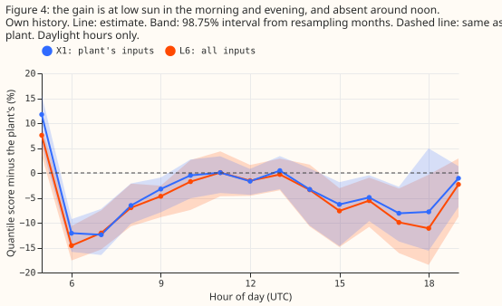
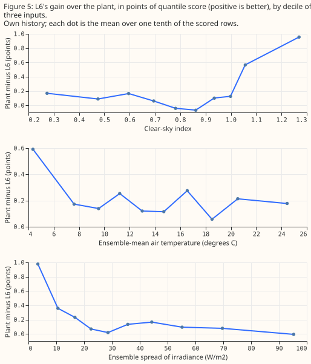

**XGBoost beats the solar-farm power model because it draws a better forecast band, not because its
median forecast is better, and a plant whose band also depends on the ensemble spread or the
clear-sky index gets the same gain.** National Grid Electricity Distribution (NGED) meters six solar
farms in its trial area, labelled A to F on this page. The "plant" is the physical power model of
[experiment 224](../00224-metered-farm-dayahead-two-number/result.md): a fixed panel geometry driven
by the mean of the 51 members of the European Centre for Medium-Range Weather Forecasts (ECMWF)
ensemble forecast. Its forecast band is the plant's forecast plus residual quantiles taken in four
bins of the forecast (the "four-bin plant"). [Experiment
243](../00243-metered-farm-architecture-comparison/result.md) found [XGBoost (Chen and Guestrin,
2016)](https://doi.org/10.1145/2939672.2939785), a gradient-boosted decision-tree library, about 3%
better than the plant in the quantile score, with the plant better at the 0.99 quantile. The
quantile score is twice the mean pinball loss over 11 quantile levels, in points of capacity, and
lower is better. [Experiment 218](../00218-metered-solar-farm-plant-fit/result.md) found that better
plant parameters barely help, and [experiment 257](../00257-metered-farm-fair-plant-arm/result.md)
found that a linear fit on lagged power and ensemble spread recovers about 90% of a neural network
head's gain over the plant. We asked which inputs let XGBoost beat the plant. We gave XGBoost the
plant's inputs alone (X1), then added input groups one at a time (rungs L1 to L6: the plant
forecast, ensemble spread, lagged power, hour of day and day of year, further ensemble weather, and
the remaining weather). We compared those fits with refits of the plant's panel parameters (P),
plants whose band is binned by a second input (pq), and an additive model of the plant's residual
(G). Each rung has a control, S2 to S6, in which that rung's added columns are shuffled among rows.

**The prediction partly holds, and the stated mechanism fails.** XGBoost on the plant's inputs alone
has a 3.0% lower quantile score than the four-bin plant in own history (98.75% interval from
resampling months, -6.1% to -0.9%) and 3.7% lower in zero history (-6.0% to -1.5%). "Own history"
means each farm's fits use only that farm's earlier months, and "zero history" means they use only
the other five farms. The pre-registered rule asked for an interval wholly below -1.5%. Zero history
meets the rule narrowly, and own history does not, so the verdict is partly supported. Lagged power
and ensemble spread, the hypothesised causes, carry about 23% of the gain. In own history, 97% of
the full ladder's gain appears at the first rung, and 73% in zero history, so prediction B holds.
XGBoost on the plant forecast alone gains nothing (+0.2%, -0.5% to +0.6%), so the gain is not a
recalibration of the plant's output. The stop rule does not fire, because the gain is above 0.5%.

**The gain comes from the band, and a plant with a better offset table matches it.** The plant's
offsets binned by its forecast and the ensemble spread give a 3.1% lower score than the four-bin
plant (-4.4% to -1.3%), which equals XGBoost's gain. The same plant has a 16% lower pinball loss at
the 0.99 quantile. We chose the binning after seeing results, from about eight variants the audit
tried, so those intervals are not corrected for that search.

## Where the gain between XGBoost and the plant comes from

**Nearly all of the gain comes from the plant's own inputs, and calendar columns subtract from it.**
We tested five candidate explanations: (a) lagged power, (b) ensemble spread, (c) calendar columns,
(d) further ensemble weather, and (e) a better mapping from the ensemble-mean inputs to the band.
The shares below are of the plant-to-L6 gain (own history 0.209 points of capacity; zero history
0.320 points). They are rough, because every rung's interval is wide. They do not sum to 100%,
because the plant forecast added at L1 carries a further 15% (own history) and 6% (zero history).

- **(e) A better mapping from the ensemble-mean inputs to the band:** 82% own history, 67% zero
  history (X1). Refitting the plant's tilt, azimuth, heat loss, scale, and ceiling on forecast
  weather scores +0.1% against the four-bin plant, and refitting on observed weather scores +0.5%,
  so the gain is not a better panel geometry. Binning the offsets by the forecast and a second input
  scores -3.1% (ensemble spread, 6 by 3 bins; -4.4% to -1.3%), -2.8% (clear-sky index, 8 by 4 bins;
  -3.7% to -1.9%), and -1.2% (sun height, 4 by 4 bins; -3.5% to +0.3%), with the median error
  unchanged. The spread is the standard deviation of the 51 members' plant forecasts, so it is not
  one of the plant's inputs.
- **(a) Lagged power and availability:** 19% own history (L3 minus L2: -0.7%, -1.4% to +0.1%), 12%
  zero history. The audit found that the own-history lag gain is farm A's (-3.7%; the other five
  farms +0.1% to -0.3%).
- **(b) Ensemble spread:** 4% own history (-0.14%, -0.45% to +0.17%), 2% zero history.
- **(d) Further ensemble weather** (humidity, longwave, rain, pressure, wind, height, clear-sky
  index, lead): 20% own history, with neither rung's interval excluding zero, and 25% zero history,
  where L5 minus L4 is -1.4% (-2.1% to -0.7%) and L6 minus X1 is -1.9% (-2.8% to -1.0%).
- **(c) Calendar columns:** -39% own history. Adding hour and day of year makes the quantile score
  1.5% worse (+0.3% to +2.9%) than the same rung without them, and the shuffled control S4 shows the
  cause is the calendar columns. The audit refit shows that day of year alone causes the effect
  (+1.4%) and hour adds nothing, which suggests that XGBoost memorises dates in the 17 tuning
  months. The effect is farm A's (+4.7%), and +0.6% to +1.1% at the other five farms. In zero
  history the effect is +0.7%.

**The gain sits in the 0.05 and 0.95 quantiles at clear skies and low sun, and not in the median.**
For L6, the pinball loss is 8% lower at the 0.05 quantile and 14% lower at the 0.95 quantile, and
the error of the median forecast changes by -0.05%. The gain is concentrated in the lowest decile of
ensemble spread and at clear skies (Figure 5). It appears in the morning and evening and is absent
around noon, and at the first daylight hour both X1 and L6 are worse than the plant (Figure 4). The
audit found that the quarter of rows with a clear-sky index of 1.0 or more carry nearly all of X1's
gain (X1 minus plant is -0.2% without them). On those rows X1 narrows the 5% to 95% band from 44.7
to 26.5 points of capacity, while under-covering the lower tail (coverage 0.070 at the 0.05
quantile). X1's gain is also concentrated in 2025-12 (-22%) and 2026-01 (-12%). At the 0.99 quantile
X1 and L6 are 16% and 17% worse than the plant, and G is 15% better (-19% to -10%).

## Numbers

- **Rows.** Experiment 243's common rows: 41,654 daylight half-hours (sun above 5 degrees) at 12 to
  36 h leads, 2025-09 to 2026-08, six farms, equal weight per farm, intervals at 98.75% (a
  Bonferroni correction across four headline contrasts) from resampling the 12 scored months 5,000
  times. XGBoost arms average three seeds.
- **Schedule.** One fit on the tuning months (2024-04 to 2025-08), no refit in the scored year
  (screening schedule), 4 cores, CPU. XGBoost: 11 quantile outputs, 150 rounds, depth 5, learning
  rate 0.15, subsample 0.8, `colsample_bytree` 1 in every arm. The differences between arms could
  depend on a weekly refit, which was not run.
- **Quantile score, own history (points of capacity, 98.75% interval):** G 5.44 (4.78 to 6.01); L3
  5.48; L6 5.52 (4.77 to 6.12); L1 5.52; X1 5.55 (4.81 to 6.15); pq with spread 5.55; pq with
  clear-sky index 5.56; pq with sun height 5.66; four-bin plant 5.73 (5.05 to 6.27); X2 (XGBoost on
  the plant forecast alone) 5.74; P on forecast weather 5.73; P on observed weather 5.75;
  climatology 8.64; manual heuristic 8.69. Zero history: L6 5.55, L3 5.59, G 5.59, X1 5.66, plant
  5.87.
- **Contrasts against the four-bin plant, own history (quantile score):** X1 -3.0% (-6.1 to -0.9);
  L6 -3.7% (-7.0 to -1.2); G -4.9% (-6.4 to -3.5); L3 -4.4% (-7.0 to -2.6). G minus L6: -1.3% (-3.2
  to +1.3). Zero history: X1 -3.7% (-6.0 to -1.5), L6 -5.4% (-7.8 to -3.2), G -4.9% (-6.0 to -3.6).
- **Tail calibration, own history (coverage; target in brackets; over the 41,676 rows in the stored
  files, 22 more than the common rows):** plant 0.033 (0.01), 0.064 (0.05), 0.946 (0.95), 0.984
  (0.99); L6 0.038, 0.088, 0.938, 0.992; G 0.033, 0.066, 0.945, 0.987. L6's 0.05 quantile sits too
  high (coverage 0.088 against 0.05). Its 0.99 quantile has coverage near the target (0.992) but a
  pinball loss 17% worse than the plant's.
- **By slice, L6 minus plant:** clear-sky index 0.9 and over -8.9% (-18.0 to -2.5); under 0.3 -8.8%
  (-18.8 to +0.8); 0.3 to 0.6 -1.7% and 0.6 to 0.9 -0.1% (intervals span zero); lead 12 to 24 h
  -3.7% and 24 to 36 h -3.5%; December to February -9.2% (-22.5 to +2.0), March to May -3.7%, June
  to August -2.4%, September to November -3.0%. Leads below 12 h cannot be forecast from a 00 UTC
  run at forecast time, and leads of 36 to 54 h were not run.
- **Per farm and leave-one-farm-out.** L6 minus plant stays between -3.1% and -4.8%, and X1 minus
  plant between -2.4% and -4.4%, with any one farm left out. X1 is 4.6% worse than the plant at farm
  A and 1.6% to 5.7% better at the other five.
- **Weather sources at forecast time.** Every input is the ECMWF ensemble 00 UTC run at the nearest
  0.25 degree cell, which exists at forecast time: mean and spread of shortwave, mean temperature,
  dew point (relative humidity by the Magnus formula), longwave, rain, surface pressure,
  mean-sea-level pressure, 10 m and 100 m wind, and 500 hPa height. Lagged power is the farm's own
  power one day earlier (two days when the lead exceeds 24 h). The plant refit on observed weather
  uses Copernicus Atmosphere Monitoring Service irradiance, a past-weather product that does not
  exist at forecast time.
- **Departures from the brief.** The ensemble store serves no cloud layers or visibility, so those
  rungs were not run; longwave and humidity stand in. The additive model has no monotonic
  constraint. The binned gain of Figure 5 replaces partial-dependence plots. Leads 0.5 to 12 h and
  36 to 54 h were not run.

## Checks

- **Median minus mean forecast (points of capacity, own history):** plant +0.90, X1 -0.49, L1 -0.48,
  L6 -0.57, G +0.43; per farm the plant is +0.76 to +1.03 and L6 is -1.10 to -0.12.
- **Mean-forecast error beside the quantile contrasts (mean absolute error, MAE, of the mean
  forecast, pooled over rows):** plant 10.12, X1 10.21, L6 10.11, G 9.96. The MAE of the median
  forecast is 9.88 for the plant, 9.94 for X1, 9.87 for L6, and 9.71 for G. X1's quantile gain
  (-3.0%) comes with a median MAE 0.6% worse on the equal-farm-weight basis of the contrasts, so the
  gain is in the band's width, as Figure 3 shows.
- **Quantile crossing.** No arm's raw quantiles cross, so sorting changes no score.
- **Triggers fired.** Two audit triggers fired: trigger 3 (X1's quantile-score gain and its median
  error disagree), and trigger 5 (L4, which holds L3's columns, scores 1.5% worse than L3, and 1.4%
  worse than its shuffled control). A second Sonnet agent re-derived the headline contrasts from the
  stored predictions and reproduced all six. The audit report is private, under
  `data/ml-experiments/briefs/`. Its findings: a binned plant matches XGBoost (now arms of this
  experiment), the gain sits at clear skies and low sun, day of year alone causes the calendar
  effect, and farm A carries part of the lag and calendar effects. No Opus audit was run, because
  the manager's brief asked for Sonnet.
- **Caveat: one fit, 12 months, six farms.** Most rung-to-rung intervals include zero. A resample of
  farms as well as months gives X1 minus plant -7.8% to +2.3% and L6 minus plant -8.4% to +2.1%
  (98.75%). Only the gain of G (-7.1% to -2.6%) survives that resample, so the X1 and L6 gains are
  conditional on these six farms.
- **Caveat: unequal clamping and shuffling.** The plant and G are capped at the tuning-month ceiling
  and the XGBoost arms are only floored at zero, which can only help the plant at the upper tail. In
  zero history the shuffled controls permute rows across the five training farms. The extra weather
  values of L5 and L6 are the 3-hourly step at or after the half-hour from the same 00 UTC run, so
  they exist at forecast time.

## What the next experiment should answer

The next experiment should test whether a plant whose band depends on the ensemble spread and the
clear-sky index together matches the additive model G at every quantile. In own history the extra
weather variables of L5 and L6 add under 1% beyond the plant's inputs, but in zero history L6 is
1.9% better than X1, so a weather-adapter experiment should expect little from more variables for a
farm with its own history. A small neural network could replace the additive terms of G, with G and
the spread-binned plant as the arms to beat.
